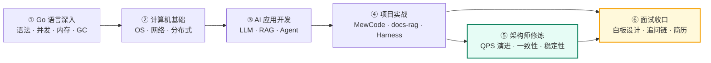

<div align="center">


# GoCampus

**Go 后端 + AI Agent 求职学习工程：从语言底层、中间件与分布式架构，一路走到 RAG / Agent 实战与面试追问链**

按「原理 → 可跑练习 → 实验 → 面试收口」组织：381 篇文档 · 128 道可判练习 · 481 个测试用例 · 509 张 mermaid 图。

[](https://gocampus.gataccay.com)
[](code/README.md)
[](code/README.md)
[](code/go.mod)
[](package.json)

[🌐 文档站](https://gocampus.gataccay.com) · [学习计划](docs/学习计划安排/总体规划.md) · [架构师修炼](docs/架构师修炼/index.md) · [代码练习](docs/练习指南.md) · [本地开发与部署](docs/本地开发与部署.md)

</div>

---

## 这是什么

一个**有明确靶心**的学习仓库：目标是 Go 后端 / Agent 开发方向的实习与校招，主线语言是 **Go**。

它和「收藏夹里的教程合集」有三点不同：

| | 一般教程仓库 | GoCampus |
| --- | --- | --- |
| **知识从哪来** | 零散文章堆叠 | 按 **阶段 → 栏目 → 篇章** 组织，每篇有前置、产出与验收动作 |
| **怎么验证学会** | 读完就算 | 每篇配 **可运行练习或 Docker 实验**（`go test` 判定 / 亲手注入故障） |
| **离面试多远** | 差一层 | 每篇带 **面试追问链 + 自测清单**，另有[白板架构设计与追问链](docs/架构师修炼/17-面试-白板架构设计与追问链.md) |

适合：准备 Go 后端、基础架构、AI 应用（RAG / Agent）岗位的同学。
不适合：想找现成框架或业务脚手架的读者——这里重点是**原理、取舍与可验证的动手能力**。

## 30 秒开始

```bash
# ① 读文档
npm install && npm run docs:dev          # http://127.0.0.1:5173

# ② 做题
cd code && go test ./...                 # 128 道练习，逐题判定

# ③ 起中间件做实验（可选，需 Docker）
cd code/backend && docker compose up -d
```

部署、批注 SDK、架构实验环境（MySQL 主从 / Redis 哨兵 / etcd 集群）等完整步骤见 **[本地开发与部署](docs/本地开发与部署.md)**。

不知道该学什么？先读 [总体规划](docs/学习计划安排/总体规划.md)，站点首页也给出了后端、Agent、算法三条路线与每阶段验收方式。

---

## 内容地图

| 板块 | 规模 | 内容 |
| --- | --- | --- |
| 🧭 **学习路线** | 19 篇 | [总体规划](docs/学习计划安排/总体规划.md)、[Go 语言底层原理](docs/第一阶段-知识详解/index.md)（Slice/Map/Interface 内存布局、GC、GMP、Context）、OS / 网络 / 分布式系统 |
| 🏗️ **后端技术栈强化** | 80 篇 | S1 MySQL → S2 Redis → S3 Kafka → S4 微服务 → S5 高并发 → S6 Agent Backend → S7 K8s → S8 分布式 → S9 对象存储 → S10 Milvus → S11 Elasticsearch → S12 [消息队列专题（Kafka vs RabbitMQ）](docs/后端技术栈强化/12-mq/index.md) |
| 🏛️ **架构师修炼** ⭐ | 29 篇 | [QPS 六道坎](docs/架构师修炼/01-QPS分级与架构演进地图.md)驱动的架构演进：各量级的 MySQL/Redis/Kafka/etcd 落地参数、一致性与故障兜底、15 个可复现实验、[pprof 调优实战](docs/架构师修炼/19-pprof实战/index.md) |
| 🧱 **Go 微服务 / K8s** | 33 篇 | [微服务实战](docs/microservice-code教程/index.md)（拆分、gRPC、治理）；[K8s Code 教程](docs/k8s-code教程/index.md)（client-go → Informer → 手写 Controller / Operator） |
| 🚀 **转岗大模型算法** ⭐ | 13 篇 | [18 个月作战地图](docs/转岗大模型算法/index.md)：差距自评、数学最小集、Transformer 手推、单卡 12GB 从零训练多模态小模型、评测与技术报告 |
| 🧠 **AI 应用** | 66 篇 | [导师学习路径](docs/导师学习路径/index.md)（RAG/Prompt/MCP/ReAct/Multi-Agent）、[主流 Agent 拆解](docs/主流agent拆解/index.md)（pi/Eino/LangGraph）、[项目实战](docs/项目实战/index.md)（MewCode/RAG/Harness）、[多模态专栏](docs/多模态学习专栏/index.md) |
| 🎯 **面试收口** | 138 篇 | [面试项目深挖](docs/面试项目深挖/index.md)（四项目追问包）、[30 天冲刺](docs/路线专题/index.md)、[习题集](docs/习题集和答案/index.md)（由代码自动生成） |

> 全站约 **12.5 万行 Markdown**，支持全文搜索、暗色模式、图片放大、Artalk 评论与划线批注。

---

## 学习主线



| 阶段 | 主题 | 配套代码 |
| --- | --- | --- |
| 一 | Go 语言深入、计算机基础 | `code/phase1/`（34 道）、`code/phase2/`（25 道） |
| 二 | AI 应用：LLM / Prompt / RAG / Agent | `code/phase3/`、[项目实战](docs/项目实战/index.md) |
| 三 | 后端技术栈：MySQL / Redis / Kafka / K8s / Milvus | `code/backend/`（39 道，需 Docker） |
| 四 | 架构师修炼：从单体到百万 QPS | [`code/architect/`](code/architect/README.md)、[`pprof-lab/`](code/architect/pprof-lab/README.md)（8 个零依赖实验） |

---

## 重点栏目

- **🏛️ [架构师修炼](docs/架构师修炼/index.md)** —— 不教「组件是什么」，只练架构判断力：六道 QPS 坎、真实落地参数（`acks=all` + `min.insync.replicas`、`min-replicas-to-write`、fencing token）、每个组件的「故障 → 降级 → 丢数据窗口 → 对账」表，以及 15 个可亲手复现的实验。
- **🚀 [转岗大模型算法](docs/转岗大模型算法/index.md)** —— 从 Agent 后端到算法岗的 18 个月路线：先做 100 分制差距诊断，再补数学/PyTorch/Transformer/多模态地基，最终落到「单卡 12GB 训练多模态小模型 + 技术报告」。
- **🏗️ [后端技术栈强化](docs/后端技术栈强化/index.md)** —— S1~S12 按依赖顺序学，每篇「原理 → 机制 → 故障 → 设计」，末尾带三层追问。
- **☸️ [K8s Code 教程](docs/k8s-code教程/index.md)** —— 从会用 `kubectl` 到能手写 Controller / Operator，配 client-go 可运行代码。

## 仓库结构

```text
GoCampus/
├── docs/                    # VitePress 文档站（381 篇）
│   ├── 后端技术栈强化/       # S1~S12 组件原理与面试题集
│   ├── 架构师修炼/ ⭐        # QPS 演进 · 一致性 · 稳定性 · 15 个实验
│   ├── 转岗大模型算法/ ⭐     # 18 个月转岗作战地图
│   ├── 项目实战/             # MewCode · RAG · Agent Harness
│   ├── 面试项目深挖/         # 四项目追问包
│   └── 习题集和答案/         # 由 code/ 自动生成
├── code/                    # 705 个 Go 文件，练习 + 中间件实验 + pprof-lab
├── projects/                # 独立项目（submodule）
├── scripts/                 # 练习 → 文档同步脚本
└── package.json             # 文档站构建脚本
```

## 技术栈

| 层 | 选型 |
| --- | --- |
| 文档站 | VitePress 1.6 + Mermaid 11 + MathJax + 本地全文搜索 + 暗色模式 |
| 交互 | Artalk 评论、划线批注 SDK、Viewer.js 图片放大、Mermaid 全屏查看 |
| 代码 | Go 1.22 / 1.25（模块级 `go.mod`），标准库优先 |
| 实验 | Docker Compose：MySQL / Redis / Kafka / MinIO / Milvus / etcd |
| 自动化 | 练习→文档同步、`judge.sh` 判题、构建期死链校验、mermaid 尺寸检查 |

## 路线图

- [x] 三阶段学习计划与 Go 底层原理详解
- [x] 后端技术栈强化 S1~S12（含面试题集与配套实验）
- [x] 架构师修炼：QPS 演进 + 一致性 + 稳定性 + 实验环境
- [x] 转岗大模型算法：差距诊断 → 原理地基 → 单卡训练 → 秋招兑现
- [ ] 把 15 个架构实验的实测数字（丢数据条数、切换耗时、拐点 QPS）回填进文档
- [ ] 分库分表迁移与分布式事务的完整可运行项目

---

<div align="center">

**持续学习，持续构建。**

个人学习工程，内容用于知识梳理与面试准备。

</div>
