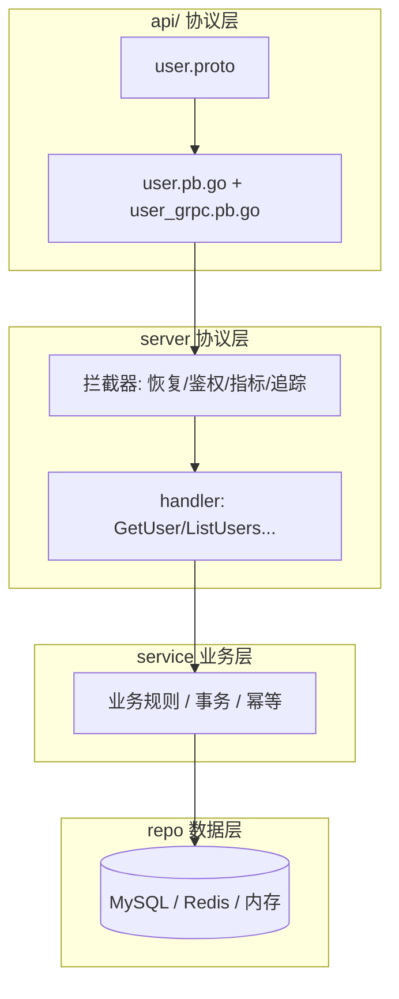

# 01 环境与项目骨架

> 属于 Go 微服务实战教程 · 第 01 篇
> 下一篇：[02 gRPC 四种 RPC 与流式](./02-gRPC四种RPC与流式)

写微服务最容易犯的错，是一上来就堆框架：注册中心、网关、链路、配置中心全家桶。结果跑不起来，也不知道哪一层在干活。这一章我们反着来——**先搭一个只依赖 Go 标准库 + gRPC 的最小骨架**，把"协议层 / 业务层 / 数据层"分开，后面所有能力都往这个骨架上挂。

代码都在 `code/microservice/`，先跑通再说。

## 1. 一个服务的最小骨架长什么样



三条铁律：

1. **业务层不 import gRPC**。`service` 只接收普通 `context` + 领域对象，这样换 HTTP/消息驱动都不影响业务。
2. **协议层只做转换**。proto 请求 → 领域入参，领域结果 → proto 响应，不写业务规则。
3. **拦截器做横切**。鉴权、日志、指标、追踪统一挂拦截器，handler 保持干净。

本教程的 Lab 为了单文件可读，把三层放在了一起；但练习里的接口抽象（`Registry`、`Publisher`、`Store`）就是分层的体现——换真实实现时业务代码不用动。

## 2. 目录与模块

```text
code/microservice/
├── go.mod                    # module gocampus/microservice
├── api/user/v1/user.proto    # 契约
├── api/user/v1/*.pb.go       # 生成代码（提交进仓库）
├── 01_grpc_basics/           # 阶段一练习
├── 02_governance/            # 阶段二练习
├── 03_messaging/             # 阶段三练习
├── 04_observability/         # 阶段四练习
├── 05_deploy/
└── lab/                      # 可运行服务 + 网关 + K8s 清单
```

为什么单独一个 module？微服务代码依赖多（gRPC、OTel、Prometheus、Kafka），和 `code/` 下的刷题练习隔离，避免 `go test ./...` 被中间件依赖拖累。

```bash
cd code/microservice
go mod download
go build ./...            # 骨架可直接编译
go test -run '^$' ./...   # 只验证测试代码能编译
```

练习里的 `solution.go` 是待填空骨架：类型和方法签名齐全，方法体是
`panic("not implemented")`。实现后 `go test -v` 才会通过；完整参考在 `answer/answer.go`。

## 3. proto 工作流：契约先行

契约只写一次，客户端和服务端都由它生成。`api/user/v1/user.proto` 定义了四种 RPC 和一个写接口：

```proto
service UserService {
  rpc GetUser(GetUserRequest) returns (User);            // 一元
  rpc ListUsers(ListUsersRequest) returns (stream User); // 服务端流
  rpc UploadUsers(stream User) returns (UploadSummary);  // 客户端流
  rpc Chat(stream ChatMessage) returns (stream ChatMessage); // 双向流
  rpc Charge(ChargeRequest) returns (ChargeReply);       // 幂等写
}
```

生成命令：

```bash
make proto
# 等价于
protoc -I api --go_out=. --go_opt=module=gocampus/microservice \
       --go-grpc_out=. --go-grpc_opt=module=gocampus/microservice \
       api/user/v1/user.proto
```

三个容易踩的坑：

- `go_package` 必须和 module 路径一致，否则生成代码的 import 全错；
- `--go_opt=module=` 让生成代码落到正确目录，而不是 `gocampus/microservice/...` 嵌套一层；
- `.pb.go` 要提交进仓库，CI 不应该依赖每个人都装 protoc。

::: tip 版本策略
proto 文件放在 `api/<服务>/v1/` 下。不兼容变更开 `v2/`，两版并行一段时间，而不是原地改 v1——第 06 章会详细讲。
:::

## 4. 第一个服务与第一个客户端

服务端最小启动代码（摘自 `lab/uservice`）：

```go
lis, _ := net.Listen("tcp", ":9001")
gs := grpc.NewServer(
    grpc.ChainUnaryInterceptor(unaryRecovery(), metricsUnary, traceUnary, authUnary),
)
userv1.RegisterUserServiceServer(gs, srv)
healthpb.RegisterHealthServer(gs, health.NewServer())
reflection.Register(gs) // grpcurl 无需 proto 文件
gs.Serve(lis)
```

客户端：

```go
conn, _ := grpc.NewClient("127.0.0.1:9001",
    grpc.WithTransportCredentials(insecure.NewCredentials()))
defer conn.Close()
client := userv1.NewUserServiceClient(conn)
u, err := client.GetUser(ctx, &userv1.GetUserRequest{Id: 1})
```

注意用 `grpc.NewClient`，不是老的 `grpc.Dial`（后者已废弃，且默认行为不同）。

## 5. 测试：bufconn 让你不占端口

微服务测试最怕"要起一堆端口"。`bufconn` 在内存里建一对双向管道，`grpc.Server` 和客户端直接连，快且无端口冲突：

```go
lis := bufconn.Listen(1 << 20)
gs := grpc.NewServer()
userv1.RegisterUserServiceServer(gs, NewUserServer())
go gs.Serve(lis)

conn, _ := grpc.NewClient("passthrough:///bufnet",
    grpc.WithContextDialer(func(ctx context.Context, _ string) (net.Conn, error) {
        return lis.DialContext(ctx)
    }),
    grpc.WithTransportCredentials(insecure.NewCredentials()),
)
```

`passthrough:///bufnet` 中的名字是假的，真正的连接由 `ContextDialer` 提供。14 个练习里有 5 个用这套方式测真实 gRPC。

## 6. 动手：把骨架跑起来

```bash
cd code/microservice

# 单实例
go run ./lab/uservice -addr :9001 -instance user-1 -metrics-addr :9101

# 另开终端，用 grpcurl（服务端开了反射，无需 proto 文件）
grpcurl -plaintext -H 'authorization: Bearer campus-secret' \
  -d '{"id": 1}' 127.0.0.1:9001 user.v1.UserService/GetUser

# 健康检查
grpcurl -plaintext 127.0.0.1:9001 grpc.health.v1.Health/Check

# 指标
curl -s http://127.0.0.1:9101/metrics | grep grpc_server
```

预期：返回的 `name` 带 `@user-1` 后缀（方便观察负载均衡命中哪个实例），health 返回 `SERVING`。

## 练习

1. 补全 `01_grpc_basics/01_unary_stream/solution.go` 的 TODO，跑通 `go test -v ./01_grpc_basics/01_unary_stream`，再对照 `answer/answer.go`。
2. 打开 `api/user/v1/user.proto`，新增一个字段（例如 `string avatar = 5;`），重新生成，确认不用改任何业务代码就能编译。
3. 启动 `lab/uservice`，用 `grpcurl` 依次调用四种 RPC，观察流式返回。

## 面试追问

1. **为什么业务层不能依赖 gRPC？** 协议会变（gRPC/HTTP/MQ），业务规则不应该跟着变；依赖倒置让领域逻辑可单测、可复用。
2. **proto 生成的代码要不要提交？** 要。CI 与本地环境统一，避免"每个人 protoc 版本不同导致 diff 爆炸"；生成物由 CI 校验是否最新。
3. **`grpc.Dial` 和 `grpc.NewClient` 的区别？** 新版默认惰性连接、不阻塞；`Dial` 语义含糊且已废弃。
4. **bufconn 和真实端口测试怎么选？** 单元/集成测试用 bufconn（快、稳、无端口）；端到端与 TLS/网关测试再起真实端口。

## 串起来

这一章搭好了"协议层—业务层—数据层"的骨架，也打通了 proto 生成、服务启动、bufconn 测试。后面每一章都是往这个骨架上加一个能力：先加"四种 RPC"（怎么通信），再加"拦截器与 deadline"（怎么安全、可控地通信）。

下一篇：**gRPC 四种 RPC 与流式**——同样是调接口，为什么有的场景必须用流？
