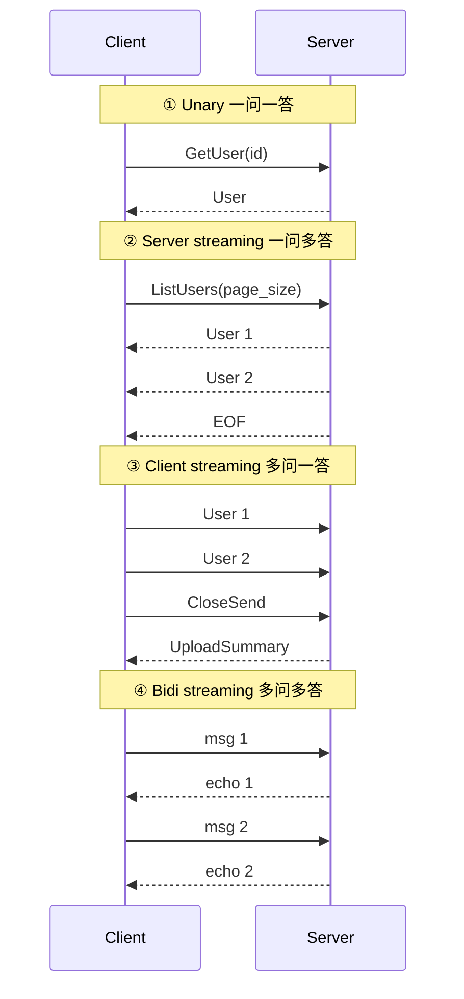

# 02 gRPC 四种 RPC 与流式

> 属于 Go 微服务实战教程 · 第 02 篇
> 上一篇：[01 环境与项目骨架](./01-环境与项目骨架)　下一篇：[03 拦截器与 Metadata 鉴权](./03-拦截器与Metadata鉴权)

一元调用就像"点外卖"：下单一次，送到一次。但很多场景不是这个形状——直播弹幕是持续推送，批量导入是持续发送，协同编辑是双方同时说。gRPC 用四种 RPC 覆盖这些形状。这一章不背定义，直接看**同一个服务怎么写四种方法、客户端怎么收**。

代码：`code/microservice/01_grpc_basics/01_unary_stream/`，测试用 `bufconn` 起真实 server。

## 1. 四种形状，一张图



| 形状 | proto 写法 | 典型场景 | 关键 API |
| ---- | ---------- | -------- | -------- |
| 一元 | `returns (User)` | 查询、下单 | 普通函数调用 |
| 服务端流 | `returns (stream User)` | 大结果集分页、订阅推送 | `stream.Send` |
| 客户端流 | `stream User) returns (Summary)` | 批量上传、聚合上报 | `stream.Recv` + `SendAndClose` |
| 双向流 | `stream Msg) returns (stream Msg)` | IM、协同、实时转换 | `Send` / `Recv` |

## 2. 一元：别小看它

```go
func (s *UserServer) GetUser(ctx context.Context, req *userv1.GetUserRequest) (*userv1.User, error) {
    s.mu.RLock()
    defer s.mu.RUnlock()
    u, ok := s.users[req.GetId()]
    if !ok {
        return nil, status.Errorf(codes.NotFound, "user %d not found", req.GetId())
    }
    return proto.Clone(u).(*userv1.User), nil // 返回副本，别把内部状态暴露出去
}
```

两个细节：

- 错误用 `status.Errorf`，调用方能拿到标准错误码；直接 `fmt.Errorf` 会变成 `Unknown`，重试策略无法判断。
- 返回前克隆。proto message 自带内部状态，直接返回指针会让调用方（尤其是并发场景）改到你的数据。

## 3. 服务端流：推完记得让客户端看到 EOF

```go
func (s *UserServer) ListUsers(req *userv1.ListUsersRequest, stream userv1.UserService_ListUsersServer) error {
    for _, u := range users {
        if err := stream.Send(u); err != nil {
            return err // 客户端取消/断开时 Send 会报错，立即退出
        }
    }
    return nil // 正常返回 = 发送 io.EOF，客户端循环结束
}
```

服务端流的三个要点：

1. **`Send` 是阻塞的**：HTTP/2 流控窗口满时会被阻塞，这本身就是背压，不要在外面再套无界队列。
2. **`return nil` 才是正常结束**，客户端 `Recv` 会得到 `io.EOF`；返回 `status.Error` 则客户端收到错误码。
3. **客户端取消后不要继续 `Send`**，`Send` 会返回错误，直接返回即可释放资源。

## 4. 客户端流：收完再一次性答复

```go
func (s *UserServer) UploadUsers(stream userv1.UserService_UploadUsersServer) error {
    var accepted, rejected int32
    for {
        u, err := stream.Recv()
        if err == io.EOF { // 客户端 CloseSend
            return stream.SendAndClose(&userv1.UploadSummary{Accepted: accepted, Rejected: rejected})
        }
        if err != nil {
            return err
        }
        if u.GetName() == "" {
            rejected++
            continue
        }
        // 落库...
        accepted++
    }
}
```

客户端：

```go
stream, _ := client.UploadUsers(ctx)
stream.Send(&userv1.User{Name: "a"})
stream.Send(&userv1.User{Name: ""}) // 会被拒
sum, err := stream.CloseAndRecv()   // 关闭发送并拿最终结果
```

注意 `io.EOF` 是**约定的结束信号**，不是错误。很多新手在这里 `return err`，导致客户端永远拿不到 `SendAndClose`。

## 5. 双向流：两边各自独立关闭

```go
func (s *UserServer) Chat(stream userv1.UserService_ChatServer) error {
    for {
        msg, err := stream.Recv()
        if err == io.EOF {
            return nil // 客户端关闭了发送方向
        }
        if err != nil {
            return err
        }
        if err := stream.Send(&userv1.ChatMessage{Text: "echo: " + msg.GetText()}); err != nil {
            return err
        }
    }
}
```

双向流的关闭语义要记清楚：

- 客户端 `CloseSend()` → 服务端 `Recv()` 返回 `io.EOF`；
- 服务端 `return nil` → 客户端 `Recv()` 返回 `io.EOF`；
- 任意一侧 `ctx` 取消 → 双方 `Recv/Send` 都报 `Canceled`。

一个 goroutine 同时 `Send` 和 `Recv` 是安全的；但**多个 goroutine 并发 `Send` 不安全**，需要自己加锁或每个方向一个 goroutine。

## 6. 什么时候不该用流

流不是"更高级"的调用方式。三种情况建议继续用一元：

- 结果集很小且大小确定——流只会增加复杂度；
- 需要严格的请求-响应事务语义——流的重试和幂等更麻烦；
- 客户端不支持长连接（某些网关/HTTP 代理）。

反过来，以下场景优先流：大文件/大结果集、实时推送、持续聚合、双向协作。

## 练习

```bash
cd code/microservice
go test -v ./01_grpc_basics/01_unary_stream
```

1. 把 `Chat` 改成"收到 `bye` 就主动结束"；
2. 给 `ListUsers` 加分页游标（`page_token`），实现真正的分页；
3. 用 `grpcurl` 对 lab 调 `ListUsers`，观察多条响应和结束帧。

## 面试追问

1. **四种流底层是什么？** 都是 HTTP/2 的 stream；一元是"单 DATA 帧 + trailers"，流式是同一条 HTTP/2 stream 上多次收发帧。
2. **流的背压怎么实现？** HTTP/2 流控窗口 + `Send` 阻塞；消费慢时发送方自然被限速。
3. **服务端流断线怎么恢复？** gRPC 流本身不提供断点续传；业务层加游标/序号，重连后从上次位置继续。
4. **双向流和 WebSocket 的区别？** 都能双向；gRPC 有强类型契约、多路复用、统一的 deadline/metadata/错误码，更适合服务间；WebSocket 更适合浏览器端。

## 串起来

四种 RPC 解决"数据怎么流"，但真实服务还需要"谁能调、调多久、失败了怎么办"。下一篇从最外层的**拦截器与 Metadata** 开始：把鉴权从每个 handler 里抽出来，统一挂到入口。
