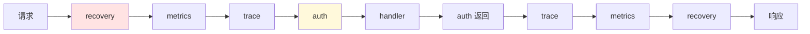

# 03 拦截器与 Metadata 鉴权

> 属于 Go 微服务实战教程 · 第 03 篇
> 上一篇：[02 gRPC 四种 RPC 与流式](./02-gRPC四种RPC与流式)　下一篇：[04 Deadline、取消与错误码](./04-Deadline取消与错误码)

一个服务有 30 个接口，每个接口都要写"取 token、验签、查用户、塞 context"？那是 30 份复制粘贴，改一处漏 29 处。拦截器就是 gRPC 的"中间件"：请求先进拦截器链，再进业务 handler。这一章把鉴权、metadata 透传和拦截器顺序讲透。

代码：`code/microservice/01_grpc_basics/02_interceptor_auth/`。

## 1. 洋葱模型：谁先谁后



`grpc.ChainUnaryInterceptor(recovery, metrics, trace, auth)` 的执行顺序：

- **进入时**从左到右：recovery → metrics → trace → auth → handler；
- **返回时**从右到左。

所以：

- `recovery` 必须放**最外层**，才能兜住后面所有拦截器和 handler 的 panic；
- `metrics` 要在 `auth` 外层，才能统计到鉴权失败（`Unauthenticated`）；
- `auth` 放最内层，省得未鉴权请求也走一遍追踪。

## 2. 一元鉴权拦截器

标准做法是从 metadata 取 `authorization: Bearer <token>`：

```go
func UnaryAuthInterceptor(v Validator) grpc.UnaryServerInterceptor {
    return func(ctx context.Context, req any, info *grpc.UnaryServerInfo, handler grpc.UnaryHandler) (any, error) {
        md, ok := metadata.FromIncomingContext(ctx)
        if !ok {
            return nil, status.Error(codes.Unauthenticated, "missing metadata")
        }
        tok, ok := tokenFromMD(md) // 解析 "Bearer xxx"
        if !ok {
            return nil, status.Error(codes.Unauthenticated, "missing bearer token")
        }
        subject, err := v(ctx, tok)
        if err != nil {
            return nil, status.Error(codes.PermissionDenied, "invalid token")
        }
        return handler(context.WithValue(ctx, subjectKey{}, subject), req)
    }
}
```

错误码的语义要分清：

| 场景 | 状态码 | 原因 |
| ---- | ------ | ---- |
| 没带凭证 | `Unauthenticated` | 你是谁我不知道 |
| 凭证无效/过期 | `PermissionDenied`（或 `Unauthenticated`，看团队约定） | 知道你是谁，但不让你进 |
| 登录了但没权限 | `PermissionDenied` | 鉴权通过，授权失败 |

## 3. 流式拦截器：别忘了替换 Context

流式拦截器最大的坑：鉴权通过后把 subject 放进了一个**新的 ctx**，但 handler 里 `stream.Context()` 拿到的还是原始 ctx。

```go
type wrappedStream struct {
    grpc.ServerStream
    ctx context.Context
}
func (w *wrappedStream) Context() context.Context { return w.ctx }

func StreamAuthInterceptor(v Validator) grpc.StreamServerInterceptor {
    return func(srv any, ss grpc.ServerStream, info *grpc.StreamServerInfo, handler grpc.StreamHandler) error {
        // ...校验...
        ctx := context.WithValue(ss.Context(), subjectKey{}, subject)
        return handler(srv, &wrappedStream{ServerStream: ss, ctx: ctx})
    }
}
```

嵌入 `grpc.ServerStream` 后，`Send/Recv` 等方法自动透传，只覆盖 `Context()` 即可。

## 4. Metadata：跨进程的"信封"

| | metadata | context.Value |
| -- | -------- | ------------- |
| 作用域 | 跨进程（HTTP/2 header） | 进程内 |
| 用途 | token、traceparent、租户 ID、灰度标记 | 请求级依赖、超时、取消 |
| key 规则 | 小写 ASCII；`-bin` 后缀走 base64 | 自定义类型防冲突 |

常用操作：

```go
// 客户端写
ctx = metadata.AppendToOutgoingContext(ctx, "authorization", "Bearer "+token)

// 服务端读
md, _ := metadata.FromIncomingContext(ctx)
vals := md.Get("authorization")

// 服务端写（响应头/trailer）
grpc.SetHeader(ctx, metadata.Pairs("x-request-id", id))
```

注意：`metadata.New` 得到的 MD 是普通 map，`Set` 后要重新 `NewOutgoingContext` 才会生效——这也是追踪注入时最容易漏的一步。

## 5. 客户端拦截器：让调用方无感

```go
func ClientAuthInterceptor(token string) grpc.UnaryClientInterceptor {
    return func(ctx context.Context, method string, req, reply any,
        cc *grpc.ClientConn, invoker grpc.UnaryInvoker, opts ...grpc.CallOption) error {
        if token != "" {
            ctx = metadata.AppendToOutgoingContext(ctx, "authorization", "Bearer "+token)
        }
        return invoker(ctx, method, req, reply, cc, opts...)
    }
}
```

业务代码只写：

```go
conn, _ := grpc.NewClient(addr,
    grpc.WithUnaryInterceptor(ClientAuthInterceptor(token)),
    grpc.WithStreamInterceptor(ClientStreamAuthInterceptor(token)),
)
```

这就把"每个调用点手动塞 token"变成了一次性配置。

## 6. 拦截器里不要做的事

- **不要做慢操作**：查库验 token 要加缓存；拦截器是所有请求的必经之路。
- **不要吞错误**：拦截器返回 nil 但没调 handler，调用方会拿到空响应。
- **不要在拦截器里写业务分支**：`if method == "/xxx"` 这种特判会让链越来越难维护，宁可拆成多个拦截器。
- **不要忘记 `defer span.End()` / `defer cancel()`**：拦截器也是普通函数，资源泄漏一样会发生。

## 练习

```bash
cd code/microservice
go test -race -v ./01_grpc_basics/02_interceptor_auth
```

1. 给 `Validator` 加一个"token 过期"错误，映射成 `Unauthenticated` 并带上 `WWW-Authenticate` trailer；
2. 写一个 `UnaryLoggingInterceptor`，打印 method、耗时、状态码；
3. 故意把 `auth` 放到 `metrics` 外层，观察指标里还能不能看到鉴权失败。

## 面试追问

1. **拦截器链顺序怎么定？** 恢复在最外；观测在鉴权外（要统计失败）；业务性校验靠内。
2. **鉴权放网关还是服务？** 网关做粗粒度（是否登录、限流），服务做细粒度（资源归属）；零信任下两边都要。
3. **metadata 能不能放大对象？** 不能。HTTP/2 header 有大小限制（默认 8KB 左右），大对象走请求体或对象存储。
4. **流式拦截器为什么容易出错？** `ServerStream` 的 `Context()` 是方法，不包装就无法替换；这是 Go 接口设计导致的常见坑。

## 串起来

拦截器把鉴权和横切逻辑从业务里剥出来了。但"能调"不等于"敢调"——下游卡住时，调用方会不会无限等？下一篇讲 **Deadline、取消传播与错误码**，这是微服务不雪崩的第一道闸。
