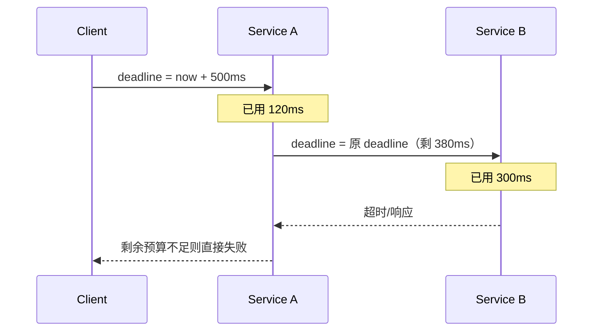
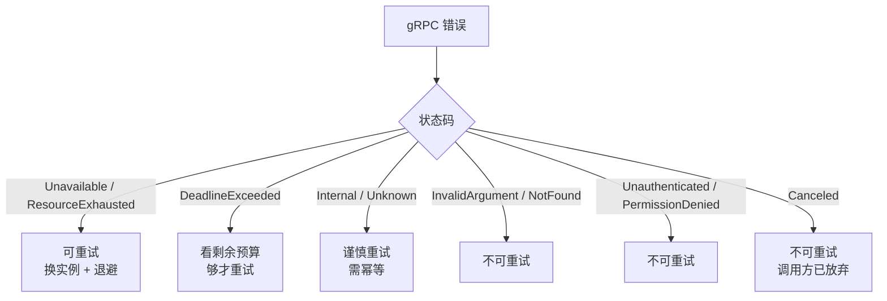

# 04 Deadline、取消与错误码

> 属于 Go 微服务实战教程 · 第 04 篇
> 上一篇：[03 拦截器与 Metadata 鉴权](./03-拦截器与Metadata鉴权)　下一篇：[05 健康检查、连接与 TLS](./05-健康检查连接与TLS)

微服务最危险的故障不是"报错"，而是"不报错也不返回"：下游卡住，上游一直等，goroutine 越积越多，最后整个进程 OOM。Deadline 和取消传播就是斩断这条链的刀。这一章把"超时从哪来、怎么传、超时之后怎么判"讲清楚。

代码：`code/microservice/01_grpc_basics/03_deadline_cancel/`。

## 1. deadline 是一份"预算"，不是每跳重置



关键认知：**deadline 是绝对时间，跨服务原样传递**。Service A 不能在调用 B 时重新给 500ms——那样每一跳都重置预算，最坏情况总耗时 = 跳数 × 500ms。

gRPC 会自动把 deadline 编码进 `grpc-timeout` header，服务端 `ctx.Deadline()` 直接可读。

## 2. 客户端：派生预算并保证 cancel

```go
func CallWithBudget(ctx context.Context, timeout time.Duration) (context.Context, context.CancelFunc) {
    return context.WithTimeout(ctx, timeout)
}

ctx, cancel := CallWithBudget(ctx, 300*time.Millisecond)
defer cancel() // 必须！否则 timer 泄漏到 deadline 到期
resp, err := client.GetUser(ctx, req)
```

`context.WithTimeout` 返回的 cancel 一定要调用，哪怕请求很快返回——否则定时器会一直挂到超时。

## 3. 服务端：不监听 ctx.Done() 等于没超时

```go
func SlowWork(ctx context.Context, d time.Duration) error {
    t := time.NewTimer(d)
    defer t.Stop()
    select {
    case <-t.C:
        return nil
    case <-ctx.Done():
        return status.FromContextError(ctx.Err()).Err()
    }
}
```

如果服务端写 `time.Sleep(300ms)` 而无视 ctx，客户端 50ms 就返回了，但服务端还在睡，连接和 goroutine 都被占着。**超时的意义是让双方都停下来**。

`status.FromContextError` 会把：

- `context.DeadlineExceeded` → `codes.DeadlineExceeded`
- `context.Canceled` → `codes.Canceled`

## 4. 服务端兜底：default + max

调用方可能不设 deadline，也可能设 1 小时。服务端应该兜底：

```go
func UnaryTimeoutInterceptor(defaultTimeout, maxTimeout time.Duration) grpc.UnaryServerInterceptor {
    return func(ctx context.Context, req any, info *grpc.UnaryServerInfo, handler grpc.UnaryHandler) (any, error) {
        if _, ok := ctx.Deadline(); !ok && defaultTimeout > 0 {
            var cancel context.CancelFunc
            ctx, cancel = context.WithTimeout(ctx, defaultTimeout)
            defer cancel()
        }
        if dl, ok := ctx.Deadline(); ok && maxTimeout > 0 && time.Until(dl) > maxTimeout {
            var cancel context.CancelFunc
            ctx, cancel = context.WithTimeout(ctx, maxTimeout)
            defer cancel()
        }
        return handler(ctx, req)
    }
}
```

这不是"防君子"，是防止一个异常客户端拖垮整个服务。

## 5. 错误码：哪些能重试，哪些不能



对应代码：

```go
func Classify(err error) Class {
    switch status.Code(err) {
    case codes.Unavailable, codes.ResourceExhausted, codes.Internal, codes.Unknown:
        return Retryable
    case codes.DeadlineExceeded, codes.Aborted:
        return Retryable // 由上层判断剩余预算
    default:
        return Fatal // Canceled / InvalidArgument / NotFound / Unauthenticated ...
    }
}
```

注意 `Canceled` 不是"服务端取消"，而是**调用方主动取消**（包括上层 deadline 到期触发的 cancel）。这时重试违背调用方意图，必须停。

## 6. 重试前先看预算

```go
func RemainingBudget(ctx context.Context) (time.Duration, bool) {
    dl, ok := ctx.Deadline()
    if !ok {
        return 0, false
    }
    return time.Until(dl), true
}
```

重试循环里：

```go
if left, ok := RemainingBudget(ctx); ok && left < time.UntilNextBackoff {
    return err // 剩余不够一次调用，别再试了
}
```

没有这一步，重试会一直撞 deadline，日志里全是超时，真正的原因被淹没。

## 7. 三个常见反模式

1. **在 handler 里 `context.Background()`**：切断取消链，客户端断了服务端还在跑。
2. **客户端每个重试都新建 500ms timeout**：总耗时不受控。正确做法是共享父 deadline。
3. **把 deadline 当"业务超时"**：deadline 是技术兜底；业务上"支付 30 分钟未完成则关闭"是另一套状态机。

## 练习

```bash
cd code/microservice
go test -race -v ./01_grpc_basics/03_deadline_cancel
```

1. 把服务端 `SlowWork` 改成忽略 ctx，观察测试里服务端耗时断言如何失败；
2. 实现一个"剩余预算 < 50ms 就放弃重试"的客户端循环；
3. 用 `grpcurl -max-time 0.05` 调用 lab 的 `GetUser`（它 sleep 20ms），再调一个更慢的接口观察 deadline 错误。

## 面试追问

1. **deadline 和 timeout 的区别？** timeout 是相对时长，deadline 是绝对时刻；跨服务传 deadline 才能保证总预算不膨胀。
2. **为什么服务端要设 maxDeadline？** 防止调用方传入超长 deadline 占满资源；故障时这是雪崩的放大器。
3. **取消能传几层？** gRPC 每一跳都透传；只要中间有一层用了 `context.Background()` 就断了。
4. **`DeadlineExceeded` 和 `Canceled` 有什么区别？** 前者是时间到了，后者是主动放弃（可能是上层 deadline 触发的级联 cancel）。
5. **流式调用怎么处理 deadline？** `stream.Context()` 同样带 deadline；长流要周期性检查 `ctx.Err()`，否则可能一直挂到连接断开。

## 串起来

Deadline 解决了"等多久"，取消解决了"什么时候停"，错误码解决了"停了之后怎么办"。但服务"能不能接流量"是另一件事——下一篇讲 **Health Checking、连接管理与 TLS**，让负载均衡器知道该把请求发给谁、敢不敢发。
