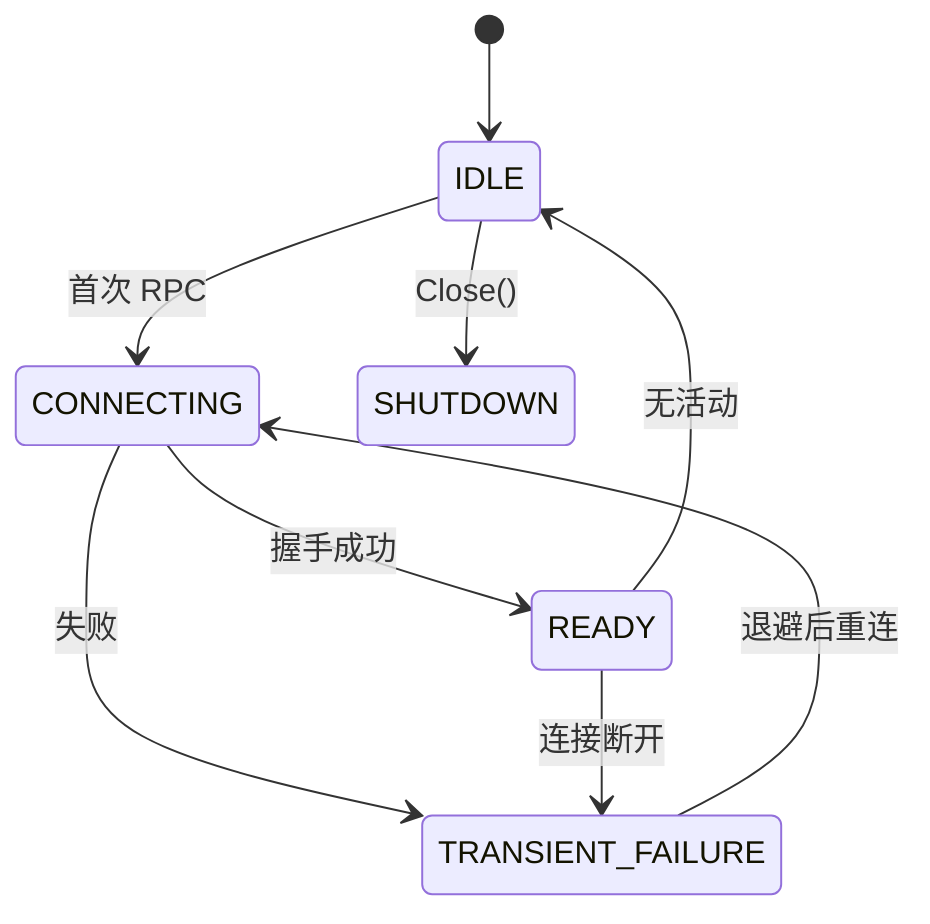

# 05 健康检查、连接与 TLS

> 属于 Go 微服务实战教程 · 第 05 篇
> 上一篇：[04 Deadline、取消与错误码](./04-Deadline取消与错误码)　下一篇：[06 Proto 兼容性与版本演进](./06-Proto兼容性与版本演进)

进程活着 ≠ 能处理请求。数据库连不上、缓存没预热、正在优雅退出——这些都要求负载均衡器**别把流量发过来**。健康检查就是服务与调度器之间的"红绿灯"；TLS 则是内部通信的"安全带"。这一章把两者和连接管理一起收掉。

代码：`code/microservice/01_grpc_basics/04_health_tls/`。

## 1. 标准 Health Checking 协议

gRPC 定义了标准服务 `grpc.health.v1.Health`，不依赖业务 proto：

```proto
service Health {
  rpc Check(HealthCheckRequest) returns (HealthCheckResponse);
  rpc Watch(HealthCheckRequest) returns (stream HealthCheckResponse);
}
```

服务端注册：

```go
hs := health.NewServer()
healthpb.RegisterHealthServer(gs, hs)
hs.SetServingStatus("user.v1.UserService", healthpb.HealthCheckResponse_SERVING)
```

进入停机流程时：

```go
hs.SetServingStatus("user.v1.UserService", healthpb.HealthCheckResponse_NOT_SERVING)
```

`NOT_SERVING` 与"直接断开连接"的区别：

- 断开连接，客户端只能等到 TCP 失败才发现，期间请求会失败；
- `NOT_SERVING` 是**主动告知**，启用健康检查的客户端/LB 会先把实例摘掉。

## 2. 连接生命周期：gRPC 不是"连上就永远好"



需要理解的三个点：

1. **gRPC 客户端默认长连接 + 自动重连**，业务代码不需要自己维护连接池；
2. `TRANSIENT_FAILURE` 期间 RPC 会快速失败（除非 `WaitForReady`），这正好配合重试/熔断；
3. 一个 `ClientConn` 内部有多条 subchannel（每个后端一条 HTTP/2 连接），不要每调一次就 `NewClient`。

## 3. Keepalive：中间设备会悄悄掐断空闲连接

NAT/防火墙通常有 5~10 分钟的空闲超时。长连接看似正常，下一次请求才发现已断。开启 keepalive：

```go
// 服务端
grpc.KeepaliveParams(keepalive.ServerParameters{
    MaxConnectionIdle: 5 * time.Minute,
    Time:              2 * time.Minute,
    Timeout:           20 * time.Second,
})
// 客户端
grpc.WithKeepaliveParams(keepalive.ClientParameters{
    Time:                30 * time.Second,
    Timeout:             10 * time.Second,
    PermitWithoutStream: true,
})
```

注意别设得太激进（比如 1 秒 ping），会被服务端当成 DoS。

## 4. TLS：内部通信也不该裸奔

```go
// 服务端
creds, _ := credentials.NewServerTLSFromFile("server.crt", "server.key")
gs := grpc.NewServer(grpc.Creds(creds))

// 客户端
pool := x509.NewCertPool()
pool.AppendCertsFromPEM(caPEM)
conn, _ := grpc.NewClient(addr, grpc.WithTransportCredentials(
    credentials.NewTLS(&tls.Config{RootCAs: pool, ServerName: "uservice"}),
))
```

`ServerName` 必须与证书里的 SAN 匹配。测试里我们用 `localhost` + `127.0.0.1` 自签，现场生成：

```go
bundle, _ := GenerateCerts()
serverCreds, _ := ServerCreds(bundle.ServerCertPEM, bundle.ServerKeyPEM, nil)
clientCreds, _ := ClientCreds(bundle.CAPEM, nil, nil, "localhost")
```

## 5. mTLS：双向验证

单向 TLS 只证明"服务器是谁"；mTLS 还要求客户端出示证书，适合零信任内部网络：

```go
cfg := &tls.Config{
    Certificates: []tls.Certificate{serverCert},
    ClientCAs:    clientCAPool,
    ClientAuth:   tls.RequireAndVerifyClientCert,
}
```

服务之间的身份从"网络位置"变成"证书身份"——即使攻击者进入内网，没有证书也调不通。

## 6. 证书轮换与热加载

证书有有效期，重启服务来换证书会造成发布抖动。用回调动态加载：

```go
cfg := &tls.Config{
    GetCertificate: func(*tls.ClientHelloInfo) (*tls.Certificate, error) {
        return loadCertFromFile() // 文件更新后下次握手自动生效
    },
}
```

K8s 里把证书挂成 Secret volume，cert-manager 自动续期，进程无需重启。

## 7. 反射：调试友好，生产谨慎

```go
reflection.Register(gs)
```

开启后 `grpcurl` 不需要 proto 文件就能调用，非常适合实验与排障。但生产环境会暴露完整接口列表，通常只在内部服务或调试端口开启。

## 练习

```bash
cd code/microservice
go test -v ./01_grpc_basics/04_health_tls
```

1. 给 lab 加 `-cert/-key` 参数启动 TLS，用 `grpcurl -cacert` 调用；
2. 让 `GenerateCerts` 签发一个 SAN 不含 `localhost` 的证书，观察客户端报错文本；
3. 用 `grpcurl` 对 health 服务发 `Watch`，再置 `NOT_SERVING`，观察推送。

## 面试追问

1. **readiness 和 health check 是什么关系？** K8s 的 readinessProbe 可以直接调 gRPC health；K8s 1.24+ 支持原生 `grpc` 探针。
2. **liveness 能探数据库吗？** 不能。数据库挂了重启自己没用，还会让所有实例一起重启。liveness 只探进程自身。
3. **TLS 在哪终止？** 入口网关终止外部 TLS；内部建议 mTLS 或服务网格自动注入，避免"内网可信"的假设。
4. **keepalive 设太短会怎样？** 服务端可能判定为连接滥用并断连；还会增加无谓流量。一般 30s~2min。
5. **gRPC 连接池要多大？** 一个 `ClientConn` 已经多路复用；通常按"目标实例数"建 subchannel，不需要业务层再池化。

## 串起来

健康检查让流量"该来的时候来、该走的时候走"；TLS 保证"来的和收的都是自己人"；连接管理与 keepalive 保证"路一直通"。到这里，单个服务的通信已经完整。但服务会持续演进——下一篇讲 **Proto 兼容性**：为什么改个字段类型会让线上直接崩。
