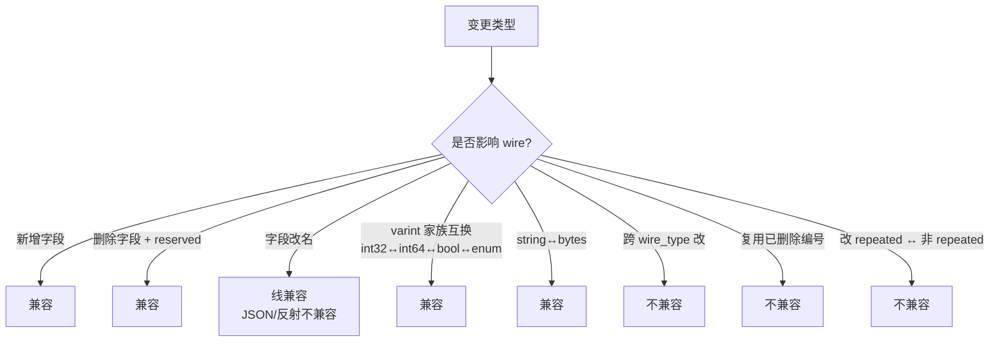

# 06 Proto 兼容性与版本演进

> 属于 Go 微服务实战教程 · 第 06 篇
> 上一篇：[05 健康检查、连接与 TLS](./05-健康检查连接与TLS)　下一篇：[07 注册发现与客户端负载均衡](./07-注册发现与客户端负载均衡)

微服务最隐蔽的事故之一：某人把 `string email = 3;` 改成了 `int64 email = 3;`，编译全过、测试全过，上线后旧版本客户端解析新数据直接乱码。原因很简单——protobuf 的线上契约是**字段编号 + 线类型**，不是字段名。这一章把兼容规则讲成可执行的检查。

代码：`code/microservice/01_grpc_basics/05_proto_compat/`。

## 1. 线上到底传了什么

一条字段的编码是：

```text
tag = (field_number << 3) | wire_type
```

| wire_type | 含义 | 对应类型 |
| --------- | ---- | -------- |
| 0 | varint | int32/int64/uint32/uint64/bool/enum |
| 1 | 64-bit | fixed64/sfixed64/double |
| 2 | length-delimited | string/bytes/message/packed |
| 5 | 32-bit | fixed32/sfixed32/float |

字段名只存在于代码和 JSON 映射里，**线上根本看不到**。所以：

- 改字段名：线兼容，但破坏 JSON/反射、日志可读性；
- 改字段编号：等于换了字段，旧数据全部错位；
- 改线类型：解析器会按错误方式读字节，可能乱码或直接报错。

## 2. 兼容矩阵



## 3. 删除字段必须 reserved

```proto
message User {
  int64 id = 1;
  string name = 2;
  reserved 3;                 // 曾经是 email
  reserved "legacy_email";    // 也可以保留名字
}
```

不 reserved 的后果：半年后新人觉得"3 没人用"，加了个 `int64 level = 3;`。旧客户端里 3 是 string，读到 level 的 varint 字节会解析失败或读到脏值。

## 4. 未知字段必须保留

网关/代理经常做"透传"：它只认识部分字段，但不能把不认识的字段丢掉。protobuf 默认会保留未知字段（Go 的生成代码里也能透传），手写 wire 编解码时要显式收集：

```go
num, typ, n := protowire.ConsumeTag(b)
b = b[n:]
switch {
case num == 1 && typ == protowire.VarintType:
    // 已知字段
default:
    vn := protowire.ConsumeFieldValue(num, typ, b)
    unknown = protowire.AppendTag(unknown, num, typ)
    unknown = append(unknown, b[:vn]...)
    b = b[vn:]
}
```

这正是练习 `DecodeUser` 的核心：旧解码器读出 1/2，把 3/4 原样留在 `unknown` 里，重新编码后字段集合完全一致。

## 5. 可执行的兼容性检查

规则写进代码，CI 才能拦住：

```go
func CheckCompatibility(old, new Schema) []Issue {
    // 1. 删除字段必须 reserved
    // 2. 同一编号的线类型必须兼容
    // 3. 新字段不能占用 reserved 编号
}
```

真实工程里更常用 `buf`：

```bash
buf breaking --against '.git#branch=main'
```

它会把"删字段没 reserved""改类型""改编号"全部报出来，比人肉 review 可靠。

## 6. 版本演进的四种手法

| 手法 | 适用 | 说明 |
| ---- | ---- | ---- |
| 加字段 | 绝大多数新增 | 旧端忽略，新端有默认值 |
| `oneof` | 互斥字段 | 新增分支兼容，删分支要 reserved |
| 新包 `v2` | 不兼容大改 | `api/user/v2` 与 v1 并行，逐步迁移 |
| 双写/双读 | 数据迁移 | 新老字段同时存在一段时间，确认后再删 |

## 7. proto3 的默认值陷阱

proto3 标量字段没有 `has_xxx`，`0 / "" / false` 无法区分"没传"和"传了默认值"。

- 需要区分时用 `optional`（生成指针/`HasXxx`）；
- 或者用 `google.protobuf.Int64Value` 等 wrapper；
- 或者约定一个不可能的业务默认值（不推荐，容易漏）。

## 练习

```bash
cd code/microservice
go test -v ./01_grpc_basics/05_proto_compat
```

1. 给 `CheckCompatibility` 增加规则：`repeated` 改为非 `repeated` 报不兼容；
2. 在 `user.proto` 里删掉 `email` 字段并 `reserved 3`，重新生成，跑所有练习确认不受影响；
3. 自己写一个"加字段、旧解码、再编码"的端到端小实验，打印十六进制对比。

## 面试追问

1. **为什么字段编号不能复用？** 旧客户端仍按旧语义解析，产生静默错误；reserved 是唯一可靠的防线。
2. **新增字段为什么向后兼容？** 旧代码跳过未知字段并保留；新字段默认值不编码，不会覆盖旧数据。
3. **`int32` 改 `int64` 为什么算兼容？** 都是 varint，线上字节格式一致；但负数编码要注意（int32 负数会编码成 10 字节）。
4. **怎么保证多服务同时升级不炸？** 契约先行 + `buf breaking` + 灰度发布 + 双读双写过渡。
5. **JSON 也会受影响吗？** 会。字段名、`json_name`、`oneof` 映射都影响 JSON 契约；gRPC-JSON 网关要单独测。

## 串起来

gRPC 的通信能力到这里闭环：能连、能鉴权、能控时、能感知健康、能安全演进。接下来进入**服务治理**：多个实例同时在线，请求该发给谁？下一篇从注册发现与客户端负载均衡开始。
