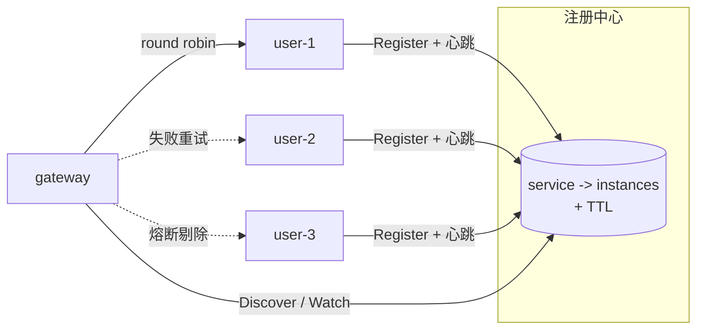
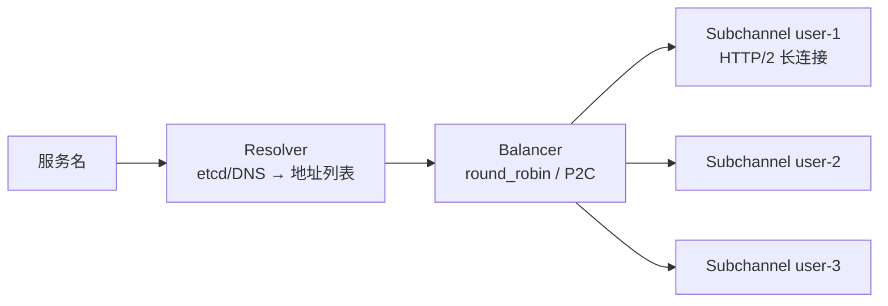
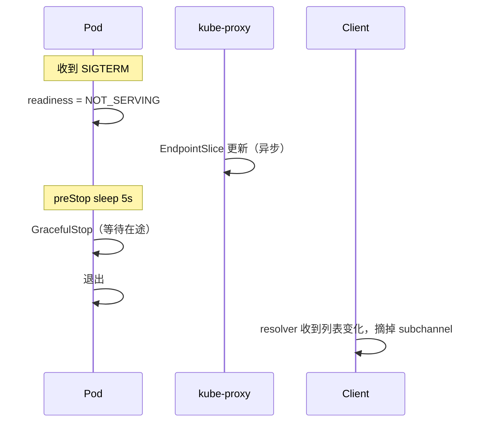

# 07 注册发现与客户端负载均衡

> 属于 Go 微服务实战教程 · 第 07 篇
> 上一篇：[06 Proto 兼容性与版本演进](./06-Proto兼容性与版本演进)　下一篇：[08 超时重试、指数退避与幂等](./08-超时重试指数退避与幂等)

服务实例是会动的：扩缩容、滚动发布、宕机、迁移。调用方不能把 IP 写死，于是需要两件事——**发现**（现在有哪些实例）和**选路**（这次发给谁）。这一章把注册中心的 TTL/心跳、gRPC 的 resolver/balancer、以及 round-robin vs P2C 讲清楚。

代码：`code/microservice/02_governance/01_registry_lb/`。

## 1. 一张图看懂注册发现



两个动作：

- **注册**：实例启动后写入 `服务名 → 地址`，并周期性心跳续租；
- **发现**：调用方拉取实例列表，最好能 Watch 增量变化。

## 2. TTL + 心跳：宕机实例怎么消失

实例宕机不会"主动注销"，所以注册中心用租约：

- 注册时写入 `lastSeen = now`；
- 心跳更新 `lastSeen`；
- `Discover` 时把 `now - lastSeen >= TTL` 的实例剔除。

```go
func (r *Registry) Discover(service string) []string {
    now := r.now()
    for addr, lastSeen := range r.m[service] {
        if now.Sub(lastSeen) >= r.ttl {
            delete(r.m[service], addr) // 惰性剔除
            continue
        }
        out = append(out, addr)
    }
    return out
}
```

真实 etcd 用 Lease + KeepAlive：进程崩溃后租约到期，key 自动删除；Watch 会把删除事件推给所有订阅者。

## 3. gRPC 的三件套：Resolver / Balancer / Subchannel



- **Resolver**：把"服务名"解析成地址列表，并持续 Watch；
- **Balancer**：每次 RPC 从 ready 的 subchannel 里选一个；
- **Subchannel**：与单个后端的连接，断开自动重连、状态上报给 balancer。

为什么负载均衡在客户端？gRPC 是 HTTP/2 长连接 + 多路复用，一个连接上可以跑上千个请求。代理层按连接分发会导致**连接均衡 ≠ 流量均衡**，所以内部流量默认客户端 LB，入口流量才用代理。

## 4. 两种选路策略

### Round-robin

```go
func (rr *RoundRobin) Pick(addrs []string) (string, error) {
    if len(addrs) == 0 {
        return "", ErrNoInstance
    }
    i := rr.next.Add(1) - 1
    return addrs[i%uint64(len(addrs))], nil
}
```

优点：实现简单、绝对均匀。缺点：**不感知实例负载**。如果某个实例因为 GC/慢查询已经堆积，轮询还会继续打过去。

### P2C（Power of Two Choices）

随机抽两个实例，选在途请求更少的：

```go
i := rnd.Intn(len(addrs))
j := rnd.Intn(len(addrs) - 1)
if j >= i { j++ }
if load(addrs[i]) <= load(addrs[j]) {
    return addrs[i], nil
}
return addrs[j], nil
```

为什么好：既避免了"所有客户端同时选最小"的羊群效应，又能感知真实负载。Envoy 的默认策略之一就是 P2C。

## 5. 在 K8s 里怎么落地

两条路：

| 方式 | 寻址 | 负载均衡 | 适用 |
| ---- | ---- | -------- | ---- |
| 普通 ClusterIP | `uservice:9001` | kube-proxy（L4） | 简单、无状态、客户端不感知实例 |
| Headless Service | `uservice-headless:9001` | 客户端 round-robin | gRPC 客户端 LB、需要感知实例 |

Headless 的用法：

```go
conn, _ := grpc.NewClient(
    "dns:///uservice-headless.microservice-demo.svc.cluster.local:9001",
    grpc.WithDefaultServiceConfig(`{"loadBalancingConfig":[{"round_robin":{}}]}`),
)
```

DNS resolver 会拿到所有 Pod IP，gRPC 为每个 IP 建 subchannel，实现真正的客户端负载均衡。

## 6. 实例下线：先摘后停

顺序错了会丢请求：



这正是第 09 章和 15 章会反复出现的流程。

## 练习

```bash
cd code/microservice
go test -race -v ./02_governance/01_registry_lb
```

1. 给 `Registry` 加后台清理 goroutine（每 TTL/2 扫一次），对比惰性剔除的优缺点；
2. 给 P2C 加权重（按实例规格加权），实现 weighted P2C；
3. 起三个 lab 实例 + 网关，用 `curl` 观察 `@user-N` 的分布，然后停掉一个实例再观察。

## 面试追问

1. **为什么 gRPC 需要客户端负载均衡？** HTTP/2 长连接多路复用，连接数均衡不等于请求量均衡；客户端选路少一跳、无代理单点。
2. **etcd 服务发现怎么实现？** Lease（TTL）+ KeepAlive 续租 + Watch 前缀；实例宕机租约到期自动删除。
3. **注册中心挂了怎么办？** 客户端本地缓存最后一次列表，fail-static 继续服务；恢复后 Watch 补齐。
4. **round-robin 和 P2C 怎么选？** 实例同构、请求均匀用 round-robin；有慢实例/长尾用 P2C 或 least-request。
5. **DNS 缓存会不会导致流量倾斜？** 会。所以客户端要尊重 TTL、及时重建 subchannel；K8s 下可用 Headless + gRPC DNS resolver。

## 串起来

发现解决"发给谁"，LB 解决"怎么分"。但即使选对了实例，下游仍可能超时或失败——下一篇讲**超时重试、指数退避与幂等**：重试是放大器，用错了会把小故障变成雪崩。
