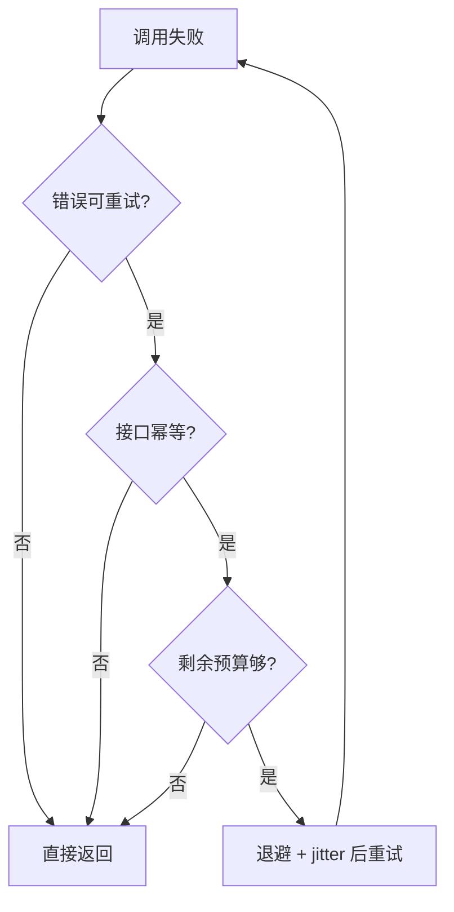

# 08 超时重试、指数退避与幂等

> 属于 Go 微服务实战教程 · 第 08 篇
> 上一篇：[07 注册发现与客户端负载均衡](./07-注册发现与客户端负载均衡)　下一篇：[09 熔断、限流与优雅停机](./09-熔断限流与优雅停机)

"失败了就重试"是工程师的本能，也是线上事故的常见源头：下游抖动时所有调用方同时重试，流量翻倍再翻倍，把"抖动"推成"雪崩"。更糟的是，重试了一个没有幂等的扣款接口，用户被扣了三次。这一章讲清楚**什么时候能重试、怎么退避、怎么保证重试安全**。

代码：`code/microservice/02_governance/02_retry_idempotent/`。

## 1. 重试的三个前提



缺一不可：

1. **错误可恢复**：`Unavailable`、连接断开、5xx 才值得重试；`InvalidArgument` 重试一万次也一样。
2. **操作幂等**：查询天然幂等；写操作必须有幂等键或去重表。
3. **预算充足**：父 deadline 快到了就别试了，否则只是把失败推迟。

## 2. 指数退避 + 抖动

```go
func (p Policy) Backoff(attempt int) time.Duration {
    d := p.BaseDelay
    for i := 0; i < attempt; i++ {
        d *= 2
        if p.MaxDelay > 0 && d >= p.MaxDelay {
            d = p.MaxDelay
            break
        }
    }
    return d + time.Duration(float64(d)*0.2*p.Jitter()) // ±20%
}
```

为什么要抖动？假设 1000 个客户端在第 100ms 同时失败，固定退避会让它们在第 200ms 又同时重试——形成周期性尖峰。抖动把重试时间打散，削平尖峰。

常见策略：

| 策略 | 特点 |
| ---- | ---- |
| 固定间隔 | 简单，容易同步尖峰 |
| 指数退避 | 快速远离故障，但可能等太久 |
| 指数 + 全抖动 | AWS 推荐，`random(0, min(cap, base*2^n))` |
| 装饰抖动 | 保留最小等待，只抖动增量 |

## 3. 退避必须响应取消

```go
select {
case <-ctx.Done():
    return attempt + 1, ctx.Err()
case <-time.After(delay):
}
```

用 `time.Sleep` 会让上层取消后还傻等几秒，goroutine 泄漏。所有等待都要能被打断。

## 4. 幂等键：让重试"安全"

```go
reply, err := client.Charge(ctx, &userv1.ChargeRequest{
    IdempotencyKey: orderID + ":pay", // 业务上稳定、唯一
    UserId:         uid,
    AmountCents:    amount,
})
```

服务端：

```go
s.chargesMu.Lock()
defer s.chargesMu.Unlock()
if hit, ok := s.charges[key]; ok {
    cp := proto.Clone(hit).(*userv1.ChargeReply)
    cp.Deduplicated = true
    return cp, nil            // 重复请求返回首次结果
}
// 首次：真正扣款并记录
```

`Deduplicated` 字段让调用方知道"这次没有真的扣"，便于对账。

## 5. 并发同 key：singleflight

只查一次不算完：两个请求可能**同时**发现 key 不存在，同时扣款。需要把并发请求合并：

```go
e := &entry{done: make(chan struct{})}
s.entries[key] = e
s.mu.Unlock()

val, err := fn() // 只有第一个请求执行

s.mu.Lock()
e.val, e.err = val, err
if err == nil { e.ready = true; e.expires = now.Add(ttl) } else { delete(s.entries, key) }
s.mu.Unlock()
close(e.done)
```

后来者在锁内看到 `!ready`，就 `<-e.done` 等结果。生产里可以用 `golang.org/x/sync/singleflight`，或 Redis `SETNX` + 结果缓存。

## 6. 失败不要缓存

幂等表只缓存**成功**结果。失败就删 key，允许同一个 key 重试；否则一次网络抖动会把"失败"永久钉死。

## 7. 多实例下的幂等：内存表是不够的

上面的 `charges map` 只在一个进程里。部署 3 个实例、网关轮询时，同一个 `idempotency_key` 会落到不同实例，每个实例都认为自己是"第一次"——用户被扣三次。这是 lab 里真实踩到的坑。

正确做法：

- **共享存储**：Redis `SETNX key value EX ttl` 或 MySQL 唯一索引，所有实例看到同一份幂等记录；
- **原子性**：占位、写入结果、失败释放都必须是原子操作；
- **TTL**：覆盖最大重试窗口，过期后同一 key 才可复用（业务上通常用新 key）。

lab 为了让本地演示可复现，用"按 key 哈希到固定实例"的粘性路由做折中（见 `lab/gateway` 的 `stickyRoute`）。它能演示去重，但**实例故障时 key 会漂移**，生产不能依赖它。

## 8. gRPC 原生重试够不够

service config 支持：

```json
"retryPolicy": {
  "maxAttempts": 3,
  "initialBackoff": "0.05s",
  "maxBackoff": "0.5s",
  "backoffMultiplier": 2,
  "retryableStatusCodes": ["UNAVAILABLE"]
}
```

它解决"网络层失败"，但不知道业务是否幂等。写接口建议：

- 传输层重试只用于 `UNAVAILABLE`；
- 应用层显式带幂等键；
- 重试次数、退避、预算由业务配置，不要一套参数打天下。

## 9. 重试风暴的三种防线

1. **抖动**：打散重试时间；
2. **重试预算**：例如"重试请求不超过总请求的 10%"，超出直接失败；
3. **熔断**：下游持续失败时快速失败，不再消耗重试额度（下一章）。

## 练习

```bash
cd code/microservice
go test -race -v ./02_governance/02_retry_idempotent
```

1. 把 jitter 改成"全抖动"（`random(0, cap)`），比较退避曲线；
2. 给 `Do` 加重试预算（单位时间最多 N 次重试）；
3. 用 lab 的 `/charge` 并发打 20 次同一个 key，验证只有一次 `deduplicated=false`。

## 面试追问

1. **为什么重试必须 jitter？** 否则大量客户端同步重试，形成尖峰，把故障放大。
2. **重试和幂等的关系？** 重试制造重复，幂等消化重复；没有幂等的重试是危险放大器。
3. **哪些错误不能重试？** 参数错误、鉴权失败、业务拒绝、调用方取消。
4. **幂等键怎么设计？** 与业务动作一一对应（订单号+动作），全局唯一、可预测、不可复用；过期时间覆盖最大重试窗口。
5. **重试次数怎么定？** 按 P99 下游恢复时间和总预算算；一般 2~3 次足够，过多只会加剧拥塞。

## 串起来

重试是"再来一次"，熔断是"别再来了一一"。下一篇讲 **熔断、限流与优雅停机**：如何在下游持续故障时快速失败，以及在发布/缩容时不丢请求。
