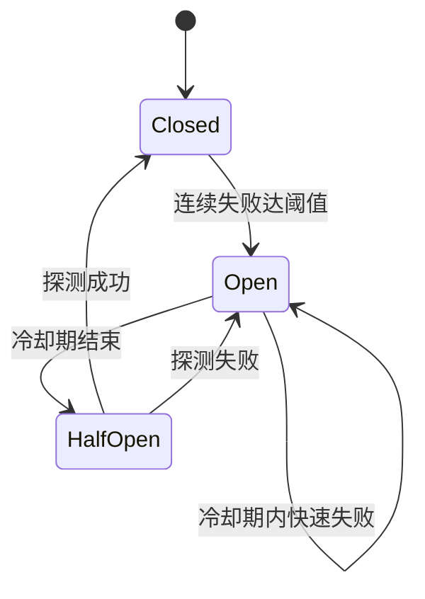
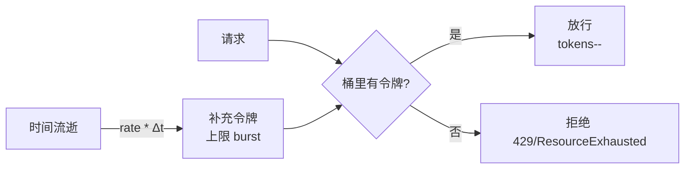
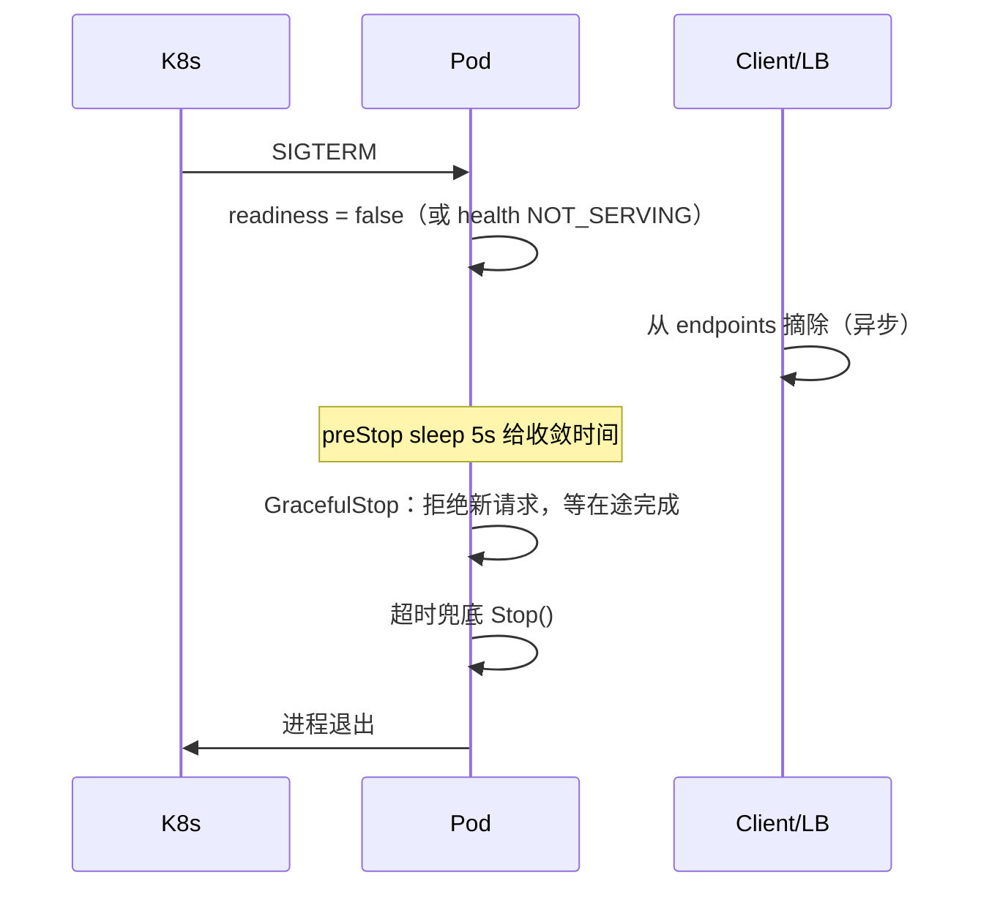
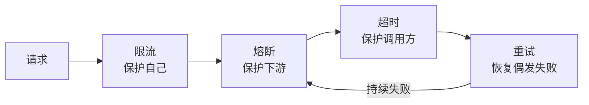

# 09 熔断、限流与优雅停机

> 属于 Go 微服务实战教程 · 第 09 篇
> 上一篇：[08 超时重试、指数退避与幂等](./08-超时重试指数退避与幂等)　下一篇：[10 Kafka 可靠投递与幂等消费](./10-Kafka可靠投递与幂等消费)

重试解决"偶发失败"，但下游持续故障时，重试只会加速死亡。这时候需要三件事：**限流**控制进来的量、**熔断**停止打下游、**优雅停机**保证发布时不丢请求。三件套合起来，系统才有"认怂但活着"的能力。

代码：`code/microservice/02_governance/03_resilience_graceful/`。

## 1. 熔断器：三态状态机



- **Closed**：正常放行，统计失败；
- **Open**：直接返回错误，不调用下游（快速失败，保护自己也保护下游）；
- **Half-Open**：放一个探测请求，成功则恢复，失败则继续 Open。

```go
func (b *Breaker) Allow() bool {
    b.mu.Lock()
    defer b.mu.Unlock()
    if b.state == BreakerOpen && b.now().Sub(b.openedAt) >= b.cfg.Cooldown {
        b.state = BreakerHalfOpen // 冷却结束，放一个探测
    }
    return b.state != BreakerOpen
}
```

为什么只放一个探测？如果放一批，刚恢复的下游会再次被打挂，形成"抖动—熔断—抖动"循环。

## 2. 限流：令牌桶



令牌桶的两个参数：

- `rate`：稳态速率（每秒多少请求）；
- `burst`：允许的突发量（桶容量）。

```go
func (b *TokenBucket) Allow() bool {
    b.mu.Lock()
    defer b.mu.Unlock()
    elapsed := b.now().Sub(b.last).Seconds()
    b.tokens = min(b.burst, b.tokens+elapsed*b.rate)
    b.last = b.now()
    if b.tokens < 1 {
        return false
    }
    b.tokens--
    return true
}
```

其他算法对比：

| 算法 | 突发 | 平滑度 | 场景 |
| ---- | ---- | ------ | ---- |
| 固定窗口 | 有窗口边界突刺 | 差 | 简单统计 |
| 滑动窗口 | 较平滑 | 较好 | 精确限流 |
| 漏桶 | 无 | 最平滑 | 恒定输出 |
| 令牌桶 | 可配置 | 好 | 允许突发（主流） |

分布式限流用 Redis + Lua 保证原子性；单机限流用本地令牌桶即可，两者可以叠加。

## 3. 优雅停机：先摘流量，再停服务



代码：

```go
ctx, stop := signal.NotifyContext(context.Background(), syscall.SIGINT, syscall.SIGTERM)
defer stop()

go func() {
    <-ctx.Done()
    srv.healthy.Store(false) // readiness 失败
    hs.SetServingStatus("user.v1.UserService", healthpb.HealthCheckResponse_NOT_SERVING)

    drained := make(chan struct{})
    go func() { gs.GracefulStop(); close(drained) }()
    select {
    case <-drained:
    case <-time.After(10 * time.Second):
        gs.Stop() // 兜底：别让进程永远退不出去
    }
}()
```

`GracefulStop` 会：

1. 停止接受新连接；
2. 等待所有在途 RPC 完成；
3. 关闭监听。

注意：如果客户端是长连接流式 RPC，`GracefulStop` 可能等很久——所以需要超时兜底。

## 4. 用门闸表达"在途请求"

更细粒度的做法是显式跟踪在途：

```go
if err := d.Acquire(); err != nil {
    return ErrDraining // draining 后拒绝新请求
}
defer d.Release()
```

`Shutdown(ctx)` 停止接收并等待计数归零，超时返回错误。这比依赖 `GracefulStop` 更可控，也方便接入自定义 server。

## 5. 三件套怎么配合



顺序很重要：

- 限流在最外层：超量请求连熔断器都不该进；
- 熔断在调用前：Open 时直接失败，不占用重试；
- 超时包住单次调用；
- 重试只在"可重试 + 幂等 + 有预算"时发生。

## 6. 参数怎么定

| 参数 | 经验值 | 说明 |
| ---- | ------ | ---- |
| 熔断失败阈值 | 5~20 次 / 连续 | 太小会误熔断，太大反应慢 |
| 冷却时间 | 5~30s | 给下游恢复时间 |
| 单机限流 | 压测值 × 0.7 | 留余量给突发 |
| 停机宽限 | 15~60s | 覆盖最长请求 |
| preStop sleep | 5~10s | 等 Endpoint 收敛 |

所有参数都应该可配置、可观测，而不是写死。

## 练习

```bash
cd code/microservice
go test -race -v ./02_governance/03_resilience_graceful
```

1. 把熔断阈值改成 1，观察误熔断；改成 100，观察反应迟钝；
2. 给令牌桶加"拒绝时返回重试间隔"，实现 `Retry-After` 语义；
3. 启动 lab 三实例，`Ctrl+C` 一个，观察 readiness/日志与网关请求是否丢。

## 面试追问

1. **熔断和限流的区别？** 限流控制"进来多少"；熔断控制"要不要打下游"。
2. **熔断为什么需要 Half-Open？** 没有探测就永远不知道下游是否恢复；只放一个探测避免二次打挂。
3. **优雅停机为什么先 readiness 后停服务？** 让 LB 先摘流量；直接停会丢掉"刚转发但未处理"的请求。
4. **`GracefulStop` 卡住怎么办？** 设置超时后 `Stop()` 强制退出；同时排查是否有长流/未响应请求。
5. **限流被拒返回什么？** gRPC 用 `ResourceExhausted`，HTTP 用 429，并带 `Retry-After`。

## 串起来

到这里，同步调用链的稳定性闭环了：发现、选路、超时、重试、幂等、熔断、限流、停机。接下来进入**异步链路**：消息会不会丢？重复消费怎么办？第 10 章从 Kafka 的投递语义开始。
