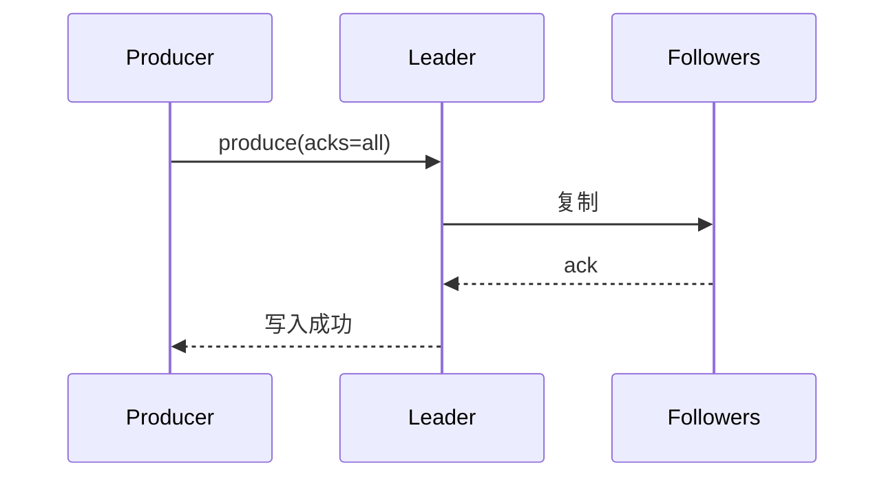
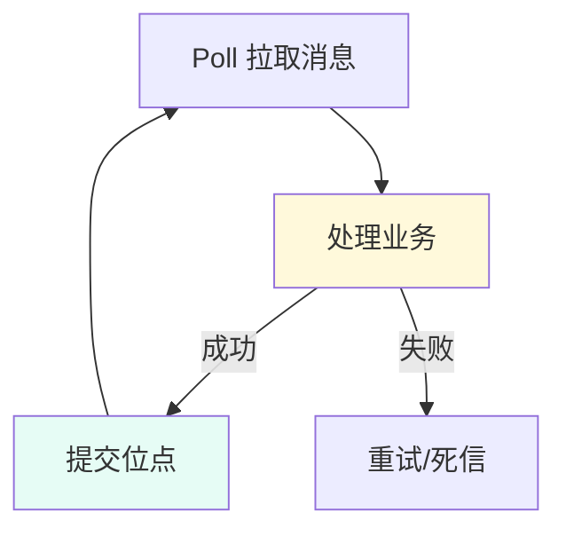
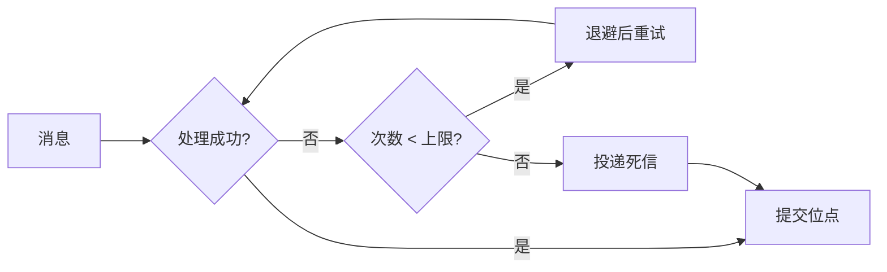

# 10 Kafka 可靠投递与幂等消费

> 属于 Go 微服务实战教程 · 第 10 篇
> 上一篇：[09 熔断、限流与优雅停机](./09-熔断限流与优雅停机)　下一篇：[11 重试、死信与 Outbox](./11-重试死信与Outbox)

同步调用解决"现在就要结果"，异步消息解决"先接下来，慢慢处理"。但异步带来三个新问题：消息会不会丢？会不会重复？重复了业务怎么办？这一章用一条订单消息走完全程。

代码：`code/microservice/03_messaging/01_kafka_idempotent/`（接口抽象，离线可测）。

## 1. 三种投递语义

| 语义 | 怎么做到 | 代价 |
| ---- | -------- | ---- |
| at-most-once | 先提交位点再处理 | 可能丢 |
| at-least-once | 先处理再提交位点 | 可能重复 |
| exactly-once | 事务/幂等 + 位点原子写 | 实现复杂、范围有限 |

现实选择：**传输层至少一次 + 业务层幂等 = 业务恰好一次**。这是绝大多数系统的做法。

## 2. 生产者：怎么尽量不丢



关键配置：

- `acks=all`：所有 ISR 副本确认才算成功；
- `enable.idempotence=true`：生产端去重（PID + sequence），避免网络重试造成重复；
- `retries` 足够大 + 退避；
- `min.insync.replicas=2`：防止只剩 leader 时仍然写入。

## 3. 消费者：位点提交顺序决定命运



- 先提交再处理 → 处理前崩溃 = **丢消息**；
- 先处理后提交 → 提交前崩溃 = **重复消息**。

我们选后者，然后用幂等表消化重复。

## 4. 幂等表：重复消息只产生一次副作用

```go
func (c *IdempotentConsumer) Handle(ctx context.Context, msg *Message) error {
    key := msg.ID() // topic/partition/offset，或用业务唯一键
    fresh, _ := c.dedup.TryBegin(key)
    if !fresh {
        return c.consumer.Commit(ctx, msg) // 已处理过，直接提交
    }
    // 处理...
    if err := c.handler(ctx, msg); err != nil {
        // 重试 / 死信
    }
    _ = c.dedup.Commit(key)
    return c.consumer.Commit(ctx, msg)
}
```

三个关键点：

1. **`TryBegin` 原子**：Redis `SETNX`、MySQL 唯一索引、`INSERT ... ON DUPLICATE KEY`；
2. **三态**：processing / done / abort，避免"处理一半"被误判为完成；
3. **失败要 abort**：否则一次失败会把这条消息永久标记为"处理过"。

## 5. 重试与死信：毒消息不能卡住分区



死信之后**必须提交位点**，否则分区会一直卡在这条消息上，后面全堵。

如果死信都发不出去（DLQ 也挂了），不要提交——宁可让分区暂停，也不能让消息无声消失。

## 6. 真实 kafka-go 写法

```go
r := kafka.NewReader(kafka.ReaderConfig{
    Brokers:        []string{"127.0.0.1:9092"},
    GroupID:        "order-consumer",
    Topic:          "order.created",
    CommitInterval: 0, // 关闭自动提交
})
defer r.Close()

for {
    m, err := r.FetchMessage(ctx)
    if err != nil {
        break
    }
    if err := handle(ctx, m); err != nil {
        // 重试 / 死信
        continue
    }
    if err := r.CommitMessages(ctx, m); err != nil {
        // 提交失败：消息会被重投，幂等表兜底
    }
}
```

写生产端时，`kafka.Writer` 也要设置 `RequiredAcks: kafka.RequireAll` 和 `Async: false`（或正确处理异步错误）。

## 7. rebalance：重复的另一个来源

消费者组扩缩容时分区会重新分配，未提交的消息会被新消费者重投。要控制：

- `max.poll.interval.ms` 要大于最长处理时间；
- 单批不要太大；
- 处理慢时考虑增加分区/消费者，而不是无限加大批次。

## 8. 顺序性

Kafka 只保证**单分区内有序**。需要顺序时：

- 用业务主键做 message key，让同一订单落到同一分区；
- 如果多分区并行处理还要顺序，就得在消费端按 key 串行化（每 key 一个队列），代价很高。

## 练习

```bash
cd code/microservice
go test -race -v ./03_messaging/01_kafka_idempotent
```

1. 把 `MaxAttempts` 改成 1，观察死信流程；
2. 实现基于 MySQL 唯一索引的 `DedupStore`（伪代码即可），说明 `TryBegin/Commit/Abort` 分别对应什么 SQL；
3. 用 Docker 起 Kafka，写一个最小 producer/consumer，手动 kill 消费者观察重投（可选）。

## 面试追问

1. **Kafka 能保证 exactly-once 吗？** 流内可以（幂等 producer + 事务）；跨外部副作用只能靠幂等表做到业务恰好一次。
2. **为什么先处理后提交？** 反过来会丢消息；重复可以用幂等消化，丢失无法恢复。
3. **消息重复的常见来源？** 生产端重试、消费端提交失败、rebalance、手动重放。
4. **死信队列怎么设计？** 记录原 topic/partition/offset、失败原因、重试次数、trace id；提供人工重放工具。
5. **消费积压怎么办？** 先看是处理慢还是分区少；处理慢优化逻辑/并行度，分区少加分区（注意 key 顺序）。

## 串起来

Kafka 解决了"消息不丢"和"重复可消化"，但还有一个经典难题：**业务写库成功、发消息失败**怎么办？下一篇讲 **Outbox 与死信**，让事件最终一定发出去。
