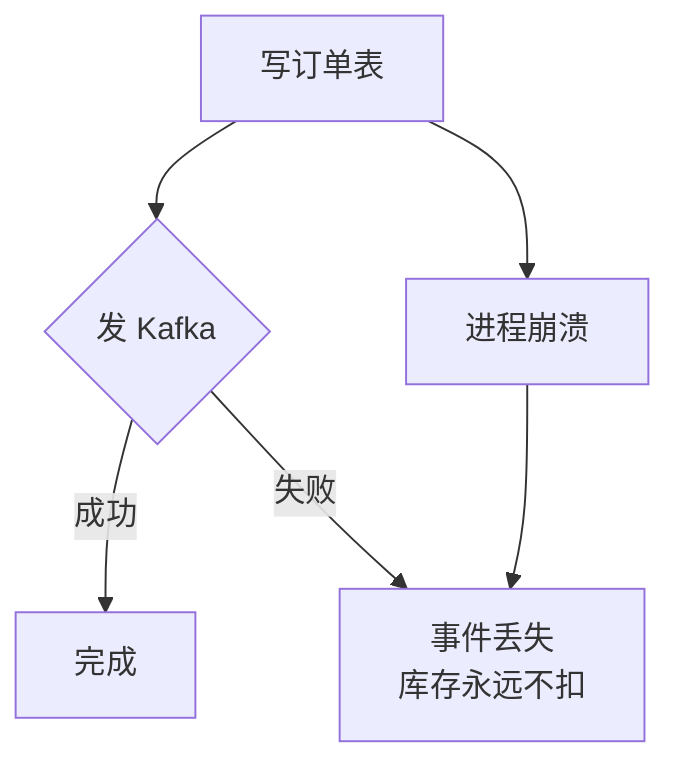
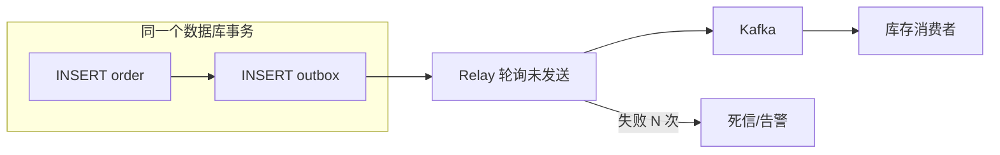

# 11 重试、死信与事务性 Outbox

> 属于 Go 微服务实战教程 · 第 11 篇
> 上一篇：[10 Kafka 可靠投递与幂等消费](./10-Kafka可靠投递与幂等消费)　下一篇：[12 Saga 与最终一致性](./12-Saga与最终一致性)

"订单创建成功后通知库存服务"——听起来就是写库之后发一条 Kafka。但如果写库成功、发 Kafka 失败呢？重试发？进程崩了怎么办？这是分布式系统最经典的双写问题。Outbox 模式用一个本地事务把两者绑在一起，再由 relay 保证最终发出。

代码：`code/microservice/03_messaging/02_outbox_dlq/`。

## 1. 双写为什么必然出问题



反过来先发 Kafka 再写库，则会出现"库存扣了但订单不存在"的幽灵事件。两条路都无法用"重试"根治，因为**两次写入不在同一个事务里**。

## 2. Outbox：把事件写进同一个本地事务



核心表：

```sql
CREATE TABLE outbox (
    id          VARCHAR(64) PRIMARY KEY,
    topic       VARCHAR(64) NOT NULL,
    payload     BLOB NOT NULL,
    created_at  TIMESTAMP NOT NULL,
    attempts    INT NOT NULL DEFAULT 0,
    sent_at     TIMESTAMP NULL,
    dead        BOOLEAN NOT NULL DEFAULT FALSE
);
```

业务代码：

```go
tx, _ := db.BeginTx(ctx, nil)
// 1. 业务写入
tx.ExecContext(ctx, "INSERT INTO orders(...) VALUES(...)")
// 2. 同一事务写事件
tx.ExecContext(ctx, "INSERT INTO outbox(id, topic, payload) VALUES(?, ?, ?)", ev.ID, ev.Topic, ev.Payload)
tx.Commit()
```

**要么都成功，要么都回滚**。这是 Outbox 成立的前提。

## 3. Relay：异步搬运

```go
func (r *Relay) RunOnce(ctx context.Context) (int, error) {
    events, _ := r.store.FetchUnsent(ctx, r.batch)
    for _, e := range events {
        if err := r.pub.Publish(ctx, e); err != nil {
            attempts := e.Attempts + 1
            if attempts >= r.maxAttempts {
                _ = r.dlq.Publish(ctx, e, err)
                _ = r.store.MarkDead(ctx, e.ID, attempts)
                continue
            }
            _ = r.store.RecordAttempt(ctx, e.ID, attempts)
            continue
        }
        _ = r.store.MarkSent(ctx, e.ID)
    }
    return sent, nil
}
```

顺序不能反：**先 Publish，再 MarkSent**。反过来会出现"标记已发但实际没发"的丢事件。

## 4. at-least-once 是设计目标，不是 bug

如果 `Publish` 成功但 `MarkSent` 失败（进程崩溃/DB 抖动），下轮会**再发一次**。这是 Outbox 的固有语义：

- 想做到"不漏"，就只能接受"可能重"；
- 消费端用幂等表消化重复（第 10 章）；
- 所以 Outbox + 幂等消费 = 业务恰好一次。

## 5. 死信：毒事件不能永远拖住 relay

和消费端一样：

- 单条事件失败不阻塞整批；
- 超过上限进死信，记录原因与重试次数；
- 死信本身失败时**不要标记已发送**，否则事件无声消失；
- 死信要有人看（告警 + 重放工具），否则等于垃圾桶。

## 6. 工程上的三种 Relay 形态

| 形态 | 优点 | 缺点 |
| ---- | ---- | ---- |
| 独立进程定时轮询 | 与业务解耦、易扩缩 | 多一次 DB 查询 |
| 业务进程内 goroutine | 简单 | 随业务重启、多实例要抢锁 |
| CDC（Debezium）读 binlog | 实时、无轮询 | 运维复杂、依赖 binlog |

小规模从"独立进程 + `SELECT ... FOR UPDATE SKIP LOCKED`"开始最稳。

## 7. 常见坑

1. **outbox 表无限增长**：定期归档 `sent_at` 非空的行；
2. **发送顺序**：按聚合 ID 分区 + 单线程搬运；跨聚合可并行；
3. **多 relay 实例重复搬运**：用 `SKIP LOCKED` 或 leader 选举；
4. **payload 太大**：只存事件 ID + 关键字段，消费端回查；大对象进对象存储。

## 练习

```bash
cd code/microservice
go test -race -v ./03_messaging/02_outbox_dlq
```

1. 给 relay 加"按聚合 ID 保序"的分组发送；
2. 把 `MemoryStore` 换成 SQLite/MySQL 实现，用事务保证 `CreateOrderWithEvent` 原子性；
3. 用 `EXPLAIN` 设计 outbox 的索引（`sent_at IS NULL` 的部分索引）。

## 面试追问

1. **Outbox 和"先发 MQ 再写库"的区别？** 后者可能产生指向不存在数据的幽灵事件；Outbox 的事件只在业务成功后存在。
2. **relay 挂了事件会丢吗？** 不会，事件在库里；重启后继续搬。
3. **为什么不能只靠 Kafka 事务？** Kafka 事务只覆盖 Kafka 内部；业务库写入不在同一事务里，跨系统仍需 Outbox/2PC。
4. **Outbox 和 Saga 的关系？** Saga 的每一步可以用 Outbox 发领域事件，两者是组合关系。
5. **怎么保证不重复？** 保证不了"不重复"，只能"重复无害"——消费端幂等。

## 串起来

Outbox 保证"事件最终发出去"，但多个服务之间的业务一致性还需要一个编排者：订单、库存、支付，任何一步失败都要回滚前面已完成的步骤。下一篇讲 **Saga 与最终一致性**。
