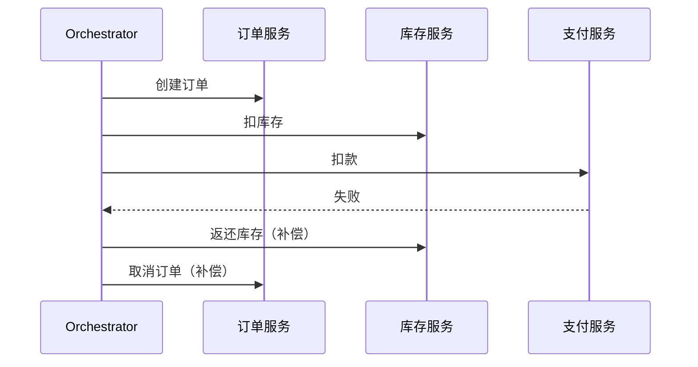
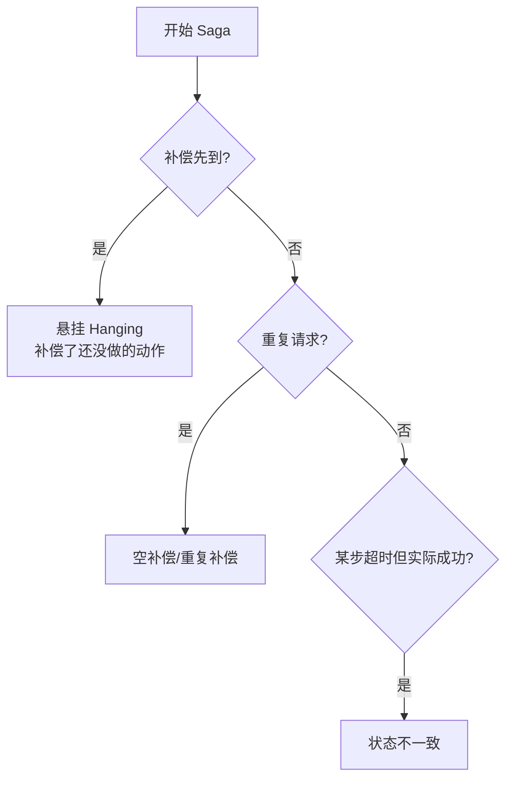

# 12 Saga 与最终一致性

> 属于 Go 微服务实战教程 · 第 12 篇
> 上一篇：[11 重试、死信与 Outbox](./11-重试死信与Outbox)　下一篇：[13 OpenTelemetry 全链路追踪](./13-OpenTelemetry全链路追踪)

下单要扣库存、扣余额、生成订单——三个服务、三个数据库。传统事务管不到跨库，2PC 又重又慢。Saga 的思路是：**每一步都是本地事务，失败就反向补偿**。它不是"回滚"，而是"用一个新的业务动作抵消之前的动作"。

代码：`code/microservice/03_messaging/03_saga/`。

## 1. 正向执行，逆向补偿



注意：

- 补偿只针对**已完成**的步骤；
- 补偿顺序与执行顺序相反；
- 失败的那一步自己负责回滚（例如扣款失败不需要"补偿扣款"）。

## 2. 编排 vs 协同

| | 编排（Orchestration） | 协同（Choreography） |
| -- | --------------------- | -------------------- |
| 控制点 | 一个 orchestrator 明确调用每步 | 各服务订阅事件自行推进 |
| 可观测 | 集中，容易看进度 | 分散，链路难追 |
| 耦合 | 服务依赖 orchestrator | 服务之间事件耦合 |
| 适用 | 步骤多、需要超时/补偿控制 | 简单、松耦合、事件驱动 |

生产上常见"编排为主 + 事件通知为辅"。

## 3. 代码骨架

```go
type Step struct {
    Name       string
    Do         func(ctx context.Context) error
    Compensate func(ctx context.Context) error
}

func (s *Saga) Run(ctx context.Context) error {
    completed := []int{}
    for i, step := range s.Steps {
        if err := step.Do(ctx); err != nil {
            return s.compensate(ctx, completed, err)
        }
        completed = append(completed, i)
    }
    return nil
}
```

补偿时逆序：

```go
for i := len(completed) - 1; i >= 0; i-- {
    step := s.Steps[completed[i]]
    // 重试 + 记录失败，不阻断其他补偿
}
```

## 4. 补偿必须幂等

补偿会被重复执行：网络重试、崩溃恢复、人工重放。所以：

- "返还库存"要按"补偿单号"去重，不能按"当前库存 +N"（可能加两次）；
- 补偿逻辑不能依赖 `Do` 的局部变量（崩溃后拿不到）；
- 最好给每次补偿一个稳定的幂等键，例如 `补偿:orderID:stock`。

## 5. 三类必须处理的状态问题



- **悬挂**：补偿请求先于正向请求到达，后面正向又执行了 → 需要状态机约束"只有已完成的步骤才能补偿"；
- **空补偿**：补偿时发现正向没执行 → 记录并忽略，不能报错重试；
- **超时未知**：调用超时不代表失败，要用查询接口确认状态（幂等查询）。

## 6. Saga vs TCC vs 2PC

| 方案 | 隔离性 | 侵入性 | 性能 | 场景 |
| ---- | ------ | ------ | ---- | ---- |
| 2PC | 强 | 低 | 差（同步阻塞） | 传统数据库 |
| TCC | 较好（Try 预留） | 高 | 好 | 支付/库存 |
| Saga | 最终一致（中间可见） | 中 | 好 | 长流程、跨服务 |

Saga 的中间状态对外可见，所以业务上要允许"订单已创建但库存未扣"这种短暂状态，用状态机 + 超时任务兜底。

## 7. 超时与重试

每一步都要有：

- 超时：单步调用必须有 deadline；
- 重试：只重试幂等步骤；
- 超时后的状态确认：调用"查询订单/查询库存"确认，而不是盲目补偿。

补偿同样要有重试上限与告警——补偿失败意味着需要人工介入。

## 练习

```bash
cd code/microservice
go test -race -v ./03_messaging/03_saga
```

1. 给 `Saga` 加状态持久化（每步完成后写 journal），支持崩溃后恢复；
2. 实现"补偿前先查询状态"，避免空补偿；
3. 给每一步加超时，观察超时后是否仍能正确补偿。

## 面试追问

1. **Saga 和 TCC 的区别？** Saga 是本地事务 + 补偿（中间态可见）；TCC 是 Try 预留 + Confirm/Cancel（隔离性更好）。
2. **补偿失败怎么办？** 重试 + 告警 + 人工补偿；所以补偿要幂等、可重入、可查询。
3. **怎么防悬挂？** 状态机 + 幂等键约束状态转移；补偿只能作用于"已完成"的步骤。
4. **Saga 能保证强一致吗？** 不能，只保证最终一致；业务要能接受中间态，并有对账兜底。
5. **编排器挂了怎么办？** 状态持久化 + 定时扫描未完成 saga 继续推进/补偿。

## 串起来

消息可靠性这块到这里完整了：至少一次投递、幂等消费、Outbox 最终发出、Saga 跨服务补偿。下一篇进入可观测性：一次请求经过 6 个服务变慢了，怎么一眼看出卡在哪一跳？
