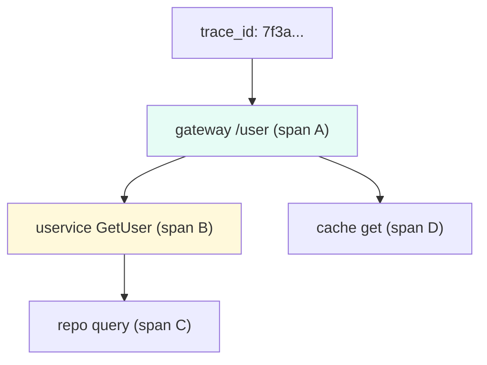

# 13 OpenTelemetry 全链路追踪

> 属于 Go 微服务实战教程 · 第 13 篇
> 上一篇：[12 Saga 与最终一致性](./12-Saga与最终一致性)　下一篇：[14 Prometheus 指标与 Grafana](./14-Prometheus指标与Grafana)

线上告警"下单接口 P99 超过 2 秒"。下单经过网关、订单、库存、支付四个服务，每个服务自己的监控都正常。问题在哪？日志只能告诉你"每个服务都处理了"，指标只能告诉你"整体慢了"，只有**链路**能告诉你"卡在哪一跳"。这一章手写 OTel 的 gRPC 埋点，把 traceparent 传起来。

代码：`code/microservice/04_observability/01_otel_trace/`。

## 1. Trace 是一棵树



- **trace_id**：整条链路唯一；
- **span_id**：单个操作唯一；
- **parent_span_id**：调用关系；
- **span kind**：client / server / producer / consumer / internal。

一条 trace 就是一棵 span 树，耗时最长的那条路径就是瓶颈。

## 2. W3C traceparent

跨进程传递靠一个 header：

```text
traceparent: 00-4bf92f3577b34da6a3ce929d0e0e4736-00f067aa0ba902b7-01
             │  │                                │                │
             │  └ trace-id (32 hex)              └ parent-id (16)  └ flags (sampled)
             └ version
```

规则：

- 客户端 `Inject`：把当前 span context 写成 traceparent；
- 服务端 `Extract`：读出来作为新 span 的 parent；
- **先 Extract 再 Start**，顺序反了就断链。

## 3. gRPC 拦截器实现

客户端：

```go
ctx, span := tracer.Start(ctx, method,
    trace.WithSpanKind(trace.SpanKindClient),
    trace.WithAttributes(attribute.String("rpc.system", "grpc")))
defer span.End()

md, _ := metadata.FromOutgoingContext(ctx)
prop.Inject(ctx, metadataCarrier{md: md})
ctx = metadata.NewOutgoingContext(ctx, md)

err := invoker(ctx, method, req, reply, cc, opts...)
```

服务端：

```go
if md, ok := metadata.FromIncomingContext(ctx); ok {
    ctx = prop.Extract(ctx, metadataCarrier{md: md})
}
ctx, span := tracer.Start(ctx, info.FullMethod,
    trace.WithSpanKind(trace.SpanKindServer))
defer span.End()
```

`metadataCarrier` 让 otel 的 `TextMapPropagator` 能读写 gRPC metadata——这是整个实现的关键适配层。

## 4. 错误标记

```go
if err != nil {
    span.RecordError(err)
    span.SetStatus(codes.Error, err.Error())
}
```

只有 `SetStatus(Error)` 的 span 才会在 Jaeger/Tempo 里标红；只 `RecordError` 不够。HTTP 4xx 一般不算错误，5xx/服务端异常才算——按团队约定统一。

## 5. 采样：不是所有请求都要存

| 策略 | 说明 |
| ---- | ---- |
| 全采样 | 调试/小流量 |
| 固定比例 | 1%~10%，简单 |
| 尾部采样 | 先收集，再按错误/延迟决定保留 |
| 入口决策 | 网关决定，随 traceparent 传播 |

采样必须**在入口决定并传播**，否则每个服务各自采样，链路会缺段。

## 6. 异步消息怎么串

生产者：

```go
carrier := propagation.MapCarrier{}
otel.GetTextMapPropagator().Inject(ctx, carrier)
headers := []kafka.Header{}
for k, v := range carrier { headers = append(headers, kafka.Header{Key: k, Value: []byte(v)}) }
```

消费者：把 headers 提取成 ctx，再 `tracer.Start(..., trace.WithSpanKind(SpanKindConsumer))`。这样消息链路也是同一条 trace（或者用 span link 表达因果）。

## 7. 日志关联

每条日志都带 trace_id/span_id：

```go
logger.Info("get user", zap.String("trace_id", TraceID(ctx)), zap.Int64("uid", uid))
```

有了它，从 Jaeger 点进一条 trace，能直接跳到对应日志；反过来从错误日志也能找到完整链路。

## 8. 接入真实后端

```go
exp, _ := otlptracegrpc.New(ctx) // 读 OTEL_EXPORTER_OTLP_ENDPOINT
tp := sdktrace.NewTracerProvider(
    sdktrace.WithBatcher(exp),
    sdktrace.WithSampler(sdktrace.ParentBased(sdktrace.TraceIDRatioBased(0.1))),
)
otel.SetTracerProvider(tp)
otel.SetTextMapPropagator(propagation.TraceContext{})
defer tp.Shutdown(ctx)
```

本地起 Jaeger：

```bash
docker run -d --name jaeger -p 16686:16686 -p 4317:4317 jaegertracing/all-in-one:latest
```

## 练习

```bash
cd code/microservice
go test -v ./04_observability/01_otel_trace
```

1. 在 lab 用 `-otlp` 启动服务，跑一次 `grpcurl`，看 stdout 里的 span 树；
2. 故意去掉服务端 `Extract`，观察 trace 分裂成两条；
3. 把采样率改成 0，确认 traceparent 仍传播但 span 不导出。

## 面试追问

1. **trace_id 和 span_id 的区别？** trace_id 标识整条链路；span_id 标识单个操作；parent_span_id 建立调用树。
2. **为什么要在入口做采样？** 避免每个服务独立决策导致链路缺段；尾部采样能保留"错误/慢请求"。
3. **链路断了怎么排查？** 检查是否覆盖 metadata、是否有服务用了 `context.Background()`、网关是否透传 header。
4. **OTel 和 Prometheus 的关系？** OTel 是统一 SDK/协议，指标可以导出到 Prometheus；tracing 导出到 Jaeger/Tempo。
5. **高并发下 span 开销大吗？** 采样后开销可控；避免在 span 上放大对象，属性要低基数。

## 串起来

链路回答"慢在哪"，指标回答"整体怎么样"。下一篇 **Prometheus 指标与 Grafana**：用 RED 三件套建立服务健康的第一屏。
