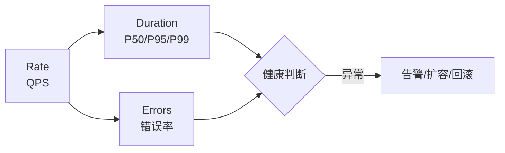
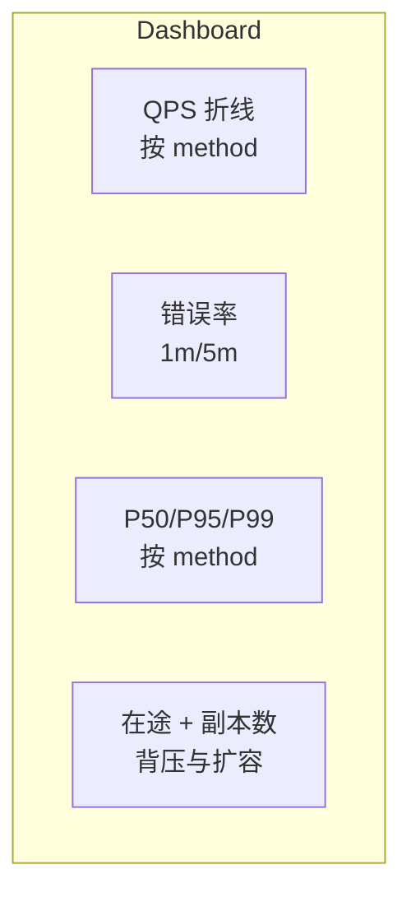

# 14 Prometheus 指标与 Grafana

> 属于 Go 微服务实战教程 · 第 14 篇
> 上一篇：[13 OpenTelemetry 全链路追踪](./13-OpenTelemetry全链路追踪)　下一篇：[15 K8s 部署、探针、滚动发布与 HPA](./15-K8s部署探针滚动发布与HPA)

链路是"个案诊断"，指标是"群体体检"。服务有没有问题、错误率多少、P99 多慢、要不要扩容——这些答案在指标里。这一章把 gRPC 的 RED 指标埋好，并给出能直接用的 PromQL 与 Grafana 面板设计。

代码：`code/microservice/04_observability/02_metrics/`。

## 1. 指标三件套

| 类型 | 特点 | 例子 |
| ---- | ---- | ---- |
| Counter | 只增不减，重启归零 | 请求总数、错误总数 |
| Gauge | 可增可减 | 在途请求、内存、连接数 |
| Histogram | 分桶统计分布 | 请求耗时、响应大小 |

延迟必须用 Histogram，不用平均值——平均值会把长尾藏起来。P99 才是用户真实感受。

## 2. RED：服务健康的最小集合



- **Rate**：`rate(grpc_server_requests_total[5m])`
- **Errors**：`code!="OK"` 的比例
- **Duration**：`histogram_quantile(0.99, ...)`

这三个指标 + 在途请求（背压信号），足够做出第一屏。

## 3. gRPC 埋点

```go
func (m *Metrics) UnaryServerInterceptor() grpc.UnaryServerInterceptor {
    return func(ctx context.Context, req any, info *grpc.UnaryServerInfo, handler grpc.UnaryHandler) (any, error) {
        start := time.Now()
        m.inflight.WithLabelValues(info.FullMethod).Inc()
        defer m.inflight.WithLabelValues(info.FullMethod).Dec()

        resp, err := handler(ctx, req)
        code := status.Code(err).String()
        m.requests.WithLabelValues(info.FullMethod, code).Inc()
        m.duration.WithLabelValues(info.FullMethod).Observe(time.Since(start).Seconds())
        return resp, err
    }
}
```

指标名遵循约定：

- 后缀 `_total` 表示 Counter；
- 后缀 `_seconds` / `_bytes` 带单位；
- 标签只放低基数：`method`、`code`，**绝不放 user_id / trace_id / request_id**。

## 4. 直方图与分位数

```go
Buckets: []float64{0.005, 0.01, 0.025, 0.05, 0.1, 0.25, 0.5, 1, 2.5, 5, 10}
```

桶要覆盖你的 SLO 边界。比如 SLO 是 P99 < 200ms，那 0.1/0.25 的桶必须存在，否则分位数只能靠插值，误差很大。

PromQL：

```text
# 错误率
sum(rate(grpc_server_requests_total{code!="OK"}[5m]))
/
sum(rate(grpc_server_requests_total[5m]))

# P99 延迟（按方法）
histogram_quantile(0.99,
  sum by (le, method) (rate(grpc_server_handling_seconds_bucket[5m])))

# 在途请求（背压信号）
sum by (method) (grpc_server_inflight_requests)

# QPS
sum by (method) (rate(grpc_server_requests_total[1m]))
```

注意 `histogram_quantile` 前必须 `sum by (le, ...)`，否则多实例的分位数不能合并。

## 5. Grafana 面板设计

一屏四块：



- 顶部放 SLO 数字（可用性、P99），一眼看结论；
- 中间放按 method 拆分的延迟与错误；
- 底部放在途请求 + HPA 副本数，用来解释"为什么扩容"；
- 所有面板统一时间范围和刷新间隔。

## 6. 告警规则

```yaml
groups:
  - name: grpc
    rules:
      - alert: HighErrorRate
        expr: |
          sum(rate(grpc_server_requests_total{code!="OK"}[5m]))
          / sum(rate(grpc_server_requests_total[5m])) > 0.05
        for: 5m
        labels: { severity: warning }
        annotations:
          summary: "错误率超过 5%"
      - alert: HighP99Latency
        expr: |
          histogram_quantile(0.99,
            sum by (le) (rate(grpc_server_handling_seconds_bucket[5m]))) > 0.5
        for: 10m
        labels: { severity: warning }
```

`for` 很重要：瞬时尖峰不应该叫醒人。告警要带 runbook 链接和排查步骤。

## 7. 指标之外的补充

- **日志**：解释"为什么错"；
- **链路**：定位"哪一跳慢"；
- **exemplar**：把 trace_id 挂到指标样本上，从延迟图直接跳链路（Prometheus 支持，Grafana 可配）。

## 8. 常见坑

1. **高基数标签**：`path="/user/123"` 会把每个用户变成一条时间序列，Prometheus 直接 OOM。路径要归一化。
2. **只统计成功请求**：错误率永远为 0，因为失败请求在 handler 之前就返回了——拦截器要在最外层。
3. **用平均值看延迟**：P99 才是用户体验。
4. **指标名冲突**：多模块注册同名指标会 panic，用 `AlreadyRegisteredError` 处理或统一命名空间。

## 练习

```bash
cd code/microservice
go test -v ./04_observability/02_metrics
```

1. 加 `grpc_server_request_bytes` 直方图，统计请求大小；
2. 写一条"在途请求持续 > 100 持续 5 分钟"的告警；
3. 起 lab，`curl /metrics`，把输出喂给 `promtool check metrics` 检查命名规范（可选）。

## 面试追问

1. **Counter 和 Gauge 的区别？** Counter 只增（用 `rate`/`increase`）；Gauge 可增可减（直接看值）。
2. **为什么延迟用 Histogram？** 可跨实例聚合、可分位数；Summary 的分位数不能合并。
3. **标签基数怎么控制？** 只放枚举型维度；高基数信息放日志/链路，不放指标。
4. **平均值为什么危险？** 长尾被平均掉；P99 才能反映最慢用户的体验。
5. **指标和告警怎么配合？** 指标是事实，告警是阈值的表达；`for` 防抖，runbook 负责处置。

## 串起来

到这里，服务"看得见"了：链路定位、指标体检。最后一跳是**部署**——怎么把这些服务安全地发到 K8s，探针、滚动发布、HPA 怎么配合。下一篇进集群。
