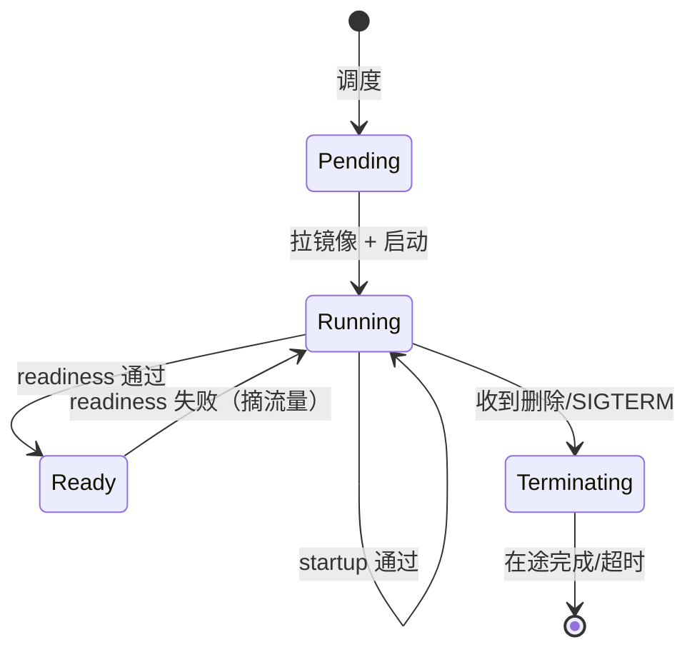
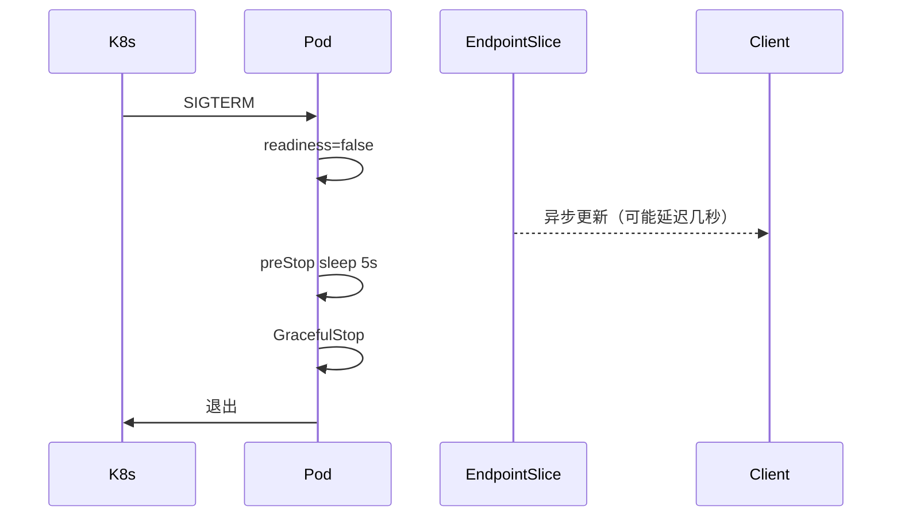

# 15 K8s 部署、探针、滚动发布与 HPA

> 属于 Go 微服务实战教程 · 第 15 篇
> 上一篇：[14 Prometheus 指标与 Grafana](./14-Prometheus指标与Grafana)　下一篇：[16 实战验收：8 项清单](./16-实战验收8项清单)

代码写完了，怎么让它稳定地跑在集群里？这一章把 Deployment、Service、三种探针、滚动发布、HPA、PDB 串起来，并给出可直接 `kubectl apply` 的清单。

清单：`code/microservice/lab/k8s/`；探针/HPA 公式练习：`05_deploy/01_probe_hpa/`。

## 1. 一个 Pod 的生命周期



三种探针各管一段：

| 探针 | 失败后果 | 探什么 |
| ---- | -------- | ------ |
| startupProbe | 重启容器 | 进程是否启动完成（慢启动保护） |
| readinessProbe | 从 Service 摘除 | 能不能接流量（依赖、预热） |
| livenessProbe | 重启容器 | 进程是否还活着（**不探下游**） |

最常见的错误：把数据库连通性写进 liveness。数据库一抖，所有实例一起重启，雪崩。

## 2. Deployment：副本与滚动

```yaml
spec:
  replicas: 3
  strategy:
    type: RollingUpdate
    rollingUpdate:
      maxSurge: 1        # 最多多起 1 个
      maxUnavailable: 0  # 发布期间容量不下降
```

发布过程：

1. 新建 1 个新版本 Pod；
2. 等它 readiness 通过；
3. 删 1 个旧 Pod；
4. 循环，直到全部替换。

`maxUnavailable: 0` 保证任何时刻可用副本数不下降，代价是发布期间多占资源。

## 3. Service：两种寻址

```yaml
# 普通 ClusterIP：kube-proxy 做 L4 负载均衡
kind: Service
spec:
  selector: { app: uservice }
  ports: [{ port: 9001, targetPort: grpc }]
---
# Headless：DNS 返回所有 Pod IP，客户端 LB
kind: Service
spec:
  clusterIP: None
  selector: { app: uservice }
```

gRPC 客户端用 Headless 才能发挥 round-robin：

```go
grpc.NewClient("dns:///uservice-headless.ns.svc.cluster.local:9001",
    grpc.WithDefaultServiceConfig(`{"loadBalancingConfig":[{"round_robin":{}}]}`))
```

## 4. 探针配置（gRPC 原生）

K8s 1.24+ 支持 `grpc` 探针：

```yaml
startupProbe:
  grpc: { port: 9001 }
  periodSeconds: 2
  failureThreshold: 30
readinessProbe:
  grpc: { port: 9001 }
  periodSeconds: 5
  failureThreshold: 2
livenessProbe:
  grpc: { port: 9001 }
  periodSeconds: 10
  failureThreshold: 3
```

服务端注册标准 Health 服务后，探针会调 `Check`。停机时置 `NOT_SERVING`，readiness 立即失败。

## 5. 优雅停机与 preStop



```yaml
terminationGracePeriodSeconds: 30
lifecycle:
  preStop:
    exec:
      command: ["/bin/sh", "-c", "sleep 5"]
```

`preStop` 的 sleep 是给 Endpoint 摘除留时间；`terminationGracePeriodSeconds` 要大于"最长请求 + preStop"。

## 6. HPA：什么时候扩、扩多少

公式：

```text
desired = ceil(current * currentMetric / targetMetric)
```

细节：

- 容忍度 ±10%：利用率在目标附近不抖动；
- 单次步长：扩容最多翻倍/加 4，缩容最多 25%/减 1；
- 稳定窗口：缩容默认 5 分钟，避免指标抖动导致副本反复横跳。

```yaml
metrics:
  - type: Resource
    resource:
      name: cpu
      target: { type: Utilization, averageUtilization: 60 }
behavior:
  scaleDown:
    stabilizationWindowSeconds: 60
```

**必须设置 `resources.requests.cpu`**，否则 HPA 显示 `<unknown>`。

## 7. PDB：自愿中断也保底

滚动发布、节点维护、集群升级都会驱逐 Pod。PDB 保证可用数：

```yaml
kind: PodDisruptionBudget
spec:
  minAvailable: 2
  selector: { matchLabels: { app: uservice } }
```

## 8. 资源与 QoS

```yaml
resources:
  requests: { cpu: 100m, memory: 64Mi }
  limits:   { cpu: 500m, memory: 256Mi }
```

- requests 决定调度与 HPA 基数；
- limits 防单个 Pod 拖垮节点；
- requests=limits 的 CPU 会获得 Guaranteed QoS，但降低弹性。

## 9. 发布验证清单

```bash
kubectl apply -f lab/k8s/
kubectl -n microservice-demo get pods,svc,hpa,pdb -w
kubectl -n microservice-demo rollout status deploy/uservice
kubectl -n microservice-demo set image deploy/uservice uservice=gocampus/uservice:v2
kubectl -n microservice-demo rollout undo deploy/uservice   # 回滚
```

## 练习

```bash
cd code/microservice
go test -v ./05_deploy/01_probe_hpa
```

1. 把 liveness 改成探测 `/healthz` 并依赖数据库，模拟数据库宕机，观察重启风暴；
2. 把 HPA 的 `averageUtilization` 从 60 改到 30，用压测观察扩容速度；
3. 执行 `kubectl drain` 一个节点，观察 PDB 是否阻止过多 Pod 同时驱逐。

## 面试追问

1. **readiness 和 liveness 的区别？** readiness 摘流量（可恢复）；liveness 重启（进程不可救）。
2. **为什么滚动发布要 `maxUnavailable: 0`？** 保证发布期间容量不下降；代价是额外资源。
3. **HPA 为什么不动？** 常见原因：没有 requests、metrics-server 未装、指标不在容忍区间、达到 min/max。
4. **preStop 为什么需要 sleep？** Endpoint 摘除异步，sleep 给收敛时间，避免新请求打到正在退出的 Pod。
5. **怎么做金丝雀发布？** 两个 Deployment + Service 权重/Ingress 分流；或 Argo Rollouts/Flagger 自动分析指标。

## 串起来

基础设施这一层解决了"发得稳、扩得动、退得干净"。下一篇是总验收：把前面所有能力装进一个可复现的 Lab，按 8 项清单逐条验证。
