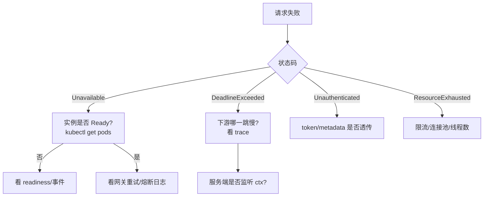

# 16 实战验收：8 项清单逐条演练

> 属于 Go 微服务实战教程 · 第 16 篇
> 上一篇：[15 K8s 部署、探针、滚动发布与 HPA](./15-K8s部署探针滚动发布与HPA)　下一篇：[17 面试题集](./17-面试题集)

学完不等于会。这一章是一份**可执行的验收单**：8 项能力，每项都有复现步骤、预期现象和失败模式。全部跑通，你才算真正拥有这套微服务能力。

前置：

```bash
cd code/microservice
go build ./...            # 14 个练习骨架可编译
go test ./...             # 实现 solution.go 后逐题变绿（参考答案见 answer/）
```

> 验收前请先完成对应章节的练习；只想快速核对参考行为时，可临时用 `answer/answer.go`
> 覆盖 `solution.go` 跑一遍，跑完再恢复骨架。

# 三个终端
go run ./lab/uservice -addr :9001 -instance user-1 -metrics-addr :9101
go run ./lab/uservice -addr :9002 -instance user-2 -metrics-addr :9102
go run ./lab/uservice -addr :9003 -instance user-3 -metrics-addr :9103

# 第四个终端
go run ./lab/gateway -targets 127.0.0.1:9001,127.0.0.1:9002,127.0.0.1:9003
```

## 验收 1：多实例部署 + 负载均衡

**目标**：请求被均匀分到 3 个实例。

```bash
for i in $(seq 1 12); do
  curl -s "http://127.0.0.1:8080/user?id=1" | grep -o 'user-1@user-[0-9]'
done
```

**预期**：`user-1@user-1/2/3` 各出现约 4 次。

**失败模式**：

- 全部打到一个实例 → 客户端用错了 `pick_first` 或目标写成了单个地址；
- 报 `connection refused` → 实例没起或端口冲突。

对应代码：`02_governance/01_registry_lb`、`lab/gateway`。

## 验收 2：停掉一个实例，系统仍可用

**目标**：容量下降但不中断。

```bash
# 先停 user-2（对应终端的 Ctrl+C）
for i in $(seq 1 9); do curl -s -o /dev/null -w '%{http_code}\n' "http://127.0.0.1:8080/user?id=1"; done
```

**预期**：全部 `200`；日志里 user-2 走 `GracefulStop`，网关的 round_robin 自动移除。

**失败模式**：

- 出现 503 → 网关没开重试/健康检查；
- 停的那一下丢请求 → 没有 preStop/优雅停机，或客户端没感知到连接关闭。

## 验收 3：下游超时能及时终止

**目标**：慢调用不会无限阻塞。

```bash
# 服务端 GetUser 固定 sleep 20ms；用极短 deadline 触发超时
grpcurl -plaintext -max-time 0.001 \
  -H 'authorization: Bearer campus-secret' \
  -d '{"id": 1}' 127.0.0.1:9001 user.v1.UserService/GetUser
```

**预期**：`DeadlineExceeded`，且服务端日志显示请求被取消，而不是继续跑。

**失败模式**：

- 客户端超时了但服务端还在处理 → handler 没监听 `ctx.Done()`；
- 总耗时远超 deadline → 每跳重置了超时。

对应代码：`01_grpc_basics/03_deadline_cancel`、`04` 章。

## 验收 4：重试不会重复扣款

**目标**：同一个幂等键重复提交只扣一次。

```bash
for i in $(seq 1 5); do
  curl -s "http://127.0.0.1:8080/charge?key=order-42&amount=100"; echo
done
```

**预期**：第一次 `"deduplicated": false`，后四次 `true`，`charge_id` 相同。

> lab 的幂等表在进程内存里，网关按 key 做了粘性路由，所以这个演示能通过。真实多实例部署必须把幂等表放 Redis/MySQL——否则轮询会把同一个 key 打到不同实例，每个实例都认为自己是第一次（第 08 章有完整分析）。

**失败模式**：

- 每次都是 `false` → 服务端没有幂等表；
- 并发时出现两次 `false` → 幂等表不是原子操作（缺 SETNX/唯一索引）。

对应代码：`02_governance/02_retry_idempotent`、`08` 章。

## 验收 5：服务重启，Kafka 消息不丢不重

**目标**：at-least-once + 幂等 = 业务恰好一次。

```bash
go test -race -v ./03_messaging/01_kafka_idempotent
```

**预期**：

- `TestCommitFailureRedeliversButNoDoubleEffect`：业务只执行 1 次；
- `TestPoisonMessageGoesToDLQ`：毒消息进死信且提交位点。

**手工验证（可选，需 Docker Kafka）**：

1. 生产 10 条消息；
2. 消费到第 5 条时 `kill -9` 消费者；
3. 重启消费者，观察投递从上次提交位点继续；业务表因幂等键无重复。

**失败模式**：先提交位点导致丢消息；死信后不提交导致分区卡死。

## 验收 6：一次请求经过的所有微服务可追踪

**目标**：一条 trace 串起网关 → 服务 → 下游。

```bash
# 终端 A：开启 span 输出
go run ./lab/uservice -addr :9001 -instance user-1 -metrics-addr :9101 -otlp
# 终端 B
curl -s "http://127.0.0.1:8080/user?id=1"
```

**预期**：stdout 打印 span，包含 `rpc.system=grpc`、`SpanKind=server`，trace_id 与客户端一致。

**失败模式**：服务端没有 `Extract`，trace 分裂；网关没有透传 metadata。

对应代码：`04_observability/01_otel_trace`、`13` 章。

## 验收 7：滚动发布 + 优雅停机

**目标**：发布期间 0 失败。

```bash
# 持续请求（另开终端）
while true; do curl -s -o /dev/null -w '%{http_code}\n' "http://127.0.0.1:8080/user?id=1"; sleep 0.1; done

# 发布新版本（K8s）
kubectl -n microservice-demo set image deploy/uservice uservice=gocampus/uservice:v2
kubectl -n microservice-demo rollout status deploy/uservice
```

**预期**：请求全 200；Pod 日志先 `draining...`，在途处理完再退出。

**失败模式**：

- 出现 503 → `maxUnavailable` 过大、没有 readiness；
- 出现 `connection reset` → 没有 preStop/优雅停机。

## 验收 8：按负载扩容

**目标**：HPA 根据 CPU 扩缩。

```bash
kubectl -n microservice-demo get hpa uservice -w
# 另开终端压测
kubectl -n microservice-demo run load --rm -it --image=busybox -- \
  sh -c 'while true; do wget -q -O- http://gateway/user?id=1 >/dev/null; done'
```

**预期**：CPU 利用率上升，副本数从 3 增加到上限；压测停止后，经过稳定窗口缩回。

**失败模式**：

- HPA 显示 `<unknown>` → 没设 requests 或 metrics-server 未装；
- 副本不动 → 利用率在容忍区间、达到 min/max、或指标延迟未到。

对应代码：`05_deploy/01_probe_hpa`、`15` 章、`lab/k8s/30-hpa-pdb.yaml`。

## 验收总表

| # | 能力 | 验证方式 | 通过标准 |
| - | ---- | -------- | -------- |
| 1 | 多实例 + LB | 12 次 `/user` | 三实例各约 1/3 |
| 2 | 实例故障 | 停一个实例后请求 | 全 200 |
| 3 | 超时终止 | `-max-time` 1ms | `DeadlineExceeded` 且服务端停止 |
| 4 | 重试幂等 | 5 次同 key `/charge` | 只有一次 `false` |
| 5 | 消息不丢不重 | 幂等消费测试 | 业务只执行一次 |
| 6 | 全链路追踪 | `-otlp` + 网关调用 | 同一 trace_id 的父子 span |
| 7 | 滚动 + 优雅停机 | 发布期间持续请求 | 全 200 |
| 8 | 弹性扩容 | HPA + 压测 | 副本数上升后回落 |

## 排障剧本



常用命令：

```bash
kubectl -n microservice-demo get pods -o wide
kubectl -n microservice-demo describe pod <pod>
kubectl -n microservice-demo logs <pod> --tail=100
kubectl -n microservice-demo get events --sort-by=.lastTimestamp
kubectl -n microservice-demo top pods
```

## 串起来

8 项验收对应 15 章内容：前 3 项是通信与治理，4-5 是数据可靠性，6-7 是可观测与发布，8 是弹性。能复现、能解释、能排障，这套微服务能力就真正长在你身上了。最后用第 17 章的面试题集收口。
