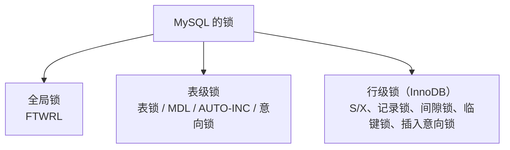
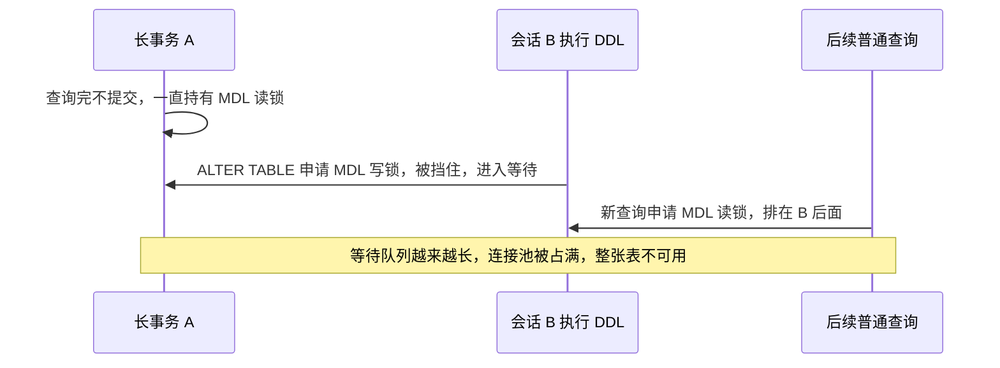

# 一条 UPDATE 到底锁了什么？—— MySQL 锁机制全解

> 属于 S1 MySQL 深入 · 深入篇第三篇
> 上一篇：[事务与 MVCC](./事务与MVCC)　下一篇：[索引与 SQL 优化](./索引与SQL优化)

先看两个线上常见的怪事。

第一个：两个事务，一个 `UPDATE users SET name='A' WHERE id=1`，另一个 `UPDATE users SET name='B' WHERE id=2`，改的是两行完全不同的数据，居然互相阻塞了，等到超时才报错。

第二个：明明只是插一条新数据，`INSERT INTO t VALUES (...)` 却卡在那里不动，查 `SHOW PROCESSLIST` 显示在等锁，可表里根本没有这条记录——一条"不存在"的数据，怎么会被锁住？

这两个现象的答案都指向同一件事：**InnoDB 的行锁，锁的不是"行"，而是"索引记录"；你最终锁住多大范围，由执行计划决定，而不是由 SQL 字面决定。**

这篇文章就把 MySQL 的锁从大到小拆一遍：先讲清锁和 MVCC 的分工，再按"全局锁 → 表级锁 → 行级锁"逐层展开，然后用一张表把一条 `UPDATE` 的加锁过程完整推演出来，最后落到死锁的排查与业务里的选型。

---

## 先把问题问对：锁到底在保护什么

上一篇讲 MVCC 时说过：普通 `SELECT` 读的是历史快照，不需要加锁。那锁还有什么用？

关键在于区分两种读：

- **快照读**：普通 `SELECT`，读事务开始时的历史版本，靠 MVCC 实现，全程无锁。
- **当前读**：`SELECT ... FOR UPDATE`、`SELECT ... FOR SHARE`、`UPDATE`、`DELETE`，必须看到并修改"最新版本"的数据。

写操作要改数据，两个事务同时改同一行，后改的必须等先改的提交，否则会互相覆盖；当前读要读最新值，也不能让别人改到一半。**这些事情 MVCC 管不了，只能靠锁把冲突串行化。**

| 操作 | 读什么 | 是否加锁 | 靠什么 |
|------|--------|----------|--------|
| 普通 `SELECT` | 历史快照 | 不加锁 | MVCC |
| `SELECT ... FOR SHARE` | 最新数据 | 加共享锁 S | 锁 |
| `SELECT ... FOR UPDATE` | 最新数据 | 加排他锁 X | 锁 |
| `UPDATE` / `DELETE` | 最新数据 | 加排他锁 X | 锁 |

所以锁和 MVCC 是分工，不是替代：

- 如果全靠锁，读写会互相阻塞，并发吞吐直接掉下来；
- 如果全靠 MVCC，写写冲突没法解决，当前读也拿不到"最新且稳定"的数据。

但锁不是免费的。它会带来三样代价：**阻塞**（等锁）、**死锁**（互相等成环）、**检测开销**（判断锁冲突本身要花 CPU）。后文讲死锁时会看到，这些代价在热点行上会被放大得非常明显。

## 锁的全景：一张图看清所有锁

MySQL 的锁名目很多，但按四个维度一拆就不乱了：

1. **按粒度**：全局锁 → 表级锁 → 行级锁。
2. **按模式**：共享锁（S，别人还能读）和排他锁（X，别人读写都不行）。
3. **按实现层**：Server 层（全局锁、MDL、`LOCK TABLES`）和 InnoDB 引擎层（行锁、意向锁、AUTO-INC）。
4. **按思想**：悲观锁（数据库自己加锁）和乐观锁（应用层用版本号/CAS 自己控制）。



| 锁 | 一句话定位 | 本文位置 |
|----|-----------|----------|
| 全局锁 | 锁住整个实例，只允许读 | 第 3.1 节 |
| 表锁 `LOCK TABLES` | 显式锁整张表 | 第 3.2 节 |
| MDL | 自动加的元数据锁，保护表结构 | 第 3.3 节 |
| AUTO-INC | 自增主键分配时锁计数器 | 第 3.4 节 |
| 意向锁 IS/IX | 表级"路标"，告诉别人行上有锁 | 第 4.3 节 |
| 记录锁 / 间隙锁 / 临键锁 | 行级锁的三种基本形态 | 第 4.4 节 |
| 插入意向锁 | INSERT 前在间隙上加的锁 | 第 4.5 节 |

日常聊的"MySQL 锁"九成指 InnoDB 行锁，但真正把线上打挂的，往往是前面两个不起眼的角色：全局锁和 MDL。所以先从它们讲起。

## 全局锁：为什么现在很少用 FTWRL 备份

### FTWRL 是什么

全局锁的加锁命令是：

```sql
FLUSH TABLES WITH READ LOCK;   -- 简称 FTWRL
UNLOCK TABLES;                 -- 释放
```

执行后，**整个数据库实例进入只读状态**：所有写操作、DDL 全部阻塞，普通 `SELECT` 仍然可以读。

它的经典用途是 **全库逻辑备份**。备份必须拿到"同一时刻"的数据快照，否则备份过程中业务一直在写，备份出来的库表可能互相矛盾——比如订单表已经记了扣款，账户表却还没扣。FTWRL 把整库冻住，备份期间谁都改不了，快照自然一致。

### 为什么 8.0 时代不再需要它

问题是，FTWRL 的代价太大了：备份期间业务写全停。主库上执行，等于把线上写入直接冻住几分钟到几小时，这显然不可接受。

更聪明的办法是 **`mysqldump --single-transaction`**：

```bash
mysqldump --single-transaction --source-data=2 mydb > mydb.sql
```

它在备份开始时开一个可重复读（RR）事务，借助 MVCC 拿到一个**一致性视图**，整个备份过程都读这个视图，不需要锁任何表，业务写入完全不受影响。

**知其所以然**：备份真正需要的是"同一时刻的一致性快照"，而 MVCC 恰好能提供这个能力。既然快照能不锁表地拿到，就没有理由把整库锁死。只有 MyISAM 这种不支持事务的引擎，才不得不退回 FTWRL——所以现在还在用 FTWRL 备份的，基本是历史遗留。

## 表级锁：真正把线上打挂的往往是 MDL

### 表锁 LOCK TABLES

最直白的表级锁是显式加锁：

```sql
LOCK TABLES t READ;    -- 读锁：本会话和其他会话都只能读 t
LOCK TABLES t WRITE;   -- 写锁：只有本会话能读写 t
UNLOCK TABLES;
```

读锁之间共享，读锁和写锁互斥，写锁和写锁也互斥。这是 MyISAM 时代的主力锁——MyISAM 没有行锁，只能靠表锁控制并发。

在 InnoDB 里，`LOCK TABLES` 仍然能用，但它和事务配合得很别扭（`LOCK TABLES` 会隐式提交当前事务，且锁的粒度过大），生产上一般不推荐。InnoDB 有自己的表级锁——**意向锁**，是自动加的，下一章讲。

### MDL：一条 DDL 如何堵死整张表

MDL（Metadata Lock，元数据锁）是 MySQL 5.5 引入的，**自动加、无法关闭**。它的职责很简单：保证表结构不会在查询过程中被改掉。

规则也不复杂：

- 增删改查（DML）自动加 **MDL 读锁**（共享）；
- 改表结构（DDL，如 `ALTER TABLE`）自动加 **MDL 写锁**（排他）；
- 读读兼容，读写、写写互斥。

MDL 内部并不是一把锁，而是一组按用途细分的模式：普通查询用读模式，DML 用写模式，`ALTER` 这类 DDL 用排他模式。这些模式大多能共存，只有 DDL 的排他模式会和所有模式冲突。日常排查不需要背完整矩阵，抓住两个事实就够了：**排他模式冲突面最大，且加锁是自动的、关不掉。**

真正要命的是这一条：**事务里的 MDL 读锁，一直持有到事务提交才释放**，不是语句结束就放。

于是就有了经典的线上雪崩：



一步一步看：

1. 会话 A 开了事务，查了一下表，然后因为代码 bug 或人工操作迟迟不提交——它手里的 MDL 读锁一直不放。
2. 运维执行 `ALTER TABLE` 加字段，申请 MDL 写锁，被 A 的读锁挡住，进入等待队列。
3. 此时其他会话发来的普通查询要申请 MDL 读锁。按理说读锁和 A 的读锁兼容，应该能过——**但为了不让 DDL 永远饿死，MDL 的等待队列会优先处理排在前面的写锁请求**，所以新来的读锁请求也排在 `ALTER` 后面。
4. 一个 `ALTER` 卡住，后面所有请求跟着排队，连接池被迅速占满，业务整体不可用。

这就是"一条 DDL 把整张表打挂"的完整机理。**问题通常不在 DDL 本身慢，而在于它前面有一个没提交的长事务，后面又堵了一串普通查询。**

把它还原成一条典型时间线，会更容易记住：

- **T0**：业务代码开启事务，查了一次表，接着去调外部接口，事务就这么挂着；
- **T0+30s**：运维执行 `ALTER TABLE`，申请 MDL 写锁，被长事务挡住；
- **T0+31s 起**：新请求的普通查询开始排在 `ALTER` 后面，连接池里的连接一个个被占住；
- **T0+45s**：连接池耗尽，接口大面积超时，监控告警；
- **处理**：找到并 `KILL` 掉那个长事务，`ALTER` 立刻拿到锁，排队请求迅速消化。

事故复盘时最该问的不是"为什么 DDL 这么慢"，而是"**为什么会有事务开了几十秒还不提交**"。前者是现象，后者才是根因。

排查时先看进程列表：

```sql
SHOW PROCESSLIST;
-- 看到大量 State = 'Waiting for table metadata lock'
```

再定位到底是谁持有 MDL 读锁：

```sql
-- 8.0：看元数据锁的持有与等待关系
SELECT * FROM performance_schema.metadata_locks;

-- 更方便的视图：直接看谁在等谁
SELECT * FROM sys.schema_table_lock_waits;
```

治理手段有四条：

- **DDL 前先查长事务**：`information_schema.innodb_trx` 里 `trx_state='RUNNING'` 且 `trx_started` 很早的，先处理掉。
- **给 DDL 设等待上限**：调小会话的 `lock_wait_timeout`，避免无限期排队。
- **大表变更用在线工具**：`gh-ost`、`pt-online-schema-change`，它们用影子表 + 增量同步，把对原表的锁时间压到极短。
- **别指望 online DDL 完全免疫**：8.0 的 online DDL 虽然大部分时间不锁表，但开始和结束时仍需要短暂的 MDL 排他，前面有长事务照样会被卡住。

再展开说下 online DDL。它把 `ALTER` 拆成三个阶段：**prepare**（短暂拿 MDL 排他，改元数据）、**execute**（允许并发 DML，通常是耗时最长的一段）、**commit**（再短暂拿 MDL 排他，提交元数据）。真正锁表的是头尾两个短暂阶段。所以"online"不等于"无锁"：只要 prepare 阶段被长事务挡住，后面所有请求就会开始排队，execute 阶段再快也没用。

### AUTO-INC 锁：自增主键怎么拿号

自增主键要求两个值不能重复，并发 `INSERT` 时就得有人负责"发号"。AUTO-INC 锁保护的就是这个**自增计数器**，注意它锁的不是数据行。

MySQL 用 `innodb_autoinc_lock_mode` 控制发号方式，三种模式：

| 模式 | 行为 | 自增值 | 并发能力 |
|------|------|--------|----------|
| 0 传统 | 语句级 AUTO-INC 表锁，语句结束才释放 | 连续 | 最差 |
| 1 连续 | 简单插入用轻量互斥量批量分配；批量插入仍用表锁 | 基本连续 | 中等 |
| 2 交错（8.0 默认） | 全部用轻量互斥量，批量插入可能一次拿多个号 | 可能有空洞 | 最好 |

模式 1 是 5.7 的默认值，模式 2 是 8.0 的默认值。**为什么 8.0 敢默认用 2？** 因为 8.0 的 binlog 默认是 ROW 格式，从库回放的是"每一行的最终值"，不再依赖主库语句级自增值的连续性。用"自增值可能出现空洞"换来更高的并发插入能力，这笔交易划算。

反过来，如果你的环境还是 `binlog_format=STATEMENT`，又用了模式 2，主从就可能因为自增值不一致而出问题——这也是老系统升级时容易踩的坑。

再补两个容易困惑的点：

- **为什么模式 2 下批量插入会出现"空洞"？** 因为它一次可能给语句预分配一批号，但实际插入的行数少于预分配数（比如 `INSERT ... SELECT` 只查出 8 行，却预留了 10 个号），多出来的号就空着了。这不会影响唯一性，只是自增值不连续。
- **自增值回滚后不会退回。** 事务回滚了，已经分配出去的自增号不会还回来，所以自增列出现断号是正常现象。别把断号和"数据缺失"混为一谈。

## InnoDB 行级锁：锁的不是行，是索引

### 30 秒复习：聚簇索引、二级索引、回表

因为锁的加法和索引强相关，先用 30 秒把上一篇的索引结构复习一下：

- **聚簇索引**：就是主键索引，B+ 树的叶子节点直接存整行数据，一张表只有一个。
- **二级索引**：你额外建的普通索引，叶子节点只存"索引列的值 + 主键值"。
- **回表**：用二级索引查到主键后，再回聚簇索引取整行，多一次查找。

记住一句话：**InnoDB 的所有行锁，最终都落在某棵索引的某条记录上。** 这句话是理解后文所有加锁现象的钥匙。

再往深一层看，"锁在索引记录上"不是比喻，而是物理事实。InnoDB 在内存里维护一套锁系统，锁的标识是"表空间 + 页号 + 记录在页内的位置"，而不是"某一行数据"：

- 同一个事务对同一页上多条记录的锁，会合并到一个锁结构里，用**位图**标记具体锁了哪几条记录；
- 所以一条语句锁了多少记录，本质上是它在索引页上"扫过并标记"了多少个位置；
- 没有索引时全表扫描，等于把所有页上的所有记录位都标满——这就是"无索引等效锁表"的底层原因；
- 间隙锁标记的不是记录本身，而是"某条记录之前的空间"，所以它才能锁住一条根本不存在的值。

理解了这层结构，后面那些"为什么锁了不存在的行""为什么锁范围这么大"的疑问，就都有了统一的解释。

### 共享锁与排他锁

行锁按模式分两种：

- **共享锁 S**：允许别人也加 S 锁读，但不允许加 X 锁改。
- **排他锁 X**：独占，别人既不能加 S 也不能加 X。

| 已持有 \ 请求 | S | X |
|--------------|---|---|
| **S** | 兼容 | 冲突 |
| **X** | 冲突 | 冲突 |

对应到 SQL：

```sql
-- 加 S 锁（8.0 写法；5.7 用 LOCK IN SHARE MODE）
SELECT * FROM t WHERE id = 1 FOR SHARE;

-- 加 X 锁
SELECT * FROM t WHERE id = 1 FOR UPDATE;
UPDATE t SET c = 1 WHERE id = 1;
DELETE FROM t WHERE id = 1;
```

8.0 还给锁定读加了两个实用选项：

```sql
SELECT * FROM t WHERE id = 1 FOR UPDATE NOWAIT;       -- 拿不到锁立刻报错，不等待
SELECT * FROM t WHERE id = 1 FOR UPDATE SKIP LOCKED;  -- 跳过已被锁的行
```

`SKIP LOCKED` 特别适合"多消费者抢任务"的队列场景：每个消费者拿到的都是没被别人锁住的任务，天然不会互相阻塞。

那普通 `SELECT` 为什么不顺便加个 S 锁？因为 MVCC 已经保证了读到一致快照，加 S 锁只会白白增加冲突，得不偿失。**锁只在必要时才用。**

### 意向锁：表锁的"快速判断器"

现在考虑一个问题：如果事务想给整张表加锁，它怎么知道"表里有没有行已经被别人锁了"？

最笨的办法是逐行检查，表有几百万行就查几百万次，显然不行。InnoDB 的方案是**意向锁**：加行锁之前，先在表级加一个标记。

- 要在某行加 **S** 锁 → 先给表加 **IS**（意向共享锁）；
- 要在某行加 **X** 锁 → 先给表加 **IX**（意向排他锁）。

这样，表锁只需要检查表上有没有 IS/IX，就能 O(1) 判断能不能加，不必逐行扫描。

意向锁之间是互相兼容的，因为它只是个"路标"，不真的限制谁：

| 已持有 \ 请求 | IS | IX | 表 S | 表 X |
|--------------|----|----|------|------|
| **IS** | 兼容 | 兼容 | 兼容 | 冲突 |
| **IX** | 兼容 | 兼容 | 冲突 | 冲突 |

**知其所以然**：IS/IX 彼此不冲突，也不和行锁冲突，它们唯一的价值就是让表级锁的判断变快。理解了这一点，就不会再把它和"插入意向锁"混为一谈——后者是行级锁，下一节讲。

### 记录锁、间隙锁、临键锁

InnoDB 行锁有三种基本形态，它们的区别在于"锁住多长一段索引区间"：

- **记录锁（Record Lock）**：锁住一条索引记录。比如 `WHERE id = 10 FOR UPDATE` 命中主键，就锁住 `id=10` 这一条。
- **间隙锁（Gap Lock）**：锁住两条记录之间的**开区间**，锁的是"不存在的空间"。比如锁住 `(5,10)`，意味着 `5` 和 `10` 之间不允许插入新值。
- **临键锁（Next-Key Lock）**：记录锁 + 它前面的间隙，区间是**左开右闭**的 `(a, b]`。它是 RR 隔离级别下默认的加锁单位。

用示例数据画出来最直观：

```text
索引记录：      5          10          15          20          25
                ●──────────●───────────●───────────●───────────●
加锁区间：  (-∞,5]     (5,10]      (10,15]     (15,20]     (20,25]     (25,+∞)
            └─ 临键锁 ─┘└─ 临键锁 ─┘└─ 临键锁 ─┘└─ 临键锁 ─┘└─ 临键锁 ─┘
```

为什么 RR 需要间隙锁和临键锁？因为要防**当前读的幻读**。如果只锁已经存在的记录，别人完全可以往两条记录之间插入新行，你的事务里第二次当前读就会多出数据。把间隙也锁住，`INSERT` 就进不来了。

那 RC（读已提交）为什么基本不用间隙锁？因为 RC 的目标是"每条语句看到最新已提交数据"，它允许当前读看到新插入的行，用"更少的锁"换更高的并发。代价是 RC 下当前读仍可能幻读——这是它主动做的取舍。

这里要点破一个很多人踩过的坑：**间隙锁可能锁住你查询里根本没出现的值。** 上面那排区间里，`(5,10]` 就包含了 `6、7、8、9` 这些"不存在"的位置。线上那些"我明明没查这条数据，为什么插不进去"的疑问，答案通常就在这里。

再区分一个容易混淆的细节：

- **临键锁 `(5,10]`**：包含记录 `10` 本身，再加上它前面的间隙 `(5,10)`；
- **纯间隙锁 `(10,15)`**：两端记录 `10` 和 `15` 都不包含，只锁它们中间的空间。

所以一条语句完全可能出现"锁了记录 `10`、锁了空间 `(10,15)`、却没锁记录 `15`"的组合。看 `data_locks` 时，`LOCK_MODE` 里有没有 `REC_NOT_GAP` 或 `GAP`，就是在告诉你锁的是记录、间隙、还是两者都要。

### 插入意向锁：为什么 INSERT 会被挡住

`INSERT` 执行时，并不是直接往 B+ 树里塞数据。它要先在目标间隙上加一种特殊的锁——**插入意向锁（Insert Intention Lock）**，意思是"我准备往这个位置插一条"。

它有两个关键性质：

1. **插入意向锁之间互相兼容**。两个事务往同一个间隙的不同位置插，互不阻塞，可以并发。
2. **插入意向锁与间隙锁、临键锁冲突**。如果别人已经把这个间隙锁住了，你的插入意向锁就得等。

**知其所以然**：这就是"间隙被锁后 INSERT 会被阻塞"的底层原因。`INSERT` 等的不是某条记录，而是"进入这个间隙的许可"。也正因为间隙锁和插入意向锁的配合，才容易出现死锁——两个事务各锁住一段间隙，再各自往对方的间隙里插，就会互相等待，形成环。

### 隐式锁：新插入的行为什么也能挡住别人

还有一个容易被忽略的机制：**隐式锁**。

`INSERT` 一条新记录时，InnoDB 并不会立刻给它建一个显式的锁结构。原因是新记录只对当前事务可见，别人正常情况下读不到，先省掉建锁的开销。

但如果另一个事务去读或改这条"未提交的新记录"，InnoDB 会通过记录头里的 `DB_TRX_ID` 发现它属于一个活跃事务，于是**替那个事务补建一把显式锁**，然后让当前事务进入等待。等原事务提交或回滚，等待才能结束。

这解释了两个现象：

- 一条还没提交的 `INSERT`，也能把别人的唯一键检查或更新挡住；
- 两个事务并发插入同一个唯一键时，会在"补建锁"的过程中互相等待，形成死锁。

隐式锁是一种性能优化：绝大多数插入不会被别的事务立刻碰到，没必要为每条新记录都建锁结构。**知其所以然之后再看"插入了但没提交"引发的阻塞，就不会觉得莫名其妙了。**

### 兼容矩阵总表

把前面几种锁放在一起，兼容关系如下（"兼容"表示可以同时持有）：

| 已持有 \ 请求 | S | X | 记录锁 | 间隙锁 | 临键锁 | 插入意向锁 |
|--------------|---|---|--------|--------|--------|------------|
| **S** | 兼容 | 冲突 | 视记录而定 | 兼容 | 冲突 | 冲突 |
| **X** | 冲突 | 冲突 | 视记录而定 | 兼容 | 冲突 | 冲突 |
| **记录锁** | 视记录而定 | 视记录而定 | 同记录冲突 | 兼容 | 视记录而定 | 兼容 |
| **间隙锁** | 兼容 | 兼容 | 兼容 | 兼容 | 兼容 | 冲突 |
| **临键锁** | 冲突 | 冲突 | 视记录而定 | 兼容 | 冲突 | 冲突 |
| **插入意向锁** | 兼容 | 兼容 | 兼容 | 冲突 | 冲突 | 兼容 |

这张表不用死背，记住三句话就够：**间隙锁之间永远兼容；插入意向锁只怕间隙锁/临键锁；S 和 X 在记录层面互斥。**

## 一条 SQL 到底加什么锁

理论讲完，回到开篇的问题：一条 `UPDATE` 或 `SELECT ... FOR UPDATE`，到底锁了哪些东西？

### 统一示例表

后面所有推演都用这张表：

```sql
CREATE TABLE t (
  id INT PRIMARY KEY,
  c  INT,
  d  INT,
  KEY idx_c (c)
) ENGINE = InnoDB;

INSERT INTO t VALUES
  (5, 5, 5),
  (10, 10, 10),
  (15, 15, 15),
  (20, 20, 20),
  (25, 25, 25);
```

- `id` 是主键（唯一索引，聚簇索引）；
- `c` 上有普通二级索引 `idx_c`；
- `d` 没有任何索引。

### 五类场景速查

| SQL 形态 | 用到的索引 | 加锁结论 |
|----------|-----------|----------|
| `WHERE id = 10 FOR UPDATE` | 唯一索引等值**命中** | 记录锁，只锁 `id=10` |
| `WHERE id = 7 FOR UPDATE` | 唯一索引等值**未命中** | 间隙锁 `(5,10)` |
| `WHERE c = 10 FOR UPDATE` | 普通索引等值 | 临键锁 `(5,10]` + 间隙锁 `(10,15)` + 主键记录 |
| 范围查询，如 `id > 10 AND id <= 15` | 唯一/普通索引范围 | 临键锁覆盖扫描区间，边界可能比字面范围大 |
| `WHERE d = 10 FOR UPDATE` | **无索引** | 全表所有记录 + 所有间隙，效果等同锁表 |

前两行是最容易理解的：唯一索引等值命中，既然该值唯一，别人不可能再插入一个相同的值，所以只锁记录、不用锁间隙；等值未命中时，要防止别人正好插入这个值，于是锁住它应该落在的那个间隙。

第四行要先说清楚：范围查询的边界取决于扫描路径。InnoDB 会从范围起点开始扫，一直扫到"第一个不满足条件的记录"才确认范围结束，所以最后锁住的区间可能比你写的条件多出一小段。具体多到哪，**建议用后文的 `data_locks` 实测**，不要死记数字。

真正值得展开的是第三行。它最反直觉：你只查了 `c=10`，为什么锁住了一大段？

### 其余四类场景的加锁过程

在展开第三行之前，先把另外四类走一遍，你对"扫描路径决定锁范围"会有更具体的感受。

**场景一：`WHERE id = 10 FOR UPDATE`（唯一索引等值命中）。**

InnoDB 在聚簇索引上定位到 `id=10`，发现它是唯一索引的等值命中，只加一把**记录锁**，不锁任何间隙。原因很直接：`id` 是唯一的，别人不可能再插入一个 `id=10`，没有"幻影"可防，锁间隙纯属浪费。这也是"按主键更新冲突最小"的根本原因。

**场景二：`WHERE id = 7 FOR UPDATE`（唯一索引等值未命中）。**

`id=7` 不存在，InnoDB 顺着索引找到第一个大于 7 的记录 `id=10`，于是锁住 `10` **前面的间隙** `(5,10)`。注意它锁的是空间，不是记录 `10` 本身——你不能因为这条 SQL 阻塞了"插入 id=8"，就误以为 `id=10` 这行被锁了。`data_locks` 里会显示 `X,GAP`，`LOCK_DATA` 指向 `10`，表示"10 之前的间隙"。

**场景三：`WHERE id > 10 AND id <= 15 FOR UPDATE`（范围查询）。**

InnoDB 从 `id=15` 开始（第一个满足 `>10` 的记录），加临键锁 `(10,15]`；然后继续向后扫到 `id=20`，确认它不满足 `id<=15`，范围结束。按唯一索引范围查询的规则，扫描终止的位置也会影响锁边界，所以最终锁住的区间可能比字面范围多出一小段。**结论是至少 `(10,15]` 被锁，插入 `11` 到 `15` 都会被挡住；精确边界以 `data_locks` 实测为准。**

**场景四：`WHERE d = 10 FOR UPDATE`（无索引）。**

`d` 上没有索引，InnoDB 只能扫聚簇索引的全表。它没法像有索引时那样"定位到范围就停"，只能一条条读、一条条判断，**扫过的每一条记录都加临键锁**：

```text
(-∞,5]  (5,10]  (10,15]  (15,20]  (20,25]  (25,+∞)
   ↑       ↑        ↑        ↑        ↑        ↑
 全部加锁，任何位置都插不进新行
```

效果就是整张表被锁住，任何 `INSERT` 都会在某个间隙上被挡。这不是 InnoDB 主动"锁升级"，而是全表扫描把所有记录位都标满了。

四类场景走下来，规律只有一句：**锁的范围，等于执行计划在索引上实际扫过的路径。**

### 完整推演：`WHERE c = 10` 为什么锁住 `(5,15)`

执行 `SELECT * FROM t WHERE c = 10 FOR UPDATE;`，InnoDB 的动作分四步：

**第一步：在 `idx_c` 上定位 `c=10`，加临键锁 `(5,10]`。**

临键锁包含记录本身和它前面的间隙。所以 `c=10` 这条记录被锁住，同时 `(5,10)` 这段空间也被锁住——现在别人插不进 `c=6、7、8、9`。

**第二步：因为 `c` 不是唯一索引，必须继续向右确认还有没有 `c=10`。**

如果是唯一索引，看到 `c=10` 就结束了。但普通索引允许重复，`c=10` 可能还有第二条、第三条，所以必须顺着叶子节点的链表继续往右扫。

**第三步：扫到 `c=15`，它不满足等值条件，临键锁退化为间隙锁 `(10,15)`。**

`c=15` 是第一个不满足 `c=10` 的记录。由于它本身不该被锁，InnoDB 把它的临键锁退化成间隙锁，只锁 `(10,15)` 这段空间，不锁 `c=15` 这条记录。这一步的作用是：防止别人在 `c=10` 和 `c=15` 之间插入新的 `c=10`。

**第四步：回表，在聚簇索引上锁住主键 `id=10`。**

因为 `SELECT *` 要取整行，必须通过二级索引里的主键值回表，聚簇索引中 `id=10` 这条记录也要加锁。

把四步合起来，最终锁住的是：

```text
idx_c 上：   (5,10] 的临键锁  +  (10,15) 的间隙锁
             └────── 合起来覆盖 (5,15) 这段区间 ──────┘

聚簇索引上： id=10 的记录锁
```

所以结论是：**你只查了 `c=10`，但 `(5,15)` 这段区间里都插不进新值。** 如果另一个事务执行 `INSERT INTO t VALUES (12, 12, 12)`，虽然 `c=12` 和你的查询条件毫无关系，它依然会被 `(10,15)` 的间隙锁挡住。

对照一下 RC 隔离级别：同样的 SQL，RC 下不锁间隙，只锁 `idx_c` 里的 `c=10` 记录和聚簇索引的 `id=10`。此时 `INSERT (12,12,12)` 立刻就能成功——**这就是 RC 并发更好的原因，也是它挡不住当前读幻读的原因。**

### 五条加锁规则

上面的推演可以提炼成五条规则，遇到新 SQL 时按顺序套：

1. **基本单位是临键锁**，区间左开右闭 `(a, b]`。
2. **只有扫描过程中访问到的索引记录/范围才会加锁**——没走到的索引，不会凭空上锁。
3. **唯一索引等值命中，临键锁退化为记录锁**。唯一性保证不会有人插重复值，锁间隙是多余的。
4. **等值查询向右扫到第一个不满足条件的记录时，该记录的临键锁退化为间隙锁**。这就是第三步的动作。
5. **范围查询会扫到第一个不满足条件的记录为止**，所以最终锁范围可能比字面条件大一点。

规则 3 是 MySQL 的一个优化。可以反过来验证：如果唯一索引等值查询也锁间隙，那所有基于主键的等值更新都会把相邻间隙锁住，并发会差很多。正是这个优化，让"按主键更新"成为冲突最小的写法。

### RR 与 RC：同样的 SQL，锁的范围不一样

同样的 SQL，在 RR 和 RC 下加锁结果可能完全不同，因为 RC 基本关闭了间隙锁（唯一性检查、外键检查等少数场景除外）。差异汇总成一张表：

| 行为 | RR（可重复读） | RC（读已提交） |
|------|----------------|----------------|
| 间隙锁 / 临键锁 | 默认使用 | 基本不用 |
| 当前读幻读 | 被临键锁挡住 | 可能出现 |
| 锁冲突与死锁概率 | 较高 | 较低 |
| 并发能力 | 较低 | 较高 |
| 快照粒度 | 事务级（首次读时定） | 语句级（每次读刷新） |
| MySQL 默认 | 是 | 否 |

那为什么互联网公司常用 RC？答案就是表里的第二、三行：**没有间隙锁，插入和更新之间的冲突大幅减少，死锁概率下降，并发自然更好。** 代价是当前读可能幻读，需要应用层用唯一约束、乐观锁或行锁兜底。

MySQL 默认 RR 是历史原因：早期 binlog 只支持 STATEMENT 格式，RC 下"当前读看到新行"可能导致主从回放的语句顺序不一致。8.0 默认 ROW 格式后，这个包袱基本消失，RC 才成为高并发场景的常见选择。

选型可以记成一句话：**写多、短事务、追求并发 → RC；一个事务内要多次读同一份快照 → RR。**

### 别背结论，自己实测

加锁规则细节多，不同版本还有差异，最可靠的办法是**自己看**。开两个会话，A 执行：

```sql
START TRANSACTION;
SELECT * FROM t WHERE c = 10 FOR UPDATE;
-- 先别提交
```

B 执行（或直接在 A 的另一个连接里查）：

```sql
SELECT ENGINE_TRANSACTION_ID, INDEX_NAME, LOCK_TYPE, LOCK_MODE,
       LOCK_DATA, LOCK_STATUS
FROM performance_schema.data_locks
WHERE OBJECT_SCHEMA = DATABASE()
  AND OBJECT_NAME = 't';
```

重点看 `LOCK_MODE` 这一列：

- `X,REC_NOT_GAP`：记录锁（只锁记录，不锁间隙）；
- `X,GAP`：间隙锁（只锁间隙）；
- `X`：临键锁（记录 + 间隙）；
- `X,INSERT_INTENTION`：插入意向锁。

`LOCK_DATA` 会告诉你锁在哪个索引值上。把 A 的 SQL 换成 `WHERE id = 10`、`WHERE id = 7`、`WHERE d = 10`，各跑一遍，你会亲眼看到锁范围从一条记录扩展到整张表——这比背十条规则都管用。

再补几个常用字段的含义：`INDEX_NAME = PRIMARY` 表示锁在聚簇索引上；`LOCK_TYPE = TABLE` 且 `LOCK_MODE` 是 `IS`/`IX`，说明这是一把表级意向锁；`LOCK_STATUS` 区分 `GRANTED`（已持有）和 `WAITING`（在等待）。把它和 `performance_schema.data_lock_waits` 一起看，用 `REQUESTING_ENGINE_TRANSACTION_ID` 与 `BLOCKING_ENGINE_TRANSACTION_ID` 两列，就能直接画出"谁在等谁"的链。

5.7 没有 `performance_schema.data_locks`，对应的是 `information_schema.innodb_locks` 和 `innodb_lock_waits`。

## 索引决定锁的边界

到这里，开篇那个问题的答案已经清楚了：**锁的范围 = 执行计划实际访问到的索引记录 + 这些记录周围的间隙。**

既然锁范围由执行计划决定，那么**任何让索引失效的写法，都会让锁范围失控**。三个高频的坑：

**坑一：隐式类型转换。** `phone` 是 `varchar`，你写 `WHERE phone = 13800138000`（数字），MySQL 会把列转成数字再比较，索引直接失效。本来只想锁一行，结果全表扫描，所有记录和间隙全被锁住。

**坑二：对索引列用函数。** `WHERE DATE(create_time) = '2024-01-01'`，列被函数包住，索引没法直接比较，同样退化成全表扫描。改成范围写法 `create_time >= '2024-01-01' AND create_time < '2024-01-02'` 才能走索引。

**坑三：优化器选错索引。** 表上有多个索引时，优化器可能选了不是你预期的那个。你以为锁的是主键，实际锁的是另一个索引的区间，锁范围完全不同。

还有一点容易被忽略：**走二级索引的锁定读，如果还需要回表取整行（比如 `SELECT *` 或 `UPDATE`），聚簇索引上的对应记录也会被锁。** 所以一条看起来只碰了二级索引的语句，实际锁了两处。

反过来，如果查询能用上**覆盖索引**，情况会好一些。比如：

```sql
-- 只需要 c 这一列，而 c 就在 idx_c 里，不需要回表
SELECT c FROM t WHERE c = 10 FOR UPDATE;
```

此时 InnoDB 只需要在 `idx_c` 上给 `c=10` 的记录加锁，不必去聚簇索引取整行，也就不会额外锁主键记录。**覆盖索引省下的不只是磁盘 IO，还有锁的范围。** 当然，别为了缩锁范围把 `SELECT *` 硬改成覆盖索引，可读性和扩展性同样重要。

实践上记住三条：

1. **`UPDATE` / `DELETE` 必须走索引**，最好按主键或唯一索引等值操作。
2. **上线前用 `EXPLAIN` 确认 `key`**，看看实际走的是哪个索引；关键语句再用 `data_locks` 实测锁范围。
3. **事务尽量短**。锁的持有时间等于事务时长，大事务 = 长时间持锁 = 更高的冲突概率。

### 一次典型事故：一条 UPDATE 锁住全表

把上面的坑拼起来，就是一类很常见的事故。假设 `users` 表的 `phone` 是 `varchar` 并建了索引，业务代码里写：

```sql
UPDATE users SET status = 1 WHERE phone = 13800138000;
```

参数是数字，不是字符串。MySQL 把 `phone` 列隐式转成数字比较，`idx_phone` 直接失效，执行计划变成全表扫描。于是：

1. 这条 `UPDATE` 扫过的每一行都被加了 X 锁，效果等同锁住整张 `users` 表；
2. 同一时刻其他用户的状态更新、注册、登录触发的写操作，全部在等锁；
3. 写请求越堆越多，连接池被占满，读请求也开始超时；
4. 监控上看到的是一张"突然变慢"的表，但根因只是一处参数类型不匹配。

排查路径很固定：

```sql
-- 1. 看谁在等锁
SELECT * FROM performance_schema.data_lock_waits;

-- 2. 看锁住了哪些记录，若几乎覆盖全表，基本就是没走索引
SELECT * FROM performance_schema.data_locks
WHERE OBJECT_SCHEMA = DATABASE() AND OBJECT_NAME = 'users';

-- 3. 看执行计划，确认 key 是不是 NULL、type 是不是 ALL
EXPLAIN UPDATE users SET status = 1 WHERE phone = 13800138000;
```

修复也简单：参数按字符串绑定（`'13800138000'`），或者统一在应用层做类型转换，让索引重新生效。改完之后，同一条 `UPDATE` 的锁范围从"全表"缩回"一行"，并发立刻恢复。

这个事故值得记住的点是：**索引失效不只是"查询变慢"的性能问题，更是"锁范围失控"的并发安全问题。** 除了隐式转换，`OR` 连接非索引列、`!=`、左模糊 `LIKE '%x'` 也都会让索引失效，进而放大锁范围。

顺便澄清一个常见误传：**InnoDB 不会主动把行锁"升级"成表锁**（不像某些数据库有锁升级机制）。你看到"像锁了全表"，是因为没有索引导致全表扫描，每一条扫描到的记录都被加了锁——是范围扩大，不是升级。

## 死锁：锁的代价

锁带来了正确性，也带来了它最麻烦的副作用：死锁。

### 死锁是怎么形成的

死锁需要同时满足四个条件：互斥、请求并保持、不可剥夺、循环等待。数据库能干预的主要是最后一个：**只要两个事务的等待关系连成一个环，就死锁了。**


事务 A 先锁 `id=1`，再要 `id=2`；事务 B 先锁 `id=2`，再要 `id=1`。两人各持有对方想要的东西，谁也不肯先放手，于是永远等下去。

### InnoDB 怎么处理死锁

InnoDB 不会让两个事务无限等下去。它维护一张 **wait-for graph（等待图）**：节点是事务，边是"谁在等谁"。每次有事务进入等待，就检查图里有没有环。

- 有环 → 判定死锁，**主动回滚其中一个事务**（通常挑"代价较小"的，即修改/锁定行数少的那个），被回滚的事务收到错误码 **1213**：`Deadlock found when trying to get lock; try restarting transaction`。
- 没环 → 继续等，直到 `innodb_lock_wait_timeout`（默认 50 秒）超时，收到错误码 **1205**。

这两个错误要分清：**1213 是死锁被主动检测并回滚；1205 是等锁等到超时。** 前者应立即重试整个事务，后者说明有长事务把锁占太久。

死锁检测本身也有成本。每次加锁都可能要遍历等待图，复杂度与并发事务数相关。在极高并发的热点行场景下，检测会吃掉可观的 CPU。于是有一个开关 `innodb_deadlock_detect`（默认 ON）：关掉它，CPU 降下来，但死锁只能靠 50 秒超时兜底，响应会明显变慢。**一般不建议关，除非你已经用业务手段（排队、拆分热点）把冲突压得很低。**

### 三类经典死锁

**第一类：交叉更新。** 两个事务以相反顺序更新两行，就是上面那张图。解决办法很简单：**约定统一的加锁顺序**，比如永远按主键从小到大更新。

**第二类：间隙锁 + 插入意向锁。** 这是 RR 下最隐蔽的一类：

- 事务 A 执行 `SELECT * FROM t WHERE id = 7 FOR UPDATE`（`7` 不存在），锁住间隙 `(5,10)`；
- 事务 B 执行 `SELECT * FROM t WHERE id = 12 FOR UPDATE`（`12` 不存在），锁住间隙 `(10,15)`；
- A 接着 `INSERT INTO t VALUES (12, ...)`：插入意向锁要进 `(10,15)`，被 B 的间隙锁挡住；
- B 接着 `INSERT INTO t VALUES (7, ...)`：插入意向锁要进 `(5,10)`，被 A 的间隙锁挡住。

A 等 B、B 等 A，成环。**间隙锁让"插入不同的新行"也能互相死锁**，这是很多人想不通的地方。缓解办法：缩小锁范围（走唯一索引等值）、改用 RC、或者让插入操作不要和范围锁定读交叉执行。

**第三类：唯一键冲突并发插入。** 两个事务同时插入同一个唯一键值，都要先做唯一性检查（加 S 锁），确认冲突后再升级为 X 锁，结果互相等对方的 S 锁，形成死锁。高并发下"先查再插"的写法尤其容易触发，用 `INSERT ... ON DUPLICATE KEY UPDATE` 或捕获重复键错误重试更稳。

### 排查与治理

线上出现死锁，第一现场在：

```sql
SHOW ENGINE INNODB STATUS;
```

输出里的 `LATEST DETECTED DEADLOCK` 段会完整记录最近一次死锁：两个事务分别执行了什么 SQL、持有哪些锁、在等什么锁、最后回滚了谁。**读这一段，基本就能还原死锁现场。**

一段典型的输出长这样（省略了线程等无关行）：

```text
*** (1) TRANSACTION:
TRANSACTION 12345, ACTIVE 3 sec starting index read
LOCK WAIT 2 lock struct(s), heap size 1136, 1 row lock(s)
MySQL thread id 10, ... UPDATE t SET c = 1 WHERE id = 2

*** (1) HOLDS THE LOCK(S):
RECORD LOCKS ... index PRIMARY of table `test`.`t`
lock_mode X locks rec but not gap
 0: len 4; hex 80000001;  -- 持有 id=1 的记录锁

*** (1) WAITING FOR THIS LOCK TO BE GRANTED:
RECORD LOCKS ... index PRIMARY of table `test`.`t`
lock_mode X locks rec but not gap waiting
 0: len 4; hex 80000002;  -- 等待 id=2 的记录锁

*** (2) TRANSACTION:
...
*** WE ROLL BACK TRANSACTION (2)
```

读这段日志只要抓三处：

1. **两个事务的 `HOLDS` 和 `WAITING` 是否交叉**——A 持有 `id=1` 等 `id=2`，B 持有 `id=2` 等 `id=1`，环就成立了；
2. **锁模式**——`locks rec but not gap` 是记录锁，`locks gap before rec` 就说明涉及间隙锁；
3. **最后一行**——`WE ROLL BACK TRANSACTION (n)` 告诉你 InnoDB 回滚了谁，通常就是代价较小的那个。

如果日志里看到的是 `gap` 相关的等待，基本可以往"范围查询/唯一索引未命中 + 插入"的方向去查。

想看更实时的锁等待关系：

```sql
-- 8.0：当前所有锁
SELECT * FROM performance_schema.data_locks;

-- 谁在等谁的锁
SELECT * FROM performance_schema.data_lock_waits;

-- 更易读的视图
SELECT * FROM sys.innodb_lock_waits;
```

如果死锁偶发、抓不到现场，可以打开 `innodb_print_all_deadlocks = ON`，让 MySQL 把所有死锁写进错误日志，事后慢慢分析。

治理清单：

- **固定访问顺序**：多行更新按主键排序后再执行；
- **事务尽量短**：把非数据库操作（RPC、文件 IO）挪到事务外；
- **走索引缩小锁范围**：避免全表扫描和间隙锁外溢；
- **能改 RC 就改 RC**：配合 ROW binlog，大幅减少间隙锁；
- **应用层重试**：捕获 1213，退避后重试整个事务（注意重试要幂等）；
- **热点行拆分/排队**：秒杀库存这类热点，用队列或分桶把并发打散。

重试不是无脑循环，要满足三个前提：

1. **事务可重放**：重试时要重新执行整个事务，不能只重跑失败的那条 SQL；
2. **业务幂等**：重试可能让同一笔操作执行两次，用唯一键、幂等号或状态机兜底；
3. **有退避和上限**：固定间隔重试会在冲突高峰制造"重试风暴"，用指数退避 + 最大次数，超过就降级或报错。

仓库里有两个可以直接跑的复现实验：`code/backend/01-mysql/04_deadlock`（交叉更新死锁）和 `code/backend/01-mysql/07_gap_lock`（RR/RC 下的间隙锁与当前读幻读）。按 README 起 MySQL 后 `go test -v`，就能亲眼看到阻塞和死锁。

### 线上锁问题的排查顺序

真遇到"数据库卡住"，按下面五步走，比凭感觉猜要快得多：

1. **先分清是锁等待还是死锁**：看应用报错。1213 是死锁（已被回滚），1205 是等锁超时；如果报错是 `Waiting for table metadata lock`，直接跳到第 4 步查 MDL。
2. **找持锁事务**：查 `performance_schema.data_locks`，筛 `LOCK_STATUS = 'GRANTED'` 的记录，拿到 `ENGINE_TRANSACTION_ID`；再到 `information_schema.innodb_trx` 里看这个事务的 `trx_started`、`trx_mysql_thread_id` 和正在执行的 SQL。
3. **看执行计划**：对持锁事务的 SQL 跑 `EXPLAIN`，确认 `key` 是否为空、`type` 是否 `ALL`。如果没走索引，锁范围失控基本就找到根因了。
4. **判断是不是 MDL**：`SHOW PROCESSLIST` 里大量 `Waiting for table metadata lock`，或 `sys.schema_table_lock_waits` 有输出，说明是长事务挡住了 DDL，再引发后续排队。
5. **处置与复盘**：确认是长事务后，评估后 `KILL` 对应的连接；短期先恢复业务，长期回到代码里拆事务、补索引、加重试。事后用慢查询日志、死锁日志和监控把时间线拼出来，别只处理现象。

这套顺序的核心是：**先找到"谁持锁、持了多久、为什么锁这么多"，再决定杀连接还是改 SQL。** 上来就 `KILL` 一堆连接，往往只是把问题推迟到下一次。

## 业务里怎么用锁：悲观锁 vs 乐观锁

最后落到应用层。业务里控制并发，通常有两种姿势。

**悲观锁**：先锁再改，假设冲突一定会发生。

```sql
START TRANSACTION;
SELECT stock FROM product WHERE id = 1 FOR UPDATE;  -- 锁住这一行
UPDATE product SET stock = stock - 1 WHERE id = 1;
COMMIT;
```

适合冲突频繁、必须强一致的场景，比如转账、扣库存。缺点是锁要跨多次网络往返持有，事务越长，别人等得越久。

**乐观锁**：先改再验，假设冲突很少发生，靠版本号或条件判断兜底。

```sql
-- version 是表里的版本号字段
UPDATE product
SET stock = stock - 1, version = version + 1
WHERE id = 1 AND version = 3;

-- 影响行数为 0 说明版本被别人改过，读最新值后重试
```

适合读多写少、冲突概率低的场景。缺点是冲突高时重试会放大压力。

版本号实现上有三个细节值得注意：

- **version 用单调递增的整数**，用时间戳在并发下可能撞同一毫秒，反而引入歧义；
- **version 天然避免 ABA**：版本号只增不减，不会出现"改回原值就被误判为没改过"；
- **影响行数为 0 有两种含义**：版本被别人改过，或者这一行根本不存在。业务需要能区分这两种情况，必要时补一次查询确认。

悲观锁这边也有一条实践：`SELECT ... FOR UPDATE` 的锁会跨越多次网络往返，所以**把 RPC、文件 IO、复杂计算挪到事务外**，让持锁窗口尽可能短。锁的代价从来不是"加锁"本身，而是"持锁多久"。

| 维度 | 悲观锁 | 乐观锁 |
|------|--------|--------|
| 加锁时机 | 读的时候先锁 | 写的时候用条件判断 |
| 冲突处理 | 阻塞等待 | 失败重试 |
| 并发度 | 较低 | 较高（低冲突时） |
| 适用场景 | 冲突多、强一致 | 冲突少、读多写少 |
| 失败代价 | 等待/超时 | 重试风暴 |

还有一个更简单的技巧：**能用一条原子语句解决的，就别先查后改。** 扣库存直接写：

```sql
UPDATE product SET stock = stock - 1 WHERE id = 1 AND stock > 0;
```

判断"库存够不够"和"扣减"在一条语句里完成，既不需要 `FOR UPDATE`，也不会出现"查的时候够、改的时候不够"的窗口。影响行数为 0 就说明库存不足。这是比悲观锁更轻的方案。

至于跨实例的分布式锁（Redis、etcd），那是另一个话题，属于 S2 Redis 和分布式系列，这里不展开。

## 常见追问自查

读完正文，可以用下面八个问题自查。能不看文章答出来，才算真正理解了。

**Q1：为什么唯一索引等值命中只锁记录、不锁间隙？**

唯一性保证不会出现第二个相同值，没有"幻影行"可防，锁间隙只会白白扩大冲突范围。这是 InnoDB 针对唯一索引的优化，不是所有等值查询都这样。

**Q2：为什么 RR 下 INSERT 一条"不存在的记录"会被挡住？**

因为 `INSERT` 需要插入意向锁，而目标间隙可能已经被别人的间隙锁/临键锁占住。锁的对象是空间，不是已存在的数据。

**Q3：没有索引的 UPDATE 一定锁全表吗？**

RR 下基本是。没有索引只能全表扫描，扫过的每条记录都加临键锁，效果等同锁表；但这不是"锁升级"，而是锁范围扩大。RC 下有 semi-consistent read，可能减少对不匹配行的锁，但仍然应该确保语句走索引。

**Q4：意向锁和插入意向锁是一回事吗？**

不是。意向锁 IS/IX 是表级"路标"，彼此兼容，用来加速表锁判断；插入意向锁是行级锁，加在目标间隙上，与间隙锁冲突。名字像，层级和作用完全不同。

**Q5：死锁和锁等待超时有什么区别？**

死锁是等待成环，InnoDB 主动检测并回滚一方（1213），应用应立即重试；锁等待超时是等不到锁超过 `innodb_lock_wait_timeout`（1205），通常说明有长事务或热点冲突，要先找到持锁者。

**Q6：RC 下还需要间隙锁吗？**

大部分场景不需要，所以并发更好、死锁更少。但唯一性检查、外键检查等少数场景仍会用到间隙锁。RC 的代价是当前读可能幻读，需要应用层用唯一约束或乐观锁兜底。

**Q7：MDL 为什么会把普通查询也堵住？**

长事务持有 MDL 读锁不释放，DDL 申请写锁进入等待；为避免写锁饿死，后来的读锁请求也排在写锁后面，于是整张表的查询一起排队。

**Q8：为什么说大事务危险？**

锁从第一条语句持有到最后提交，事务越长，持锁越久，冲突、死锁、MDL 雪崩的概率都越高，undo 和回滚成本也越大。拆小事务是最划算的优化之一。

## 把这条线串起来

回到开篇那两个怪事。

**为什么改不同的行会互相阻塞？** 因为 InnoDB 锁的是索引区间，不是行。如果 SQL 没走对索引，或者范围查询/间隙锁覆盖了相邻区间，两条"看起来无关"的语句就会落在同一个锁范围里。

**为什么插入一条不存在的记录会被锁住？** 因为 `INSERT` 需要插入意向锁，而目标间隙已经被别人的间隙锁/临键锁占住。锁的对象是"空间"，不是"已存在的数据"。

把全文收成三层：

| 层次 | 保护什么 | 关键点 |
|------|----------|--------|
| 全局锁 / MDL | 整个实例、表结构 | 备份用 MVCC 替代 FTWRL；MDL 会被长事务拖成雪崩 |
| 表级锁 / 意向锁 | 表的并发访问 | 意向锁是路标，让表锁判断 O(1) |
| 行级锁 | 索引记录与间隙 | 锁在索引上；RR 用临键锁防幻读；RC 关间隙换并发 |

一句话速记：

- **全局锁**：整库只读，能不用就不用。
- **MDL**：自动加、事务结束才放，DDL 卡住先查长事务。
- **AUTO-INC**：锁计数器，8.0 默认交错模式。
- **S/X**：读共享、写排他；普通读靠 MVCC 不加锁。
- **意向锁**：表级路标，彼此兼容，只为加速表锁判断。
- **记录锁 / 间隙锁 / 临键锁**：锁记录、锁空间、锁"记录 + 前面的空间"。
- **插入意向锁**：INSERT 的入场券，只怕间隙锁。
- **死锁**：等待成环，InnoDB 检测后回滚代价小的一方；1213 重试，1205 查长事务。

下一篇进入 **索引与 SQL 优化**：索引到底长什么样、为什么建了还是不生效、`EXPLAIN` 的每一列到底在说什么。锁的范围由索引决定，所以把索引彻底搞懂，锁这件事才算真正闭环。
