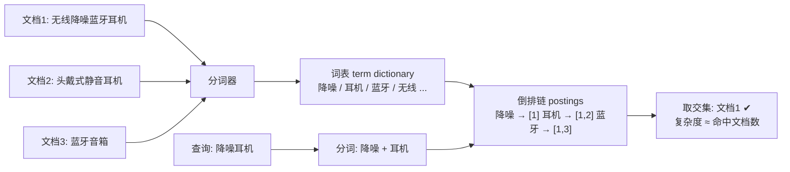
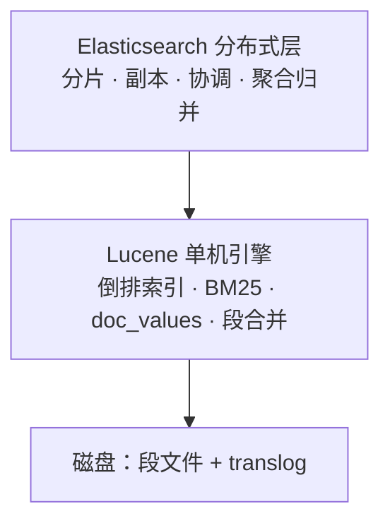
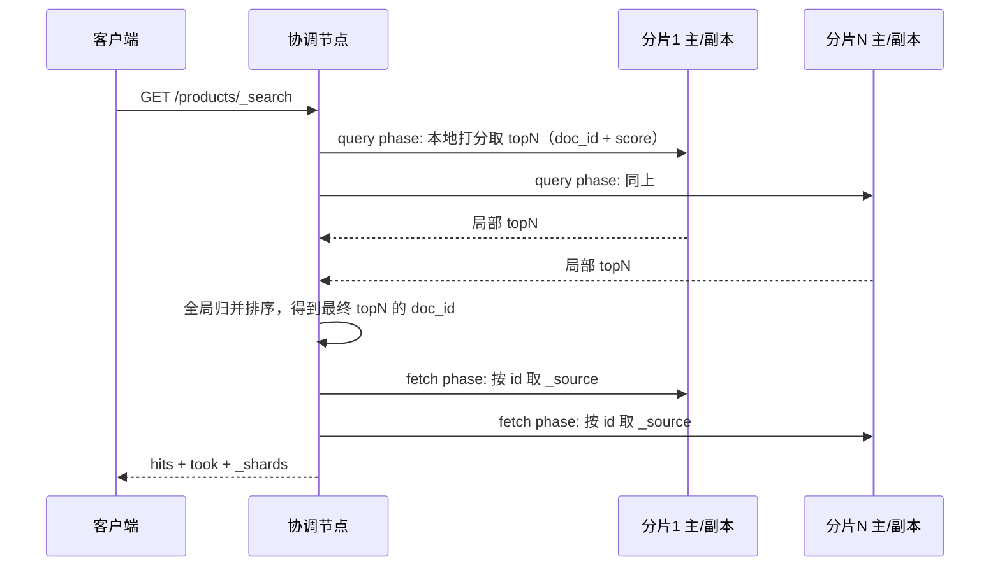

# MySQL 的 LIKE '%关键词%' 为什么救不了你？—— 为什么需要搜索引擎

> 属于 S11 Elasticsearch · 第一篇
> 下一篇：[倒排索引与分词](./02-倒排索引与分词)

先看一个真实到不能再真实的场面：商品表 500 万行，产品经理要"搜索框"。你写了一句 `WHERE title LIKE '%降噪耳机%'`，上线第一天就炸了——单次查询 800ms，CPU 打满；第 2 天用户搜"静音头戴式耳机"，一条都搜不出来；第 3 天用户把"降噪"打成"降躁"，还是搜不出来；第 4 天运营要求"相关性排序"，你发现 LIKE 压根没有"相关"这个概念，只能按销量排。

这一篇不急着讲 ES 怎么装、DSL 怎么写，先把最根上的问题说清楚：**搜索要解决的是三件事——匹配、排序、规模**，而 `LIKE` 一件事都办不好。理解了这一点，你才知道 ES 每个设计（倒排索引、分词器、BM25、分片）是在补哪个洞。

## 一、LIKE 到底差在哪

### 1.1 前导 `%` 直接废掉 B+ 树

MySQL 的索引是 B+ 树，靠"有序"做二分定位。`LIKE '降噪%'` 还能用上索引（找前缀起点，然后顺序扫），但 `LIKE '%降噪%'` 的前缀是未知的——B+ 树不知道该从哪个叶子节点开始找，只能**全表扫描**，然后对每一行做字符串包含判断。500 万行 × 每行一次字符串匹配，800ms 就是这么来的。

### 1.2 就算加了索引，也解决不了"词"的问题

`LIKE '降噪%'` 能用索引，但它做的是**字符串前缀匹配**，不是**词匹配**：

| 用户输入 | 库里的数据 | LIKE | 搜索引擎 |
|---------|-----------|------|---------|
| `降噪耳机` | `无线降噪蓝牙耳机` | 搜不到（不是前缀） | 搜得到（词命中） |
| `耳机 降噪` | `降噪蓝牙耳机` | 搜不到（顺序不同/有空格） | 搜得到（分词后取交集） |
| `降躁耳机` | `降噪蓝牙耳机` | 搜不到 | 搜得到（模糊/纠错，看配置） |
| `Bluetooth` | `bluetooth 耳机` | 依赖大小写排序规则 | 搜得到（分词时统一小写） |
| `降噪耳机` | `静音头戴式耳机` | 搜不到 | 搜得到（同义词表） |

搜索引擎在**建索引和查询时都过一遍分词器**（小写化、去停用词、切词、同义词、词干还原），所以它比对的是"词"，而 LIKE 比对的是"字符子串"。这是两套完全不同的模型。

### 1.3 没有"相关度"这个概念

LIKE 的返回结果是没有序的（实际按主键/索引序），你想按"相关"排只能人工拼规则。搜索引擎天然给每条命中文档一个**打分**（BM25），标题命中权重高于正文、短文档权重高于长文档、罕见的词权重高于常见的词——这些是打分公式自动算出来的。第 4 篇会把 BM25 拆开讲。

### 1.4 深分页与横向扩展

`LIMIT 200000, 20` 在 MySQL 上是扫掉 20 万行再丢掉；在 ES 里 `from + size` 也有同样的深分页问题（默认上限 10000），所以 ES 提供了 `search_after` / `scroll` 两种"游标式"翻页——这本身也说明：**搜索的翻页模型和数据库的 OFFSET 模型不是一回事**。

## 二、倒排索引：把"扫文档"换成"查词表"

数据库是**正排**视角：一行一条记录，你要找什么就逐行检查。搜索引擎反过来建**倒排**：先分词，记录"每个词出现在哪些文档里"。

一次查询的代价从"扫全表 500 万行"变成"在词表里定位两个词 → 取两条倒排链求交集"，**复杂度跟文档总数基本无关，只跟命中文档数有关**。这就是搜索能在十亿级文档上做到百毫秒的根本原因——不是机器多，是索引结构把问题降维了。

倒排索引的两个核心组件（第 2 篇细讲）：

- **词表（term dictionary）**：所有词的集合，用 FST（有限状态转换器）压进内存，定位词是 O(词长) 的；
- **倒排链（postings list）**：每个词对应的文档 ID 列表，ID 递增所以能压缩（增量编码 + 分块压缩），查询时用跳表（skip list）快速跳跃求交。

## 三、ES 是什么：Lucene 的分布式外壳

很多人把 ES 当"一个数据库"，其实它是三层：

- **Lucene** 是单机库：倒排索引、打分、列存、段合并、近实时刷新都在这里，它**没有集群概念、没有 HTTP 接口、也不处理 JSON**；
- **ES** 在 Lucene 之上加了三样东西：**分片副本**（把一个索引切成 N 个 shard 分布到多台机器、每个 shard 有副本）、**REST + JSON DSL**（查询语言）、**集群状态与协调**（路由、故障转移、聚合归并）；
- **生态**：Kibana（可视化）、Beats/Logstash（采集）、以及 8.x 起默认开启的安全（TLS + 内置账号）与机器学习能力。OpenSearch 是 7.10 之后的分叉，API 高度兼容，面试提到要能区分。

一次搜索请求的完整路径：

这就是著名的 **query-then-fetch** 两阶段：先只传 doc_id 和 score（数据量小），确定最终要哪些文档后再取内容。第 3 篇会展开。

## 四、什么时候该用 ES，什么时候别用

### 4.1 别把 ES 当主存储

这是实习生面试最容易踩的坑。ES 有四个硬伤：

| 硬伤 | 原因 | 后果 |
|------|------|------|
| **没有事务** | 单文档原子，多文档无 ACID | 扣库存/转账类业务不能用它 |
| **近实时** | 写完默认 1 秒后才可被搜到 | "写后立刻读"要特殊处理（第 5 篇） |
| **更新 = 删 + 重建** | 倒排索引不可原地改 | 高频更新的字段很贵 |
| **无 join / 弱约束** | 不支持外键、唯一约束 `_id` 之外 | 关系型数据必须冗余（宽表） |

正确姿势：**MySQL 存事实（主存储、事务、强一致），ES 存"检索视图"（冗余字段、宽表、可重建）**，通过 binlog/消息异步同步。ES 里的数据丢了可以从 MySQL 重建——这句话就是"ES 能不能当主存储"的标准答案。

### 4.2 该用与不该用的判断表

| 需求 | 别用 ES，用这个 | 用 ES |
|------|----------------|-------|
| 单表百万内、条件简单、精确匹配 | MySQL 索引 | ✘ |
| 后台模糊搜索、数据量不大 | MySQL `LIKE 'x%'` + 分页 | 可选 |
| 全文检索、同义词、拼音、纠错、相关性排序 | — | ✔ 主场 |
| 日志/指标检索（海量、按时间滚动） | ClickHouse（分析）、Loki（轻量） | ✔ 配 data stream + ILM |
| 多维聚合分析（大盘、报表） | ClickHouse / OLAP | 能用，但别当数仓 |
| 语义相似（向量）检索 | Milvus / Qdrant | 8.x 能，但规模大时用专用库 |
| 关键词 + 语义混合检索 | — | ✔ 8.x kNN + RRF（第 9 篇） |
| 账务、订单状态机 | MySQL/Oracle | ✘ 绝对不行 |

一句话记忆：**"搜"用 ES，"存"用 MySQL，"算"用 OLAP，"像"用向量库**。

::: warning 面试追问（3 层）
**Q1：为什么 MySQL 的全文索引（FULLTEXT）不能替代 ES？**——MySQL 的 FULLTEXT 依赖内置分词（中文基本按字切），不支持同义词/纠错/拼音/高亮/复杂相关性调优；且是单机能力，没有分布式分片与副本，撑不起海量检索与高可用。它适合"小表里搜一下"，不适合做搜索产品。
**Q2：既然 ES 不能当主存储，为什么很多公司还是把数据灌进 ES？**——因为定位不同：ES 是**读侧的可重建投影**，主数据仍在 MySQL。数据丢了从 binlog 重放即可回填；一致性靠异步同步 + 幂等写入 + 对账补偿，接受秒级最终一致。
**Q3：那什么时候可以"没有 MySQL、只有 ES"？**——日志、监控、埋点这类**追加写、按时间检索、无事务需求**的数据，ES 可以当唯一存储（配 data stream + 快照）。但凡涉及金额、订单状态、用户主数据的，必须有事务型主存储。
:::

## 五、和 S10 Milvus 的分工：关键词 vs 语义

学完 Milvus 再看 ES，最容易混的是"这两个到底谁干谁"。核心区别就一句：**Milvus 解决"意思相近"，ES 解决"字面命中"**。

| 维度 | ES | Milvus |
|------|-----|--------|
| 检索模型 | 倒排索引 + BM25（字面/词级） | 向量 ANN（语义/embedding 距离） |
| 强项 | 精确词、专有名词、型号、数字、聚合、高亮、拼写纠错 | 同义改写、口语化表达、跨语言、图片/音视频相似 |
| 过滤 | ★★★★★ 极强（bool/filter/geo/nested） | ★★★☆ 标量过滤下推 |
| 聚合分析 | ★★★★★ | ★☆☆☆ |
| 规模 | 十亿文档级（分片 + 副本） | 十亿向量级（PQ/磁盘索引） |
| 8.x 新能力 | `dense_vector` + kNN，能兼职向量检索 | — |

所以真实系统里两者经常**并存**：ES 出关键词候选（还带高亮和过滤），Milvus 出语义候选，再按 RRF 融合重排——这就是第 9 篇的混合检索。面试里被问"为什么不用 ES 一把梭"，答案要落在"向量规模上来之后，ES 的 kNN 内存与精度不如专用库；但中小规模、已有 ES 的团队，用 ES 做混合检索是最省事的"。

---

## 串起来

`LIKE '%x%'` 的问题不是"慢"一个字能概括的：B+ 树被前导 `%` 破坏、字符串匹配不懂"词"、没有相关度、深分页是 OFFSET 模型。倒排索引把"扫文档"换成"查词表"，复杂度从 O(全表) 降到 O(命中)，这是搜索能在十亿级文档上做毫秒响应的根。ES = Lucene（倒排 + 打分 + 列存 + 段）+ 分布式外壳（分片副本 + REST DSL + 协调归并）+ 生态。它的定位是**可重建的检索视图**，不是主存储；和 Milvus 的分工是"字面 vs 语义"。

下一篇往下一层：**倒排索引到底长什么样、分词器怎么把"降噪耳机"切成词**——倒排索引里存的是"词"，那"词"是怎么来的？这一层决定了你后面所有"为什么搜不到"的排查能力。

> 下一篇：[倒排索引与分词](./02-倒排索引与分词)
