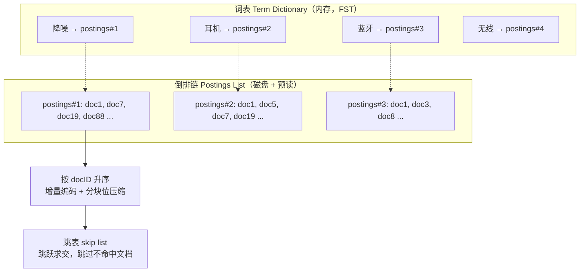

# 为什么搜"降噪耳机"能命中"无线降噪蓝牙耳机"？—— 倒排索引与分词

> 属于 S11 Elasticsearch · 第二篇
> 上一篇：[为什么需要搜索引擎](./01-为什么需要搜索引擎)
> 下一篇：[集群架构与读写路径](./03-集群架构与读写路径)

上一篇立了结论：倒排索引把"扫文档"换成了"查词表"。但这里藏着一个前提——**倒排表里存的是"词"，而"词"不是天然存在的**。"无线降噪蓝牙耳机"这八个字切不切成词、按什么规则切，直接决定了用户搜"降噪耳机"能不能命中、搜"耳机降噪"能不能命中、搜"降噪"会不会把"降噪耳机"和"降躁耳机"都算命中。

所以这一篇要拆两件事：**倒排索引内部长什么样**（为什么 10 亿文档还能毫秒），以及**分词器（analyzer）怎么把文本变成倒排表里的词**（为什么你搜不到，90% 的锅在这里）。

## 一、倒排索引的内部结构：词表 + 倒排链

一个索引里，每个字段（分词字段）都有自己的倒排表，可以拆成两部分：



### 1.1 词表：FST 为什么能压进内存

词表就是"所有出现过的词 + 指向倒排链的指针"。一个中文商品库，词可能有几百万个，直接存字符串哈希表要吃几百 MB。Lucene 用的是 **FST（有限状态转换器）**：把所有词构造成一个有向无环图，公共前缀/后缀只存一份（"降噪""降躁""降噪耳机"共享"降"分支），整体压到原大小的 1/10 左右，可以常驻内存。

查询一个词时沿 FST 走字符，复杂度是 **O(词长)**——跟词表里有多少词无关。这就是"查词快"的第一层保障。

### 1.2 倒排链：三个技巧让"求交集"变快

倒排链是"包含这个词的文档 ID 列表"，按 docID 升序：

- **增量编码**：存 `1, 7, 19, 88` 不如存 `1, 6, 12, 69`——差值小得多，变长编码后省空间；
- **分块位压缩**：Lucene 把 128 个 docID 一组，按这组里最大值的位宽统一压缩（Frame of Reference），解码时可以用 SIMD 批量算；
- **跳表（skip list）**：链上每 N 个元素建一个"跳点"，求交集时（`降噪` ∩ `耳机`）可以整段跳过不可能命中的区间，而不是逐个比对。

有了这三样，一次 `降噪 + 耳机` 的求交只需要读两条链里"有希望"的块，**代价跟命中文档数成正比，跟索引总文档数无关**。这是 ES 能扛十亿文档的底层原因，面试必答。

### 1.3 正排索引：排序和聚合靠另一套存储

倒排索引擅长"找文档"，但"按价格排序""按品牌聚合"需要的是反方向：从文档取字段值。

| 结构 | 方向 | 用途 | 说明 |
|------|------|------|------|
| **倒排索引** | 词 → 文档 | 检索、打分 | 只有 `text` 字段（分词字段）有 |
| **doc_values** | 文档 → 字段值（列存） | 排序、聚合、脚本 | 默认对所有非 text 字段开启；列存对磁盘友好 |
| **fielddata** | 文档 → 词（堆内存） | 对 text 字段做聚合/排序 | 默认关闭，开启会吃堆内存，通常应改用 keyword 子字段 |
| **_source** | 文档 → 原始 JSON | 返回结果、reindex、update | 存的是原始内容，可压缩；可以用 `_source: false` 或过滤字段省空间 |

顺带解释一个新手困惑：**为什么 text 字段不能直接排序/聚合？** 因为 text 只有倒排索引，没有 doc_values——"按标题排序"这件事没有意义（标题被切成了一堆词）；要做聚合就给它加一个 `keyword` 子字段（下一节）。

## 二、分词器：analyzer 的三段流水线

`analyzer` 的本质是一条流水线：**字符过滤器 → 分词器 → 词元过滤器**。


三个位置各自能做什么：

| 阶段 | 作用 | 典型插件 |
|------|------|---------|
| char_filter | 在切词**之前**清洗字符 | `html_strip`（去标签）、`mapping`（`&`→`and`）、`pattern_replace` |
| tokenizer | 把文本切成 token 流 | `standard`、`whitespace`、`keyword`（整串当一个词）、`pattern`、`ik_smart`/`ik_max_word`（中文） |
| token_filter | 在 token 上做变换/增删 | `lowercase`、`stop`（去停用词）、`stemmer`（英文词干）、`synonym_graph`、`edge_ngram`、`asciifolding`（去音标）、`pinyin` |

### 2.1 standard 分词器对中文是"按字切"

内置的 `standard` tokenizer 遵循 Unicode UAX#29 分词规则，对中文的处理是**逐字切分**。实测：

```json
POST /_analyze
{ "analyzer": "standard", "text": "降噪蓝牙耳机" }
// 结果: ["降","噪","蓝","牙","耳","机"]
```

这会造成两个后果：

- **召回噪声大**："降噪"变成"降"+"噪"两个词，搜"降"会把"下降""降低""降温"全捞出来；
- **没有语义边界**："耳机"被拆成两个字，`match_phrase`（短语匹配）在这种粒度下也失去意义。

所以中文必须换分词器，生产上用 **IK**（`analysis-ik` 插件）：`ik_max_word`（最细粒度，索引时用）和 `ik_smart`（最粗粒度，查询时用）是它的两种模式。

```json
POST /_analyze
{ "analyzer": "ik_max_word", "text": "无线降噪蓝牙耳机" }
// ik_max_word: ["无线","降噪","蓝牙","耳机","无线降噪","降噪蓝牙"]  ← 尽可能多切
POST /_analyze
{ "analyzer": "ik_smart", "text": "无线降噪蓝牙耳机" }
// ik_smart:    ["无线","降噪","蓝牙","耳机"]                        ← 语义最少切分
```

**推荐组合**：索引时 `ik_max_word`（切碎，提高召回）、查询时 `ik_smart`（切粗，保证精度），靠 `search_analyzer` 分别指定：

```json
PUT /products
{
  "settings": { "analysis": { "analyzer": { "ik_index": { "type": "custom", "tokenizer": "ik_max_word" } },
                              "analyzer": { "ik_query": { "type": "custom", "tokenizer": "ik_smart" } } } },
  "mappings": {
    "properties": {
      "title": { "type": "text", "analyzer": "ik_index", "search_analyzer": "ik_query",
                 "fields": { "kw": { "type": "keyword", "ignore_above": 256 } } }
    }
  }
}
```

### 2.2 索引时分析 vs 查询时分析

这是"为什么搜不到"的头号元凶，必须分清：

| 阶段 | 用什么分析器 | 说明 |
|------|-------------|------|
| 建索引（index time） | `analyzer` | 文档入库时把 text 切成词，写入倒排表 |
| 查询（search time） | `search_analyzer`（默认继承 `analyzer`） | 查询语句里的文本同样要切词，再去词表里查 |

于是有两个经典现象：

1. **`term` 查询不走分词**：`term: {"title": "降噪蓝牙耳机"}` 是拿整串去词表里精确找"降噪蓝牙耳机"这个词——词表里只有切好的"降噪""蓝牙""耳机"，所以查不到。**`term` 用于 keyword 字段（枚举/ID/标签），`match` 用于 text 字段**，这条线记住就不会错。
2. **索引和查询用了不同分词器**：比如索引用 `edge_ngram`（前缀爆破）而查询用 `standard`，前缀命中没问题；反过来查询被爆破就会失配。改分词器 = **重建索引（reindex）**，因为倒排表已经按旧规则写死了。

排查工具：`GET /_analyze` 看某段文本被切成什么；`GET /索引/_mapping` 确认字段类型；`GET /索引/_field_caps?fields=title` 快速看字段是 text 还是 keyword。**90% 的"搜不到"用这三条命令就能定位**。

::: tip 一个真实事故
商品标题字段早期被建成 `text`，运营后台要按标题精确查某个 SKU，用 `term` 查一直查不到，开发以为是数据同步问题，排查了两天才发现是分词器把"iPhone15 降噪版"切碎了。修法：加 `keyword` 子字段（`title.kw`），用 `term` 查 `title.kw`——不用重建索引，因为 `fields` 子字段可以后加（新增 mapping 是允许的，改已有字段类型才必须 reindex）。
:::

## 三、比"分词"更常见的需求：同义词、拼音、前缀

### 3.1 同义词：站在应用层加"语义"

"降噪"≈"静音"、"蓝牙耳机"≈"无线耳机"、"手机"≈"移动电话"。做法是 `synonym_graph` 过滤器（查询期生效，避免索引膨胀）：

```json
PUT /products/_settings
{
  "analysis": {
    "filter": { "my_syn": { "type": "synonym_graph", "synonyms_path": "analysis/synonyms.txt" } },
    "analyzer": { "ik_query": { "type": "custom", "tokenizer": "ik_smart", "filter": ["my_syn"] } }
  }
}
// synonyms.txt: 降噪, 静音, 消音
//              蓝牙耳机, 无线耳机
```

要点：**同义词表放查询侧**（`synonym_graph`），索引侧只放"必要的等价扩展"；同义词会放大召回，也放大噪声，要配合短语匹配和排序使用。

### 3.2 前缀搜索：`edge_ngram` vs `search_as_you_type`

搜索框的"边输入边提示"（auto-complete）需求，两种主流方案：

| 方案 | 做法 | 代价 |
|------|------|------|
| `edge_ngram` 分词 | 索引时把词的所有前缀都存进倒排表（`降`, `降噪`, `降噪蓝`…） | 索引膨胀几倍，查询走普通 `match` 即可 |
| `search_as_you_type` 字段类型 | 内置 2~3gram 的 ngram 字段族，单个字段搞定 | 索引更大，但查询写法简单 |
| `completion` suggester | 单独建 FST 前缀索引，内存型 | 只能做补全，不能参与打分/过滤 |
| `wildcard` 查询 | 运行时通配 | **前缀 `*abc` 会扫描全部词，禁止在生产用** |

`index_prefixes`（keyword 字段）是另一条轻量路线：只为 keyword 字段建 2~5 字符前缀索引，适合"ID/编号前缀查询"。

### 3.3 拼音、繁简、错别字

- **拼音**：`pinyin` 插件（`medcl`），把"降噪"变成 `jiangzao`/`jz`，用户打拼音也能搜到；通常加一个 `pinyin` 子字段，和原字段做 `multi_match` 的 `best_fields`；
- **繁简**：`smartcn` 或自建 char_filter 映射表；
- **错别字**：ES 8.x 有 `term` 级模糊（`fuzziness: AUTO`，编辑距离 1~2），但**模糊查询不能走前缀，性能差**，一般只对小字段或配合 `term` 的 `fuzzy` 参数使用，大促期间慎用。

## 四、中文分词选型的实话

| 分词器 | 优点 | 缺点 | 适用 |
|--------|------|------|------|
| `standard` | 内置、零依赖 | 中文按字切，噪声大 | 英文/多语言混合 |
| `ik`（IKAnalyzer） | 中文效果稳、词典可扩展 | 需装插件、词典要维护、未登录词一般 | 中文搜索主力 |
| `smartcn` | 内置模块、效果尚可 | 可定制性弱 | 不想装插件 |
| `pinyin` | 拼音/首字母输入 | 仅辅助字段 | 搜索框提示 |
| `jieba`（Go 端预处理） | 可以在写入侧切好再入库 | 与查询侧规则必须一致 | 特殊场景 |

**一个常被忽略的工程点**：分词器版本和插件版本必须与 ES 版本**严格一致**（`analysis-ik` 8.15.x 只能配 ES 8.15.x），升级 ES 时它是第一个要跟着升的插件；字典文件（`IKAnalyzer.cfg.xml`）支持热更新（配远程 URL），但**词典变了不会自动重刷已有倒排表**——新词只对新文档生效，老数据要 reindex 才吃到新词典。

---

## 串起来

这一篇的两条线：**倒排索引内部** = 内存 FST 词表（O(词长) 查词）+ 磁盘倒排链（增量编码/位压缩/跳表，求交代价 ∝ 命中数）+ doc_values 列存（排序聚合）+ `_source`（取回原始文档）。**分词器** = char_filter → tokenizer → token_filter 三段流水线；中文必须上 IK；索引期用 `ik_max_word`、查询期用 `ik_smart`；`term` 不走分词、`match` 走分词；索引期和查询期的分析规则不一致就是"搜不到"的头号原因。

下一篇往分布式走：一个索引被切成多个分片，一条文档写进去要经过几个节点、什么时候能被搜到、副本怎么保证不丢——**集群架构与读写路径**。

> 下一篇：[集群架构与读写路径](./03-集群架构与读写路径)
