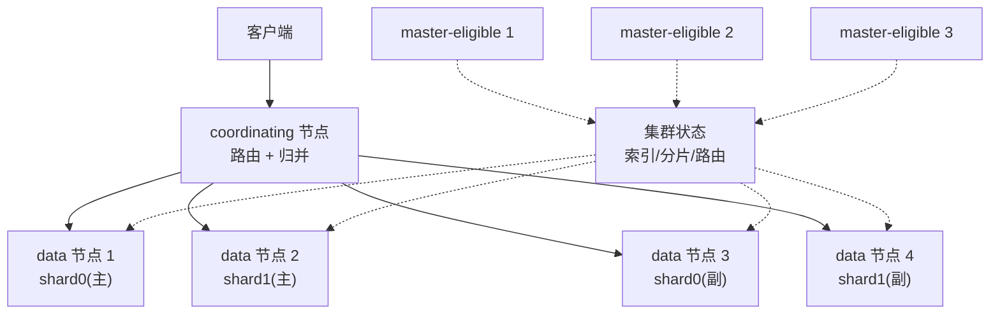
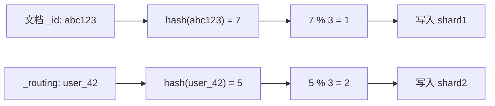
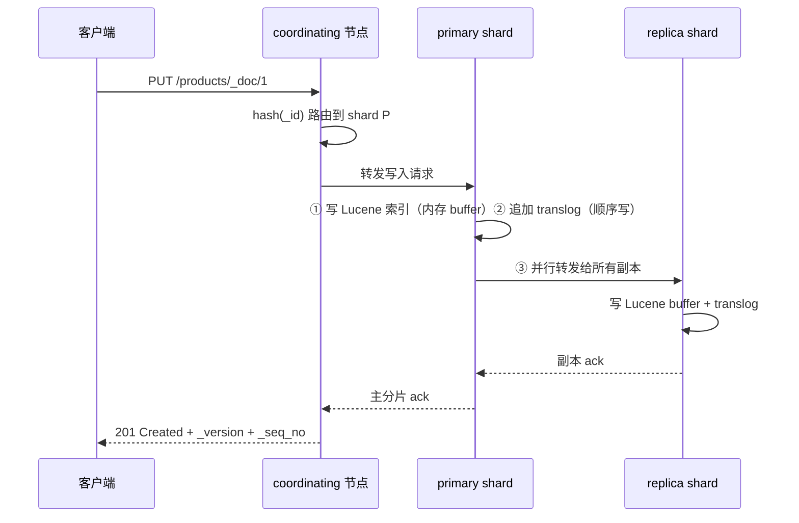
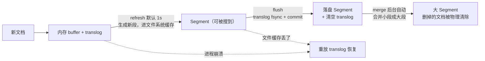
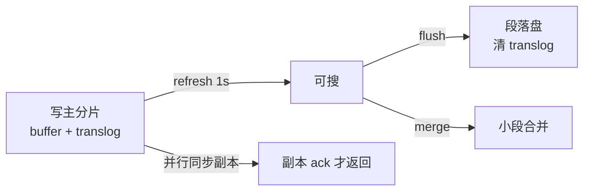
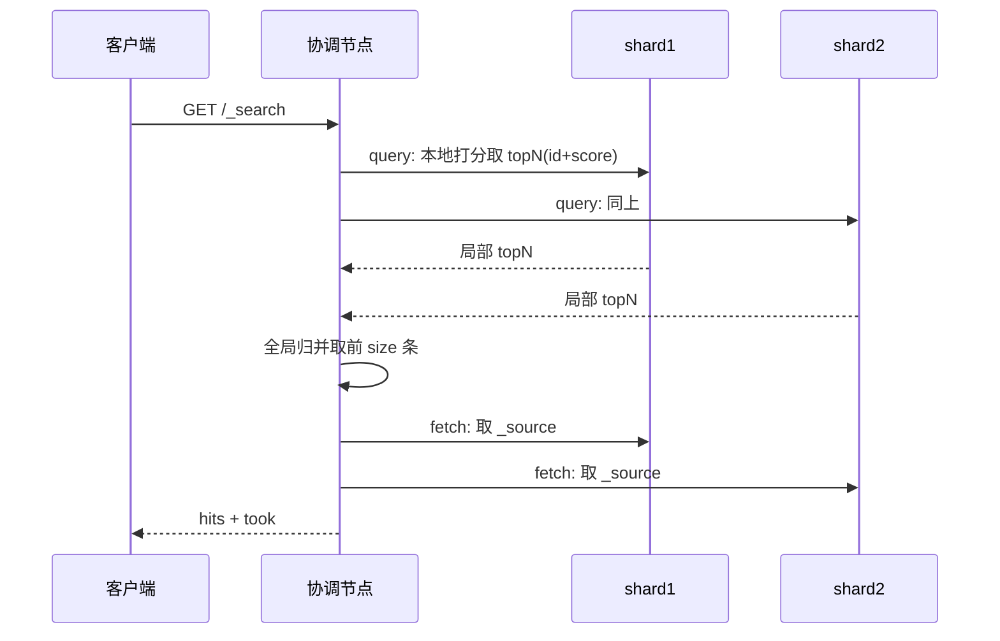

# 一条文档从写入到能搜到，到底经过了谁？—— 集群架构与读写路径

> 属于 S11 Elasticsearch · 第三篇
> 上一篇：[倒排索引与分词](./02-倒排索引与分词)
> 下一篇：[查询 DSL 与 BM25 打分](./04-查询DSL与BM25打分)

第二篇讲的是"单机单索引"的样子：Lucene 建倒排、搜索、返回。但线上 ES 是一个集群——一个索引被切成 N 个分片，散在 M 台机器上，还各有一份副本。于是"写一条文档"变成了：找哪个分片、写主分片、同步副本、写日志、刷段、合并；"搜一次"变成了：每个分片本地查 topN、协调节点归并、再按 docID 取回来。

这一篇把这两个路径完整走一遍。**理解了写路径，你就知道为什么"写后 1 秒才搜得到"、为什么"更新一条文档其实很贵"、为什么"段合并会打满磁盘 IO"；理解了读路径，你就知道深层分页为什么慢、为什么"两阶段取回"会被设计成这样。**

## 一、先认识集群里的几种节点

| 角色 | 干什么 | 配置 | 说明 |
|------|--------|------|------|
| **master-eligible** | 维护集群状态（元数据：索引/分片/路由表）、分配分片 | `node.roles: [master]` | 生产建议 3 台**专用** master（不是 1 台也不是偶数台），7.x 起用 quorum 选举，不再有脑裂 |
| **data（hot）** | 存数据分片、承担写入与热查询 | `node.roles: [data_hot]` | 通常配 SSD / 大内存 |
| **data（warm/cold/frozen）** | 老数据、只读查询 | `data_warm`/`data_cold`/`data_frozen` | 配合 ILM 分层降本（第 7 篇） |
| **ingest** | 写入前预处理（pipeline：改字段、加地理编码） | `node.roles: [ingest]` | 类似"轻量 ETL 前置" |
| **coordinating** | 只做请求分发与归并（不存数据、不当 master） | 不配置 data/master 角色 | 大集群单独拆出，抗住搜索扇出 |
| **ml / remote_cluster_client** | 机器学习任务 / 跨集群复制代理 | — | 按需 |



**集群状态（cluster state）** 是整个集群的元数据：有哪些索引、每个索引几个分片、分片在哪个节点上、路由表长什么样。它由 master 维护并推给所有节点，**节点数量多、分片数量多，状态就越大**——这是"分片别开太多"的另一个理由（第 6 篇展开）。

## 二、分片与路由：一条文档去哪

一个索引 = 若干**主分片（primary）**，每个主分片有若干**副本（replica）**。副本不参与写入的"决策"，只负责同步和读扩展。

文档落哪个分片，由路由公式决定：

```text
shard = hash(routing) % number_of_primary_shards
routing 默认 = 文档 _id（也可以用 _routing 自定义）
```



三个直接后果，面试高频：

1. **主分片数建好就改不了**，因为公式里的取模基数变了，所有文档的归属都会错位。要改只能**新建索引 + reindex + 别名切换**（第 5 篇给完整流程）。
2. **副本数可以随时改**（`PUT /索引/_settings {"number_of_replicas": 2}`），因为副本不参与路由计算，改了只是"多复制几份"。
3. **自定义 `_routing` 能把"同一类文档"钉在同一个分片**（比如按 user_id 路由），查询时带上 `routing=user_42` 就只查 1 个分片而不是 N 个——这是降低搜索扇出的经典手段，代价是可能产生**热点分片**（第 5 篇细讲）。

## 三、写路径：从请求到"可被搜到"

### 3.1 六个步骤



注意几件事：

- **只有主分片能收写**，副本由主分片转发同步（不是客户端直接写副本）；
- **写是"并行同步"**：主分片写完立刻转发副本，等待副本 ack（默认至少 1 个副本成功即返回，由 `wait_for_active_shards` 控制）；
- **translog 是 WAL**：数据先落 Lucene 内存 buffer 和 translog，进程崩了可以从 translog 重放，所以"写入成功后进程崩溃不丢数据"（前提是 translog 落盘策略）；
- 返回的 `_seq_no` / `_primary_term` 是后续做乐观并发控制的依据（第 5 篇）。

### 3.2 refresh / flush / merge：三个动作，三种"持久化"

写入之后数据在哪？分三段理解：



| 动作 | 触发 | 做了什么 | 回答什么问题 |
|------|------|---------|-------------|
| **refresh** | 默认每 1 秒自动 | 把内存 buffer 里的文档写入新的 Lucene 段（segment），段先进**文件系统缓存**，所以**可搜但未落盘** | "为什么写完要等 1 秒才搜得到？" |
| **flush** | 自动（按 translog 大小/时间）或 `POST /索引/_flush` | 对段做 fsync 落盘 + 写 commit point + 清空 translog | "数据什么时候真正落盘？" |
| **merge** | 后台自动（合并策略） | 把多个小段合并成大段，物理删除标记删除的文档 | "为什么磁盘 IO/CPU 会周期性飙高？" |

**这就是 ES 的"近实时"（NRT）**：数据写入后默认 1 秒才可被搜索到，不是设计缺陷，是为了让"每次写入都生成一个段"这件事不至于把 IO 打爆——**用可见性延迟换吞吐**。所以：

- 想在测试里立刻搜到：`POST /索引/_doc/1?refresh=true`（或 `refresh=wait_for`）；
- 批量导入时想快：把 `refresh_interval` 设成 `-1`，导完再恢复 `1s` 并手动 `_refresh`（第 6 篇性能篇会讲完整套路）。

**为什么"更新"很贵**：倒排索引不可原地修改，`POST /_update` 的本质是"读出 `_source` → 改字段 → **删除旧文档 + 写入新文档**"，一条 update 产生一次删除标记 + 一次新文档写入，还要同步所有副本。所以高频更新的字段别指望 ES 便宜。

一条文档的一生，用一张速查图收口：



（上图是"一条文档的一生"的速查版，与本节前面的 sequence 图对照看。）


### 3.3 写失败：副本挂了怎么办

- 主分片挂：节点被移出集群，**从副本里推举一个新主**（集群状态更新），写请求自动转到新主；
- 副本挂：主分片继续收写，但副本会进入 `unassigned`/恢复队列，追平后自动转正——**副本数量不足时，数据一致性风险上升**（只剩 1 份），所以 `wait_for_active_shards` 可以要求"至少几个分片活跃才写入"；
- 恢复（recovery）是靠**段文件复制 + 增量 translog 重放**：先拷段（大），再重放期间的新写（小）。

## 四、读路径：为什么一次搜索要"两阶段"

单个分片内，查询由 Lucene 完成；跨分片时，协调节点负责"扇出 + 归并"。



- **query phase**：每个分片本地打分，只把 `from+size` 个（docID, score）返回给协调节点——所以**分片越多，协调节点要归并的候选越多**；
- **fetch phase**：拿到最终名单后，再按 docID 去对应分片取 `_source`、做高亮。**两层分离的好处**：网络上传的只是 docID，不是整篇文档；
- **副本择优**：同一分片的多个副本里，协调节点默认挑"负载最低/最近"的那个（adaptive replica selection），所以**读请求会被随机分流到副本**——这也是"读一致性不保证"的根源（第 5 篇）。

### 4.1 为什么深层分页慢

`from=10000, size=20` 意味着**每个分片都要返回 10020 个候选**，协调节点归并 10020 × N 条，再丢掉前 10000 条。分片数越多、from 越大，越浪费。ES 默认把 `max_result_window` 卡在 10000，正是为了拦住这种"翻到第 500 页"的用法。解决方案是游标：`search_after`（配合排序 + PIT）或 `scroll`（导出全量）。第 4 篇详细对比。

### 4.2 一个被低估的优化：让协调节点少干活

- 查询里加 `"size": 0` 只做聚合/计数，跳过 fetch 阶段；
- 用 `_source` 过滤（`"_source": ["title","price"]`）减少取回体积；
- 只查必要字段时用 `stored_fields` 或 `docvalue_fields`。

## 五、分片规划：数量不是越多越好

分片是 ES 的"并行单位"，也是"管理成本单位"：

| 现象 | 分片太少 | 分片太多 |
|------|---------|---------|
| 写入 | 单分片写入串行，打不满机器 | 每个分片一个小段，段合并开销大，集群状态膨胀 |
| 查询 | 并行度低 | 协调节点扇出多，归并开销大，堆内存压力大 |
| 恢复 | 单分片恢复慢 | 恢复并发高，但每 GB 堆内存承载分片有限 |

经验数字（面试能落地的版本）：

- **单个分片 10~50GB**，超过就考虑加主分片（新索引 + reindex）；
- **每 GB 堆内存不超过 ~20 个分片**（含副本）；10GB 堆、2 副本、3 主分片 = 9 个分片，很宽松；但 1000 个分片 + 20GB 堆就会出问题；
- **堆内存 ≤ 32GB**（超过会失去指针压缩，反而更慢），且**不超过物理内存的 50%**（剩下的给文件系统缓存，ES 重度依赖它）；
- **副本数**：至少 1 副本（高可用），读 QPS 高可加到 2~3；
- 冷热分层：热数据少分片、快盘；冷数据用 ILM 迁到 warm/cold 节点并 `forcemerge` 成 1 段。

集群写满了怎么办：**加数据节点 → 自动 rebalance**（不改分片数）；如果要"改分片数"或"换 mapping"，只能**新建索引 + reindex + 别名切换**。

::: warning 面试追问（3 层）
**Q1：为什么主分片数不能动态改？**——路由公式 `hash(routing) % 主分片数` 里，主分片数是取模基数。改了它，所有文档的归属都会变，等于全量数据搬家。ES 没有提供在线改分片的 API，官方给的路就是 reindex。
**Q2：一个索引分片数怎么定？**——先估数据量：日增 500 万文档 × 1KB ≈ 5GB/天，保留 180 天 ≈ 900GB，按 30GB/分片 → 30 个主分片；再按"每 GB 堆 ≤20 分片"倒推堆内存与节点数；同时考虑峰值写入与查询并行度，宁可先少后多（未来加索引），不要一上来几百个分片。
**Q3：为什么要有 coordinating-only 节点？**——大集群里所有请求都经过"扇出 + 归并"，这步消耗 CPU 和堆；把它拆成专用角色，数据节点就只干存储和本地计算，避免"查询洪峰把数据节点打挂"。
:::

---

## 串起来

写路径：客户端 → 协调节点（hash 路由）→ 主分片（Lucene buffer + translog）→ 并行副本 → ack；数据先可搜（refresh 1s）后持久（flush），后台 merge 清理小段。读路径：query phase 各分片本地打分只回 docID+score → 协调节点归并 → fetch phase 按 docID 取 `_source`；副本择优导致读不保证一致。分片数量是"并行度 vs 管理成本"的权衡：单分片 10~50GB、每 GB 堆 ≤20 分片、堆 ≤32GB。

下一篇进入查询语言：**为什么同一个关键词，别人搜出来的排第一**——`bool` 查询的四种子句、`filter` 为什么比 `query` 快、BM25 到底怎么打分、深分页三种姿势怎么选。

> 下一篇：[查询 DSL 与 BM25 打分](./04-查询DSL与BM25打分)
