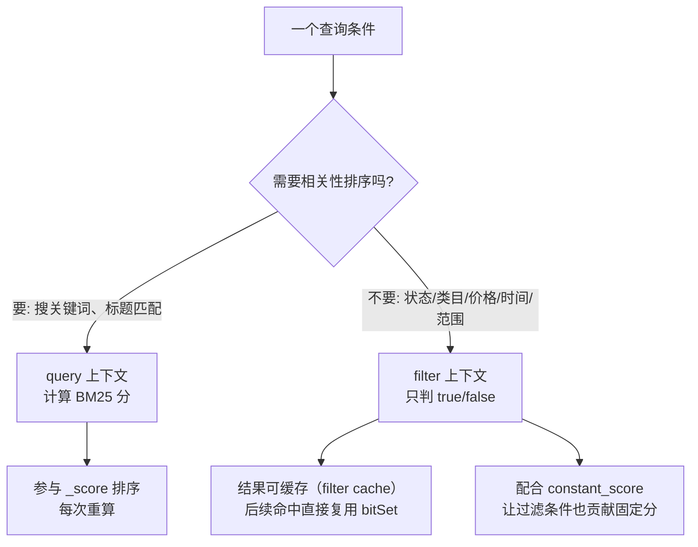
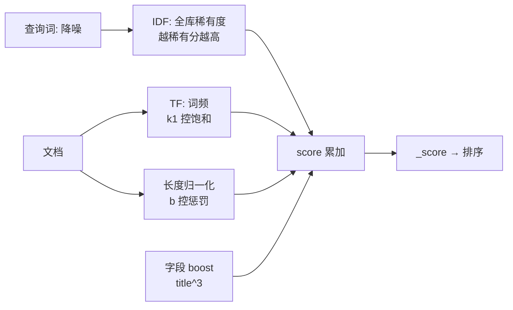
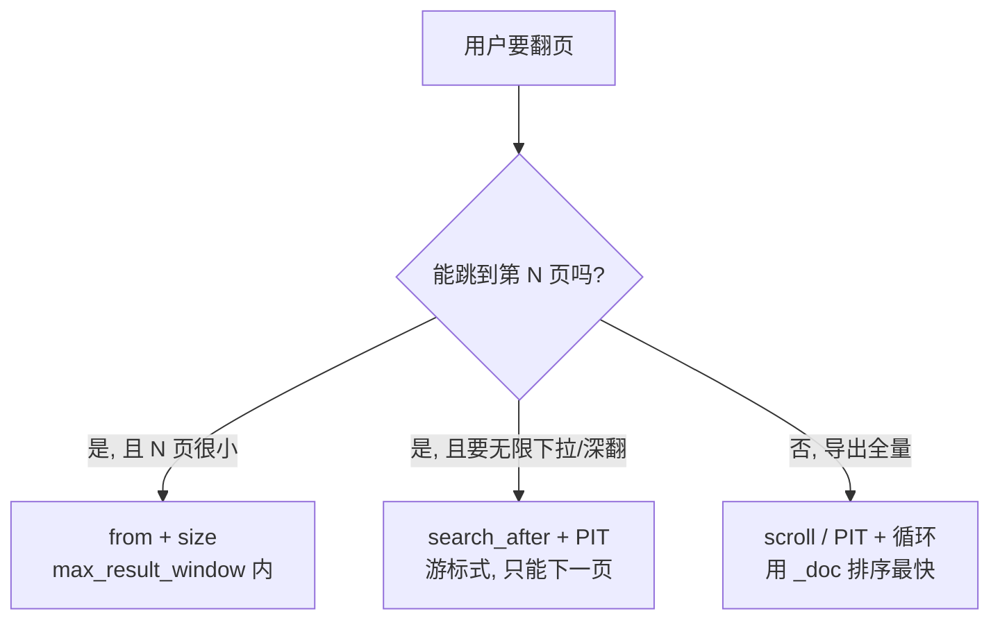

# 同一个关键词，为什么别人搜出来的排第一？—— 查询 DSL 与 BM25 打分

> 属于 S11 Elasticsearch · 第四篇
> 上一篇：[集群架构与读写路径](./03-集群架构与读写路径)
> 下一篇：[近实时、并发控制与索引重建](./05-近实时并发控制与索引重建)

上一篇讲了搜索在集群里怎么跑，这一篇讲**跑什么**：同样是搜"降噪耳机"，A 团队搜出来的第一条是用户真正想要的，B 团队搜出来的是关键词堆出来的垃圾。差距不在数据，在**查询 DSL 的写法 + 打分**。

这一篇覆盖面试里 80% 的 ES 查询题：`bool` 四子句、`query` vs `filter`、`term` vs `match`、BM25 怎么算、怎么调相关度、深分页三种姿势、聚合为什么"不准"。写法上以"一个电商商品搜索"贯穿到底。

## 一、bool 查询：四种子句决定一切

几乎所有复杂查询最后都会被包进 `bool`：

| 子句 | 是否参与打分 | 是否必须命中 | 缓存（filter cache） | 典型用法 |
|------|------------|-------------|---------------------|---------|
| `must` | ✔ | ✔ | ✘ | 全文检索条件（`match`），影响排序 |
| `filter` | ✘ | ✔ | ✔ | 精确条件：状态、类目、价格区间、时间范围 |
| `should` | ✔ | ✘（默认） | ✘ | 加分项/可选条件；`minimum_should_match` 控制必须命中几个 |
| `must_not` | ✘ | ✘（必须不命中） | ✔ | 排除：下架、屏蔽词、黑名单 |

```json
GET /products/_search
{
  "query": {
    "bool": {
      "must":   [ { "match": { "title": { "query": "降噪 耳机", "operator": "and" } } } ],
      "filter": [ { "term": { "status": "on_sale" } },
                  { "term": { "category.kw": "耳机" } },
                  { "range": { "price": { "gte": 100, "lte": 2000 } } } ],
      "should": [ { "match": { "brand": "索尼" } },
                  { "term": { "is_official": true } } ],
      "minimum_should_match": 0,
      "boost": 1.0
    }
  }
}
```

三条规则要背下来：

1. **能放 `filter` 的绝不放 `must`**。`filter` 不打分、可缓存、可跳过评分，同样的条件性能可能差好几倍；
2. **`should` 默认"有就行"**：在只有 `should` 的 `bool` 里，`minimum_should_match` 默认是 1；但只要同时存在 `must`/`filter`，`should` 默认就变成"可选加分"（`minimum_should_match` 默认 0）——这个默认值差异坑过很多人；
3. **打分结果不稳定**：同一查询在不同分片上算出的 IDF 可能不同（因为只看到本地分片的文档统计），想要全局一致得用 `search_type=dfs_query_then_fetch`（多一轮往返，精度换性能）。

## 二、query 与 filter：不是"两种写法"，是两种语义



- **filter 为什么快**：不计算打分，且结果（哪些文档命中）是"位图/bitSet"形式的缓存，相同的过滤条件第二次直接复用；同时 Lucene 在纯过滤时可以用**倒排链求交 + 跳表**跳过不命中段，根本没有打分开销；
- **cache 的边界**：有状态的过滤（`range` 对 `now` 的动态时间）缓存失效快；字段值变化后缓存失效；所以"时间范围过滤"通常仍能缓存，但别指望它一直命中；
- **`constant_score`**：把一组 filter 包起来给一个固定分数（默认 1.0），常用于"完全靠过滤、排序交给 sort"的场景：

```json
{ "query": { "constant_score": { "filter": { "term": { "category.kw": "耳机" } }, "boost": 1.0 } },
  "sort": [ { "sales_30d": "desc" } ] }
```

## 三、term / match / match_phrase / multi_match

| 查询 | 是否分词 | 用于 | 语义 |
|------|---------|------|------|
| `term` | ✘（整串精确匹配） | `keyword` 字段（状态、ID、标签） | 词表里精确找这个 term |
| `terms` | ✘ | 多值枚举 | 命中任意一个（IN） |
| `match` | ✔（分词后 OR） | `text` 字段 | 任一 token 命中即可，可 `operator: and` |
| `match_phrase` | ✔，且要求相邻 | `text` 字段 | 短语命中，`slop` 允许词间距离 |
| `match_bool_prefix` | ✔ | 搜索框"边输入边搜" | 最后一个词做前缀匹配 |
| `multi_match` | ✔，可跨字段 | 多字段 | `best_fields`（取最高分）/`most_fields`（累加）/`cross_fields`（跨字段拼词） |

几个必须会的细节：

- **`term` 查 text 永远查不到**（第 2 篇讲过原因），要么换 `.keyword` 子字段，要么用 `match`；
- **`match` 默认是 OR**：`"降噪 耳机"` 会命中"只有降噪"的文档，只是分低。想要"全都要"用 `operator: and`，或用 `minimum_should_match: "75%"` 控制命中比例；
- **`match_phrase` 的 `slop`**：`slop: 2` 表示两个词之间最多隔 2 个词；短语查询能显著提精度，代价是不能用 OR 扩展；
- **`multi_match` 的 `best_fields` 最常用**，配合 `fields: ["title^3", "desc"]` 做字段加权；`cross_fields` 适合"标题里是'降噪耳机'、描述里是'耳机降噪'"这种跨字段组合。

```json
{ "multi_match": { "query": "降噪耳机", "type": "best_fields",
                   "fields": ["title^3", "subtitle^2", "desc"],
                   "operator": "and", "tie_breaker": 0.3 } }
```

## 四、BM25：分数到底是怎么算出来的

`_score` 不是"有多像"，而是"这个词在文档里有多重要"。BM25 的直觉只有三条：**词在文档里出现越多分越高（tf）、这个词在全库越稀有分越高（idf）、文档越短越占便宜（长度归一化）**。

单个词元（term q）对文档 d 的打分：

```text
score(q, d) = IDF(q) × tf × (k1 + 1) / ( tf + k1 × (1 - b + b × |d| / avgdl) )
```

| 因子 | 含义 | 参数 |
|------|------|------|
| `IDF(q)` | 逆文档频率：词越稀有越重要 | `ln(1 + (N - n + 0.5)/(n + 0.5))`，不可调 |
| `tf` | 词频：出现次数越多越相关 | 上限被 k1 压制（防止堆词） |
| `|d| / avgdl` | 文档长度归一化 | `b` 控制强度 |
| `k1` | tf 的饱和速度 | 默认 **1.2**，越大越"词频敏感" |
| `b` | 长度归一化强度 | 默认 **0.75**，0=不惩罚长文档，1=完全按长度平摊 |



验证方式：对命中的文档加 `explain: true`，DSL 里能看到每个 term 的贡献明细。面试时能说出"标题命中比正文命中分高，是因为给的 **field boost** 大，且标题短、长度归一化也加分"，就到位了。

### 4.1 相关度调优的四种武器（按使用顺序）

| 武器 | 干什么 | 示例 |
|------|-------|------|
| **字段加权 `title^3`** | 标题命中权重更高 | `multi_match` 的 `fields` |
| **`boost`** | 对某个子句/条件加权（filter 上的 boost 无效） | `{ "match": { "brand": { "query": "索尼", "boost": 2 } } }` |
| **`function_score`** | 用函数改分：按销量、时间衰减、随机、脚本 | `gauss` 时间衰减让新上架排名靠前 |
| **`rescore`** | 对前 N 条候选做二次精排（低成本） | 粗排 top 100 → 精排 top 10 |

```json
{
  "query": {
    "function_score": {
      "query": { "match": { "title": "降噪耳机" } },
      "functions": [
        { "filter": { "range": { "created_at": { "gte": "now-7d" } } }, "weight": 1.5 },
        { "field_value_factor": { "field": "sales_30d", "modifier": "log1p", "factor": 0.1 } },
        { "gauss": { "created_at": { "origin": "now", "scale": "30d", "decay": 0.5 } } }
      ],
      "score_mode": "sum",
      "boost_mode": "multiply"
    }
  }
}
```

`score_mode`（函数之间怎么合）与 `boost_mode`（函数结果和查询分怎么合）是面试追问点：常用 `score_mode=sum` + `boost_mode=multiply`，让"相关度 × 业务权重"同时生效。

## 五、分页：三种姿势，选错了就慢

| 姿势 | 怎么写 | 适合 | 限制 |
|------|--------|------|------|
| `from + size` | `{"from": 20, "size": 20}` | 前几页 | 每个分片都要凑 `from+size` 个候选；默认 `max_result_window = 10000` |
| `search_after` | `{"search_after": [last_sort_value], "size": 20}` + 唯一 tiebreaker 排序 | 无限下拉、深翻页 | 不能跳页（只能下一页）；需要稳定排序字段 |
| `scroll` | `POST /索引/_search?scroll=1m` 循环取 | 全量导出、重建 | 持有快照占用资源；8.x 推荐用 PIT 替代 |
| `PIT`（Point in Time） | `POST /索引/_pit?keep_alive=1m` + `search_after` | 深分页且要一致快照 | 要显式关闭，否则一直占资源 |



两个加分细节：

- `search_after` 的排序字段必须**全局唯一**（常用 `[业务字段, _id]` 双键），否则边界文档会重复/丢失；
- 计数用 `track_total_hits: true` 才返回精确总数（默认只精确到 10000），或者用 `"size": 0` + `cardinality` 做近似计数，别在大表上默认要精确总数。

## 六、聚合：为什么"统计出来的数不对"

聚合分三类：**bucket（分组，如 terms/range/date_histogram）、metric（指标，如 avg/sum/cardinality）、pipeline（对桶再计算，如 bucket_selector）**。

```json
GET /products/_search
{
  "size": 0,
  "query": { "bool": { "filter": [ { "term": { "status": "on_sale" } } ] } },
  "aggs": {
    "by_brand": {
      "terms": { "field": "brand.kw", "size": 10, "order": { "_count": "desc" } },
      "aggs": { "avg_price": { "avg": { "field": "price" } } }
    },
    "uv": { "cardinality": { "field": "user_id", "precision_threshold": 40000 } },
    "by_day": { "date_histogram": { "field": "created_at", "calendar_interval": "day" } }
  }
}
```

聚合的四个"不准与不快"：

1. **`terms` 是近似的**：每个分片只返回本地 top N（`shard_size`，默认 `size*1.5+10`），协调节点合并后取全局 top N——**某个"长尾品牌"可能因为分布式统计被漏掉**。测不准时看响应里的 `doc_count_error_upper_bound`，调大 `shard_size`，或改用 `composite` 聚合做精确分页；
2. **`cardinality` 是 HLL 近似**（去重计数），`precision_threshold` 越大越准（≤40000 时误差很小）；
3. **聚合吃内存**：深桶/大基数聚合会触发 **circuit breaker**（`data too large`），要控制 `size`、加 `filter` 收窄范围；
4. **text 字段不能直接聚合**（没有 doc_values），必须用 `.keyword` 子字段。

## 七、一个完整示例：商品搜索一把梭

```json
GET /products/_search
{
  "size": 20,
  "track_total_hits": true,
  "_source": ["id", "title", "price", "brand", "image"],
  "query": {
    "function_score": {
      "query": {
        "bool": {
          "must": { "multi_match": { "query": "降噪耳机", "type": "best_fields",
                                     "fields": ["title^3", "subtitle^2", "desc"], "operator": "and" } },
          "filter": [
            { "term": { "status": "on_sale" } },
            { "term": { "category.kw": "耳机" } },
            { "range": { "price": { "gte": 100, "lte": 3000 } } }
          ],
          "should": [ { "term": { "is_official": true } } ],
          "minimum_should_match": 0
        }
      },
      "functions": [ { "field_value_factor": { "field": "sales_30d", "modifier": "log1p", "factor": 0.05 } } ],
      "score_mode": "sum",
      "boost_mode": "multiply"
    }
  },
  "sort": [ { "_score": "desc" }, { "_id": "asc" } ],
  "highlight": { "fields": { "title": { "pre_tags": ["<em>"], "post_tags": ["</em>"] } } },
  "aggs": { "by_brand": { "terms": { "field": "brand.kw", "size": 10 } } }
}
```

这个例子把本篇文章的零件都用上了：`must` 负责相关度、`filter` 负责收口、`should` 负责加分、`function_score` 混业务权重、`sort` 加了唯一 tiebreaker 为将来切换 `search_after` 留路、`highlight` 给前端标红、`size: 0` 的聚合另起一个请求。

::: warning 面试追问（3 层）
**Q1：为什么 `filter` 比 `query` 快？**——不打分（省掉 BM25 计算）、能跳过评分阶段、结果可缓存成 bitSet 复用。代价是 filter 里的条件不贡献 `_score`，需要时用 `constant_score` 或 `function_score` 补分。
**Q2：`terms` 聚合为什么可能漏桶？**——分布式聚合是"各分片返回本地 top shard_size → 协调节点合并"。某个桶只要在任何一个分片里没进本地 top，就会被漏掉。解法：调大 `shard_size`、加 `filter` 收窄、或用 `composite` 精确翻页。
**Q3：`from+size` 不能超过 10000，怎么支持"跳到第 500 页"？**——产品上先否掉"跳页"（改成下拉加载 → `search_after`）；确实要跳页，用 `search_after` + `PIT` 或 `scroll` 做游标；再不行是需求本身有问题（用户不会翻 500 页），应该改排序/筛选策略。
:::

---

## 串起来

`bool` 四子句各司其职：`must` 管相关度、`filter` 管收口（不打分可缓存）、`should` 管加分、`must_not` 管排除。`term` 是精确匹配（keyword）、`match` 是分词匹配（text）。BM25 = IDF × 词频饱和 × 长度归一化，靠 `title^3`、`boost`、`function_score`、`rescore` 四件武器调相关度。分页三姿势按"要不要跳页/要不要一致快照"选，深分页用 `search_after + PIT`。聚合是"近似 + 吃内存"的，`terms` 有误差、`cardinality` 是 HLL。

下一篇往"时间"维度走：**refresh 1 秒的窗口里，到底能不能读到刚写的数据？并发更新怎么不互相覆盖？mapping 改不了怎么办？**——近实时、乐观锁与索引重建。

> 下一篇：[近实时、并发控制与索引重建](./05-近实时并发控制与索引重建)
