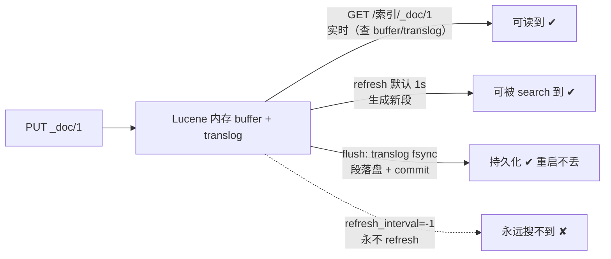
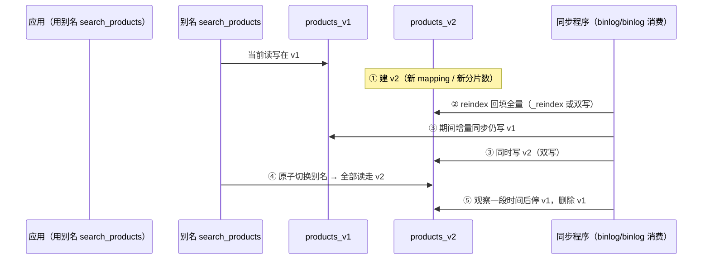
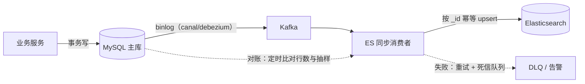

# 写完立刻查不到、两个线程互相覆盖—— 近实时、并发控制与索引重建

> 属于 S11 Elasticsearch · 第五篇
> 上一篇：[查询 DSL 与 BM25 打分](./04-查询DSL与BM25打分)
> 下一篇：[Mapping 设计与调优](./06-Mapping设计与调优)

第三篇讲了写路径的物理过程，但真正让业务同学抓狂的是三个"时间/并发"问题：

- 商品刚改完价格，刷新页面还是旧价，客服说"你们系统有 bug"；
- 两个后台运营同时改同一个商品的库存，后保存的把先保存的覆盖了，没人报错；
- 早期 mapping 把价格建成了 `text`，现在想排序——`PUT _mapping` 直接被拒，被告知"只能 reindex"。

这一篇就是这三件事的答案：**近实时（NRT）的边界、乐观并发控制、索引的无损重建**。它们共同指向一个认知：ES 是"可重建的检索视图"，它提供的不是数据库那种强一致，而是一套"最终一致 + 你负责兜底"的工程约定。

## 一、"写完能读到"到底分几层

ES 里有三种"读"，延迟完全不同：

| 读方式 | 走什么 | 延迟 | 说明 |
|--------|--------|------|------|
| **GET by id**（`/索引/_doc/1`） | 实时读：先查内存 buffer，再查 translog | 即时 | 单文档按 ID 读**是实时的**，因为它不需要倒排索引 |
| **search**（`/_search`） | 倒排索引（段） | 默认 **1 秒**（refresh 周期） | 文档要等 refresh 生成新段后才进倒排表 |
| **near-real-time 可见性** | 段可被搜索 | 1s | `refresh_interval` 可调 |



业务上的正确姿势：**"写后立刻按 ID 查详情"用 GET（实时）；"写后立刻要出现在列表/搜索里"要么接受 1 秒延迟，要么在写请求上带 `refresh=wait_for`**（阻塞到下一次 refresh 完成再返回，代价是慢）。

```json
// 写完等可见再返回（适合"改价后立刻要出现在搜索结果里"）
PUT /products/_doc/1?refresh=wait_for
{ "price": 199 }

// 批量导入：关掉定时 refresh，导入更快
PUT /products/_settings
{ "index": { "refresh_interval": "-1" } }
// ... 导入 ...
POST /products/_refresh
PUT /products/_settings
{ "index": { "refresh_interval": "1s" } }
```

## 二、translog：写到哪一步才算"不丢"

translog 是 ES 的 WAL。它的落盘策略决定"进程崩了/掉电了会丢多少"：

| `index.translog.durability` | 行为 | 丢数据窗口 | 适合 |
|----------------------------|------|-----------|------|
| `request`（默认） | **每个写请求**都 fsync translog | 0 | 生产默认，安全 |
| `async` | 后台每 `sync_interval`（默认 5s）fsync | ≤5s | 批量导入、可重放的场景 |

所以批量导入时常见的调优组合是：

```json
// 灌数据前：关 refresh、临时去副本、translog 改异步（数据可从 MySQL 重放才这么干）
PUT /products/_settings
{
  "index": {
    "refresh_interval": "-1",
    "number_of_replicas": 0,
    "translog": { "durability": "async", "sync_interval": "5s" }
  }
}
// 导完：恢复 1s / 1 副本，手动 refresh
```

**代价要说清楚**：副本为 0 时节点挂了数据就没了；`async` 时掉电最多丢 5 秒。所以这套参数只在"数据可重建（从 MySQL/binlog 重放）"的灌数据场景用，导完必须恢复。

## 三、写入的"确认级别"：`wait_for_active_shards`

一次写请求默认只需要**主分片**成功就返回（`wait_for_active_shards=1`）。副本是异步追的，所以"接口返回成功" ≠ "所有副本都有"。

| 值 | 含义 |
|----|------|
| `1`（默认） | 只要主分片 ack 即可 |
| `quorum` | 需要 `(primary + replicas)/2 + 1` 个分片活跃（更安全） |
| `all` | 所有分片都 ack（最安全最慢，副本挂了就写入失败） |

```json
PUT /products/_doc/1?wait_for_active_shards=quorum
{ "title": "降噪耳机" }
```

`quorum` 是"多数派确认"的思想：容忍少数副本落后，但保证不会出现"主分片刚写就被仲裁换掉、导致数据回退"的极端情况。

## 四、读一致性：ES 不保证，你要知道怎么应对

- 副本是**异步**同步的，读请求又会**随机挑副本**（ARS），所以"写完立刻搜，可能搜到旧数据"；
- refresh 之后新段可搜，但**不同副本的 refresh 进度可能不同**，所以同一个查询打到不同副本，结果可能有"秒级抖动"；
- 没有"读己之写"（read-your-writes）的内建保证。

工程上的兜底手段（按推荐顺序）：

1. **业务上接受最终一致**：搜索列表 1 秒延迟可接受，这是最省事的；
2. **关键操作用 GET by id 读**（实时）；
3. **写时 `refresh=wait_for`**：保证写返回时数据已可见（会影响吞吐）；
4. **用 `preference=_local` 或固定 routing**：让同一用户/请求尽量打到同一个分片副本，减少"漂移感"——注意这**不是**一致性保证，只是缓解；
5. **版本号/`_seq_no` 校验**：前端拿到旧数据时用 `if_seq_no` 更新会拿到 409，避免覆盖。

## 五、并发更新：用 `_seq_no` + `_primary_term` 做乐观锁

ES 没有行锁，`POST /_update` 的"读-改-写"是**非原子**的，两个并发更新会互相覆盖。解决办法是**乐观锁**：文档自带版本信息，更新时带上你看到的版本，版本对不上就失败。

| 机制 | 字段 | 说明 |
|------|------|------|
| 内部版本 | `_version` | 每次写 +1，`?version=N` 可做条件更新（老 API，简单场景够用） |
| 序列号 + 主分片任期 | `_seq_no` + `_primary_term` | 7.x 起的推荐方式，跨副本/主分片切换后依然正确 |

```json
// 1. 读：拿到当前 _seq_no 与 _primary_term
GET /products/_doc/1
// { "_seq_no": 12, "_primary_term": 1, "_source": {"price": 199} }

// 2. 带版本更新：版本不匹配 → 409 冲突，由调用方决定重试或放弃
PUT /products/_doc/1?if_seq_no=12&if_primary_term=1
{ "price": 189, "updated_by": "ops_a" }

// 3. 冲突返回：{"error":{"type":"version_conflict_engine_exception"}}
```

- **`_primary_term` 的作用**：主分片切换（节点故障）后任期 +1，同样的 `_seq_no` 在不信任的新主上不会误判成功——这是"防止主分片切换导致版本校验失效"的关键；
- **冲突处理**：读最新版本重试（有限次）或返回"请刷新后重试"；**不要**无限重试，那是热点更新；
- **`update` 的原子性**：脚本更新（`ctx._source.price = params.price`）在**单文档内是原子的**，适合"计数器 +1"这类场景，但注意**不能用 ES 做高并发计数器**（更新 = 重写文档 + 同步副本，热点文档会把分片打满）；
- **批量更新的冲突**：`_update_by_query` 用 `conflicts=proceed` 继续跑，用 `conflicts=abort` 快速失败；它本质是"读一批 → 改 → 写回"，不是事务。

## 六、mapping 改不了？三步零停机重建

mapping 只能**加字段**，不能改字段类型（`text` → `keyword`、改分词器都不行），因为倒排表已经按旧规则写死了。官方出路是 **新建索引 + reindex + 别名切换**，用别名（alias）对上层屏蔽索引名：



关键点：

- **`POST /_reindex?wait_for_completion=false` 异步跑**，用 `_tasks` 看进度；大索引按时间分片/scroll 分批，别一次性拉爆；
- **`_reindex` 期间的新写入必须双写或补做增量**，否则切过去会丢窗口期数据；
- **别名切换是原子的**：一个请求里 `remove v1` + `add v2` 同时执行，客户端无感知；
- **新分片数**也可以借此机会改（reindex 到不同分片数的索引），但**改了分片数就改了路由**，`_id` 相同的文档会落到不同分片——所以 reindex 后按 ID 查询仍然正确（因为 GET 用 `_id` 实时查），但 `_routing` 自定义的要重算。

## 七、数据库到 ES 的同步：三种姿势与它们的坑

ES 是可重建的检索视图，主数据在 MySQL。同步方式三选一：

| 方案 | 做法 | 一致性 | 复杂度 |
|------|------|--------|--------|
| **同步双写** | 业务代码里先写 DB 再写 ES（或事务外） | 弱（ES 失败要补偿） | 低，但耦合业务 |
| **异步消息（推荐）** | 业务写 DB → 发 MQ（或 binlog CDC）→ 消费者写 ES | 最终一致（秒级） | 中，需幂等 + 重试 |
| **定时全量** | 定时扫描增量/全量重建 | 分钟~小时级 | 低，但延迟大、对账成本高 |



四条铁律：

1. **写入必须幂等**：用业务主键当 `_id`（`PUT /索引/_doc/{订单号}`），重复消费只会覆盖成同一结果；
2. **删除要能同步**：逻辑删除给个 `status=deleted` 字段 + 查询时 `filter` 掉，或直接 `DELETE`——注意 ES 删除是打标记，段合并后才物理删除；
3. **失败要能补偿**：消费失败进死信队列 + 告警 + 定时对账（抽样比 `count` 与 `_id` 抽查）；
4. **顺序要可控**：同一文档的更新如果乱序到达，用 `version`/`_seq_no` 或"消息里带版本号，旧版本丢弃"来防回退。

::: warning 面试追问（3 层）
**Q1：ES 为什么默认 1 秒才可见？能改成 0 吗？**——`refresh_interval` 可设 `0`（或更小的 ms 值），但每次写都触发段生成，吞吐会塌；1s 是"可见性 vs 写入吞吐"的默认折中。想看"写后立即读"，用 GET by id（实时）或写时 `refresh=wait_for`。
**Q2：`_version` 和 `_seq_no` 有什么区别？**——`_version` 是文档级自增计数（简单但主分片切换后语义弱）；`_seq_no` 是分片内单调递增序列号，配合 `_primary_term`（主分片任期）能在主分片切换后依然正确判断"这个版本是不是我读到的那个"。
**Q3：reindex 到新索引后，为什么还要留别名？**——别名让"索引名"和"物理索引"解耦：改 mapping、改分片数、改分词器都通过"建新索引 → reindex → 切别名"完成，应用代码零改动；别名还能做读写分离（写指向 v2、读指向 v1+v2 的过渡期）。
:::

---

## 串起来

- **实时性**：GET by id 实时；search 默认 1s（refresh）；持久化靠 flush（translog fsync）；`refresh_interval` 和 translog durability 是"吞吐 ↔ 安全"两个旋钮。
- **一致性**：副本异步 + 读随机挑副本 = 不保证读己之写；用 GET、`refresh=wait_for`、版本校验兜底。
- **并发**：`_seq_no + _primary_term` 乐观锁，冲突返回 409 由调用方重试；单文档脚本更新原子，但别拿 ES 当高并发计数器。
- **演进**：mapping 改不了 → 新索引 + reindex + 别名原子切换；DB→ES 同步走异步消息 + 幂等 + 对账。

下一篇转向"建索引时的设计决策"：**mapping 怎么写才不踩坑、分片数怎么定、批量导入怎么快 10 倍、哪些查询写法会拖垮集群**。

> 下一篇：[Mapping 设计与调优](./06-Mapping设计与调优)
