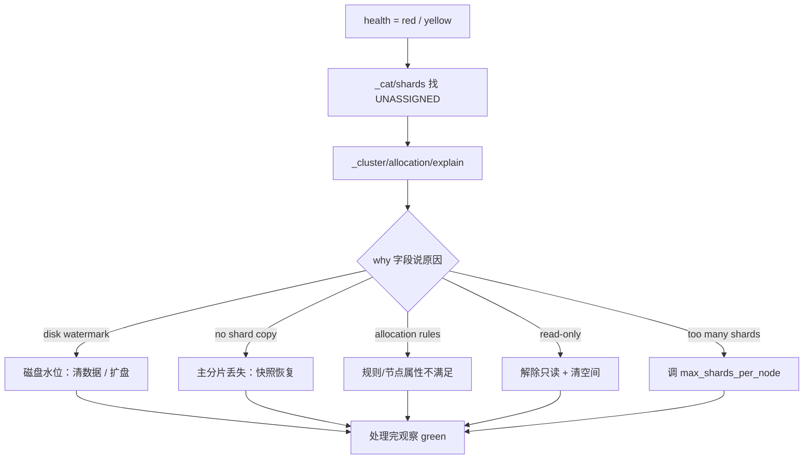

# 集群变红、分片分配不上、写入被拒—— 生产运维与故障排查

> 属于 S11 Elasticsearch · 第七篇
> 上一篇：[Mapping 设计与调优](./06-Mapping设计与调优)
> 下一篇：[用 Go 把 ES 接进服务](./08-Go实战-搜索服务)

前六篇建立的模型是"正常情况下它怎么跑"。真实值班不是这样：凌晨两点告警"集群 health 是 red"、早上发现"分片一直 unassigned"、大促前"bulk 全被拒了 429"、磁盘 90% 后"索引变只读写不进去"。

这一篇是按"症状 → 定位命令 → 根因 → 处理"组织的运维手册。面试里"集群红了怎么办"是高频题，答出**决策树 + 具体命令 + 根因清单**，比背概念有用得多。

## 一、先立资源基线：部署时就要对

| 项 | 推荐 | 原因 |
|----|------|------|
| JVM 堆 | **≤ 32GB**，且 ≤ 物理内存 50% | 超过 32GB 失去压缩指针（OOP），反而更慢；剩下内存给文件系统缓存（ES 的段文件缓存全靠它） |
| swap | 关闭 | 换页会让 GC 停顿不可控 |
| `vm.max_map_count` | ≥ 262144 | Lucene 用 mmap 打开大量文件，太低会 `max virtual memory areas` 报错 |
| 文件描述符 | 65536+ | 每个段都是文件 |
| 磁盘水位 | low **85%** / high **90%** / flood **95%**（默认） | 超过 high 不再分配分片；超过 flood 索引变只读 |
| 主节点 | 3 台**专用** master-eligible（`node.roles: [master]`） | 7.x 起 quorum 选举，不再有脑裂；专用避免数据节点负载拖死选举 |
| 分片总数 | ≤ 堆 GB × 20 | 每个分片都有常驻元数据开销，太多会拖垮 master 与协调节点 |

## 二、集群健康三色：red / yellow / green 到底指什么

| 状态 | 含义 | 业务影响 |
|------|------|---------|
| **green** | 所有主分片和副本都分配好了 | 正常 |
| **yellow** | 所有**主分片**都分配好了，但有副本没分配 | **读写正常**，只是少一份冗余（有数据风险） |
| **red** | 至少一个**主分片**没分配 | **部分数据不可读、不可写**（该分片的所有请求失败） |

所以"红"和"黄"的严重性差了量级：**yellow 可以慢慢修，red 要立刻处理**。

## 三、red / yellow 排查决策树



### 3.1 三个必会命令

```bash
GET  /_cluster/health?level=indices          # 哪个索引不健康
GET  /_cat/shards?v&h=index,shard,prirep,state,node,unassigned.reason
POST /_cluster/allocation/explain             # 针对 unassigned 分片给出原因（最关键）
GET  /_cat/indices?v&s=store.size:desc        # 谁在占空间
```

`_cluster/allocation/explain` 的 `why` 字段会直接告诉你"磁盘 91% 超过 high 水位，不允许分配"或者"该分片的主分片数据在节点 X 上已损坏"。**先看 explain，再动手**——这一步能省掉 80% 的瞎试。

### 3.2 unassigned 分片常见根因清单

| 根因 | 典型报错/现象 | 处理 |
|------|--------------|------|
| 磁盘水位超限 | `low disk watermark [85%] exceeded` | 清理旧索引/扩大磁盘/调 `cluster.routing.allocation.disk.watermark.*` |
| 索引只读（flood 阶段） | `index read-only / allow delete` | `PUT /索引/_settings {"index.blocks.read_only_allow_delete": null}` |
| 分片数超限 | `maximum shards open` | 调 `cluster.max_shards_per_node`（默认 1000）或减分片 |
| allocation 规则不满足 | `allocation deciders` | 检查 `index.routing.allocation.require/include/exclude` 与 `node.attr` |
| 节点角色缺失 | `node does not have the [data] role` | 加数据节点 / 改 `node.roles` |
| 版本不兼容 | `version mismatch` | 滚动升级完成前不要用新版本特性 |
| 主分片数据丢失 | `no shard copy available` | 从快照恢复；或用 `POST /索引/_close` + `allocate_stale_primary` 强分配（会丢数据） |
| 索引被关闭 | `closed` 状态 | `POST /索引/_open` |
| 快照/恢复进行中 | freeze/恢复阻塞 | 等或处理 |

### 3.3 "磁盘满了"的完整处置

1. 磁盘到 **95%（flood）** → 相关索引自动 `read_only_allow_delete`，写入全部失败；
2. 先删数据（最老的日志索引/快照归档），或临时调低副本（`number_of_replicas: 0` 能立刻省一半空间）；
3. 解除只读：
   ```json
   PUT /索引/_settings { "index.blocks.read_only_allow_delete": null }
   ```
4. 如果水位是"临时误报"（比如刚删完数据还没回收），可以调高阈值（治标）：
   ```json
   PUT /_cluster/settings { "persistent": { "cluster.routing.allocation.disk.watermark.high": "92%" } }
   ```

## 四、写入被拒：429 与线程池

```json
{ "error": { "type": "es_rejected_execution_exception",
             "reason": "rejected execution of coordinating operation [...]" },
  "status": 429 }
```

这是**背压**，不是 bug：线程池队列满了，ES 主动拒绝以保护自己。常见队列与默认值（可调）：

| 线程池 | 用途 | 默认队列 | 打满的表现 |
|--------|------|---------|-----------|
| `write` | index/bulk/update | 1000~10000（视版本） | bulk 429，写入变慢 |
| `search` | 查询 | 1000 | 查询 429 |
| `get` | 按 ID 读 | 1000 | GET 也会 429 |

处理原则：

1. **客户端退避重试**（指数退避 + 抖动），不要死循环重试——重试风暴会把集群彻底打死；
2. **降低写入并发**，或增大 bulk 批大小（减少总请求数）；
3. **别盲目调大队列**：队列只是缓冲，调大只会把"快速失败"变成"长时间排队 + 超时"，真正的解法是加节点/减少单次请求开销/降低 merge 压力；
4. **监控 `thread_pool.*.rejected` 与 `queue`**，它是"集群过载"最直接的指标。

## 五、断路器与堆内存告警

```json
{ "error": { "type": "circuit_breaking_exception",
             "reason": "[parent] Data too large, data for [<http_request>] would be [...]" } }
```

断路器是 ES 的"内存保险丝"：估算一次查询要用的堆内存，超过阈值就直接拒绝，避免 OOM 把节点打死。

| 断路器 | 默认阈值 | 触发场景 |
|--------|---------|---------|
| `parent`（总） | 堆的 **95%** | 任意查询/聚合总量超限 |
| `fielddata` | 堆的 **40%** | text 字段做排序/聚合走了 fielddata |
| `request` | 堆的 **60%** | 单次请求（如大聚合、大 bulk）占用过多 |
| `in_flight_requests` | 堆的 **100%** | 大量未完成请求累积 |

排查：先 `GET /_nodes/stats/jvm` 看堆使用与 GC，再 `GET /_nodes/stats/breaker` 看是哪个断路器触发；`GET /_nodes/hot_threads` 看线程卡在哪。

**fielddata 断路器被触发**几乎总是设计问题：对 `text` 字段做了排序/聚合 → 加 `keyword` 子字段，别开 `fielddata: true`。

## 六、段合并：那个周期性打满 IO 的元凶

批量导入或高写入场景下，段（segment）数量暴涨，后台 merge 线程拼命合并 → **磁盘 IO 与 CPU 飙高、查询变慢**。

```bash
GET /索引/_segments            # 看段数量与大小
GET /_nodes/stats/thread_pool  # 看 merge 队列
```

处理：

- 导入完成后对**只读索引**执行 `POST /索引/_forcemerge?max_num_segments=1`（后台执行，大索引很慢，低峰做）；
- **绝不**对正在高频写入的索引 force merge（会反复触发 merge 风暴）；
- 日志类用 `data stream` + ILM，warm 阶段自动 `forcemerge` + `shrink`。

## 七、快照、ILM 与滚动重启

### 7.1 快照是"最后的保险"

```json
PUT /_snapshot/my_repo
{ "type": "s3", "settings": { "bucket": "es-snap", "base_path": "prod" } }

PUT /_snapshot/my_repo/snap-2026.10.21?wait_for_completion=false
{ "indices": "products", "include_global_state": false }

POST /_snapshot/my_repo/snap-2026.10.21/_restore
{ "indices": "products", "rename_pattern": "products", "rename_replacement": "products_restored" }
```

- 快照是**增量**的（相同段只存一次），所以频率可以高；
- 恢复时**必须改名或恢复成新索引**，不能直接覆盖正在用的索引；
- 用 **SLM**（snapshot lifecycle management）定时拍，别靠人肉；
- 生产还要配 **CCR**（跨集群复制）或异地集群做容灾。

### 7.2 ILM：日志数据的自动分层

```text
// 概念示意（实际用 _ilm/policy 定义）
hot    → rollover（按大小/时间滚动索引），写 SSD
warm   → forcemerge 到 1 段、shrink 减少分片，只读
cold   → 迁到低配节点
delete → 保留 N 天后删除
```

日志/监控类数据必须上 `data stream` + ILM：**手建"按天索引 + 定时删除脚本"是老思路，容易把 master 压垮**（索引数量爆炸）。

### 7.3 滚动重启与升级

```text
① 停止写入（或接受短暂降级）→ ② POST /_flush 落盘
③ 逐个节点：停 → 升级/改配置 → 启动 → 等节点加入且分片恢复
④ 全部完成后确认 green，恢复写入
```

要点：**一次只动一个节点**；先升数据节点，**master 最后升**（7.x 起 master 可最后升级，因为选举协议兼容）；升级前检查所有插件（尤其 IK）有对应版本。

::: warning 面试追问（3 层）
**Q1：集群 yellow 要紧吗？red 呢？**——yellow 只是副本缺失，读写正常但少一份冗余，可排期修；red 表示有主分片没分配，对应数据不可读写，属于 P0，必须立刻用 `_cluster/allocation/explain` 定位。
**Q2：为什么建议堆内存 ≤32GB？**——JVM 开启压缩指针（compressed oops）的边界大约在 32GB，超过后对象指针从 4 字节变 8 字节，同样的堆反而能装的对象变少、GC 压力更大；正确做法是"多个 30GB 堆的节点"而不是"一个 64GB 堆的节点"。
**Q3：bulk 全被 429 拒绝，除了加机器还能怎么办？**——先降并发、增大单批大小（减少请求数）、客户端指数退避；再排查是否 merge 线程打满（导入后 forcemerge 放低峰）、是否有大聚合/大 terms 在抢资源；队列大小别乱调，它只是把失败推迟成超时。
:::

---

## 串起来

生产运维的心法：**先看健康三色，再问 allocation/explain，最后才动手**。red = 主分片没分配，yellow = 副本没分配；磁盘水位（85/90/95）同时决定"能不能分配"和"能不能写"；429 是背压不是故障，退避 + 降并发 + 查 merge；断路器是内存保险丝，触发得先看是不是 fielddata 滥用。最后两件保命的事：**快照（SLM 定时 + 异地）+ ILM（日志自动分层）**，以及"一次一个节点"的滚动升级纪律。

下一篇换到写代码的视角：**Go 服务怎么接 ES**——客户端选型、bulk 的逐条错误处理、search_after 分页、ES 挂了怎么降级。

> 下一篇：[用 Go 把 ES 接进服务](./08-Go实战-搜索服务)
