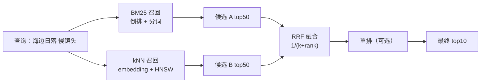
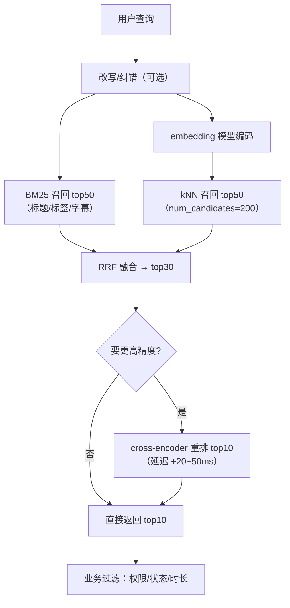

# 关键词 + 向量一起搜，为什么比单一方式准？—— 混合检索与 AI 应用落地

> 属于 S11 Elasticsearch · 第九篇
> 上一篇：[用 Go 把 ES 接进服务](./08-Go实战-搜索服务)
> 下一篇：[面试题集](./10-面试题集)

前八篇讲的是"传统搜索"。但 2024 年之后，你的岗位 JD 上写的是 AI 应用：**剪辑素材检索**（"海边日落 慢镜头 无人声"）、**字幕/ASR 全文搜索**、**知识库问答**，这些场景里用户输入的是自然语言，而不是商品关键词。于是出现了一个新的组合：**倒排 + BM25（字面）** 和 **向量 + ANN（语义）** 一起用。

这一篇收口：ES 8.x 怎么存向量、kNN 怎么查、为什么 RRF 融合比简单加权靠谱、什么时候该上 Milvus 而不是 ES。

## 一、两种检索的边界：谁也替代不了谁

| 查询 | 关键词检索（BM25） | 向量检索（kNN） |
|------|------------------|----------------|
| `iPhone 15 Pro Max 256G` | ✔ 精确命中型号/容量 | ✘ 数字、型号容易丢（embedding 对数字不敏感） |
| `降噪耳机` vs 文档"ANC 主动降噪" | ✘ 字面不匹配 | ✔ 语义相近 |
| `海边日落 慢镜头` | 只能命中字面含这些词的素材 | ✔ 能召回"金色夕阳下的海浪慢动作" |
| 错别字/拼音/同义词 | 需要词典维护 | ✔ 天然鲁棒（也有限） |
| 专有名词、代码、错误码 | ✔ | ✘ 常常召不回 |
| 可解释性 | ✔ 能高亮命中词 | ✘ 只能算相似度分数 |
| 资源成本 | 倒排 + 少量内存 | 向量索引常驻内存，$$$ |
| 精确过滤（状态/时间/类目） | ★★★★★ | ★★★（依赖过滤下推） |

结论很清晰：**关键词擅长"精确"，向量擅长"意思"**。用户真实输入往往两者混合（"帮我找上周拍的日落延时，要 4K 的"），所以生产系统的主流做法是**双路召回 + 融合排序**。



## 二、ES 8.x 的向量能力：`dense_vector` + kNN

### 2.1 建字段

```json
PUT /media_clips
{
  "mappings": {
    "properties": {
      "title":       { "type": "text", "analyzer": "ik_max_word" },
      "transcript":  { "type": "text", "analyzer": "ik_max_word" },
      "tags":        { "type": "keyword" },
      "duration_ms": { "type": "integer" },
      "created_at":  { "type": "date" },
      "embedding": {
        "type": "dense_vector",
        "dims": 1024,
        "index": true,
        "similarity": "cosine",
        "element_type": "float"
      }
    }
  }
}
```

- **`index: true`** 才会建 HNSW 图（否则只能逐条算距离，没法 kNN）；
- **`similarity`** 三选一：`cosine`（文本/图片语义，最常用）、`dot_product`（内积，向量已归一化时等价）、`l2_norm`（欧氏）；**8.x 用 `dot_product` 替代了旧的 `max_inner_product`**；
- **`element_type`**：`float`（4 字节/维）或 `byte`（量化后的 1 字节/维，省内存、精度略降）；
- **`index_options`**（8.15+）：可调 HNSW 的 `m` 与 `ef_construction`；早期版本内部固定 M=16、ef_construction=100。

### 2.2 kNN 查询

```json
GET /media_clips/_search
{
  "size": 10,
  "knn": {
    "field": "embedding",
    "query_vector": [0.12, -0.33, /* ... 1024 维 ... */],
    "k": 10,
    "num_candidates": 100,
    "filter": { "bool": { "filter": [ { "term": { "tags": "4k" } },
                                      { "range": { "created_at": { "gte": "now-30d" } } } ] } }
  },
  "_source": ["title", "tags", "created_at"]
}
```

| 参数 | 含义 | 影响 |
|------|------|------|
| `k` | 返回多少条 | 上限 10000 |
| `num_candidates` | **每个分片**参与精算的候选数（默认 1.5×k） | 越大召回越高、延迟越高 |
| `filter` | 标量过滤**下推**到 kNN 图搜索里 | 先过滤后搜索，避免"搜出 100 条再过滤掉 90 条" |
| `similarity` | 在 mapping 里定 | 改它必须重建索引 |

**内存成本要提前算**：1024 维 × float32 × N 条。100 万条 ≈ 4GB 原始向量 + HNSW 图开销（约 1.2~1.5 倍）。**这也是 ES 做向量检索的上限所在**——超过几千万条，专用向量库（Milvus 的 PQ/DiskANN）更划算。

### 2.3 混合检索：一次请求里同时做 BM25 和 kNN

ES 8.4+ 支持在同一个请求里写 `query` + `knn`（或并行多个 `knn`），8.14+ 引入 **`rrf` retriever**：

```json
GET /media_clips/_search
{
  "retriever": {
    "rrf": {
      "retrievers": [
        { "standard": { "query": { "multi_match": { "query": "海边日落 慢镜头", "fields": ["title^2", "transcript"] } } } },
        { "knn": { "field": "embedding", "query_vector": [...], "k": 50, "num_candidates": 200 } }
      ],
      "rank_constant": 60
    }
  },
  "size": 10
}
```

如果集群版本低于 8.14，就在应用层发起两次查询再自己融合——**融合算法推荐 RRF**。

## 三、RRF：为什么"按名次融合"比"按分数加权"靠谱

两路召回的分数**不可比**：BM25 是 0~30 的无上界分数，余弦相似度是 0~1。直接 `0.3×bm25 + 0.7×cos` 需要大量调参，而且换个查询分布就失效。

**RRF（Reciprocal Rank Fusion）** 只看名次，不看分数：

```text
RRF(d) = Σ_i  1 / (k + rank_i(d))       // k 通常取 60
```

- 一路排第 1 名给 `1/(60+1)`，排第 50 名给 `1/110`；两路都在前列的文档得分自然最高；
- **无量纲、无需调参、鲁棒**——这是它能成为混合检索"默认融合算法"的原因（论文里 k=60 是经验值，对结果不敏感）；
- 面试加分：能说出"RRF 假设各路召回器的分数不可比，只信任排序"这一层。

Go 里手写 RRF 只要几十行：

```go
func fuseRRF(rankings [][]string, k float64) []string {
	scores := map[string]float64{}
	for _, ranking := range rankings {
		for i, id := range ranking {
			scores[id] += 1.0 / (k + float64(i+1))
		}
	}
	ids := make([]string, 0, len(scores))
	for id := range scores { ids = append(ids, id) }
	sort.Slice(ids, func(i, j int) bool { return scores[ids[i]] > scores[ids[j]] })
	return ids
}
```

## 四、ES 向量 vs Milvus / Qdrant / pgvector：选型表

| 维度 | ES 8.x kNN | Milvus | Qdrant | pgvector |
|------|-----------|--------|--------|----------|
| 定位 | 搜索 + 向量（顺带） | 纯向量数据库 | 纯向量 + payload 过滤 | PG 扩展 |
| 向量规模 | 百万~千万 | 十亿级（PQ/DiskANN） | 千万~亿 | 百万~千万（HNSW 索引） |
| BM25/全文 | ★★★★★ 原生 | ☆ | ★★ 简单全文 | ★ PG 全文/trgm |
| 混合检索 | 内置（8.14+ RRF） | 需应用层融合 | 需应用层融合 | 需应用层融合 |
| 聚合/分析 | ★★★★★ | ☆ | ★★ | ★★★（SQL） |
| 过滤 | 极强（nested/geo/脚本） | 强 | ★★★★★ payload 索引 | ★★★★ SQL |
| 运维 | 已有 ES 团队则最省心 | 独立组件，重 | 中等 | 最轻（有 PG 就行） |
| 事务/事务性写入 | ✘ | ✘（流式） | ✘ | ✔ ACID |

**选型口诀**：**文档/日志/关键词搜索是主战场 → ES；纯向量 + 亿级 → Milvus；已有 PG、数据 < 千万 → pgvector；要强 payload 过滤 + 中等规模 → Qdrant**。混合检索优先在 ES 里做（少一个组件、天然带 BM25 和过滤）；向量规模压不住时再拆"ES 召回关键词 + Milvus 召回向量 + 应用层 RRF"。

## 五、落地到剪映类 AI 剪辑场景

三个典型检索需求，对应三套建模：

| 需求 | 数据 | 方案 |
|------|------|------|
| **素材语义检索**（"海边日落 慢镜头"） | 素材标题 + 标签 + 视觉 embedding（关键帧） | BM25（标题/标签）+ 向量（关键帧 embedding）+ RRF |
| **字幕/ASR 全文搜索**（"这句台词在第几秒"） | ASR 转写文本 + 时间戳 | 纯 BM25（分词 + `match_phrase` + 高亮），**不需要向量** |
| **知识库问答（RAG）检索** | 文档 chunk + embedding | BM25 + kNN + RRF，再交给 rerank/LLM |

### 5.1 数据建模的三个细节

1. **chunk 与时间戳**：字幕/ASR 按"Sentence + start_ms + end_ms"切分，ES 里存 `start_ms/end_ms`，查询命中后直接返回时间区间，前端就能定位到"第 12 秒"；
2. **embedding 必须和查询用同一个模型**：换 embedding 模型 = 全量重算向量 + 重建索引（`dims` 变了 mapping 也变不了）；
3. **向量字段尽量放独立索引**：把 `embedding` 和"用于 BM25 的文本"放不同索引，可以分别扩缩容、分别重建（一个索引用 3 分片存文本、一个用 6 分片存向量），也是 Milvus 拆分的过渡态。

### 5.2 召回 → 融合 → 重排



**代价要算清楚**：RRF 融合几乎零成本（纳秒级），cross-encoder 重排才是大头（每对 query-doc 一次模型推理，top30 就是 30 次）。所以常见配置是 **BM25/kNN 各 50 → RRF 取 30 → 重排取 10**，重排服务独立部署、可降级跳过。

::: warning 面试追问（3 层）
**Q1：为什么 ES 做混合检索要 RRF，不能直接加权分数？**——BM25 与余弦相似度量纲不同、分布随查询变化，加权系数必须随场景调参且泛化差；RRF 只用名次，天然对不同召回器可比，k=60 时对结果不敏感，是工业界默认。
**Q2：kNN 里 `num_candidates` 和 `k` 的关系？**——`k` 是最终要的条数；`num_candidates` 是每个分片在图搜索时参与精算的候选数（默认 1.5k），越大召回越高、延迟越高。分片越多，全局候选是各分片候选的并集，所以分片多时 `num_candidates` 可以适当减小。
**Q3：什么情况下不应该用向量检索？**——精确匹配类（型号、错误码、ID、代码）、数据量小（BM25 足够）、延迟预算极紧（向量编码 + 图搜索有固定开销）、以及 embedding 模型领域不匹配（效果可能不如关键词）。"全都要向量"是常见误区。
:::

---

## 串起来

AI 应用的检索层不是"上向量就完事"：**关键词管精确、向量管语义、RRF 管融合、重排管精度、过滤管权限**。ES 的独特价值在于它**同时**提供 BM25、强过滤、聚合和高亮，8.x 的 kNN + RRF 让"一套系统做混合检索"成为可能；当向量规模到亿级、内存吃紧时，再把向量部分拆给 Milvus（S10），这是最自然的演进路径。数据建模上盯住三件事：chunk + 时间戳、embedding 与查询同模型、文本与向量可独立扩缩容。

最后一篇收口：**把 S11 全部高频面试题按"问题 → 参考答案 → 追问三层"过一遍**，每题一句记忆点。

> 下一篇：[面试题集](./10-面试题集)
