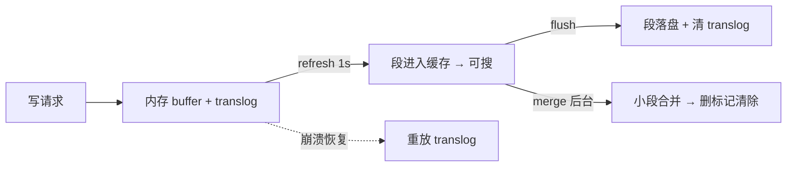
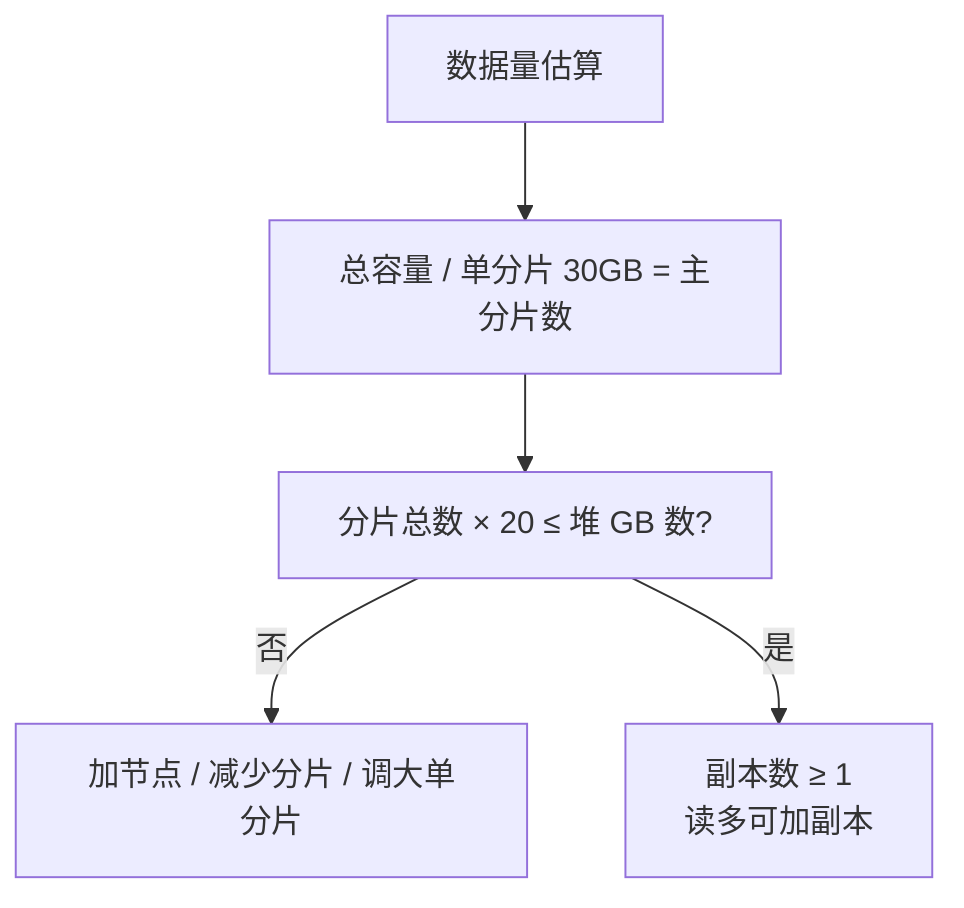
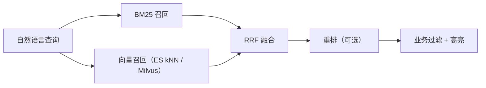

# 搜索面试，连问三层都不慌—— Elasticsearch 面试题集

> 属于 S11 Elasticsearch · 收口篇
> 上一篇：[混合检索与 AI 应用落地](./09-混合检索与AI应用落地)

S11 的高频面试题都在这了，12 道题，每题按"**问题 → 参考答案 → 追问1 → 追问2 → 追问3 → 记忆点**"练到三层。答题姿态很重要：先给结构化结论（分点、带数字），再往深里讲机制，最后把话题引回你自己的项目（素材检索、日志检索、RAG）——这是实习生面试最加分的节奏。

面试前 30 分钟，只扫每题末尾的**记忆点**和最后的**速答表**就够。

## Q1：倒排索引是什么？为什么比 MySQL 的 LIKE 快这么多？

**参考答案**：
1. **正排 vs 倒排**：数据库按"行"存，要找内容只能逐行比对；倒排索引按"词"建表——`词 → 包含它的文档 ID 列表`。查询时先对查询词分词，再去词表里定位，然后取倒排链求交。
2. **两个组件**：**词表（term dictionary）** 用 FST 压缩后常驻内存，定位词是 O(词长)；**倒排链（postings list）** 存 docID，按升序排列后做增量编码 + 分块位压缩，配合**跳表**加速求交。
3. **为什么快**：代价从 `O(全表行数 × 字符串匹配)` 变成 `O(命中文档数 × 链长)`，跟索引总文档数基本无关；再叠加分片并行（各分片本地算 topN）+ 两阶段取回（query 只传 docID），十亿文档做到百毫秒级是结构决定的，不是机器堆出来的。

**追问1：为什么 MySQL 的 LIKE 救不了？** 前导 `%` 让 B+ 树无法定位起点，只能全表扫；而且 LIKE 是字符子串匹配，不懂分词、同义词、纠错，也没有相关性排序。

**追问2：词表为什么用 FST 而不是哈希表？** 哈希表存全量字符串吃内存；FST 把公共前后缀共享，压缩到 1/10 左右还能支持前缀扫描（自动补全/前缀查询就靠它）。

**追问3：既然倒排这么快，为什么还要 doc_values？** 排序、聚合、脚本需要"文档 → 字段值"的方向，倒排给不了，所以非 text 字段默认建列存 doc_values（列式、按需解压）；text 没有 doc_values，对它排序聚合会退化为堆内存 fielddata——这是很多人踩的坑。

> 记忆点：**倒排 = 词表（FST 内存）+ 倒排链（压缩+跳表）；代价 ∝ 命中数，不 ∝ 文档总数**；排序聚合靠 doc_values。

## Q2：分词器是什么？中文搜索为什么一定要换 IK？

**参考答案**：
1. 分词器（analyzer）是流水线：**char_filter（清洗字符）→ tokenizer（切分）→ token_filter（小写/停用词/同义词/词干）**。
2. 内置 `standard` 对中文是**逐字切**："降噪蓝牙耳机" → `降/噪/蓝/牙/耳/机`，导致召回噪声大、短语失去意义。
3. 生产中文用 **IK**：索引期 `ik_max_word`（切细，提高召回）、查询期 `ik_smart`（切粗，保证精度），mapping 里分别配 `analyzer` / `search_analyzer`。
4. **`term` 不走分词**（拿整串去词表精确匹配），**`match` 走分词**；text 字段用 `term` 查不到是设计使然，要精确匹配就加 `.keyword` 子字段。

**追问1：索引时分词和查询时分词不一致会怎样？** 词表里的词和查询产出的词对不上，直接"搜不到"。典型例子：索引用 `edge_ngram` 爆破、查询用 `standard`；或索引换了分词器但没 reindex。

**追问2：同义词该放索引期还是查询期？** 一般放**查询期**（`synonym_graph`），避免索引膨胀；索引期只放必要的等价扩展。同义词放查询期 = 改词表立即生效，不用重建索引。

**追问3：为什么升级 ES 大版本要先升 IK？** 分词器插件与 ES 版本强绑定（`analysis-ik` 8.15.x 只能配 ES 8.15.x），插件没跟上会导致节点起不来或分词行为变化——升级检查清单第一项。

> 记忆点：**standard 切字 → 中文必须 IK；索引 ik_max_word、查询 ik_smart；term 不分词、match 分词**。

## Q3：一条文档写进 ES，经历哪些步骤？什么时候能搜到、什么时候不丢？

**参考答案**：
1. **路由**：协调节点 `hash(_id) % 主分片数` 找到主分片；
2. **主分片写**：数据进 Lucene 内存 buffer + **translog**（WAL，默认每个请求 fsync）；
3. **副本同步**：主分片并行转发给所有副本，副本写自己的 buffer + translog，全部 ack 后返回（`wait_for_active_shards` 控制确认级别）；
4. **refresh（默认 1s）**：buffer 刷成一个新的 Lucene 段，段进文件系统缓存，**此时可被 search 到**；
5. **flush**：段 fsync 落盘 + 写 commit point + 清空 translog，**此时持久化**；
6. **merge**：后台把小段合并成大段，物理删除已删文档。



**追问1：为什么"更新"一条文档比"插入"贵？** 倒排不可原地改，`_update` 是"读 `_source` → 改 → 删旧 + 写新"，一次更新产生一次删除标记和一次完整写入，还要同步所有副本；高频更新字段不适合放 ES。

**追问2：refresh 和 flush 的区别？** refresh 只让文档"可见"（生成段，进缓存，可丢）；flush 才让文档"持久"（fsync + commit point）。所以服务重启后数据不丢靠 translog + 段文件，不靠 refresh。

**追问3：段合并为什么会让查询/写入变慢？** merge 是后台 IO 与 CPU 密集操作，和应用读写抢磁盘带宽；大批量导入后堆出大量小段，查询要扫的段变多、缓存命中率下降。只读索引用 `_forcemerge` 合并成 1 段，但**不要在活跃写入索引上 force merge**。

> 记忆点：**buffer+translog → refresh 1s 可搜 → flush 持久 → merge 清理**；更新 = 删+重写。

## Q4：为什么写完立刻搜不到？怎么解决？

**参考答案**：
1. 因为 search 走倒排索引，而新文档要等 **refresh**（默认 1 秒，可调 `index.refresh_interval`）生成新段后才能被搜到——这是**近实时（NRT）**，用可见性延迟换写入吞吐。
2. 三种解法按场景选：
   - **按 ID 读详情**：`GET /索引/_doc/id` 是**实时**的（查 buffer/translog），不受 refresh 影响；
   - **写后要立刻出现在列表**：写请求带 `?refresh=wait_for`（阻塞到下次 refresh 完成再返回），代价是延迟；
   - **测试/调试**：`?refresh=true` 立即刷新（生产别用，批量场景会打爆）。

**追问1：能把 refresh_interval 改成 0 吗？** 能，但每个写请求都触发段生成，写入吞吐会塌；只能用于"极低频写入 + 强实时"的特殊索引。

**追问2：ES 能保证"读己之写"吗？** 不能。副本异步同步、读请求随机挑副本（ARS），所以先写的文档可能读到旧值。工程上用 GET by id、`refresh=wait_for`、版本号校验兜底，业务上接受秒级最终一致。

**追问3：批量导入怎么加速？** `refresh_interval: -1` + `number_of_replicas: 0` + `translog.durability: async` + 5~15MB 的 bulk，导完恢复参数并 `_refresh`，只读索引再 `_forcemerge`。前提：数据可重建（能从 MySQL/消息重放）。

> 记忆点：**search 1s 可见、GET 实时；refresh=wait_for 保写后可见；NRT 是拿可见性换吞吐**。

## Q5：两个运营同时改同一商品，怎么防止互相覆盖？

**参考答案**：
1. ES 没有行锁，`_update` 的"读-改-写"非原子，并发会丢更新。
2. 用**乐观锁**：文档带 `_seq_no`（分片内单调递增）+ `_primary_term`（主分片任期）；更新时带 `if_seq_no` + `if_primary_term`，版本不匹配返回 **409 version_conflict**。
3. 冲突处理：读最新版本有限次重试，或直接返回"请刷新重试"；**不要无限重试**（热点文档会把分片打满）。

```json
PUT /products/_doc/A1001?if_seq_no=12&if_primary_term=1
{ "price": 189 }
```

**追问1：为什么还要 `_primary_term`？** 主分片故障切换后新主分片的 `_seq_no` 可能"看起来相同但内容不同"，`_primary_term` 标识任期，两者一起校验才能避免主从切换后的误判。

**追问2：脚本更新（`ctx._source.x += 1`）是原子的吗？** 单文档内是原子的（在 Lucene 写锁内执行），适合简单计数；但更新 = 重写整个文档 + 同步副本，**热点文档（一个商品被千万人抢）不能用 ES 当计数器**，用 Redis。

**追问3：能不能用 ES 做分布式锁？** 不能。没有租约、没有 watch、没有 fencing token，主分片切换/网络分区下不安全；锁用 Redis（Redlock 有争议）或 etcd（Raft + Lease）。

> 记忆点：**`_seq_no + _primary_term` 乐观锁，冲突 409；单文档脚本原子但别当计数器；ES 不做锁**。

## Q6：`query` 和 `filter` 有什么区别？为什么 filter 快？

**参考答案**：
1. **query 上下文**：计算相关度（BM25），贡献 `_score`，用于排序；每次查询重新算分。
2. **filter 上下文**：只判断 true/false，**不打分**、结果可被 **filter cache** 缓存成 bitSet 复用，且 Lucene 在纯过滤时能跳过评分阶段，只用倒排求交 + 跳表。
3. 实践规则：**状态、类目、价格区间、时间范围、权限、黑名单全部放 `filter`**；只有"关键词匹配"这类影响排序的放 `must`。

**追问1：filter 里能不能加权？** 不能（boost 在 filter 上无效）。要"过滤 + 加分"用 `constant_score`（固定分）或把条件放 `should` 里加 boost，或 `function_score` 的 filter+weight。

**追问2：filter cache 什么时候失效？** 文档/段变化、缓存段被淘汰时失效；但即便如此，filter 仍然比 query 便宜，因为省了打分。

**追问3：`bool` 里 `should` 默认必须命中吗？** 分情况：`bool` 里**只有** `should` 时默认 `minimum_should_match=1`；只要同时有 `must`/`filter`，`should` 默认变成可选加分（0）。这个默认值差异是高频陷阱。

> 记忆点：**能 filter 就 filter——不打分、可缓存、可跳过评分**；`should` 的默认值看有没有 `must`。

## Q7：BM25 怎么算分？怎么调相关性？

**参考答案**：
1. 三个直觉：**词在文档里出现越多分越高（tf）；词在全库越稀有分越高（idf）；文档越短越占便宜（长度归一化）**。
2. 公式：`score = IDF × tf×(k1+1) / (tf + k1×(1-b+b×dl/avgdl))`，`k1=1.2` 控制 tf 饱和速度，`b=0.75` 控制长度惩罚强度。
3. 调优四件武器：字段权重 `title^3` → `boost` → `function_score`（销量、时间衰减、随机）→ `rescore`（对前 N 条二次精排）。
4. 用 `explain: true` 或 `GET /索引/_explain/{id}` 看每个 term 的贡献，别拍脑袋。

**追问1：为什么标题命中比正文命中得分高？** 因为 `multi_match` 里给了 `title^3` 的字段权重，且标题短，长度归一化也让它占优。两个因素叠加。

**追问2：`k1`、`b` 能调吗？** 能（`similarity` 自定义），但一般不动；要业务加权优先用 `function_score`（可解释、可灰度），改 BM25 参数是全局行为、难回滚。

**追问3：搜索排序完全是 BM25 吗？** 生产中通常是"**BM25 相关度 × 业务权重**"：`function_score` 用销量、时效、付费加权，`boost_mode=multiply`。还要给"广告位/置顶"留出独立渠道，别和数据排序混在一起。

> 记忆点：**BM25 = IDF × tf 饱和 × 长度归一化；调相关度先给字段 boost，再 function_score，最后 rescore**。

## Q8：深分页怎么解决？为什么 `from+size` 不能超过 10000？

**参考答案**：
1. `from+size` 模式下，**每个分片都要返回 `from+size` 个候选**（docID+score），协调节点归并后丢掉前 `from` 个——`from` 越大，浪费越大；`max_result_window` 默认 10000 是保护。
2. 三种替代：
   - **`search_after`**：带上一页最后一条的排序值作为游标，只能"下一页"，适合无限滚动；排序字段要加唯一 tiebreaker（如 `_id`）；
   - **`PIT + search_after`**：保证翻页期间数据快照一致（8.x 推荐，替代 scroll）；
   - **`scroll`**：全量导出/重建，持有快照资源，用完必须 `clear_scroll`。
3. 产品层也要配合：别做"跳到第 500 页"，改成筛选/排序收窄。

**追问1：为什么 search_after 需要唯一排序？** 排序值不唯一时，边界文档可能被重复返回或跳过；加 `_id` 作为第二排序键保证全序。

**追问2：精确总数有成本吗？** 有。默认 `track_total_hits` 只精确到 10000（`relation: gte`），开 `true` 要统计全量命中；只需要"约数"时用 `size: 0` + 聚合或直接不返回总数。

**追问3：聚合能不能分页？** `terms` 聚合只能从上往下取 top N；要遍历全部桶用 **`composite` 聚合**（类似游标，按 `after_key` 翻页），这也是"精确桶统计"的正解。

> 记忆点：**深分页 = 每个分片堆 from+size 候选；用 search_after（+PIT）做游标，scroll 只做导出**。

## Q9：mapping 怎么设计？`dynamic`、`nested` 什么时候用？

**参考答案**：
1. **text vs keyword**：要分词检索用 text，要精确匹配/排序/聚合用 keyword；"既要搜又要精确"加 `fields` 双份（`title` + `title.kw`）。
2. **生产必须 `dynamic: strict` + `dynamic_templates` 兜底**，否则未定义字段会被自动推断类型并永久写进 mapping，推断错就要 reindex。
3. **mapping explosion** 是真实事故：字段数膨胀（默认上限 1000）会让 cluster state 膨胀、master 推送变慢、集群"假死"；半结构化数据用 `flattened`。
4. **数组对象要组合条件（红 + XL）必须 `nested`**：`object` 会扁平化数组元素边界，`specs.color=红 AND specs.size=M` 会误命中；`nested` 的代价是每个元素独立成 Lucene 文档（写放大），查询要包 `nested`。

**追问1：mapping 能改吗？** 只能**新增字段**；改类型/改分词器/改分片数都不行，只能"新建索引 + reindex + 别名切换"。

**追问2：`date` 和 `keyword` 存日期有什么区别？** `date` 支持 range、date_histogram、按时间排序；`keyword` 只能字符串精确匹配，做不了时间运算。

**追问3：金额用什么类型？** `scaled_float`（`scaling_factor: 100`）或 `long` 存"分"；不要用 `float`（精度丢失）。

> 记忆点：**text 搜、keyword 精确；生产 strict；数组对象组合条件用 nested；mapping 只能加不能改**。

## Q10：分片和副本怎么设计？主分片数为什么不能改？

**参考答案**：
1. 文档路由：`shard = hash(_id) % 主分片数`；主分片数是取模基数，改了等于全量数据搬家，所以**只能新建索引 + reindex**；副本数可随时改（不参与路由）。
2. 规划四步：估总容量（日增 × 保留天数 × (1+副本)）→ 按单分片 10~50GB 定主分片数 → 按"堆 GB × 20 ≥ 分片总数"校验 → 定节点数。
3. 副本作用：高可用（主分片挂了提升副本）+ 读扩展（读请求分散到副本）。**副本为 0 时节点挂 = 数据丢**。
4. 过度分片的代价：每个分片都有常驻元数据/缓存开销，cluster state 膨胀、恢复慢、查询扇出多、coordinating 节点归并压力大。



**追问1：怎么扩容？** 加数据节点后自动 rebalance（不改分片数），这是"加机器就能扛"的部分；分片数不够是另一回事，要新索引 + reindex。

**追问2：自定义 `_routing` 有什么用？** 让"同一用户/同一租户"的数据落同一分片，查询带上 routing 只扫 1 个分片（省扇出）；代价是可能产生热点分片。

**追问3：一个索引 3 主 1 副，几个节点能扛？** 至少 3 个数据节点（每个节点各分到主/副各 1 个左右），但高可用要求"任意 1 个节点挂掉仍有完整副本"，3 节点已经满足（挂 1 个，其余节点上的副本可提升）；生产更常见 3 节点起步、按容量加。

> 记忆点：**主分片数改不了（取模基数）、副本随时可改；单分片 10~50GB、分片总数 ≤ 堆 GB×20**。

## Q11：集群变红/黄怎么办？429、断路器、分片分配不上分别怎么处理？

**参考答案**：
1. **先定义**：red = 有主分片未分配（部分数据不可读写，P0）；yellow = 主分片都在、副本缺失（读写正常，可排期修）；green = 全部就位。
2. **定位三步**：`GET /_cluster/health?level=indices` → `GET /_cat/shards?v` 找 UNASSIGNED → `POST /_cluster/allocation/explain` 看 `why`。
3. **常见根因**：磁盘水位（85% 不再分配、95% 索引变只读）、allocation 规则/节点属性不匹配、分片数超 `max_shards_per_node`（默认 1000）、主分片数据丢失（从快照恢复）。
4. **429 是背压**：线程池队列满（search 1000、write 视版本 1000~10000），客户端指数退避 + 降并发 + 加大 bulk 批；别靠调大队列解决（只是把失败推迟成超时）。
5. **断路器**：parent 95% 堆、fielddata 40%、request 60%；触发先看是不是对 text 字段做了排序/聚合（fielddata 滥用），再查大聚合/大 terms。

**追问1：磁盘 90% 了怎么办？** 删老索引/归档快照、临时降副本（省一半空间）、扩盘；95% 触发只读后用 `PUT /索引/_settings {"index.blocks.read_only_allow_delete": null}` 解除。

**追问2：merge 把磁盘 IO 打满了怎么办？** 低峰期对只读索引 `_forcemerge`，不要在活跃索引上做；导入期用 `refresh_interval=-1` 减少段生成。

**追问3：怎么保证 ES 挂了数据不丢？** 主数据在 MySQL、ES 可重建；ES 侧靠"至少 1 副本 + 快照（SLM 定时 + 异地）+ 写入失败重试队列"。备份不测等于没有——定期做恢复演练。

> 记忆点：**red 看主分片、yellow 看副本；`allocation/explain` 定根因；429 退避不调队列；断路器先查 fielddata**。

## Q12：为什么用 ES，不用 MySQL？ES 和 Milvus 怎么分工？混合检索怎么落地？

**参考答案**：
1. **ES vs MySQL**：ES 解决"匹配（分词/同义词/纠错）、排序（BM25 相关性）、规模（倒排 + 分片）"；MySQL 是主存储（事务、强一致、关系约束）。**ES 是无事务的可重建检索视图**，主数据必须在 MySQL，异步同步（binlog/MQ）+ 幂等 + 对账。
2. **ES vs Milvus**：ES 强在**字面/关键词 + 过滤 + 聚合 + 高亮**，8.x 也能做向量（kNN）但规模有限（百万~千万，内存成本高）；Milvus 强在**纯向量 + 亿级 + ANN 索引谱系（IVF/PQ/HNSW/DiskANN）**。选型：文档/日志搜索选 ES；纯向量/亿级选 Milvus；中小规模混合检索直接用 ES（省一个组件）。
3. **混合检索**：BM25 召回 top50 + 向量召回 top50 → **RRF（1/(k+rank) 求和，k=60，只看名次不看分数）** → 可选 cross-encoder 重排 → 业务过滤。RRF 之所以主流，是因为两路分数量纲不可比。



**追问1：ES 里既存文本又存向量，有什么问题？** 向量索引吃内存（1024 维 float32 ≈ 4KB/条，100 万条 ≈ 4GB + HNSW 图开销），且向量规模大时召回精度/延迟不如专用库；常见做法是**文本与向量分索引存**，分别扩缩容，或把向量迁到 Milvus。

**追问2：换 embedding 模型要注意什么？** 全量重算向量 + 重建索引（`dims` 不同 mapping 也变不了），且**查询模型必须与写入模型一致**；可以双写新旧向量、灰度切换。

**追问3：怎么评估混合检索的效果？** 离线用标注集算 Recall@K / nDCG，线上看点击率/零结果率/首条点击位置；RRF 的 `k`、候选数、是否重排都用 A/B 决定，别拍脑袋。

> 记忆点：**搜用 ES、存用 MySQL、像用 Milvus；混合检索 = 双路召回 + RRF + 重排**。

---

## 速答表：面试前 30 分钟扫一遍

| 问题 | 一句话答案 |
|------|-----------|
| 倒排为什么快 | 词表 FST 内存定位 + 倒排链求交，代价 ∝ 命中数 |
| 中文分词 | standard 切字 → 必须 IK；索引 max_word、查询 smart |
| term vs match | term 不分词（keyword）、match 分词（text） |
| 写路径 | buffer+translog → refresh 1s 可搜 → flush 持久 → merge |
| 写后搜不到 | NRT 默认 1s；GET by id 实时；refresh=wait_for |
| 并发更新 | `_seq_no + _primary_term` 乐观锁，409 冲突 |
| query vs filter | filter 不打分可缓存，能 filter 就 filter |
| BM25 | IDF × tf 饱和 × 长度归一化；k1=1.2、b=0.75 |
| 深分页 | from+size 每片堆候选；search_after (+PIT) 做游标 |
| mapping | 只能加不能改；text vs keyword；nested 解决数组组合 |
| 分片 | 主分片数是取模基数改不了；10~50GB/片；堆 GB×20 |
| 集群红 | 主分片未分配；`allocation/explain` 定根因 |
| 429 | 线程池背压，退避降并发，别调大队列 |
| 选型 | 搜用 ES、存用 MySQL、像用 Milvus |
| 混合检索 | BM25 + kNN 双路召回 → RRF（k=60）→ 重排 |

> 最后一句：面试里 ES 的题几乎都能用同一条主线回答——**"它解决的是匹配/排序/规模，代价是最终一致和无事务，所以它只能是可重建的检索视图"**。把这句话挂在每个答案的结尾，你就赢了大半。
