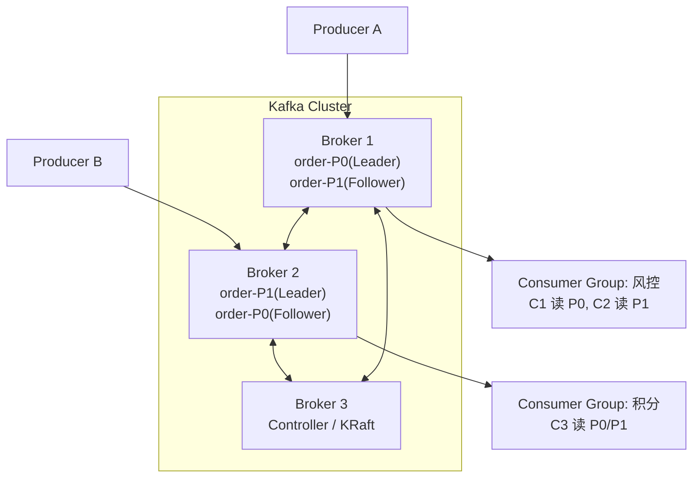

# Kafka 架构全景：Topic / Partition / Broker / 副本 / 消费组

> 专题第 2 篇 · 上一篇：[从零理解消息队列](./01-从零理解消息队列) · 下一篇：[RabbitMQ 架构全景](./03-RabbitMQ-架构全景)
> 目标：读完能画出 Kafka 集群图，并跟着一条消息走完「生产 → 存储 → 复制 → 消费」全程。

## 一、先看全景：一个 Kafka 集群里有什么



图里有五个角色，先给一句话定义，再逐个拆：

| 角色 | 一句话 | 容易误解的点 |
|------|--------|--------------|
| **Broker** | 一个 Kafka 进程（通常一台机器一个），负责存数据、接请求 | 不是「一台机器」，一台机器可以跑多个 Broker（不同端口） |
| **Topic** | 消息的逻辑分类，比如 `order-events` | 不是一个文件，也不存在「Topic 的数据」这种物理实体 |
| **Partition** | Topic 的物理分片，是一个**只追加的有序日志** | 不是「队列」，消息不会因为被消费而消失 |
| **Replica** | 分区的副本，一主多从 | 副本是**分区级**的，不是 Broker 级的 |
| **Consumer Group** | 一组消费者，合作消费一个 Topic 的全量 | 组内互斥、组间独立 |

**Q：为什么 Topic 要拆成 Partition？不能一个 Topic 一个文件吗？**

两个原因，都很硬：

1. **并行**：一个分区在同一时刻只能被同组的一个消费者消费。想要 10 个消费者一起干活，至少要有 10 个分区。
2. **扩展**：一个分区的数据必须完整地放在某台 Broker 上（连同副本）。不分区，单 Topic 就被单机磁盘和网卡锁死；分区后可以分散到多台 Broker。

所以记住这句话：**Partition 是 Kafka 的并行单位和存储单位，分区数决定了消费并行度的上限。**

## 二、Topic 与 Partition：逻辑与物理的分界线

### 2.1 Topic 只是「名字 + 配置」

创建 Topic 时真正落地的动作是：**在多个 Broker 上创建若干分区目录，并决定每个分区的 Leader/Follower 分布**。

```bash
kafka-topics.sh --create --topic order-events \
  --partitions 3 --replication-factor 3
```

这条命令的含义：

- 逻辑上多了一个叫 `order-events` 的分类；
- 物理上多了 3 个分区（`order-events-0/1/2`），每个分区 3 个副本，共 9 个副本目录，尽量均匀打散到 Broker 上。

### 2.2 分区内部长什么样

每个分区就是一个目录，里面是不断滚动的段文件：

```text
order-events-0/
├── 00000000000000000000.log        # 消息本体（追加写）
├── 00000000000000000000.index      # offset → 文件物理位置（稀疏索引）
├── 00000000000000000000.timeindex  # 时间戳 → offset
├── 00000000000000036800.log        # 写满 segment.bytes（默认 1GB）滚新段
└── ...
```

三个关键性质：

1. **只追加**：永远写到末尾，不修改、不插入。这是顺序 IO 和零拷贝的前提。
2. **offset 分区内单调递增**：offset 不是全局消息 ID，**消息的唯一标识是 `(topic, partition, offset)`**。
3. **删除以段为单位**：按 `retention.ms` / `retention.bytes` 整段删，不逐条删；`cleanup.policy=compact` 则按 key 保留最后一条。

**Q：消费者读的时候，怎么根据 offset 找到消息？**

不用从头扫。步骤是：

1. 用 offset 在**段文件名**里二分，定位到它属于哪个 segment；
2. 在该段的 `.index` 里二分，找到「不大于目标 offset 的最近索引项」，拿到物理位置；
3. 从该位置开始**顺序扫描**，直到命中目标 offset（通常扫几条）。

所以读旧消息也是「二分 + 小段顺序扫」，不是 O(n) 全盘扫。

## 三、副本：Leader / Follower / ISR / HW

### 3.1 三种副本角色

- **Leader**：唯一对外提供读写的副本。生产者和消费者都只找 Leader。
- **Follower**：主动向 Leader 发 fetch 请求拉数据，只做备份，不对外服务（除非被选为新 Leader）。
- **ISR（In-Sync Replicas）**：当前**跟得上** Leader 的副本集合，包含 Leader 自己。
- **OSR**：掉队太久的副本（落后超过 `replica.lag.time.max.ms`，默认 30s），被踢出 ISR。

**Q：为什么要有 ISR？所有副本一视同仁不行吗？**

因为「所有副本都确认」在副本多、机器慢的时候会无限拖慢写入。ISR 是一份**动态的「可靠副本名单」**：

- 写入时，`acks=all` 只等 **ISR 里的副本**确认，不等掉队者；
- 选主时，**只从 ISR 里选**，保证新 Leader 的数据不比旧 Leader 少（不丢已确认消息）。

代价是：ISR 会缩水。如果 ISR 只剩 Leader，`acks=all` 就退化成 `acks=1`——所以还要配 `min.insync.replicas`（见第 04 篇）。

### 3.2 LEO 与 HW：消费者到底能读到哪

- **LEO（Log End Offset）**：某个副本日志的末尾位置，即「下一条要写的 offset」。
- **HW（High Watermark）**：**ISR 中所有副本 LEO 的最小值**。消费者只能读到 HW 之前的消息。

用一个三副本的例子走一遍（初始 LEO 都是 5，即 0~4 已写入）：

| 步骤 | Leader LEO | Follower1 LEO | Follower2 LEO | ISR | HW | 消费者可见 |
|------|-----------|---------------|---------------|-----|----|-----------|
| 初始 | 5 | 5 | 5 | {L,F1,F2} | 5 | 0~4 |
| Leader 写入 1 条 | 6 | 5 | 5 | {L,F1,F2} | **5** | 0~4（新消息不可见） |
| F1 拉取同步 | 6 | 6 | 5 | 同上 | **5** | 0~4 |
| F2 拉取同步 | 6 | 6 | 6 | 同上 | **6** | 0~5（新消息可见） |
| F2 宕机 40s | 6 | 6 | 5 | {L,F1} | 6 | 0~5 |

这张表解释了两件常被追问的事：

- **为什么刚写入的消息消费者可能读不到？** 因为 HW 还没推进，Kafka 要保证「读到的数据不会因为选主而消失」。
- **HW 什么时候推进？** 所有 ISR 副本都复制到某个 offset 后，HW 才能越过它。

## 四、Broker 内部：一条消息的完整旅程

把镜头拉近到 Broker。假设生产者发来一批消息，`acks=all`：

```text
① Producer：序列化 → 选分区 → 进 RecordAccumulator 攒批 → Sender 线程发往 Leader Broker
② Broker 网络层：Acceptor 收连接 → Processor 线程解析请求 → 放入请求队列
③ 请求处理线程：KafkaApis 校验 → Log.append() 追加到分区日志（写页缓存）
④ 副本同步：Follower 发 Fetch 请求 → Leader 返回数据 → Follower 追加 → 上报 LEO
⑤ HW 推进：Leader 更新 HW（= ISR 最小 LEO）
⑥ 返回成功：ISR 都写完后，Broker 给 Producer 回 acks
⑦ 消费：Consumer fetch(offset) → Leader 从页缓存/磁盘读 → 网络发出（零拷贝）
```

几个值得单独记住的点：

**Q：Broker 收消息是「一条一条」处理的吗？**

不是。生产者端先攒批（`batch.size` 默认 16KB、`linger.ms` 默认 0），Broker 端一次网络请求携带一批消息、一次追加。**批量是 Kafka 高吞吐的第一性原理之一**：系统调用、网络包、索引更新的固定开销被摊薄。

**Q：写入成功时，数据落盘了吗？**

没有强制 fsync。Kafka 写的是 **OS 页缓存**，由操作系统异步刷盘；可靠性靠**副本冗余**而不是单机刷盘。这也是「Kafka 写磁盘却很快」的核心原因。想强制刷盘可以调 `flush.messages` / `log.flush.interval.messages`，但会显著降低吞吐，生产上一般不这么干。

**Q：读的时候为什么快？**

因为 `sendfile` 零拷贝：数据从页缓存直接送到网卡，不经过用户态，省掉两次内存拷贝和两次上下文切换。前提是消费者消费的是「原始日志」，不做解密/转换——所以 Kafka 的压缩、加密都在端上做，Broker 尽量不碰消息体。

**Q：Controller 是干嘛的？**

集群里某个 Broker 兼任 **Controller**，负责**分区 Leader 选举、副本分配、Broker 上下线感知、Topic 变更**。它是控制面，不在数据读写路径上。老版本靠 ZooKeeper 存元数据，新版本用 **KRaft**（Kafka 自己实现的 Raft）替代 ZK，Kafka 4.0 已完全移除 ZK。

## 五、消费组：分区到底分给谁

这是初学者最容易「以为自己懂了」的部分，拆成四个问题。

### 5.1 消费组是什么？

```text
Topic order-events（3 分区）
├─ Group "风控"：C1 → P0，C2 → P1，C3 → P2   （组内瓜分，共消费全量 1 次）
└─ Group "积分"：C4 → P0，C5 → P1，C6 → P2   （另一套进度，再消费全量 1 次）
```

规则只有两条：

1. **同一分区，同一时刻只能被同组的一个消费者消费**；
2. **不同消费组之间完全独立**，各自维护 offset。

所以 Kafka 里的「广播」不需要复制消息，多开一个消费组就行——这正是它相比 RabbitMQ 的结构性优势。

### 5.2 谁来分配？offset 存在哪？

- **Group Coordinator**：某个 Broker 兼任（由 `__consumer_offsets` 的分区归属决定），负责组成员管理、心跳、触发 rebalance。
- **分区分配**：由 **Group Leader**（组内某个消费者，不是 Broker）按分配策略算出结果，再 SyncGroup 下发给全组。
- **offset 存储**：提交到内部 Topic `__consumer_offsets`（默认 50 个分区，compact 清理），key 是 `(group, topic, partition)`。

**Q：offset 是 Broker 帮消费者记的吗？**

是「消费者主动提交，Broker 持久化」。Broker 不知道你处理到哪，只知道你报告到哪。所以：

- 先提交、后处理 → 崩了会丢消息；
- 先处理、后提交 → 崩了会重复消费。

这就是 05 篇要展开的 at-least-once / at-most-once 取舍。

### 5.3 分配策略有哪几种？

| 策略 | 特点 | 适用 |
|------|------|------|
| Range | 按分区范围均分，可能不均（分区数除不尽） | 老默认，简单 |
| RoundRobin | 跨 Topic 轮询，较均匀 | 多 Topic 订阅 |
| Sticky | 尽量保留上次分配，减少迁移 | 降低 rebalance 抖动 |
| CooperativeSticky | Sticky + **增量再平衡**（只迁移变动分区） | 生产推荐 |

### 5.4 Rebalance：为什么消费者一上线就「全员卡住」？

**触发条件**：消费者加入/离开/崩溃、订阅的 Topic 分区数变化、订阅关系变化。

老协议（eager）的过程是**全停**：

```text
所有消费者停止消费 → 放弃全部分区 → JoinGroup 重新入组
→ 选出 Leader → 计算新分配 → SyncGroup 下发 → 恢复消费
```

组越大、分区越多，停顿越久；停顿期间 lag 飙升，还可能因为 `max.poll.interval.ms` 超时被踢出，引发**连环 rebalance**。

优化手段（面试高频）：

- `CooperativeStickyAssignor`：只迁移需要变动的分区，其他消费者不停；
- `group.instance.id`（static membership）：滚动重启/短暂掉线不触发 rebalance；
- 合理设置 `session.timeout.ms`（心跳超时）与 `max.poll.interval.ms`（两次 poll 的最大间隔，处理慢要调大或减 `max.poll.records`）；
- **KIP-848**（Kafka 4.0 默认新协议）：把分配逻辑从客户端移到 Broker，进一步缩短停顿。

**Q：消费者数量比分区数多会怎样？**

多出来的消费者**分不到分区，空转**。所以「加消费者提升消费能力」有上限：**上限 = 分区数**。这也是分区数要提前规划的原因（分区只能增不能减，扩容还会打乱 key 的路由）。

## 六、分区数、key 与顺序性

### 6.1 key 怎么决定分区

```text
有 key：partition = murmur2(key) % 分区数
无 key：粘性分区（一个 batch 尽量发同一分区），批次轮转
```

要保证「同一订单的事件有序」，就用订单号做 key：同一 key 永远落同一分区，而**分区内有序**。

**Q：分区内为什么有序？全局有序不行吗？**

分区是单一日志文件，追加顺序就是消费顺序，天然有序。全局有序意味着所有消息进一个分区——吞吐退回单通道，Kafka 的并行能力全废。所以 Kafka 只承诺**分区内有序**，这是吞吐与顺序的取舍。

破坏顺序的常见原因：

- 增加分区数（同 key 可能映射到新分区）；
- 生产者重试 + `max.in.flight.requests.per.connection > 1` 且未开幂等（后发的批次先成功）；
- 消费端多线程处理同一分区的消息。

### 6.2 分区数怎么定

| 因素 | 影响 |
|------|------|
| 目标吞吐 | 分区数 ≈ 峰值吞吐 / 单分区吞吐（单分区通常几 MB/s 到几十 MB/s，取决于批量和压缩） |
| 消费并行度 | 分区数 ≥ 期望消费者数 |
| 文件句柄 | 每分区每段一个 fd，分区过多打满 `ulimit` |
| 故障恢复 | Leader 切换、副本同步的开销随分区数增长 |
| 元数据压力 | Controller / KRaft 在万级分区时开始吃力 |
| 不可逆 | 不能减少；增加会破坏 key 稳定性 |

经验：单 Topic 十几到几十个分区足够绝大多数业务；只有超大流量才需要上百。**先按「消费并行度」和「单分区吞吐」估，再留 1.5~2 倍余量**。

## 七、五个常见误解

1. **「Kafka 是消息队列，消费完消息就删了」**——错。消息按保留策略过期，跟消费无关。
2. **「一个分区可以被多个消费者同时消费」**——错。同组内互斥；不同组可以。
3. **「offset 是 Broker 自己维护的消费位置」**——错。客户端提交，Broker 只存。
4. **「副本越多越安全，所以副本数越多越好」**——错。副本多会放大写放大和网络开销；3 副本 + `min.insync.replicas=2` 是常见平衡。
5. **「`acks=all` 就落盘了」**——错。只写进所有 ISR 的页缓存，见 04 篇。

## 八、本篇自测

1. 画出一个 3 Broker、Topic 3 分区、副本 3 的集群，标出每个分区的 Leader 分布（不用唯一）。
2. 解释 HW 为什么取 ISR 的最小 LEO，以及它和「不丢消息」的关系。
3. 消费者组有 5 个消费者、Topic 只有 3 个分区，会发生什么？怎么解决？
4. 一次 rebalance 期间，消息会丢吗？lag 会怎样？如何减少停顿？
5. 为什么说「分区数只能增不能减」？增加分区对顺序性有什么影响？

---

下一篇换到 RabbitMQ：Connection 和 Channel 为什么要分开、Exchange 的四种类型怎么用、ack 与 prefetch 如何配合，以及为什么它的队列是「单点」。
