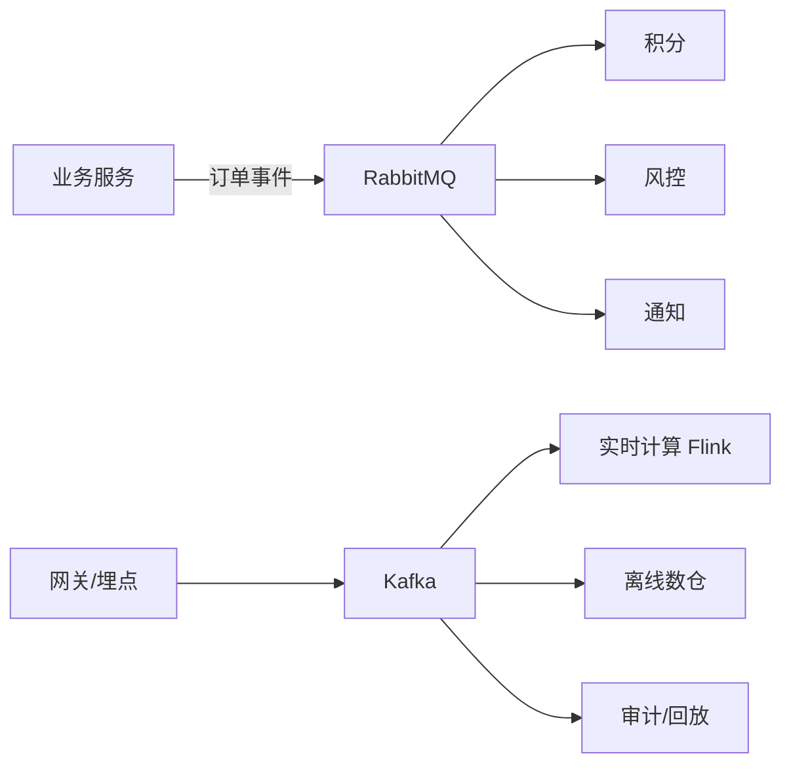

# 选型与面试：决策树与背诵卡

> 专题第 7 篇 · 上一篇：[能力边界](./06-能力边界)
> 前六篇讲「它们是什么」，这一篇讲「什么时候用谁、面试怎么答」。建议先合上文章，自己回答一遍，再对照。

## 一、一句话定位（先定基调）

> **RabbitMQ 是消息路由器**：以 Queue 为中心，消息被消费即删除；强在路由、低延迟、确认与死信等业务语义。
> **Kafka 是分布式提交日志**：以 Partition 为中心，消息按保留策略存储、按 offset 消费；强在吞吐、堆积、回放与多下游。

这句话决定了后面所有差异，面试时先说它，再展开。

## 二、对照总表（能复述 8 行就够用）

| 维度 | Kafka | RabbitMQ |
|------|-------|----------|
| 核心抽象 | Topic → Partition（只追加日志） | Exchange → Binding → Queue |
| 消息生命周期 | 按时间/大小/compact 过期 | 消费 ack 后删除 |
| 消费驱动 | 拉 + 长轮询 | 推 + prefetch |
| 消费进度 | offset（存 `__consumer_offsets`） | unacked 集合 + ack |
| 广播 | 多消费组共享一份数据 | 多队列绑定同一 Exchange（复制消息） |
| 路由 | 仅 Topic/Partition | 四种 Exchange，规则灵活 |
| 顺序 | 分区内有序 | 单队列单消费者有序 |
| 高可用 | 副本 + ISR + HW + Leader 选举 | quorum queue（Raft） |
| 失败处理 | 自建重试 Topic/DLQ | 原生 DLX + TTL |
| 历史回放 | 支持 | classic 不支持（streams 支持） |
| 堆积 | 强（磁盘日志） | 弱（内存索引 + 流控） |
| 扩展 | 分区水平扩展 | 队列分散，单队列受限 |
| 延迟 | 毫秒~几十毫秒 | 亚毫秒~毫秒 |
| 运维 | 重（分区、磁盘、lag、rebalance） | 中（管理界面友好） |

## 三、决策树

```text
① 需要回放历史 / 多下游各自读全量 / CDC / 流计算 / 海量日志？
   └─ 是 → Kafka

② 需要复杂路由（按规则分发多个业务方）/ 延迟消息 / 优先级 / 单条重试与死信？
   └─ 是 → RabbitMQ

③ 峰值吞吐？
   ├─ > 10 万/秒，或需扛数小时以上积压 → Kafka
   └─ 万级/秒，且要求低延迟 → RabbitMQ

④ 团队运维能力？
   ├─ 有专人管 Kafka → 按上面选
   └─ 没有 → 优先 RabbitMQ / 云托管，别硬上

⑤ 数据规模很小、只是解耦？
   └─ Redis Stream / 数据库任务表也能撑，先别引入重中间件
```

## 四、六类真实场景，逐题给答案

### 场景 1：全站日志、埋点、监控指标

**选 Kafka。** 理由：写入量巨大、需要多下游（实时计算 + 离线数仓 + 审计）、需要按时间重跑。RabbitMQ 在这里会：堆积打满内存 → 阻塞生产者 → 还无法回放。

### 场景 2：订单创建后通知积分、风控、推荐

**选 RabbitMQ**（或按团队现状）。理由：典型的「一个事件多个下游」，topic exchange 一条 binding 搞定；新增下游不动生产者。用 Kafka 也能做（多消费组），但如果消息量不大、又需要「按事件类型精确路由」，RabbitMQ 更省事。

### 场景 3：30 分钟未支付自动关单

**选 RabbitMQ 延迟插件**，或 Redis ZSet + 定时任务。理由：Kafka 没有原生延迟，自己搭延迟 Topic + 时间轮，复杂且容易积压。注意 RabbitMQ 用延迟插件，不要用「队列 TTL」——会被队头阻塞。

### 场景 4：大促秒杀削峰

**选 Kafka。** 理由：峰值可能是平时的几十倍，需要把请求堆在队列里慢慢消费；Kafka 的磁盘日志能扛住亿级积压。RabbitMQ 要靠 lazy queue + 限流勉强支撑，且堆积时生产者会被阻塞，反而把上游拖死。

### 场景 5：CDC / 事件溯源 / 审计流水

**选 Kafka。** 理由：需要「不可变、可回放、按 key 保留最新状态」（compact topic），还要多个下游独立消费。RabbitMQ 消费即删，天然做不了事件溯源。

### 场景 6：服务间 RPC / 请求-响应

**都不合适**（优先 gRPC）。如果一定要用 MQ 解耦：RabbitMQ 的 `reply_to` + `correlation_id` 更顺手；Kafka 要自己拼回复 Topic，延迟还高。面试时能说出「这不是 MQ 的主场」是加分项。

## 五、两者并存的典型架构

大厂很少二选一，常见组合是：



判断标准：**「业务消息」走 RabbitMQ，「数据流」走 Kafka。** 前者关心「这条消息该给谁、处理成功没有」；后者关心「这条事实如何被可靠记录并被多方消费」。

## 六、面试答题模板

被问「Kafka 和 RabbitMQ 怎么选」时，按四步答：

1. **结论先行**：按「数据流 vs 业务消息」分流；
2. **模型差异**：队列（消费即删、推、ack）vs 分区日志（保留、拉、offset）；
3. **能力边界**：路由/延迟/死信 → RabbitMQ；回放/堆积/多下游 → Kafka；
4. **落到场景**：我们项目是 X，峰值 Y，所以我选 Z，并给出一个具体配置或指标（如 lag 告警、prefetch=20、`min.insync.replicas=2`）。

**Q：如果面试官说「我们两个都用，你说说为什么」？**

答「职责不同」：Kafka 做数据管道（日志、CDC、埋点），RabbitMQ 做业务事件分发（订单状态、通知）。再补一句成本：两套中间件意味着两套运维与监控，小团队未必值得。

## 七、三级追问链（提前准备到第三层）

### 链 1：Kafka 架构

```text
Q1: Kafka 为什么快？
 → 顺序写 + 页缓存 + 零拷贝 + 批量 + 分区并行

Q2: 零拷贝省了什么？
 → 用户态两次拷贝 + 两次上下文切换；sendfile 从页缓存直达网卡

Q3: 那写的时候也零拷贝吗？
 → 不是；写是 append 到页缓存，读才用 sendfile；写入的持久化靠副本而非 fsync
```

### 链 2：Topic / Partition / Broker

```text
Q1: Topic 和 Partition 什么关系？
 → Topic 是逻辑分类，Partition 是物理分片，一个分区是一个有序追加日志

Q2: 为什么要分区？
 → 并行（分区是消费并行上限）+ 扩展（分散到多 Broker）

Q3: 分区数怎么定？能减吗？
 → 按吞吐与消费并行度估，留余量；不能减，增加会打乱 key 映射
```

### 链 3：消费组与 rebalance

```text
Q1: 消费组是什么？
 → 组内分区互斥、组间独立；同组消费者数 > 分区数会空转

Q2: rebalance 为什么会卡？
 → eager 协议全员放弃分区重分配；组大时停顿长，lag 飙升

Q3: 怎么优化？
 → CooperativeSticky + static membership + 调 max.poll.interval + KIP-848
```

### 链 4：可靠性

```text
Q1: Kafka 会丢消息吗？
 → 会，三段：生产 acks、Broker 副本、消费提交

Q2: acks=all 就安全吗？
 → 不，ISR 可能缩水，且只写页缓存不 fsync

Q3: 那怎么保证？
 → RF=3 + min.insync.replicas=2 + 禁止 unclean 选主 + 手动提交 + 幂等
```

### 链 5：RabbitMQ

```text
Q1: 消息消费后还在吗？
 → 不在，ack 后删除；要回放只能用 streams 或换 Kafka

Q2: 怎么保证不丢？
 → durable + persistent + confirm + 手动 ack；高可用用 quorum queue

Q3: 队列堆积怎么办？
 → lazy queue + x-max-length + 扩容消费者；根治要限流或换 Kafka
```

## 八、必背参数

```properties
# Kafka：可靠性
acks=all
min.insync.replicas=2
enable.idempotence=true
unclean.leader.election.enable=false

# Kafka：消费与吞吐
enable.auto.commit=false
max.poll.records=500
max.poll.interval.ms=300000
fetch.min.bytes=1
linger.ms=5~50
compression.type=lz4/zstd
```

```text
# RabbitMQ
durable=true + delivery_mode=2
publisher confirm（异步批量）
basic.qos(prefetch=20)        # 按处理耗时调整
autoAck=false + 手动 ack/nack
x-dead-letter-exchange + x-message-ttl
x-queue-type=quorum           # 关键队列高可用
```

## 九、五个最容易答错的点

1. **「Kafka 消费完就删消息」**——错，按保留策略过期。
2. **「一个分区能被同组多个消费者消费」**——错，组内互斥。
3. **「acks=all 就落盘、绝对不丢」**——错，只写 ISR 页缓存，且 ISR 会缩水。
4. **「RabbitMQ 加节点就能提升单队列吞吐」**——错，队列是单点，只能分散。
5. **「Kafka 能做延迟消息」**——原生不支持，需要自己搭。

## 十、自测：能连续答三层再上考场

1. 画出 Kafka 集群图，讲清一条消息从生产到消费经过哪些组件。
2. 画出 RabbitMQ 拓扑，讲清 Exchange、Binding、Queue、ack、prefetch 的关系。
3. 对比两者在「消息生命周期、消费驱动、进度记录」上的差异，并解释各自的原因。
4. 给定「订单通知 + 日志收集 + 延迟关单」三个需求，分别选型并说明取舍。
5. 设计一个「不丢 + 不重复（业务幂等）+ 可回放」的 Kafka 消费方案，写出关键配置。

---

## 关联知识点

| 主题 | 去处 |
|------|------|
| Kafka 存储与副本细节 | [Kafka 架构与存储](../03-kafka/架构与存储) |
| 幂等、事务、消费组 | [Kafka 生产消费语义](../03-kafka/生产消费语义) |
| 积压治理与故障 | [Kafka 可靠性与积压](../03-kafka/可靠性与积压) |
| 削峰落地 | [Kafka 削峰与可靠投递落地](../../架构师修炼/05-Kafka削峰与可靠投递落地) |
| 最终一致与本地消息表 | [分布式事务与最终一致落地](../../架构师修炼/09-分布式事务与最终一致落地) |
| 容量与架构演进 | [QPS 分级与架构演进地图](../../架构师修炼/01-QPS分级与架构演进地图) |
