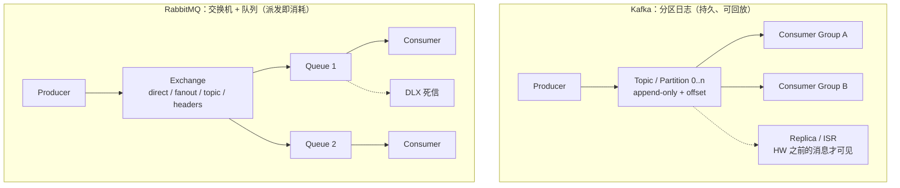

# 消息队列专题：Kafka 与 RabbitMQ 从架构到选型

> 这是一个**从零开始**的专题：先把 Kafka 的 Topic / Partition / Broker / 副本 / 消费组讲成一个完整系统，再把 RabbitMQ 的 Connection / Channel / Exchange / Queue / Binding 讲透，最后才做对照与选型。
> 不假设你用过任何一种 MQ；每篇都能独立读，但按顺序读收获最大。

## 为什么值得单独开一个专题

初学者最容易掉进两个坑：

1. **把两者当成同一种东西**，只记「Kafka 快、RabbitMQ 慢」，于是面试一追问「为什么快」「消息被消费后还在不在」就露馅；
2. **只背结论，不知道模型**，于是遇到「延迟关单该用哪个」「为什么消费组里多出来的消费者不干活」这类问题无从下手。

这两个坑的根源是同一个：**消息队列的差异不在性能参数，而在数据模型。** 模型决定了消息的生命周期、消费的并行方式、能不能回放、能不能路由。所以这个专题先讲模型，再谈参数。

## 系列目录

| # | 文章 | 回答什么问题 |
|---|------|--------------|
| 01 | [从零理解消息队列](./01-从零理解消息队列) | 为什么需要 MQ？它能做什么、代价是什么？「任务队列」和「日志」两种世界观从哪来？ |
| 02 | [Kafka 架构全景：Topic / Partition / Broker / 副本 / 消费组](./02-Kafka-架构全景) | 一个集群长什么样？一条消息从生产到消费经过谁？消费组怎么分活？rebalance 为什么卡顿？ |
| 03 | [RabbitMQ 架构全景：Connection / Channel / Exchange / Queue](./03-RabbitMQ-架构全景) | AMQP 的模型怎么运转？四种 Exchange 怎么选？ack、prefetch、confirm 各自解决什么？ |
| 04 | [可靠性对照：消息到底在哪一段丢](./04-可靠性对照) | 生产、Broker、消费三段分别怎么防丢？`acks=all` 就安全了吗？EOS 的边界在哪？ |
| 05 | [消费语义与顺序：消费组、位点与重复消费](./05-消费语义与顺序) | 拉和推各有什么代价？位点什么时候提交？顺序性怎么保证、又被什么破坏？ |
| 06 | [能力边界：路由、延迟、重试、回溯、堆积](./06-能力边界) | 延迟消息、死信、重放、亿级积压，两者各自能做到什么程度？ |
| 07 | [选型与面试：决策树与背诵卡](./07-选型与面试) | 六类真实场景怎么选？面试怎么答到第三层追问？ |

## 一张图先建立直觉

读完 02 和 03，你应该能对着这张图讲 10 分钟；读完 04~06，应该能回答「如果让你 redesign，哪里会不同」。

## 术语对照速查

| 概念 | Kafka | RabbitMQ |
|------|-------|----------|
| 消息存放的逻辑分类 | Topic | Exchange + Queue |
| 并行/分片单位 | Partition | Queue（单队列内难并行） |
| 消费进度 | offset（客户端提交，存 `__consumer_offsets`） | ack（Broker 记录未确认消息） |
| 消费后消息 | 保留至过期 | 删除 |
| 多下游 | 多个消费组各读全量 | 多个队列绑定同一 Exchange（消息复制） |
| 路由 | 仅按 Topic/Partition | 四种 Exchange + Binding |
| 高可用 | 副本 + ISR + Leader 选举 | quorum queue（Raft）/（旧）镜像队列 |
| 重试/死信 | 应用层自建重试 Topic | 原生 DLX + TTL |
| 顺序性 | 分区内有序 | 单队列单消费者有序 |
| 回放 | 支持（seek offset） | 不支持（消费即删） |

## 与其他栏目的关系

- Kafka 单点深入：[架构与存储](../03-kafka/架构与存储)、[生产消费语义](../03-kafka/生产消费语义)、[可靠性与积压](../03-kafka/可靠性与积压)
- Kafka 落地：[Kafka 削峰与可靠投递落地](../../架构师修炼/05-Kafka削峰与可靠投递落地)
- 一致性：[分布式事务与最终一致落地](../../架构师修炼/09-分布式事务与最终一致落地)
