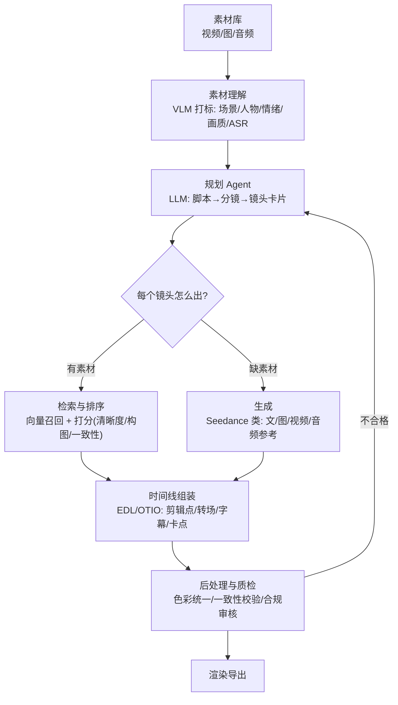

# 01 · 视频多模态 · 事实与面试弹药

> **这份文档的定位**：模块一的**事实底稿**——把易错、易混、易被面试官追问的具体事实钉死，并显式区分「已核实」与「需核实」。
> **不替代进度表**：学习进度的唯一真相来源仍是 [00 · 知识点总表](./00-知识点总表)。本文只给事实与面试弹药。
> **配套大纲**：[01 · 视频多模态 · 知识点大纲](./01-视频多模态-知识点大纲)——**学习主线走大纲，查数字与对比表看本文**。
> 面向：Go 后端工程师 / ML 基础薄弱 / 目标 1–2 个月达到面试水平（字节剪映 CapCut AI 剪辑方向）
> 硬件：Apple M5 Mac / 32GB 统一内存 / 无 NVIDIA 独显
> 核查时点：**2026-10-14**（不是 2025 年底，见下方更正说明）。标注约定：**行内带一手来源链接（arXiv 摘要页 / 官方博客 / GitHub README）= 已核实**；带 **[需核实]** 的 = 本次未拿到一手文档，面试前请自行确认，**不要背具体数字**；既无链接也无标记的表述属于行业共识级（教材/常识），但**参数量、榜单分数、时长上限仍然不要背**。

::: warning 核查时点更正：现在是 2026 年 10 月，不是 2025 年底
本专栏 02/03 两篇弹药的抬头写的是"核查时点：2025 年底"。本文按**实际系统时间 2026-10-14** 重新核查，视频多模态在这 10 个月里又迭代了至少两代，三条直接影响备考：

1. **字节自家产品线已换代（最高优先级）**：CapCut 国际版 **2026-03-26** 上线 **Video Studio**（抛弃时间线的无限画布 + AI 编剧 Agent + 分镜卡片，每张卡片单独调用生成）与内嵌 **AI Video**；底层模型是 **Seedance 2.0**（**2026-02-12** 发布，统一多模态音视频联合生成架构，最多 9 图 + 3 视频 + 3 音频参考，15 秒多镜头 + 双声道）；**Seedance 2.5 于 2026-07-31 发布**（单次 30 秒、最多 30 图/10 视频/10 音频参考、timestamp 级编辑），其 **Draft 模式 2026-09-22** 上线（480P 试错 → 1080P 定稿）；国内侧 **2026-09-20** 发布会推出**剪映 Hub**（无限画布 + 多轨道）与创作 Agent"**剪映助手**"（支持自定义 Skills）。面试聊"即梦/Dreamina"时若不知道 Seedance 2.x 与剪映 Hub，会显得完全脱节。[Seedance 2.0 官方](https://seed.bytedance.com/zh/blog/seedance-2-0-%E6%AD%A3%E5%BC%8F%E5%8F%91%E5%B8%83) · [CapCut Video Studio 报道](https://m.chinaz.com/ainews/26577.shtml) · [剪映发布会（新华网）](https://www.news.cn/tech/20260921/6742f6c1f32f41d4918105bc686fe907/c.html)
2. **开源侧换代**：**HunyuanVideo 1.5**（8.3B，2025-11 开源，官方 14GB 显存口径）、**LTX-2 系列**（LTX-2 于 2026-01-05 放权重，2.3 = 22B，2.5 = 2026-07-23；许可是 **Community License，年收入超 1000 万美元需先买商用许可**）、**MOVA**（2026-01-29，32B/18B MoE，Apache-2.0，音视频联合生成）、**SANA-WM**（2.6B 世界模型）。⚠️ **Wan2.6 没有开源权重**（只有百炼 API），网上"Wan2.6/2.7 开源"的说法来自 SEO 农场站。[来源](https://tongyi.aliyun.com/tongyi/news/?id=pxwhvf%2Fsuodqg%2Fqkhh70wdrlgwogs2)
3. **对 03 篇的一处更正**：Qwen3-VL 的档位现在可以确认了——dense **2B/4B/8B/32B** + MoE **30B-A3B/235B-A22B**，原生 256K 交错上下文（技术报告 [arXiv:2511.21631](https://arxiv.org/abs/2511.21631)，2025-11-27）。03 篇该行的 [需核实] 可以划掉。
:::

---

## 〇、三条"面试防翻车"原则

1. **视频问题的第一句话永远是"先算账"**：帧数 × 每帧 token 数 = 爆炸的序列长度，理解侧是 token 预算问题、生成侧是注意力复杂度问题。所有视频多模态的工程结论都从这道算术里推出来，这比背模型名有说服力得多。
2. **架构骨架可以背，参数量/训练成本/榜单分数一律不要背**。视频模型半年换代一次，你背的数字大概率已过期；能讲清"解决了什么问题、代价是什么、什么时候不该用"才是面试官要的。
3. **落点必须回到剪映业务**：一键成片（素材理解 + 打分 + 脚本 + 拼接）、多模态生成（Seedance 系列）、编辑一致性（主体/参考/首尾帧）、时序检索（Vidi 系列）。字节面试官对"能跑通 VBench 第一"没兴趣，对"你怎么把生成模型接进剪辑流水线并控住延迟成本"有兴趣。

---

## 一、知识分层清单

### 第 1 层：原理层（必须能推导，不能只背结论）

| 知识点 | 核心内容 | 面试可考形式 |
|---|---|---|
| **抽帧与采样率** | 均匀采样（1/2 fps）、场景切分后按镜头采样、关键帧采样、动态 FPS（Qwen2.5-VL 支持动态 FPS）；抽帧率同时决定 token 成本与可回答的问题类型 | "1 分钟视频 1fps 多少 token？为什么不能 30fps" |
| **视频 token 算术** | `token ≈ 帧数 × (H/p)·(W/p) / merge²`；生成侧 `patch 数 ≈ (T/t)·(H/h)·(W/w)`，全注意力算力 ∝ patch 数² | 见下方"关键算术模板" |
| **时空 patch / Tubelet** | 把视频体切成 `t×h×w` 的立方体当 token，是 ViViT 的 **tubelet embedding** 与视频 DiT 的共同起点；`t>1` 就把运动信息编码进单 token | "视频 patch 和图像 patch 差在哪" |
| **3D 卷积** | I3D 把 2D 卷积核沿时间"膨胀"成 3D（inflate）；SlowFast 双路径（慢路径低帧率高通道、快路径高帧率低通道）；代价是参数量与时序感受野的权衡 | "为什么 3D CNN 没成为主流"→ 序列建模交给 Transformer，卷积退居 VAE |
| **光流** | RAFT 等迭代式光流估计；显式运动表征的用途：插帧（RIFE/FILM）、V2V 编辑沿光流传播（TokenFlow 类）、训练时的运动监督；不是所有视频模型都用光流 | "光流和隐式时序建模各自的适用场景" |
| **时序位置编码** | 时间维位置编码的三种做法：帧索引 embedding、**M-RoPE 分解（t/h/w 三路）**、**绝对时间编码**（Qwen2.5-VL，让模型理解真实秒数而非帧序号） | "怎么让模型知道'第 30 秒'而不是'第 30 帧'" |
| **时间戳对齐** | Qwen3-VL 明确用 **Text-Timestamp alignment** 训练视频理解；TimeChat 用 timestamp-aware frame encoder 把时间戳绑到帧特征上 | "时序定位（temporal grounding）靠什么机制" |
| **3D VAE / 潜空间压缩** | 视频生成先压到潜空间：空间压缩 8× + 时间压缩 4~8× 量级；Step-Video-T2V 的 Video-VAE 是 **16×16 空间 + 8× 时间**（[arXiv:2502.10248](https://arxiv.org/abs/2502.10248)）；LTX-Video 的 Video-VAE 宣称 **1:192 压缩、每个 token 覆盖 32×32×8 像素**（[arXiv:2501.00103](https://arxiv.org/abs/2501.00103)）；压缩比越高越省算力、越容易糊细节 | "为什么视频生成必须先做 3D VAE，压缩比意味着什么" |
| **扩散与流匹配** | DDPM → **flow matching / rectified flow** 是当前视频模型主流训练目标；CFG（推荐 3–3.5 量级，见 LTX-Video README）；蒸馏到 8 步甚至更少步数 | "视频生成的采样步数、guidance 怎么调" |
| **注意力的复杂度瓶颈** | 全时空注意力 `O(N²)`（Step-Video-T2V 用 3D 全注意力 + 序列并行）；分解注意力（空间/时间分开）、窗口/滑窗（HunyuanVideo 1.5 的 **SSTA**：selective + sliding tile attention）、线性注意力 | "为什么长视频必须有注意力分解" |
| **对比学习与检索** | 视频-文本对比（CLIP 思路的时间扩展）；片段级 vs 视频级粒度；时刻检索的损失（对齐 + 排序）；负采样决定上限 | "视频检索和文本 RAG 是同一套思路吗" |
| **时刻定位的任务形式** | **TR（temporal retrieval）**：query → 时间区间；**STG（spatio-temporal grounding）**：query → 时间区间 + 目标框；输出形式是指针式时间戳 token + 归一化坐标 | "让他找出'递伞那一段'怎么建模" |
| **唇形同步判别** | SyncNet 用音视频对比训练一个"同步/不同步"判别器，LatentSync 把它当监督信号解决"视觉-视觉捷径学习"（[arXiv:2412.09262](https://arxiv.org/abs/2412.09262)）；常用指标 LSE-C / LSE-D | "唇形同步怎么量化" |
| **评测原理** | FVD = I3D 特征 + Fréchet 距离（对特征提取器/分辨率/帧数敏感，对运动与文本对齐不敏感，社区已有专门的批评与替代方案）；一致性类指标本质是"相邻帧特征（DINO/CLIP）相似度" | "FVD 高就说明视频差吗" |

**关键算术模板（背这一条就够）**

```
理解侧（视觉 token）:
  token ≈ 帧数 × (H/p)·(W/p) / merge²
    Qwen 系 (p=14, merge=2) → 每 token 覆盖 28×28 像素
    CLIP-L/14-336          → 576 token/帧
    例: 60 帧 @CLIP-L/14-336 = 60 × 576 ≈ 3.5 万 token      ← 1 分钟 1fps
        60 帧 @Qwen 系 1080p ≈ 60 × 2.9k ≈ 17 万 token       [需核实每帧取整]
        提到 2fps → 直接翻倍；240p 缩略图 → 降到 1/10 量级
生成侧（时空 patch）:
  patch 数 ≈ (T/t)·(H/h)·(W/w)   注意力算力 ∝ patch 数²
  3D VAE 压缩后才进 DiT，压缩比差一倍 = 算力差数倍
一致性经验值:
  音画不同步超过约 100ms 人耳/人眼可察觉（量级判断，具体阈值以产品实测为准）
```

---

### 第 2 层：架构层

#### 2.1 视频理解 VLM 的四件套（任何新模型都往这四个位置挂）

| 部件 | 视频特化的问题 | 代表做法 |
|---|---|---|
| **视觉编码器** | 图像编码器 + 时间维怎么进来 | 原生动态分辨率 ViT（Qwen2-VL/2.5-VL/3-VL）、窗口注意力降复杂度（Qwen2.5-VL）、独立视频编码器（InternVideo2 6B） |
| **时序注入** | 帧之间的顺序与真实时间怎么表达 | 帧序拼接、时间维位置编码、**M-RoPE 的 t 分量**、**绝对时间编码**（Qwen2.5-VL）、时间戳 token（TimeChat、Qwen3-VL Text-Timestamp） |
| **连接器** | 视觉 token 怎么进 LLM 词空间 | Merger（pixel shuffle）/ MLP / Q-Former（Video-LLaMA 的 Video Q-Former）/ Perceiver；视频场景额外承担**压缩**职责 |
| **token 压缩** | 长视频几十万 token 怎么装下 | 见 2.2 |

**几条必背的状态结论**
- **Video-LLaMA（[arXiv:2306.02858](https://arxiv.org/abs/2306.02858)）**：冻结视觉/音频编码器 + 冻结 LLM，用 **Video Q-Former + 时序位置编码**捕获时序，用 **ImageBind** 分支接音频——它是"音视频联合理解"的早期范式，今天看架构已过时，但**两条支路 + 冻结塔**的骨架仍是标准答法。
- **VideoChat（[arXiv:2305.06355](https://arxiv.org/abs/2305.06355)）**：视频基础模型 + 可学习 neural interface + LLM，主打 chat-centric 与时空推理/事件定位。
- **VideoLLaVA（[arXiv:2311.10122](https://arxiv.org/abs/2311.10122)）**：核心洞见是 **alignment before projection**——先把图像与视频统一到同一表征空间（LanguageBind）再投影，避免"两套编码器 + 两个差 projector"。
- **Qwen2-VL → 2.5-VL → 3-VL 是主线**：Qwen2-VL 引入 **M-RoPE（t/h/w 三分解）+ 朴素动态分辨率**；Qwen2.5-VL 引入 **绝对时间编码 + 动态 FPS + ViT 内窗口注意力**，支撑小时级视频与秒级事件定位（[arXiv:2502.13923](https://arxiv.org/abs/2502.13923)）；Qwen3-VL 加了 **Interleaved-MRoPE、DeepStack 多层特征融合、Text-Timestamp 对齐**，原生 256K 交错上下文，档位为 dense 2B/4B/8B/32B + MoE 30B-A3B/235B-A22B（[arXiv:2511.21631](https://arxiv.org/abs/2511.21631)）。
- **字节自家 Vidi 系列必须知道**（岗位直接相关）：Vidi → Vidi1.5-9B → **Vidi2**（2025-11-25，[arXiv:2511.19529](https://arxiv.org/abs/2511.19529)）→ **Vidi2.5**（2026-01，含 Vidi2.5-Think）。能力是**时序检索（TR）+ 精细时空定位（STG）+ 视频问答 + 剪辑规划**，给定文本 query 能同时给出时间区间与目标框；官方称在 VUE-TR-V2 / VUE-STG 上**超过 Gemini 3 Pro Preview 与 GPT-5**，并配套 VUE-PLOT（剧情理解）基准。它是"多模态模型用于剪辑"的官方样板，讲项目时引用它比引用通用 VLM 有效得多。[仓库](https://github.com/bytedance/vidi)

#### 2.2 长视频 token 压缩（P0，最高频追问）

| 手段 | 机制 | 效果 | 代表 |
|---|---|---|---|
| **降采样** | 降 FPS、降分辨率、关键帧/场景切分选择 | 最便宜，直接线性省 | 所有工程实践 |
| **空间池化 / pixel shuffle** | 相邻 patch 合并 → 一个 token 覆盖 28×28 | 直接 /4 | Qwen 系 |
| **重采样到定长** | Q-Former / Perceiver 用固定 query 数吸收变长输入 | 压缩比极高，细节丢失 | BLIP-2、Video-LLaMA |
| **分层/时序压缩** | 先 clip 级再 video 级逐层聚合冗余 | VideoChat-Flash 的 **HiCo** 宣称约 **1/50** 压缩几乎不掉点，10,000 帧 NIAH 达 99.1% | [arXiv:2501.00574](https://arxiv.org/abs/2501.00574) |
| **KV 稀疏化** | 借用 LLM 自身的 KV 稀疏能力筛掉冗余视觉 token | 支撑小时级视频 | Video-XL [arXiv:2409.14485](https://arxiv.org/abs/2409.14485) |
| **两阶段定位再细看** | 粗采样定位相关片段 → 对该片段高分辨率细读 | 兼顾"看得全"与"看得清"，**产品上最实用** | 工程通用解 |

> 面试话术：**压缩比的每一次提升，都是用细节能力换来的**。字幕、小目标、精确时间戳首先被压没，所以工业界的答案是"两阶段：先粗定位、再局部高分辨率"，而不是把长视频硬塞进一次前向。

#### 2.3 视频生成架构（骨架 + 五个设计位）

```
文本编码器 → 条件注入 ┐
                       ├→ 潜空间时空 patchify → DiT 去噪(×N) → VAE 解码 → (可选)超分/插帧 → 编码
视频/图/音频 → 3D VAE ┘
```

| 设计位 | 选项 | 代表 |
|---|---|---|
| 文本编码器 | T5/CLIP 双塔、双语、**MLLM 当文本编码器**（理解能力更强） | HunyuanVideo 用 MLLM |
| 潜空间压缩 | 3D causal VAE，空间 8× 时间 4~8× 量级；越高压缩越省算力 | CogVideoX 的 3D VAE（[arXiv:2408.06072](https://arxiv.org/abs/2408.06072)）、Step-Video 的 Video-VAE 16×16×8 |
| 注意力 | 3D 全注意力 / 空间+时间分解 / 窗口滑窗 / 线性 | Step-Video 全注意力、HunyuanVideo 1.5 的 **SSTA** |
| 条件注入 | cross-attention vs **潜空间拼接**（参考图/首尾帧 as in-context token）vs ControlNet / **IC-LoRA** | VACE、LTX IC-LoRA（depth/pose/canny） |
| 加速 | 蒸馏（8 步/更少）、FP8 量化、特征缓存、多尺度上采样（latent upsampler / 超分网） | LTX distilled 系列 |

**两个必答的架构观点**
1. **MoE 化是 2025 年后的主线**：Wan2.2 用双专家（高噪专家管整体布局、低噪专家管细节纹理），总参数 27B 但每步只激活 14B，官方称算力开销降低最多 50%（[官方博客](https://www.alibabacloud.com/blog/alibaba-releases-wan2-2-to-uplift-cinematic-video-production_602413)）。
2. **"统一模型"是 2026 年的产品方向**：可灵 3.0 系列打 **All-in-One**（理解 + 生成 + 编辑在同一模型内闭环）；Seedance 2.0 打**统一的多模态音视频联合生成架构**（4 模态输入、参考与编辑能力合一）。面试讲趋势时，说"从多工具串联走向单模型统一"比说"参数越来越大"更到位。

#### 2.4 视频编辑与一致性（剪映的核心业务）

| 控制方式 | 机制 | 对应产品能力 | 开源代表 |
|---|---|---|---|
| **首帧/尾帧** | 指定帧作为强条件，中间帧由模型插值；潜空间拼接实现 | 首尾帧过渡、镜头衔接 | **Wan2.1-FLF2V-14B（开源权重，2025-04）**；⚠️ **Wan2.2 的官方开源清单不含 FLF2V**，其首尾帧只有 API 版（wan2.2-kf2v-flash）；Kling/Vidu 首尾帧为闭源 API |
| **多关键帧** | 多个关键帧 + 关键帧动画 | 分镜动画 | LTX-2 的 multiple keyframe support |
| **参考图 / 主体一致性** | 把参考主体特征注入（cross-modal alignment 或 in-context 拼接） | 角色一致性、商品一致性 | **Phantom（字节，1.3B/14B，[arXiv:2502.11079](https://arxiv.org/abs/2502.11079)）**、**Stand-In（腾讯，仅 153M 额外参数，[arXiv:2508.07901](https://arxiv.org/abs/2508.07901)）**、**Video-As-Prompt（字节，5B+5B / 14B+5B，Apache-2.0，[arXiv:2510.20888](https://arxiv.org/abs/2510.20888)）**。⚠️ 注意：**UNO（[arXiv:2504.02160](https://arxiv.org/abs/2504.02160)）是 subject-to-IMAGE，不是视频模型**，别在"视频主体一致性"题里引它 |
| **姿态/深度/边缘控制** | ControlNet 思路时序化，或蒸馏成 IC-LoRA | 舞蹈/动作迁移、结构保持 | LTX IC-LoRA（depth/pose/canny）、VACE |
| **统一编辑框架** | 一个模型吃 参考生视频 / 视频编辑 / 掩码编辑 | "换装、去水印、换背景"多合一 | **VACE**（[arXiv:2503.07598](https://arxiv.org/abs/2503.07598)） |
| **镜头语言控制** | 运镜/景别/光影的文本与参数化指令 | 专业分镜、相机运动 | Wan2.2 的影视化提示体系、可灵 3.0 的自定义镜头控制 |
| **分段生成 + 拼接** | 重叠窗口 + 参考帧条件 + 色彩/光流对齐；**漂移**是主要风险 | 30 秒以上的长视频 | 工程通用解（大纲已给 mermaid） |

> 面试话术：**一致性从来不是单一模型解决的，是"参考条件 + 身份锚定 + 后置校验重生成"的组合拳**。产品上还要有"不合格就重试/换 seed"的兜底——这是后端工程师最容易讲出差异化的地方。

#### 2.5 音视频联合（三条子线，别混着说）

| 子线 | 任务 | 机制要点 | 代表 |
|---|---|---|---|
| **联合生成** | 一次前向同时出画面与声音 | 三条实现路线：① **统一 latent 序列**（音视频 token 交错，Seedance 2.0 的"统一多模态音视频联合生成架构"）② **双分支 DiT + 跨模态联合模块**（Seedance 1.5 pro 的官方描述：dual-branch Diffusion Transformer + cross-modal joint module，[arXiv:2512.13507](https://arxiv.org/abs/2512.13507)）③ 级联管线（配音 + 唇形同步分开做，成本高、误差累积——MOVA 论文明确批评这条路，[arXiv:2602.08794](https://arxiv.org/abs/2602.08794)） | **Seedance 1.5 pro**（2025-12-16，字节）、Seedance 2.0、Wan2.6、LTX-2、MOVA（开源）、Veo 3、Sora 2 |
| **音频驱动人像 / 唇形同步** | 给定音频 + 人像/视频，生成口型与表演 | 音频条件 LDM + SyncNet 监督（LatentSync）；DiT + 混合运动条件（OmniHuman）；Speech-to-Video | LatentSync 1.5/1.6、OmniHuman-1（[arXiv:2502.01061](https://arxiv.org/abs/2502.01061)，字节）、Wan2.2-S2V-14B、HunyuanVideo-Avatar、MuseTalk、EchoMimic、Sonic |
| **视频配音 / 音效（V2A）** | 画面 → 匹配的音效/音乐 | 视觉条件 + 文本条件的潜在扩散；常接 LLM 做音效规划（CoT） | MMAudio、ThinkSound、FoleyCrafter |

**评测口径**：唇形同步看 LSE-C / LSE-D（**这两个指标由 Wav2Lip 论文定义**，与 SyncNet 同源）；音画同步在产品上更该看端到端主观测试与卡点准确率（BGM 卡点是否落在节拍上）——这是剪映场景的真实指标。**字节另一条线**：SeedRealtime（2026-08-05，官方 blog）是原生**音视频全双工 LLM**，主打实时对话中的"主动交互"（画面变化主动提醒）与抗误触发，已在字节产品部署、未放权重——被问到"音视频联合的下一个形态"时这是好答案。

#### 2.6 Agent 化剪辑架构（CapCut 岗位的真正落点）



**架构上必须能讲清的四个判断**
1. **不要端到端**：剪辑的价值在于**可解释、可回退、可局部重做**。输出中间表示（EDL/OTIO/FCPXML 类时间线结构），每一步都能被人改一版，这比"一个模型直接出片"更符合产品现实。
2. **生成是"补素材"，不是"全生成"**：真实业务里 80% 的镜头来自已有素材（检索 + 排序），只在缺镜头时用生成模型。这也是 CapCut 内嵌 AI Video 的定位——剪到一半缺素材就现场生成一段插进时间线。
3. **成本与延迟分级**：草稿用低分辨率/低步数（Seedance 2.5 的 Draft 模式：480P 试错、1080P 定稿就是官方在做这件事），成片才走高成本路径；异步任务队列 + 幂等 + 重试 + 超时降级。
4. **人机协同的交互形态在变**：CapCut Video Studio 把"时间线"换成"无限画布 + 分镜卡片"，AI 编剧 Agent 先出脚本、每张卡片单独重生成。**面试时能说出"交互形态从时间线转向画布/卡片式"是很强的产品敏感度证据。**

**产品功能 → 技术能力 → 可引用的工作（这张表就是你的"我来做会怎么做"）**

| 剪映/CapCut 功能 | 需要的技术能力 | 可引用的模型/工作 |
|---|---|---|
| 一键成片 / AutoCut | 素材理解（打标）+ 片段打分 + 脚本 + 卡点拼接 + 检索排序 | **Vidi2.5 的 TR/STG**；CLIP/SigLIP 向量检索；节拍检测（librosa 类）做卡点。另可引 **AutoCut（CVPR 2026，[arXiv:2603.28366](https://arxiv.org/abs/2603.28366)）**：用 RVQ 把视频/音频离散化成与文本对齐的**统一 token 空间**，一个 MLLM 同时做**选片、排序、脚本生成、BGM 选择**四件事（⚠️ 该论文与剪映内部 AutoCut 是否同源未知） |
| 智能成片 / GenAI 补素材 | 多模态条件生成 | **Seedance 2.0 / 2.5**（2.0：9 图 + 3 视频 + 3 音频参考；2.5：30 图 + 10 视频 + 10 音频参考、30 秒、timestamp 级编辑）；Wan2.6 |
| 分镜脚本 / 镜头卡片 | LLM 规划 Agent + 结构化输出 | **Vidi-Edit**（结构化编辑计划：叙事结构/旁白/音频属性/视觉意图 → 曲库检索 + TTS + 特效检索 → 渲染，论文称可扩展为 **editing agent 架构**）；EDL/OTIO 中间表示 |
| 无限画布 + 多轨道（剪映 Hub / Video Studio） | 非线性工作流 + 对话式剪辑 Agent | 2026-09-20 发布会：剪映 Hub（无限画布 + 多轨道）+ Agent"剪映助手"（素材整理、口播删减、字幕纠错、视频包装，**支持自定义 Skills**）；CapCut Video Studio（故事板镜头卡片，每卡单独重生成） |
| 智能剪口播 / 智能解说粗剪 | ASR + "按文本剪视频" + 自动生成解说词 | 剪映官网能力清单（转写 → 按文本删减 → 粗剪） |
| 智能镜头分割 / 多机位同步 | 镜头边界检测 / 音频对齐 | 场景切分（TransNetV2/PySceneDetect 类）+ 音频指纹对齐（剪映支持 4/9 机位） |
| 角色 / 主体 / 商品一致性 | 参考注入 + 跨镜头一致 | Phantom、Stand-In、Video-As-Prompt；Wan2.6 与可灵 3.0 的"主体上传 + 音色绑定" |
| 首尾帧过渡 / 镜头衔接 | 首尾帧条件 + 分段拼接 | **Wan2.1-FLF2V-14B（开源）**；Wan2.2 首尾帧只有 API；LTX-2 多关键帧 |
| 长视频叙事（>15 秒） | 分段生成 + 漂移控制 | 重叠窗口 + 参考帧条件 + 固定 seed + 色彩归一化；Seedance 2.5 的多轮续写 |
| 配音 / 唇形同步 / 音效 | 音视频联合 + 同步判别 | Seedance 1.5 pro/2.0、LatentSync、Wav2Lip（LSE-C/LSE-D 出处）、MMAudio（V2A） |
| 素材库去重 / 检索 | 视频指纹 + 片段级 embedding | CLIP/SigLIP 抽帧特征 + ANN 索引 |
| 字幕 / 文案 / 翻译 | OCR + ASR + TTS + 时间轴对齐 | 03 篇的 VLM 能力 + 音频侧工具链 |
| 内容安全与质检 | 审核模型 + 一致性打分 + 重生成兜底 | CLIP/DINO 相似度阈值 + 人工复核链路 |

#### 2.7 评测体系

| 层次 | 指标/基准 | 测什么 | 坑 |
|---|---|---|---|
| 生成·分布 | **FVD**（[arXiv:1812.01717](https://arxiv.org/abs/1812.01717)，2018-12） | I3D 特征（**Kinetics-400 训练的 logits 层**）空间的 Fréchet 距离 | 非高斯假设被违反（I3D 特征 PCA 后解释方差仅 0.134–0.231）；对时间失真不敏感、偏逐帧画质；跨实现（分辨率/帧数/编码）不可比；严格说是**半度量**。"Beyond FVD"（ICLR 2025，[arXiv:2410.05203](https://arxiv.org/abs/2410.05203)）提出 **JEDi**（V-JEPA 特征 + MMD），称只需 **16%** 样本达稳态、与人评对齐 +34% |
| 生成·重建 | PSNR / SSIM / LPIPS | 有 GT 的重建/编辑保真（PSNR 源自信号处理惯例，**没有唯一权威原始论文**；SSIM = IEEE TIP 2004；LPIPS = CVPR 2018，[arXiv:1801.03924](https://arxiv.org/abs/1801.03924)） | 与"好不好看"无关 |
| 生成·多维 | **VBench**（16 维，[arXiv:2311.17982](https://arxiv.org/abs/2311.17982)，CVPR 2024 Highlight，[仓库](https://github.com/Vchitect/VBench)） | Quality 分：subject/background consistency、temporal flickering、motion smoothness、aesthetic quality、imaging quality、dynamic degree；Semantic 分：object class、multiple objects、human action、color、spatial relationship、scene、temporal style、appearance style、overall consistency | 不同抽帧/分辨率配置分数不可比；榜上数值会随榜单更新变化 |
| 生成·内在合理性 | **VBench-2.0**（5 大类 / 18 维，[arXiv:2503.21755](https://arxiv.org/abs/2503.21755)） | Human Fidelity、Controllability、Creativity、Physics、Commonsense——从"看着像"转向"符合物理与常识" | 用 VLM/LLM 做裁判，裁判本身有偏置 |
| 生成·广度扩展 | **VBench++**（[arXiv:2411.13503](https://arxiv.org/abs/2411.13503)，**IEEE TPAMI 2025**） | ⚠️ 与 VBench-2.0 是**并行**关系，不是升级：++ 加的是 **VBench-I2V（图生视频）+ VBench-Long（长视频）+ VBench-Trustworthiness（公平/偏见/安全）**；2026-03 又上了 I2V Arena | 三块的归属别搞混（README 明确警告） |
| 生成·业界人评 | **Artificial Analysis Video Arena** | 盲测投票 + Elo 式排名，页面含 **Text-to-Video / Image-to-Video / Video Editing 三个子榜**——**Video Editing 子榜与剪辑业务最直接相关** | 榜单为前端 JS 渲染，抓不到静态数值；排名随时变 |
| 理解·长视频 | Video-MME（[2405.21075](https://arxiv.org/abs/2405.21075)）、LongVideoBench（[2407.15754](https://arxiv.org/abs/2407.15754)）、MLVU（[2406.04264](https://arxiv.org/abs/2406.04264)）、LVBench、MVBench（[2311.17005](https://arxiv.org/abs/2311.17005)，20 个时序任务）、TempCompass、视频版 NIAH（VNBench，ICLR 2025） | 长视频理解/时序推理 | 抽帧配置强烈影响分数 |
| 理解·新一代 | **Video-MME-v2**（[arXiv:2604.05015](https://arxiv.org/abs/2604.05015)，2026-04） | 针对"榜单虚高与实际能力脱节"提出三级层级 + 分组非线性评分（惩罚碎片化/猜测式正确），最强模型仍明显落后人类专家 | 2026 年新榜，尚未成为默认口径 |
| 理解·时序/空间 | **GST-Bench**（**字节 Seed**，[arXiv:2608.05747](https://arxiv.org/abs/2608.05747)，2026-08） | VLM 能否从视频里建立**全局空间感知** | 新榜，样本与口径仍在演进 |
| 时序定位 | **VUE-TR-V2 / VUE-STG / VUE-PLOT**（Vidi 系列配套） | 见下方"VUE 指标口径" | 与通用 VQA 榜不是一回事 |
| 业务 | 生成成功率、重试率、一致性不合格率、审核拦截率、单条成片成本/时延 | 产品真正关心的 | 公开榜看不到 |

**VUE 指标口径（Vidi2/2.5 论文原文，面试问到"时序定位怎么评"直接背这个）**：统一 **1 FPS** 采样；**VUE-TR-V2** 规模 **310.72 小时**（上一版 107.87 小时），主指标 **ĪoU**（预测与 GT 区间 IoU 的 AUC），另有 P̄ / R̄；**VUE-STG** 时序用 **tP / tR / tIoU**，时空用 **vP / vR / vIoU**（**vIoU 为主排序指标**，vIoU-Int. 只在预测 tube 与 GT 有重叠时算）；**VUE-PLOT** 用 **tIoU / sIoU / WER**（角色轨）+ **问答准确率**（推理轨）。

**VBench-2.0 的 18 个维度名（官方代码注册表原文，便于自己跑）**：`Human_Anatomy, Human_Identity, Human_Clothes, Diversity, Composition, Dynamic_Spatial_Relationship, Dynamic_Attribute, Motion_Order_Understanding, Human_Interaction, Complex_Landscape, Complex_Plot, Camera_Motion, Motion_Rationality, Instance_Preservation, Mechanics, Thermotics, Material, Multi-View_Consistency`（维度→5 大类的逐条官方映射表 [需核实]）。

---

### 第 3 层：工程层（Go 后端工程师的相对优势区）

| 主题 | 要点 | M5 可行性 |
|---|---|---|
| **解码与抽帧** | ffmpeg / VideoToolbox 硬解；抽帧是 CPU/IO 密集，独立进程池；场景切分（PySceneDetect 类）+ 关键帧选择 | ✅ 完全可做，本地就能量测 |
| **视频编码与容器** | H.264/H.265 码率、关键帧间隔、色彩空间（BT.709 与 HDR）；生成结果要重编码才能进时间线 | ✅ |
| **训练侧并行** | 长序列的序列并行（SP/USP）、FSDP/TP、梯度检查点；视频训练显存 ∝ 帧数 × 分辨率 | ❌ 只能读懂 |
| **生成推理服务** | 异步队列 + 幂等 + 优先级 + 超时降级；按步 streaming 回传预览；多卡切分（xDiT 类）；量化（FP8/int8） | ⚠️ 本地只能跑极小模型，服务骨架可在 Mac 上写完 |
| **成本模型** | 单条视频成本 ≈ 步数 × patch 数 × 每步算力单价；**草稿/定稿分级**是最有效的降本手段（Seedance 2.5 Draft 模式即官方验证） | ✅ 可算账 |
| **缓存** | prompt/文本 embedding 缓存、首帧 latent 缓存、参考图特征缓存；相同 seed + prompt 幂等返回 | ✅ 可做 |
| **一致性工程** | 分段生成时固定 seed、全局参考图、色彩归一化、后置人脸/主体校验（CLIP/DINO 相似度阈值） | ⚠️ 小规模可验证 |
| **数据流水线** | 视频打标（VLM captioning）、画质/美学打分、去重、水印字幕检测、镜头切分、数据配比 | ✅ 概念与小样本可做 |
| **合规** | 内容安全审核、肖像/声音授权、版权与训练数据来源、生成内容标识 | ✅ 必须能在面试里提一句 |

---

## 二、代表工作对照表

**可复现性口径（M5 / 32GB 统一内存）**：✅ 量化后能流畅跑并做实验；⚠️ 能跑但慢/需量化/易踩 MPS 算子坑；❌ 单机跑不动或仅 API。
**未拿到一手文档的数字一律标 [需核实]。**

### 2.1 视频理解 VLM

| 模型 | 发布方 | 时间 | 参数量 | 核心机制（一句） | 开源 | M5 单机 |
|---|---|---|---|---|---|---|
| **Video-LLaMA** | 阿里达摩院等 | 2023-06 | 7B / 13B [需核实] | 冻结 BLIP-2 Q-Former + Video Q-Former + 时序位置编码 + ImageBind 音频分支 | ✅ | ⚠️ 老代码，MPS 需实测 |
| **VideoChat** | OpenGVLab | 2023-05 | 7B 级 [需核实] | 视频基础模型 + 可学习 neural interface + LLM，chat-centric | ✅ | ⚠️ |
| **VideoLLaVA** | 北大等 | 2023-11 | 7B | **alignment before projection**：LanguageBind 统一图像/视频表征 | ✅ | ✅ |
| **TimeChat** | 上海 AI Lab | 2023-12 | 7B | 时间戳感知帧编码器 + 滑动 Video Q-Former，按视频长度变速输出 | ✅ | ⚠️ |
| **Video-XL** | 上海 AI Lab 等 | 2024-09 | 7B | 用 LLM 自身的 KV 稀疏能力压缩视觉 token，做小时级理解 | ✅ | ⚠️ |
| **VideoChat-Flash** | OpenGVLab | 2024-12 | 2B / 7B | **HiCo 分层视频 token 压缩**，约 1/50 压缩比近无损；10k 帧 NIAH 99.1% | ✅ | ⚠️ 2B 可试 |
| **VideoLLaMA3** | 阿里达摩院 | 2025-01 | 7B | **vision-centric 四阶段训练**：不堆海量视频-文本对，而是用高质量图文数据 + 视觉 token 数自适应 | ✅ | ✅ 4bit |
| **Qwen2-VL** | 阿里 | 2024-08（[arXiv:2409.12191](https://arxiv.org/abs/2409.12191)） | **2B / 7B（Apache-2.0 开源）+ 72B（仅 API）** | **M-RoPE（t/h/w 分解）+ 朴素动态分辨率**；官方称可理解 **20 分钟以上**长视频 | ✅ 2B/7B | ✅ 2B / ⚠️ 7B |
| **Qwen2.5-VL** | 阿里 | **2025-01-26**（32B 档 2025-03 追加） | **3B / 7B / 32B / 72B**（Base + Instruct 各一套） | 动态分辨率 + **绝对时间编码** + 动态 FPS + ViT 窗口注意力；官方称可理解 **1 小时以上视频**并精准定位相关片段 | ✅ | ✅ **3B 是 Mac 最佳起点** |
| **Qwen2.5-Omni / Qwen3-Omni** | 阿里 | 2025-03-26 / 2025-09-22 | 前者 7B 级 [需核实]；Qwen3-Omni **30B-A3B**（MoE） | **TMRoPE（Time-aligned Multimodal RoPE）**把音视频按时间戳交错编码 + **Thinker-Talker** 架构（Talker 自回归预测语音码），文本+语音流式输出——**音视频联合理解/生成的最强开源参考** | ✅（Qwen3-Omni Apache-2.0） | ⚠️ 30B-A3B 量化可试 |
| **Qwen3-VL** | 阿里 | 2025-09~10（报告 2025-11-27） | dense 2B/4B/8B/32B；MoE 30B-A3B / 235B-A22B | **Interleaved-MRoPE + DeepStack + Text-Timestamp 对齐**，原生 256K 交错上下文 | ✅ | ✅ 4B/8B 4bit / ⚠️ 32B |
| **Vidi1.5-9B / Vidi2 / Vidi2.5** | **字节跳动** | 2025-08 / 2025-11-25 / 2026-01 | **Vidi2 = 12B**（论文原文，LLM 主干 **Gemma-3**）；Vidi1.5 = 9B | TR 时序检索 + 精细时空定位 STG（同时给时间区间 + 目标框）+ 视频 QA + **剪辑规划（Vidi-Edit）**；单张图当作 **1 秒静音视频**统一编码；另有自适应 token 压缩平衡长短视频 | **只放 Vidi-7B / Vidi1.5-9B 权重与微调代码；Vidi2/2.5 未见放权重** | ✅ Vidi1.5-9B 4bit 可试 |
| **InternVideo2.5** | 上海 AI Lab | 2025-01（[arXiv:2501.12386](https://arxiv.org/abs/2501.12386)） | **8B** | LRC（长且富上下文）+ DPO + **自适应层次化 token 压缩（HiCo）**，可记忆比原模型长 6× 以上的视频 | ✅ | ⚠️ 8B 量化可试 |
| **InternVideo2** | 上海 AI Lab | 2024-03 | 6B | 掩码建模 + 跨模态对比 + 下一 token 预测三合一渐进训练，视频编码器扩到 6B | ✅ | ⚠️ 只跑编码器/检索 |
| **VideoPrism** | Google | 2024-02 | [需核实] | 冻结单模型通吃多任务的通用视频编码器，36M 视频-文本对预训练 | [需核实] | ⚠️ |
| **Gemini 3 / Agentic Video Understanding** | Google | 2025-11 / 2026-09 | 未公开 | 闭源原生多模态；2026-09 的 agentic video 反复转写与回查长视频，宣称 token 可降最多 88% | ❌ | ❌ 仅 API |
| **GPT 系（GPT-5 / GPT-6 Astra 等）** | OpenAI | 2025–2026 | 未公开 | 闭源、架构未披露。两个可引用的硬事实：① **Vidi2 论文把 GPT-5 作为时序检索/时空定位的对比基线，并声称在 VUE-TR-V2 / VUE-STG 上超过它**（[arXiv:2511.19529](https://arxiv.org/abs/2511.19529)）；② 第三方实测称 **GPT-6 Astra 的 API 直接拒收 mp4**（无原生视频输入），只能用"抽帧 + 时间戳"绕过（100 帧 @768×432 ≈ 425 token/帧、约 45k 输入 token）——**"多模态大模型 ≠ 支持视频输入"是很好的面试细节** | ❌ | ❌ 仅 API |

### 2.2 视频生成 · 开源（能本地/云上真跑）

> 表中 **Wan2.6** 一行是**反例**：它虽在"开源"语境里被反复提起，但**官方没有开源权重**（只有百炼 API），保留此行是为了让你面试时不被 SEO 农场站误导。

| 模型 | 发布方 | 时间 | 参数量 | 核心机制（一句） | 许可 | M5 单机 |
|---|---|---|---|---|---|---|
| **HunyuanVideo 13B** | 腾讯混元 | 2024-11-28（仓库）/ 2024-12-03（arXiv） | **13B**（官方称当时最大开源视频模型） | MLLM 作文本编码器 + 全注意力 DiT + 3D VAE 的完整框架 | **Tencent Hunyuan Community License（自定义，明文不适用于欧盟/英国/韩国）** | ❌ 官方 720×1280×129f 需 **60 GB**、544×960×129f 需 45 GB |
| **Wan2.1** | 阿里 | 2025-02-25（仓库）/ 2025-03-26（arXiv） | 1.3B / 14B；另有 **FLF2V-14B-720P**、VACE-1.3B/14B | DiT + 自研 3D causal VAE；官方给 T2V-1.3B 的最低显存 **8.19 GB** | Apache-2.0 | ✅ **1.3B 可跑（480P）**；14B 需量化 + offload |
| **Step-Video-T2V** | 阶跃星辰 | 2025-02-17 | **30B** | Video-VAE（16×16 空间 + 8× 时间）+ 3D 全注意力 DiT + flow matching + DPO 后训练，最长 204 帧 | **MIT**（仓库） | ❌ 官方 768×768×204f 需 **78.55 GB** |
| **Open-Sora 2.0** | HPC-AI Tech | 2025-03-12 | **11B** | 用 20 万美元训出商业级 T2V，VBench 上对标 HunyuanVideo / Gen-3；**无 2.1/3.0 等后续版本** | Apache-2.0 | ❌ 依赖 colossalai 张量/序列并行 |
| **Wan2.2** | 阿里 | 2025-07-28 | **A14B**（MoE，总参数量官方未公布 [需核实]）；另有 dense **TI2V-5B**、S2V-14B、Animate-14B | 首个开源 MoE 视频模型：**双专家去噪**（高噪管布局、低噪管细节）；TI2V-5B 用 16×16×4 高压缩 VAE | Apache-2.0 | ⚠️ TI2V-5B 官方口径 **24 GB**（4090 级，`--offload_model`）；**A14B / S2V-14B 官方 80 GB** → ❌ |
| **Wan2.2-S2V-14B** | 阿里 | 2025-08-26 | 14B | 音频驱动视频生成（Speech-to-Video），影视级数字人 | Apache-2.0 | ❌ 官方 80 GB |
| **CogVideoX** | 智谱 | 2B: 2024-08-06；5B: 2024-08-27；5B-I2V: 2024-09-19 | 2B / 5B；另有 CogVideoX1.5-5B（2024-11） | 3D 因果 VAE + **expert transformer（expert adaptive LayerNorm）**；2B 专为低显存设计 | **2B = Apache-2.0；5B = 自定义 CogVideoX LICENSE** | ✅ **2B 可跑**（diffusers：FP16 最低 4 GB / INT8 3.6 GB；官方称 2B 可跑 GTX 1080Ti）；5B diffusers BF16 10 GB / INT8 7 GB |
| **LTX-Video** | Lightricks | 2024-11-21（v0.9.0）起；0.9.8 的 2B/13B distilled 为 2025-07 | 2B / 13B | DiT + 高压缩 Video-VAE（**1:192，每 token 32×32×8 像素**，把 patchify 挪进 VAE 与去噪器协同设计），主打**实时**；distilled 版 8 步、无需 CFG；**官方支持 macOS MPS（PyTorch 2.3.0+）** | Apache-2.0（0.9.5+ 权重曾切 OpenRAIL-M，细节 [需核实]） | ✅ **2B distilled 是 Mac 首选**；官方另有 0.9.7-distilled-lora128 仅需 1GB |
| **LTX-2 → LTX-2.3 → LTX-2.5** | Lightricks | LTX-2 于 **2026-01-05 开源**（2025-10-23 宣布）；2.3 = 2026-03-04；2.5 = 2026-07-23 | **2 = 19B；2.3 = 22B DiT + Gemma-3-12B 文本编码器；2.5 = 22B + Gemma-4-12B** | 首个 DiT 音视频基础模型：一次前向同时出画面 + 同步音频、原生 4K/50fps、多关键帧、IC-LoRA（depth/pose/edges）、A2V、retake/extend、原生 HDR | **LTX-2.x Community License**：年收入 ≥ **1000 万美元**的公司须先购买商用许可 | ⚠️ **可跑但吃紧**：2.3 的 MLX int8 **≈26 GB（官方建议 32GB+）**、int4 **≈12 GB（16GB+）**；bf16 ≈42GB 需 `--low-ram` 流式；**2.5 的 bf16 官方 MLX 实测峰值 62.4 GB**（DiT 单独常驻下限 37.98 GB）→ 32GB 只能 int4 |
| **HunyuanVideo 1.5** | 腾讯 | 2025-11-20/21 | **8.3B** | 8.3B DiT + 3D 因果 VAE（16× 空间 / 4× 时间）+ **SSTA 稀疏注意力**，端到端较 FA3 加速 1.87×；480P I2V 步数蒸馏 8–12 步 | 同上的腾讯社区许可（**EU/UK/韩国不适用**） | ⚠️ 官方标 **14 GB（开启 offload）**但那是 NV 显存口径，MPS 无对应量化路径 → 实际 [需核实] |
| **SANA-Video** | NVIDIA | 2025（ICLR 2026） | 2B（480p/720p 档）；2026-08 有 5B 版 | **Block Linear Diffusion Transformer**：混合 linear/softmax 注意力把长视频的可扩展性打开，另有 LongLive 长视频变体；**是 diffusers 官方仅有的两个带 MPS badge 的视频管线之一** | 开源（代码 Apache-2.0） | ⚠️ 2B 可试 |
| **SANA-WM** | NVIDIA NVlabs | 2026-05（[arXiv:2605.15178](https://arxiv.org/abs/2605.15178)） | **2.6B** | 开源**世界模型**：原生训练一分钟 720p，**混合线性注意力**（逐帧 Gated DeltaNet + softmax）+ 双分支 6-DoF 相机控制 | 代码 Apache-2.0；**权重许可未确认**（论文页的 CC BY-NC-SA 4.0 是**论文**许可，勿与权重混淆） | ❌ 32GB 跑不动：官方两阶段合计约 **45 GB**、社区 MLX 移植标 **48GB+ 统一内存 / 峰值 40GB** |
| **MOVA（MOSS Video and Audio）** | OpenMOSS（上海 AI Lab） | 2026-01-29（[arXiv:2602.08794](https://arxiv.org/abs/2602.08794)） | **32B 总 / 18B 激活**（MoE） | 开源**音视频联合生成**：非对称双塔（视频塔 + 音频塔）经**双向交叉注意力**融合，单次推理同时出视频 + 同步音频（多语种唇形、环境音、音乐），IT2VA | **Apache-2.0** | ❌ 官方基准（8 秒 360p）：12 GB 显存档也需 **76.7 GB 主机内存**，32GB 统一内存不够 |
| **Wan-Dancer / Wan-Animate-2** | 阿里 Wan-AI | 2026-07-13 / 2026-08-07 | 均 14B | 前者音乐驱动舞蹈（层次化关键帧规划 + 时间映射 RoPE）；后者端到端吃驱动视频做角色动画 + 文本控视角 | Apache-2.0 | ❌ 14B + 80GB 级 |
| **Wan2.6** | 阿里 | 2026-01-12 发布 | [需核实] | 音画同步 + 多镜头叙事 + 角色扮演（参考角色外观与音色）+ 分镜控制；**API only**：百炼文档（2026-10-11）显示输入为图/文/音、输出视频 + 音频，最长 15 秒，720P $0.086/秒、1080P $0.143/秒 | ❌ **无官方开源权重**（Wan 组织仅 Wan2.1 / Wan2.2 / diffusers / Wan-skills / Wan-Dancer / Wan-Animate-2；`Wan-Video/Wan2.5`、`Wan2.6` 仓库均 404，搜索到的"Wan2.6/2.7 开源"全部来自 SEO 农场站） | ❌ 只能 API |

### 2.3 视频生成 · 闭源（只能谈机制与产品）

| 模型 | 发布方 | 时间 | 参数量 | 核心机制（一句） | 面试要点 |
|---|---|---|---|---|---|
| **Sora** | OpenAI | 2024-02 公布 | 未公开 | 视频压缩到潜空间 → **spacetime patches** → DiT，靠规模涌现世界模拟能力 | 讲"潜空间时空 patch"的范式意义即可，别谈细节 |
| **Sora 2** | OpenAI | 2025-09-30 | 未公开 | 生成**同步对白/音效**、物理更准，配套 TikTok 式 App 与 cameo | "从无声到音画同出"的转折点 |
| **Sora 2 Pro** | OpenAI | [需核实] | 未公开 | 更高画质档位 | 引用前先查 |
| **Veo 2 / Veo 3 / Veo 3.1** | Google | 2024-12 / 2025-05 / 2025-10 | 未公开 | Veo 3 起**原生音频生成**；3.1 增加参考图/首尾帧/延长等创作能力 | "原生音视频"与"创作控制"两个关键词 |
| **Kling 可灵** | 快手 | 1.0 2024-06 / 2.x 2025 / **3.0 与 3.0 Omni 2026-02-05** | 未公开 | 3.0 打 **All-in-One**：文/图/音/视频统一输入，主体上传 + 音色绑定 + 智能分镜 + 自定义镜头控制，最长 15 秒连续生成 | 截至 2025-12 官方称 6000 万创作者、生成超 6 亿视频、年化收入 2.4 亿美元 [已核·官方口径] |
| **Seedance 1.0 / 1.5 pro / 2.0 / 2.5** | **字节跳动** | 2025-06 / **2025-12-16** / **2026-02-12** / **2026-07-31**（2.5 的 Draft 模式 2026-09-22） | 未公开 | 1.0 靠多阶段蒸馏做 ~10× 推理加速（官方：L20 上 5 秒 1080p 用 41.4 秒）；1.5 pro 起**音视频联合生成**（双分支 DiT + 跨模态联合模块，[arXiv:2512.13507](https://arxiv.org/abs/2512.13507)）；2.0 升级为**统一多模态音视频联合生成架构**（[模型卡 arXiv:2604.14148](https://arxiv.org/abs/2604.14148)），最多 9 图 + 3 视频 + 3 音频参考、15 秒多镜头 + 双声道；**2.5：单次最长 30 秒 + 多轮续写、最多 30 图 + 10 视频 + 10 音频参考、timestamp 级音视频定点编辑**；Draft 模式先用 480P 试错、选定后按样片 ID 出 1080P（`draft=true`） | **岗位必背**，这是剪映/CapCut 的生成底座 |
| **Wan2.5 preview** | 阿里 | 2025-09-24 | 未公开 | 10 秒 / 1080P / 24fps，首度音画同步（人声、音效、BGM 与画面匹配），支持运镜等连续变化指令 | 只走 API/百炼 |
| **Vidu Q4 Preview** | 生数科技 | 2026-10-08 | 未公开 | 最多 **15 张参考图 + 3 段参考音频**，2K/4K 输出，首发 0.09 元/秒起 | 用来说明"参考驱动的可控生成 + 价格战" |
| **Hailuo / MiniMax、PixVerse 等** | MiniMax 等 | 2025–2026 | 未公开 | 国内第一梯队商用 API | 细节 [需核实] |

### 2.4 编辑 / 一致性 / 音视频（代表工作）

| 工作 | 发布方 | 时间 | 参数量 | 核心机制（一句） | 开源 | M5 单机 |
|---|---|---|---|---|---|---|
| **VACE** | 阿里（Wan 系） | 2025-03（Wan2.1-VACE-1.3B/14B 权重 2025-05-13） | 1.3B / 14B | All-in-One：**Video Condition Unit（VCU）**把 editing / reference / masking 统一成同一接口 + **Context Adapter** 注入时空表示 | ✅ Apache-2.0（⚠️ **没有 VACE 2**：README News 止于 2025-10-17；功能续作是阿里云 PAI 的 Wan2.2-VACE-Fun-A14B，发布方不是 ali-vilab） | ⚠️ 1.3B 可量化跑，无官方 MLX |
| **Phantom** | **字节跳动** | 2025-02（1.3B 权重 2025-04-21；14B 2025-05-27） | **1.3B / 14B** | Subject-to-Video：重设计 text-image 联合注入，用 text-image-video 三元组学跨模态对齐，保主体/人像 ID 一致 | ✅ Apache-2.0（⚠️ 没有 Phantom-1.5/2；README 里 "14B Pro" 的勾选项至今未打勾） | ✅ **1.3B 有 MLX 端口**（`mlx-community/Phantom-Wan-1.3B`，约 15.6GB，含 int4 与流式）——**Mac 上最现实的主体一致性实验** |
| **Stand-In / Video-As-Prompt** | 腾讯 / **字节跳动** | 2025-08 / 2025-10 | Stand-In 仅 **153M 额外参数**；VAP = Wan2.1-I2V-14B + **5B VAP**，官方称显存已优化到 **~8 GB** | 身份保持的轻量条件分支（受限自注意力 + 条件位置映射）/ 参考视频即 prompt（Mixture-of-Transformers 驱动冻结的 Video DiT） | ✅ 均 Apache-2.0 | ⚠️ VAP 显存友好但无官方 MLX/GGUF |
| **TokenFlow / Rerender-A-Video** | 学术 | 2023–2024 | — | **免训练**：在扩散特征空间强制跨帧一致 / 用光流把逐帧编辑传播到整段 | ✅ | ✅ 可跑小片段 |
| **LatentSync** | **字节跳动** | 2024-12 起，**最新为 1.6（2025-06-11）** | [需核实] | 诊断 **shortcut learning**（只学 visual-visual 捷径、忽略音视频关联），提出 **StableSyncNet** 把 SyncNet 监督显式注入 audio-conditioned LDM | ✅ **OpenRAIL++**（⚠️ 没有 LatentSync 2.0） | ⚠️ 短片段可试（含 Whisper 音频编码器 + CUDA 依赖） |
| **Wav2Lip / MuseTalk / EchoMimic / Sonic** | 学术 / 腾讯音乐 / 蚂蚁 / 腾讯 | 2020 / 2024-10（MLX 包 2026-06）/ 2024–2025 | 小模型 | Wav2Lip（2020）用**强 lip-sync 判别器**驱动任意身份对口型，**LSE-C / LSE-D 指标即由它定义**；MuseTalk 走实时；EchoMimic 音频 + 关键点联合训练 | ✅ | ✅ **MuseTalk 有 MLX 4-bit 端口**（`mlx-community/MuseTalk-1.5-q4`，MIT）→ **Apple Silicon 上最现实的唇形方案**；⚠️ 官方 Sonic 仓库未能定位（`Tencent/Sonic` 404，`nvidia/GEAR-SONIC` 是无关的机器人模型） |
| **OmniHuman-1** | **字节跳动** | 2025-02（ICCV 2025） | [需核实] | DiT + 把运动相关条件**混入训练阶段**的一阶段人体动画，支持特写/半身/全身、说话与唱歌 | ❌ **未开源**（HF/GitHub 无官方权重；搜到的 `julia-cherry/OmniHuman` 是 ECCV 2026 的**数据集/基准**，不是模型） | ❌ |
| **HunyuanVideo-Avatar / Wan2.2-S2V** | 腾讯 / 阿里 | 2025-05 / 2025-08 | Wan-S2V = **14B** | 音频驱动数字人：前者支持多角色对话；后者支持长视频与**精确视频配音（lip-sync editing）** | ✅ / ✅ Apache-2.0 | ❌/⚠️ |
| **MMAudio / ThinkSound / FoleyCrafter** | 学术 / 阿里 | 2024-12 / 2025-06 / 2024-07 | MMAudio **157M** | 视频→音效（V2A）：MMAudio 用帧级条件同步模块 + flow matching（8 秒音频仅 1.23 秒）；ThinkSound 用 **CoT 三阶段**做音效规划与编辑 | ✅ | ✅ 可跑小片段 |

### 2.5 检索与对齐（工程上最像你已有技能的一块）

| 工作 | 时间 | 要点 | M5 |
|---|---|---|---|
| **CLIP4Clip** | 2021 | 把 CLIP 扩展到视频检索的经典基线，逐帧特征 + 时序聚合 | ✅ |
| **QVHighlights / Moment-DETR** | 2021 | 时刻检索任务的**标准数据集与指标**（R@1、IoU 阈值、mAP），[arXiv:2107.09609](https://arxiv.org/abs/2107.09609) | ✅ 可复现 |
| **InternVideo2 / LanguageBind / VideoPrism** | 2024 | 通用视频编码器，对比学习 + 大规模视频-文本训练 | ⚠️ 编码器推理可跑 |
| **Vidi2 的 TR/STG** | 2025-11 | 生成式 VLM 直接输出时间区间 + 框，取代"检索头 + 排序"两段式 | ✅ 4bit |
| **SigLIP2 / CLIP 系** | 2024–2025 | 图像级强编码器，抽帧后做片段 embedding 是工程上最便宜的视频检索方案 | ✅ |

**检索工程的三个关键点（面试可直接讲）**
1. 片段粒度的选择决定一切：帧级太碎、整段太粗，工程上常用"镜头级"（场景切分后）作为检索单元。
2. 索引要分层：粗召回（CLIP 向量）→ 精排（VLM 打分）→ 时刻定位（VLM 输出区间）。
3. 和文本 RAG 是同一套：embedding + ANN + 重排，只是多了一层"时间轴"约束（片段边界、时长、卡点）。

---

## 三、面试高频问题（8 题 + 答案要点）

**Q1. 为什么视频不能"当图像处理"？成本差在哪？**
① 直接算账：CLIP-L/14-336 一帧 576 token，1 分钟视频按 1fps 就是 3.5 万 token；按 30fps 是 100 万 token，KV cache 直接爆。② 所以视频侧所有设计都是"怎么在有限 token 里保住关键信息"：降 FPS、降分辨率、池化、重采样、分层压缩。③ 生成侧更狠：潜空间 patch 数 ∝ 时长 × 分辨率，全注意力算力 ∝ patch 数²，所以必须做时空压缩与注意力分解。④ 结论一句话：**图片问题里 token 预算是"优化项"，视频里是"约束条件"，所有架构选择都被它逼出来**。⑤ 落回业务：抽帧率是最常被追问的参数，要能说出"降到多少帧刚好保住卡点与字幕"。

**Q2. 一个 1 小时的视频要理解，几十万 token 你怎么装进去？**
① 先分层：抽帧（1fps 甚至更低 + 场景切分）→ clip 级压缩 → video 级聚合（VideoChat-Flash 的 HiCo 宣称约 1/50 压缩近无损）。② 用 LLM 自身的 KV 稀疏能力筛 token（Video-XL）。③ 位置编码必须换：M-RoPE 的时间分量或**绝对时间编码**（Qwen2.5-VL），否则模型只会数帧、不懂秒。④ 工业界最实用的是**两阶段**：粗采样定位相关片段 → 对片段做高分辨率细读，牺牲一点首字延迟换细节能力。⑤ 代价要主动讲：压缩比越高，字幕/小目标/精确时间戳越先失效。

**Q3. "找出他递伞那一段"，模型怎么输出时间区间？怎么评？**
① 任务形式：文本 query → 时间区间（TR），进一步还能输出目标框（STG），代表是字节 Vidi2 系列，配套 VUE-TR-V2 / VUE-STG 基准。② 机制上靠"时间戳 token 化"：训练时把时间戳对齐进视觉特征（TimeChat 的 timestamp-aware encoder、Qwen3-VL 的 Text-Timestamp alignment），推理时直接生成 `[start, end]`。③ 评测口径要能报出具体指标：传统时刻检索用 R@1（IoU=0.5 / 0.7）、mIoU、HIT@1（QVHighlights/Charades-STA 系）；字节 VUE 系列更细——**VUE-TR-V2 主指标是 ĪoU（区间 IoU 的 AUC）**，**VUE-STG 主指标是 vIoU**（时空 tube 级），VUE-PLOT 用 tIoU/sIoU/WER + 问答准确率，且统一按 **1 FPS** 采样。④ 工程上常做"粗召回 + 精定位"两段式：先用片段 embedding 召回候选镜头，再让 VLM 在候选里给精确区间，成本和准确率都更可控。⑤ 难点：相邻镜头语义相近时边界模糊，标注本身就有噪声。

**Q4. 视频生成比图像生成多了哪些架构变化？为什么这么贵？**
① 多了一个 3D VAE 和时空 patchify：图像是 `H×W` 的 patch，视频是 `T×H×W` 的立方体，序列长度随时长线性增长。② 注意力代价：全时空注意力是 `O(N²)`，所以主流要分解——空间注意力、时间注意力分开（Step-Video 用 3D 全注意力但配序列并行），或走窗口/瓦片化（HunyuanVideo 1.5 的 SSTA）。③ 条件注入变复杂：文本之外还有首帧、尾帧、参考图、深度/姿态，注入方式从 cross-attention 扩到潜空间拼接和 IC-LoRA。④ 训练数据与目标也不同：高质量视频-文本对远少于图文对，主流训练目标已从 DDPM 转向 flow matching。⑤ 一句话收口：**贵在序列长度与注意力，技术上的一切努力都在压这两个量**。

**Q5. 保证视频里同一个角色/商品不崩，怎么做？**
① 说清三件事：身份（长得像）、运动（动得对）、跨镜头（前后一致）。② 手段一：参考条件——参考图/参考视频注入主体特征（Phantom 的 Subject-to-Video、Wan2.6 与可灵 3.0 的"主体上传 + 音色绑定"）。③ 手段二：首帧锚定 + 分段生成时把上一段末帧当下一段首帧，配合固定 seed、全局参考图、色彩归一化压漂移。④ 手段三：训练专属角色 LoRA / IC-LoRA；手段四：后置校验——用 CLIP/DINO 相似度算主体一致性，不合格就重生成。⑤ 结论：**没有单一模型能解决，这是"控制条件 + 一致性约束 + 质量兜底"的组合拳**，产品上必须预留重试预算。

**Q6. 音视频联合生成怎么做到"词画同步"？唇形同步怎么量化？**
① 架构上三条路：**统一 latent 序列**（音视频 token 一起进同一个 DiT，Seedance 2.0 的"统一多模态音视频联合生成架构"）、**双分支 DiT + 跨模态联合模块**（Seedance 1.5 pro 的官方描述，[arXiv:2512.13507](https://arxiv.org/abs/2512.13507)）、**级联管线**（先出画面再配音/对口型——成本高、误差累积，MOVA 论文明确批评这条路）。② 唇形同步的经典解法是加**同步判别器监督**（SyncNet）：LatentSync 指出纯扩散会学到"视觉-视觉捷径"而忽略音频关联，用 SyncNet 监督把注意力逼回音频。③ 指标看 LSE-C / LSE-D；产品侧更该看"卡点是否落在节拍上""口型与配音是否对上"这类端到端主观指标。④ 音频驱动人像还有一条线：音频 → 表情/头姿 → 视频（OmniHuman-1 用混合运动条件扩展数据规模）。⑤ 工程上要记住：**音画偏移超过约 100ms 人就觉得别扭**，这是产品验收的阈值量级。

**Q7. 视频生成怎么评？FVD 有什么问题？VBench 16 维在测什么？**
① FVD = 用 **I3D（Kinetics-400 的 logits 层）**特征算两个视频分布的 Fréchet 距离，问题有三层：特征本身非高斯（PCA 后解释方差才 0.13–0.23）、对时间失真/运动崩塌不敏感、跨实现（分辨率/帧数/编码）不可比，严格说只是**半度量**。② 所以 ICLR 2025 的 "Beyond FVD" 提出 **JEDi**（换 V-JEPA 特征 + MMD 距离），号称 16% 的样本量就能达到稳定估计、与人评对齐度 +34%——面试提一句"FVD 的替代方向是换更强的自监督表征"就够加分。③ VBench 把"生成质量"拆成 **16 维**，分 Quality（主体/背景一致性、时序闪烁、运动平滑、美学、成像质量、动态幅度）与 Semantic（物体类别、多物体、人体动作、颜色、空间关系、场景、风格、整体一致性）；VBench-2.0 转向"内在合理性"（5 大类 18 维：Human Fidelity / Controllability / Creativity / Physics / Commonsense）；**VBench++ 是并行的广度扩展**（加 I2V、长视频、可信度），别当成 2.0 的升级。④ 业界人评看 **Artificial Analysis Video Arena**，它有 Text-to-Video / Image-to-Video / **Video Editing** 三个子榜，**Video Editing 子榜和剪辑业务最相关**。⑤ 用法是"筛候选 + 分项定位问题"，不是刷单一分数；产品指标另算一套：生成成功率、重试率、一致性不合格率、单条成本与 P99 时延。

**Q8. 让你设计"一键成片"（AutoCut），链路怎么拆？延迟、成本、失败怎么控？（岗位核心题）**
① 拆六段：素材理解（VLM 打标：场景/人物/情绪/画质/ASR 文本）→ 规划（LLM 按音乐节拍与语义出脚本与分镜）→ 素材检索与排序（向量召回 + 清晰度/构图/一致性打分）→ 时间线组装（剪辑点、转场、字幕、卡点，输出 EDL/OTIO 这类中间表示）→ 缺镜头时生成补素材（Seedance 类，多模态参考）→ 质检与重生成兜底。② 关键设计原则：**不要端到端**，每一段都要可解释、可回退、可局部重做——这是剪辑产品的本质要求，也让后端能真正参与优化。③ 延迟控制：人机协同的交互节奏下，先秒级返回"可编辑的粗剪 + 低分辨率预览"，高成本镜头异步补齐（Seedance 2.5 的 Draft 模式就是官方在做这件事）。④ 成本控制：草稿/定稿分级、缓存（文本 embedding、参考图特征）、相同 seed+prompt 幂等复用、批量排队削峰。⑤ 失败处理：生成失败/一致性不合格要有明确降级路径（改用素材库镜头、换 seed 重试、降级到静态图 + 运镜），并把失败率当核心 SLI 监控。

---

## 四、Apple Silicon 最小实验（3 个）

**通用前提**
- M5 / 32GB 统一内存：CPU 与 GPU 共享内存，可用 `sudo sysctl iogpu.wired_limit_mb=24576` 放宽（默认值 [需核实]）。**注意 Metal 只允许 GPU 锁住约 66–75% 的统一内存**（48GB 机器上"安全线"约 32GB），所以 32GB 机器上留给模型的实际上限比标称更小。[第三方实测口径](https://smeltcore.com/recipes/ltx-video-2-3-m4-max/)
- **没有 CUDA、没有 FlashAttention、没有 `torch.compile`**：NVIDIA 教程里的 `pip install flash-attn`、cu128 wheel 索引全部跳过；部分官方组件（如 CUDA-only 的 IC-LoRA）在 Metal 上不可用。**vLLM / SGLang / WanGP / Nunchaku-SVDQuant 直接不要碰**（都是 CUDA/Triton 栈）。
- **diffusers 的 MPS 支持面比想象中小**：官方 MPS 文档用"带 MPS badge"来背书管线，而**全部管线文档里只有两个视频管线带 badge——`ltx_video` 与 `sana_video`**；其余（`wan`、`cogvideox`、`hunyuan_video`、`ltx2`、`mochi`、`kandinsky6`…）示例里写的 `device="cuda"  # or "mps"` 只是**允许、不是承诺**。别把"示例能填 mps"说成"官方支持"。**MPS 三条硬约束**：① 内存 <64GB **必须** `enable_attention_slicing()`；② **一个 batch 里塞多个 prompt 会崩或不稳**，要改成循环；③ dtype 用 **float16**——bf16 在 MPS 上缺优化内核会走慢速仿真（实测可慢到 10×），**fp64 不支持**（隐式类型提升到 fp64 也会崩）。`enable_model_cpu_offload()` 在 MPS 上基本退化为直接放置（其实现假设 CUDA 语义）。
- 路线优先级：理解侧 **MLX（mlx-vlm）** 最快 > transformers + MPS；生成侧 **原生 Metal 应用（Draw Things）/ MLX 移植** > diffusers + MPS。
- PyTorch MPS 必设环境变量：`export PYTORCH_ENABLE_MPS_FALLBACK=1`（未实现的算子回退 CPU，慢但不会崩；**每次回退都有同步开销，别放进热循环**）。
- 所有时间/内存均为**量级估计，需实测**。视频生成在 Mac 上是分钟级、预览画质——**先接受这一点，再开始做实验**。

### 实验 1：视频理解 + 时间戳定位，找出"抽帧率—精度—延迟"曲线（约 1 天）

**目标**：亲手量出"帧率降一半，检索/定位精度掉多少、延迟省多少"。这是面试问"抽帧率你怎么定"时唯一有说服力的答案来源。

**步骤思路**
1. 环境：`pip install -U mlx-vlm`；模型用 `mlx-community/Qwen2.5-VL-3B-Instruct-4bit`（mlx-vlm README 明确支持视频对话的模型是 Qwen2-VL / **Qwen2.5-VL** / LLaVA-OneVision / MiniMax M3 等，Qwen3-VL 目前未列出）。
2. 数据：自备 5 段 30–60 秒视频（自己拍的素材最好），人工标注 10 条 query 的真实时间区间（例如"递东西的那 3 秒"）。
3. 跑三档 fps（1.0 / 2.0 / 4.0）：
   ```bash
   mlx_vlm.generate --model mlx-community/Qwen2.5-VL-3B-Instruct-4bit \
     --video clip01.mp4 --fps 1.0 --max-tokens 256 \
     --prompt "找出<递伞>发生的时间区间，只输出 [start-end] 秒。"
   ```
4. 指标：① R@1（预测区间与 GT 的 IoU>0.5 视为命中）② 绝对时间误差（秒）③ 首 token 延迟与总耗时 ④ 峰值内存（`mx.metal.get_peak_memory()`）。
5. **长视频必做的一步**：加 **KV 量化**（`--kv-bits 8/4` 等）再重跑，观察内存曲线——这是 32GB 机器上把"1 小时视频"跑起来的唯一现实杠杆；对照两次的定位精度变化，量化掉点的代价要能讲出来。
6. 产出：一张"fps × 精度 × 延迟 × 内存"表 + 一句结论（如"2fps 是精度拐点，再往上只涨成本"）。

**预期量级（需实测）**：3B 4bit 权重约 2GB；1fps 的 60 秒视频约 60 帧视觉 token，prefill 秒级；fps 翻倍则视觉 token 与 prefill 时间近似翻倍，峰值内存在数 GB 量级；长视频的内存瓶颈几乎全在 **KV cache**（按帧数线性增长）。

**面试怎么用**：直接回答"你怎么定抽帧率"——"我实测过 1/2/4fps 在时间戳定位任务上的精度拐点，再往上只涨成本"，比背结论强十倍。

---

### 实验 2：生成侧最小闭环 —— 在 32GB Mac 上真跑出一条视频（约 1–2 天）

**目标**：跑通"文本 → 视频"的最小链路，量出**时间随分辨率×帧数的增长曲线**，验证"生成侧成本是时空 token 的平方级"。

**必须先接受的现实（2026 年的 Apple Silicon 现状）**：视频生成是本地 AI 里**最弱的一档**。Mac 上没有 CUDA / FlashAttention / `torch.compile`，NVIDIA 教程里的 `pip install flash-attn` 与 cu128 wheel 全部跳过；官方 IC-LoRA 里的部分组件（CUDA-only）在 Metal 上不可用；**一条短视频是分钟级，不是秒级，且画质是预览级**。[社区实测记录（第三方）](https://smeltcore.com/recipes/ltx-video-2-3-m4-max/)

**三条路径，按"能跑通"排序**
- **路径 A（最省事，推荐先跑通）：Draw Things**——macOS 原生 Metal 推理引擎（自带 Metal attention，不需要 CUDA FlashAttention），内置模型管理器可直接拉 LTX-2.3/2.5 与 Wan 系列，选 **distilled** 权重、短帧数、小分辨率即可出片，零 Python 环境。官方工程博客给出的实测口径很能说明问题：**"16GiB 内存的 M5 iPad 上可以跑 Wan 2.2 A14B 的 5 秒 480p（448×768）视频"**，且 M5 的 Metal FlashAttention v2.5 相对 M4 提升约 **4.6×**（MPSGraph + Neural Accelerators）[官方口径]（[来源](https://releases.drawthings.ai/p/metal-flashattention-v25-w-neural)）。
- **路径 B（终端党、想改代码）：社区纯 MLX 移植 [dgrauet/ltx-2-mlx](https://github.com/dgrauet/ltx-2-mlx)**——README 明确：**32GB+ 推荐跑 int8，16GB 用 `--low-ram` 分块流式可跑 q8**，int4 无流式 16GB 起步；权重按模型分档：**LTX-2.3 的 int8 ≈26GB（32GB+ 推荐）/ int4 ≈12GB（16GB+）**，而 **LTX-2.5 的 bf16 官方实测峰值 62.4GB**（DiT 单独常驻下限约 38GB）→ 32GB 上只能选 **2.3 的 int8/int4**。功能覆盖 T2V（含 48kHz 立体声音频）/ I2V / A2V / keyframe / retake / extend / IC-LoRA / LipDub。32GB M5 的稳妥起点：
  ```bash
  git clone https://github.com/dgrauet/ltx-2-mlx.git && cd ltx-2-mlx
  uv sync --all-extras
  # 先小后大：短帧数、小分辨率、distilled 权重，跑通再加规模
  ltx-2-mlx generate --prompt "a calm ocean sunset, slow camera push in" --distilled -o sunset.mp4
  ```
  另有更轻的 `Blaizzy/mlx-video`（支持 LTX-2 与 Wan2.1/2.2 的 1.3B–5B 档），以及 Mac 桌面 App **Phosphene**（驱动 LTX-Video 2.5 MLX 端口 + MiniMax Hailuo H3；官方说明 **统一内存低于 48GB 时只暴露放得下的管线**，即 32GB 机器上只剩文/图生视频）。
- **路径 C（最贴近论文与 diffusers 生态）：diffusers + MPS 跑 LTX-Video 0.9.8 2B distilled**——它是 diffusers **官方带 MPS badge 的两个视频管线之一**，蒸馏版 8 步、无需 CFG，是"读官方代码 + 手改参数"的最佳载体。若要更小的入门模型，可用 **CogVideoX-2B**（diffusers FP16 最低 4GB / INT8 3.6GB）或 **Wan2.1-T2V-1.3B**（官方最低 8.19GB）。

**路径 C 的步骤思路**
1. 环境：`python -m venv env && pip install -e ".[inference]"`（[仓库](https://github.com/Lightricks/LTX-Video)）；或直接用 diffusers 的 `LTXVideoPipeline`。
2. 遵守模型约束（README 原文）：**分辨率必须是 32 的倍数，帧数必须是 8k+1（如 25、121）**，最佳工作在 720×1280 以内、257 帧以内；guidance 3–3.5；distilled 用 8 步。
3. 最小配置先跑通：`256×384`、**25 帧**、8 步、固定 seed；把计时与显存观测塞进采样循环：
   ```python
   import time, torch
   from diffusers import LTXVideoPipeline
   pipe = LTXVideoPipeline.from_pretrained("Lightricks/LTX-Video", torch_dtype=torch.float16)
   pipe.to("mps"); pipe.enable_attention_slicing()      # MPS 上务必开；offload 类 API 在 MPS 上易报错，失败就退回切片
   t0 = time.time()
   out = pipe(prompt="a calm ocean sunset, slow camera push in", height=256, width=384,
              num_frames=25, num_inference_steps=8, guidance_scale=3.0,
              generator=torch.Generator("mps").manual_seed(42)).frames[0]
   print(time.time()-t0, torch.mps.current_allocated_memory()/1e9, "GB")
   torch.mps.empty_cache()
   ```
   > generator 的 device 与 pipeline device 必须一致；若你的 PyTorch 版本报 "MPS generator 未实现"，改成 `torch.Generator("cpu")` 或直接 `torch.manual_seed(42)`（**版本相关，[需核实]**）。先跑通再谈画质。
4. 扫一轮：`256×384×25` → `512×768×25` → `512×768×121`，记录时间与峰值内存，判断增长是线性还是超线性，并找出 OOM 点。
5. 云端对照（2026-10 实况，均需自行复核）：**Colab 免费档 = T4 16GB、单会话上限 12 小时**（Google 不公布型号与额度，这是用户报告口径）；**Kaggle = 2×T4（各 16GB）、单会话 12 小时**（⚠️ **P100 已于 2026-09-15 退役**；"每周 30 小时"是社区口径，官方从不公布）；**HF ZeroGPU 现在是 RTX Pro 6000 Blackwell，但免费账号每天只有 5 分钟**，只能跑短 demo，不适合视频；**Modal Starter 每月 $30 免费额度 ≈ 12 小时 A100 80GB**，是唯一能舒服跑 14B 级视频模型的"准免费"方案。同一个 prompt 在 Colab T4 与本地 M5 各跑一遍（**Wan2.1-T2V-1.3B 或 LTX-2B**），对比时间与成本，得出"本地适合调参调试、云端适合出片"的结论。

**预期量级（需实测）**：2B distilled 8 步 + 256×384 + 25 帧在 M5 上**分钟级**；分辨率翻倍（面积 ×4）时间约 ×3–4；帧数 ×5 时间近似 ×5 量级；峰值内存数 GB —— **跑通比跑大重要，先出 25 帧再谈 121 帧**。

**面试怎么用**：你能说出"我在 M5 上量过 2B 模型 25 帧 / 121 帧的耗时增长，也试过 int4 量化的 22B 模型跑出来是预览画质"，同时说明"这就是为什么产品要做分段生成 + 草稿/定稿分级"——**这段踩坑经历比任何榜单分数都值钱**。

---

### 实验 3：自建检索 + 时刻定位 mini 基准，再用 VBench 给自己的生成结果打分（约 1 天）

**目标**：把"视频检索/定位"这块变成你可量化的项目经历（与你已有的向量检索技能直接衔接），并把 VBench 从黑盒变成用过一次的工具。

**步骤思路**
1. 数据：10 段 5–10 秒短视频（实验 1 的素材复用），20 条 query（覆盖"人物+动作+场景"）。
2. 抽帧 + 特征：`ffmpeg` 按 2fps 抽帧 → CLIP/SigLIP 编码 → 片段级聚合（均值或时序 Transformer 池化）→ 建 FAISS 索引。
3. 检索指标：R@1 / R@5（视频级）；再做滑窗时刻定位（窗口 2 秒、步长 0.5 秒），用 **tIoU** 与 R@1(IoU>0.5) 评估——直接对标 QVHighlights 系列的评测口径。
4. 一致性小实验：对实验 2 生成的视频，计算相邻帧 CLIP/DINO 特征相似度的均值与方差，用"相似度漂移"近似 VBench 的 `subject_consistency` 思路，观察画面在哪些时刻开始崩。
5. 用官方工具复核：
   ```bash
   pip install vbench
   vbench evaluate --videos_path "sampled_videos/ltx" --dimension subject_consistency
   vbench evaluate --videos_path "sampled_videos/ltx" --dimension imaging_quality
   ```
   （维度名以 [VBench 仓库](https://github.com/Vchitect/VBench) 的 16 维列表为准）
6. 对比实验：把 fps 从 2 降到 0.5 再跑一遍检索，量化"帧率 → R@1"的损失，与实验 1 的 VLM 定位结果互相印证。

**预期量级（需实测）**：10 段视频的 CLIP 编码在 M5 上分钟级；VBench 的两个维度在 CPU 上也能跑（imaging_quality 需准备依赖），单次几分钟到十几分钟。

**面试怎么用**：这是你简历上唯一可以自称"我做过视频检索评测"的项目，而且能自然带出"向量检索 + 时序约束"的后端视角。

---

**可选加餐（都与剪映业务直接相关，且确认有 Apple Silicon 路径）**

| 想验证的能力 | 用什么 | 为什么选它 |
|---|---|---|
| **参考图 / 主体一致性** | `mlx-community/Phantom-Wan-1.3B`（Apache-2.0，约 15.6GB，含 int4 与流式） | 字节自家的 Subject-to-Video 模型，Mac 上有现成 MLX 端口，是"角色一致性"最小实验 |
| **唇形同步** | `mlx-community/MuseTalk-1.5-q4`（MIT） | 老一代唇形模型里**唯一有 MLX 4-bit 端口的**；跑通后你就能亲口解释 LSE-C/LSE-D 到底在测什么 |
| **音视频联合生成** | 暂无 32GB 可行方案（MOVA 需 76.7GB 主机内存、Seedance/LTX-2.5 bf16 需 40–62GB） | 只读论文 + 用 API 体验，别在本机硬刚 |

> 贪多必崩：**先把实验 1/2/3 跑完再考虑加餐**。三个实验覆盖的是"读懂 + 量过 + 说得清"，加餐只增加故事性，不增加判断力。

---

## 五、2 个月落地顺序（对齐剪映/CapCut 面试）

| 周 | 内容 | 产出 |
|---|---|---|
| 1 | 原理层：抽帧、token 算术、时空 patch、3D VAE 压缩比 | 一份手推笔记（能当场算 1 分钟视频的 token 数） |
| 2 | 视频理解 VLM 骨架 + 长视频压缩六手段 + 实验 1 | "抽帧率—精度—延迟"曲线 |
| 3 | 视频生成架构骨架 + 注意力分解 + 扩散/流匹配基础 | 能白板画出"VAE→patchify→DiT→decode"并指出五个设计位 |
| 4 | 生成谱系对照表 + 读 Open-Sora / CogVideoX 代码 + 实验 2 | 本地跑出一条视频 + 时间随规模的曲线 |
| 5 | 编辑与一致性（首尾帧/参考/主体一致性/分段拼接） | "一致性组合拳"话术 + 分段生成方案设计 |
| 6 | 音视频联合 + 时序定位/检索 + 实验 3 | 检索 R@1/tIoU 报告 + VBench 打分记录 |
| 7 | 工程层：队列/幂等/成本分级/缓存 + 用 Go 写一个生成任务编排壳 | 一个能讲 15 分钟的 Agent 化剪辑架构图 |
| 8 | 面试复盘：第三节 8 题各 60 秒讲完 + 亲自体验即梦 / CapCut（含剪映 Hub 画布工作流与 Seedance 2.5 样片模式） | 每个答案里都能落到"剪映这个业务我会怎么做" |

**最后提醒**：本清单所有 [需核实] 项，面试前一天打开对应 model card / 技术报告确认；确认不了就**只讲架构与权衡，不讲数字**——"这个数我不确定，但机制是这样"远比编造一个数字安全。

---

## 六、本次未能一手核实的清单（面试前请自行确认）

> **本次核实环境限制**：本机 `huggingface.co` 不可达（权重体积/许可标签只能经镜像或 GitHub／官方页声明），GitHub API 有速率配额，`capcut.com` 全部 302 到 `capcut.cn`。因此"某权重是否真能下载、具体体积"这类结论请以你自己当天打开的模型卡为准。

- **❗已核实为「不存在」，面试别说**：**Wan2.5 / 2.6 / 2.7 的开源权重**（`Wan-Video/Wan2.5`、`Wan2.6` 仓库 404，只有 API）、**Step-Video-T2V 2.0**、**VACE 2**（HF 上的 vace2.x 名全是社区自造）、**Phantom-1.5 / Phantom-2**、**Open-Sora 2.1/3.0**（最新即 2.0，2025-03-12）、**HunyuanVideo 2026 新版**（止于 1.5）、**LatentSync 2.0**（最新 1.6）、**"FVD-f"**、**"VBench-3"**、**PSNR 的权威原始论文**；以及两个最常见的误引——**UNO 是图像模型不是视频模型**、**OmniHuman 未开源**（`julia-cherry/OmniHuman` 是数据集/基准）。
- **参数量类**：Sora / Sora 2 / Veo 全系 / Kling 全系 / Seedance 全系（均未公开）；Wan2.6、LTX-2 系列、VACE、LatentSync、OmniHuman-1、HunyuanVideo-Avatar、VideoPrism、Video-LLaMA（7B/13B 档位细节）。**已确认的参数量**（可直接引用）：Vidi2 = 12B（Gemma-3 主干）、InternVideo2 编码器 6B、InternVideo2.5 8B、Qwen3-Omni 30B-A3B、Qwen3-VL dense 2B/4B/8B/32B + MoE 30B-A3B/235B-A22B、VideoPrism-g 1B、SigLIP2 ViT-B 86M、MMAudio 157M、Phantom 1.3B/14B、Stand-In 153M 额外参数、VAP 5B+5B / 14B+5B、Wan2.1 1.3B/14B、Wan2.2 A14B/5B/S2V-14B。
- **时间类**：Veo 3.1 的具体日期（官方博客已确认存在，精确到日 [需核实]）；Sora 2 Pro 首发日期；Hailuo/MiniMax、PixVerse 的版本时间线；Qwen3.5-Omni 的发布日期（官方公众号无日期，2026-03-30 来自用户投稿文章）。
- **开源状态类**：LTX 系列三个版本的许可差异（LTX-Video 仓库 Apache-2.0，权重曾在 0.9.5+ 切 OpenRAIL-M；LTX-2.x 是 Community License）；**SANA-WM 的权重许可**（代码 Apache-2.0，权重未确认——论文页的 CC BY-NC-SA 是论文许可）；OmniHuman-1 未开源（已确认）；VideoPrism 是否开源；**Vidi2 / Vidi2.5 未放权重**（只放了 Vidi-7B / Vidi1.5-9B）；EchoMimic / Sonic / OmniInsert / Kaleido 等仓库与权重的对应关系。
- **数字类**：Wan2.2 的 **A14B 总参数量**（官方只给 "A14B"，从未公布总数）；HunyuanVideo-Avatar 的参数量与最低显存；Chitu/各模型在 Mac 统一内存下的真实峰值（NV 显存口径不能直接换算）；Qwen 系每帧 1080p 的精确 token 数；M5 上 `iogpu.wired_limit_mb` 的默认值；LTX-2（19B）的官方最低显存；SANA-Video 2.0 / SANA-Streaming / LongSANA 的显存与许可；Kandinsky 6.0 的单一最低显存数值；Bernini-R 的最低显存；VUE-PLOT 表里的具体分数（抓取文本表头错位，需以 PDF 复核）。
- **本机可跑性类**：`mlx-video-with-audio` / `Blaizzy/mlx-video` 的显存表（README 未给）；Draw Things 当前内置模型清单与最低内存要求（闭源 App，只经官方博客确认）；Phosphene 的 stars 与最新版本日志；M5 上 diffusers+MPS 跑 LTX-Video 2B 的实际耗时（本文只给"分钟级"量级，必须自测）；**所有 MLX/GGUF 结论只代表"能加载运行"，不代表速度与画质可接受**。
- **云平台类**：Colab 免费档的确切 GPU 型号与 idle 超时（Google 从不公布）、Colab Pro/Pro+ 价格与 CU 数、Kaggle 每周 GPU 配额（官方从不公布，"30 小时/周"是社区口径）、Lightning 免费档定义、ModelScope 的免费 GPU 时长、AutoDL / 百度 AI Studio / 天池额度（仅有第三方或带邀请码博客来源）；Paperspace 免费实例关机时限（官方两处文档分别写 6h 与 12h，自相矛盾）。
- **存疑表述**：`Video-As-Prompt`（arXiv:2510.20888）的具体开放状态；**CVPR 2026 的 *AutoCut* 论文（arXiv:2603.28366）与剪映内部"一键成片/AutoCut"是否同源未知**——论文未给 affiliation，引用时必须说明是"同名论文"而非字节产品；**`capcut.com` 在本机全部 302 到 `capcut.cn`**，CapCut 官方产品页与 Auto Cut 帮助页无法一手核实，Video Studio / AI Video 的细节均来自二手报道；UNO 是 **subject-to-IMAGE**（别当视频模型引用）；**"FVD-f" 与 "VBench-3" 都不存在**（Beyond FVD 提的是 JEDi，FVMD 是另一篇 [arXiv:2407.16124](https://arxiv.org/abs/2407.16124)）；PSNR 没有权威原始论文可引。
