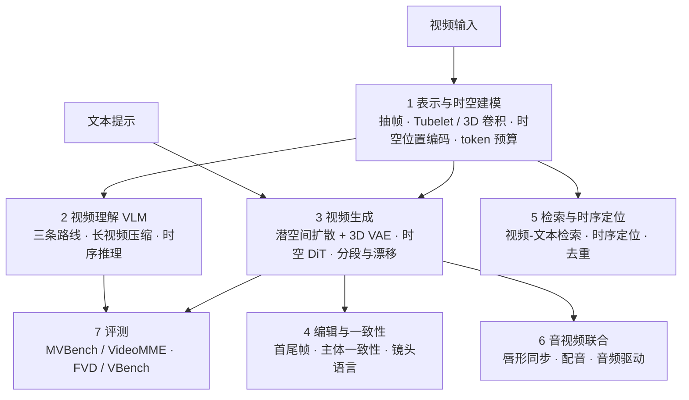
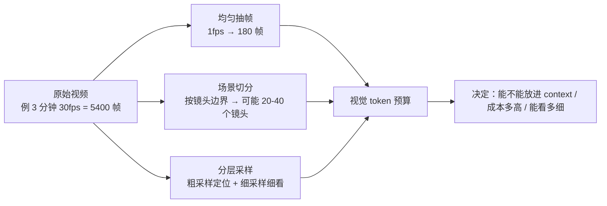
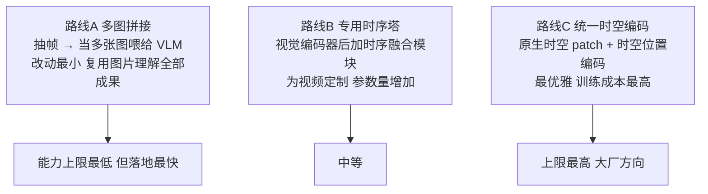
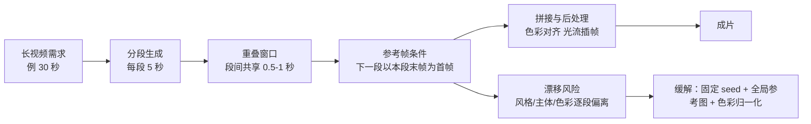

# 01 · 视频多模态 · 知识点大纲

> **模块定位**：三大模块里**最综合**的一块——它同时用到图片理解（抽帧后的多图）、生图模型（视频生成的扩散主干），外加独有的时间维度。放在最后学，是因为它约等于前两块之和再加一个"时间"。
> **为什么它决定面试成败**：目标岗位是剪映/CapCut 的 AI 剪辑方向，JD 明写「一键成片（AutoCut）、智能成片、GenAI 等 AI 剪辑与创作相关业务」。视频多模态不是加分项，是**主战场**。
> **学完的标准**：能说清视频 token 为什么爆炸、长视频怎么压、视频生成比图片多了哪些难点、一致性问题的工程解法、以及如何评测。
> **编号纪律**：本章编号与 [00 · 知识点总表](./00-知识点总表) **一一对应**（1.1–7.3 共 32 项）。
> ⚠️ **时效提醒（重要）**：本文的架构与算术结论**跨时间稳定**，可以放心讲；**模型名与版本会过期**。查最新模型与数字用 [01 · 视频多模态 · 事实与面试弹药](./01-视频多模态-事实与面试弹药)（核查时点 2026-10-14）。**尤其注意：字节自家产品线已换代到 Seedance 2.x + CapCut Video Studio / 剪映 Hub，只提"即梦/Dreamina"会显得脱节。**

## 一、知识地图

本模块有一条**理解线**（视频 → 看懂）和一条**生成线**（文本 → 视频），两条线的共同难点都是**时间维度**：



**一条主线**：视频 = **图片 + 时间轴**，所有难点都来自这个"+"：

| 难点 | 出现在哪条线 | 本质 |
|------|-------------|------|
| **token 爆炸** | 理解线 | 时间维度让视觉 token 多两个数量级，必须激进压缩 |
| **一致性** | 生成线 | 同一主体在几十帧里不能漂移 |
| **算力随时长增长** | 生成线 | 潜空间序列长度随时长线性涨，注意力更贵 |
| **时序语义** | 两条线 | "谁先发生""怎么动的"是图片理解完全没有的问题 |

## 二、怎么用这篇

| 读法 | 花多久 | 读什么 |
|------|--------|--------|
| **速览** | 5 分钟 | 每节「本质」句 + 「面试一句话」 |
| **深读** | 90 分钟 | 1.1、1.2、1.6、2.1、2.2、3.4、3.6 是面试主干，先吃透 |
| **动手** | 1–2 天 | 抽帧算术 → 跑一个视频 VLM 做"抽帧率 vs 精度"曲线 → LTX-Video 2B 出一条 2 秒视频 |

::: tip 一个判断优先级
如果只能学三块：**1.1 抽帧算术、2.2 长视频压缩、3.2/3.4 视频生成的时序难点**。这三块覆盖了视频多模态面试 80% 的追问面，其余是储备。
:::

## 三、知识点详解（编号与 00 总表一一对应）

### 模块 1 · 视频表示与时空建模

#### 1.1 视频数据本质：帧序列 + 帧率 + 分辨率 + 时长（P0）

**本质**：视频就是"一串按时间排列的图片 + 一个采样率"。所有视频任务的第一个决定是**怎么把这串图变成可计算的输入**。

**四个量的互算**（记住这组关系，后面算 token 全靠它）：

```text
总帧数 = 时长(秒) × 帧率(fps)
原始像素量 = 总帧数 × 宽 × 高 × 3
视频文件大小 ≈ 原始像素量 × 压缩比（H.264/HEVC 通常能压到 1/100 ~ 1/1000）
```

**算例**：3 分钟、30fps、1080p 的视频 ≈ 5,400 帧、约 `5400×1920×1080×3 ≈ 3.4×10¹⁰` 个像素值——**注意这里还是"像素"，不是 token**；真正进模型的 token 数由 1.6 的公式决定，两者差了三个数量级。

**边界**：分辨率与帧率不能只看"看起来清楚"——**对模型而言，帧率决定"时间分辨率"，分辨率决定"空间分辨率"，两者是不同维度的成本**。

> 面试一句话：视频 = 帧序列 × 帧率，原始像素量随时长线性涨；但真正决定成本的是抽帧之后的视觉 token 数，所以第一步不是"看视频"，是"决定看多密"。

#### 1.2 抽帧策略：均匀抽帧 / 关键帧 / 场景切分（P0）

**本质**：抽帧不是预处理小细节，而是**直接决定成本与能力上限**的第一道工程决策。



| 策略 | 做法 | 优点 | 缺点 | 适用 |
|------|------|------|------|------|
| 均匀抽帧 | 固定间隔取帧 | 实现最简单、可预期 | 快动作漏掉、静态段浪费 | 快速原型、短视频 |
| 关键帧 | 取 I 帧或按变化度取代表帧 | 保留"代表画面" | 快速运动段仍会漏 | 预览、封面 |
| 场景切分 | 按镜头边界切段，每段取代表帧 | **对齐"镜头"语义**、token 效率高 | 依赖切分质量，快切误判 | 剪辑类业务（**剪映场景最相关**） |
| 分层采样 | 先粗采样定位相关片段，再对片段细看 | 长视频可用 | 系统复杂、两阶段延迟 | 长视频理解 |

**场景切分怎么做**（工程上要能说出一种）：对相邻帧算**直方图差异/感知哈希/像素差**，超过阈值判定为切点；剪辑软件常用的"镜头"就是切点之间的区间。**为什么剪映场景更该用它**——镜头天然对应剪辑单元，模型看"镜头"比看"等间隔帧"更接近创作语义。

**必须记住的换算**：

```text
1 分钟 · 1fps = 60 帧
每帧 336 patch14 ≈ 576 视觉 token
总计 ≈ 34,560 token   ← 已超过多数模型的视觉预算
```

**三个降本手段**：降帧率（线性）、降分辨率（按边长平方缩）、时序池化/压缩（把相邻帧 token 合并）。**三者可叠加，但每一项都直接损失能力**。

> 面试一句话：抽帧是视频理解的第一道决策——1fps 抽 1 分钟就是约 3.5 万 token，剪映这类场景应优先用场景切分，因为镜头边界天然对应剪辑单元。

#### 1.3 光流与运动表征（P2）

**本质**：光流是"每个像素在相邻帧间移动了多少"的稠密向量场；它显式编码运动，但在当前多模态大模型路线里**基本不再用**。

**为什么不用**：让 Transformer 从帧序列里自己学运动比显式计算光流更灵活，且光流计算本身昂贵、对遮挡/大位移不鲁棒。

**它还留在哪**：传统动作识别、视频压缩（编码器的运动补偿）、以及生成侧的**后处理插帧**（3.6 的段间过渡）。**面试被问"你们用光流吗"，答"当前主流是端到端学习，光流更多出现在传统管线与后处理"是准确的。**

> 面试一句话：光流显式编码运动但贵且不鲁棒，被端到端学习取代；它现在主要活在视频压缩与后处理插帧里。

#### 1.4 3D 卷积与 Tubelet 时空 patch（P1）

**本质**：把"时间"当作卷积/注意力的一个维度——**3D 卷积**让卷积核在时间上也滑动，**Tubelet** 把连续几帧的同一空间位置合成一个"时空 patch"。

| 方案 | 做法 | 优劣 |
|------|------|------|
| 3D 卷积 | 卷积核在时间维滑动 | 能抓局部运动，但感受野受限、堆不深 |
| Tubelet（时空 patch） | 连续 k 帧的同一 patch 合成一个 token | ViT 化视频的标准做法，与 Transformer 天然契合 |
| 分解式（先空间后时间） | 先逐帧编码，再在时间维融合 | 算力可控，是主流工程折中 |

**算例**：2×16×16 的 tubelet（时间 2 帧、空间 16×16）把 8 帧的视频压成 4 个时间切片——**时间维的 stride 直接决定 token 数**，这是"时间压缩"的第一个旋钮。

> 面试一句话：3D 卷积给卷积加了时间维，Tubelet 把时空 patch 变成 token；工程上更常用"逐帧编码 + 时间融合"的分解式方案来控成本。

#### 1.5 时空位置编码与分解式注意力（P1）

**本质**：视频位置有三个维度（t/h/w），而**全时空注意力的复杂度是序列长度的平方**——序列 = 时间 × 空间，所以视频的平方比图片的平方贵得多。

```text
全 3D 注意力：O((T·H·W)²)            ← T=8、H=W=14 时约 (1568)²
分解式：空间注意力 O(T·(H·W)²) + 时间注意力 O((T·H·W)·T)
       ← 空间内先融合，再跨帧融合，总代价从"平方于全部 token"降到"平方于单帧 + 线性于帧数"
```

**为什么这是长视频可用的关键**：分解后"帧数"只进入线性项，帧数翻倍只让成本翻倍而不是平方。这是几乎所有视频模型（含视频 VLM 与视频生成）共用的技巧。

**位置编码怎么给**：加性分解编码（t/h/w 各一套相加）或 **RoPE 扩展（M-RoPE）**——把 RoPE 的频率分量按维度切给时间/高/宽，天然支持变长与变分辨率。

> 面试一句话：视频注意力要么全时空（平方爆炸），要么分解成"帧内 + 跨帧"；分解让帧数只进线性项，这是长视频可用的前提，位置编码则用 M-RoPE 把频率切给 t/h/w。

#### 1.6 视频 token 预算算术（时长 × 帧率 × 分辨率）（P0）

**本质**：视频 token 数 = **时长 × 帧率 × 每帧 token 数**，三个乘数任何一项翻倍都是线性膨胀——而"每帧 token 数"本身还随分辨率平方增长。

```text
视频 token ≈ 时长 × 帧率 × (H/p) × (W/p)

1 分钟 · 1fps · 336/patch14   ≈ 60 × 576    ≈ 34,560
1 分钟 · 2fps · 336           ≈ 69,120      ← 帧率翻倍
1 分钟 · 1fps · 448/patch16   ≈ 60 × 784    ≈ 47,040
10 分钟 · 1fps · 336          ≈ 345,600     ← 远超任何上下文窗口
```

**三个工程含义**：

1. **上下文装不下长视频**，所以必须压缩（2.2）；
2. **帧率与分辨率要按任务分级**——"这条视频里有没有人开枪"不需高清，但"字幕写了什么"必须高清；
3. **KV cache 与时长线性**——服务端必须对时长/分辨率设上限（7.3）。

> 面试一句话：视频 token = 时长 × 帧率 × 每帧 token，帧率与分辨率是乘法关系；1 分钟 1fps 就约 3.5 万 token，所以长视频必须压缩，且要按任务分级配置。

#### 1.7 长视频 token 压缩：池化 / Q-Former / 稀疏采样（P0）

**本质**：长视频的 token 压缩比图片理解**激进得多**，因为视频 token 天然多两个数量级。

| 手段 | 做法 | 压缩比 | 代价 |
|------|------|--------|------|
| 降帧率 | 少抽帧 | 线性 | 漏掉快速动作 |
| 空间池化 | 相邻 patch 特征平均 | 4–16× | 小字与细节丢失 |
| 时序池化 | 相邻帧同位置合并 | 2–8× | 快速运动模糊 |
| 可学习压缩 | Q-Former / Perceiver 重采样 | 任意 → 固定 | 信息瓶颈 |
| 稀疏采样 + 分层摘要 | 先粗采样定位相关片段，再对片段细看 | 很高 | 两阶段延迟、误差累积 |

**关键洞察**：压缩的代价是"**视频 VLM 在细节任务上普遍弱于图片 VLM**"——这不是模型不行，是压缩的必然结果。**面试官问"为什么视频模型看不清字幕"，标准答案就是这个。**

**边界**：压缩比的选择取决于"任务需要多细"。剪映类场景的正确做法是**分级**：理解/打标用激进压缩，字幕 OCR 用"先定位片段再局部高分辨率"的两阶段。

> 面试一句话：长视频压缩有"降帧率、空间/时序池化、可学习重采样、分层摘要"四类；压缩越激进细节越丢，所以视频 VLM 看不清字幕是压缩的必然结果，正解是分级 + 先定位再细看。

### 模块 2 · 视频理解 VLM

#### 2.1 视频理解 VLM 三条路线（多图拼接 / 专用时序塔 / 统一时空编码）（P0）

**本质**：视频 VLM = "把视频变成模型能吃的序列"，三条路线是三种编码方式。



| 路线 | 代表形态 | 优点 | 缺点 |
|------|---------|------|------|
| A 多图拼接 | 抽帧 + 帧标记 + 位置编码 | 复用图片 VLM、改动最小、落地最快 | 时序建模靠 LLM 自己从 token 顺序里学，能力有限 |
| B 专用时序塔 | 视觉塔后接时序融合模块 | 针对视频优化 | 参数量增加、结构复杂 |
| C 统一时空编码 | 原生视频 patch + 时空位置编码 | 最优雅、能力上限高 | 训练成本最高、数据需求大 |

**实践现状**：绝大多数开源 VLM 的"视频能力"是**路线 A**——把视频当多张图，用 M-RoPE 之类的机制标记帧序。**这正说明模块三是模块二的前置**：视频 VLM ≈ 图片 VLM + 帧序标记 + token 压缩。

> 面试一句话：三条路线是"多图拼接（快但上限低）、专用时序塔（折中）、统一时空编码（贵但上限高）"；当前开源 VLM 基本都在路线 A 上补时序能力。

#### 2.2 Video-LLaMA / VideoChat 早期方案（P2）

**本质**：在 LLaVA 式架构上"加一个时序模块"，代表是 VideoChat（时序聚合）与 Video-LLaMA（视频 Q-Former + 音频 Q-Former 双塔）。

**为什么现在不再作为主线**：这些方案的时序模块是"外挂式"的（先逐帧编码再聚合），而 M-RoPE + 多图拼接的路线更简单、更易扩展；它们的价值是**说明了"时序聚合"这件事的几种做法**。

> 面试一句话：早期方案是"LLaVA + 外挂时序聚合"，如今被"多图 + M-RoPE + token 压缩"取代，但其时序聚合思路仍有参考价值。

#### 2.3 Qwen2-VL 的 Naive Dynamic Resolution 与 M-RoPE（P0）

**本质**：两个机制分别解决"**按什么分辨率看**"与"**位置怎么编码**"。

| 机制 | 解决什么 | 怎么工作 | 代价 |
|------|---------|---------|------|
| **Naive Dynamic Resolution** | 强制 resize 导致畸变、细节损失 | 按原生分辨率编码，token 数随图大小变 | token 数不可控，服务端要设上限 |
| **M-RoPE** | 图片/多图/视频的统一位置编码 | 把 RoPE 频率分量拆给时间/高/宽 | 实现复杂、预填充更碎 |

**算例**：一张 1920×1080 的图、patch14 且 2×2 merge（有效 28）后：`(1920/28)×(1080/28) ≈ 69×39 ≈ 2691` token——**这就是"动态分辨率"下 token 数随输入变化的直观后果**。

**边界**：动态分辨率对 grounding 更准（不畸变），但**延迟变得不可预测**；生产上必须配合 `max_pixels` 与业务分级（7.3）。

> 面试一句话：Naive Dynamic Resolution 按原生分辨率编码保真不畸变，M-RoPE 把频率切给时间/高/宽支持统一时空位置——代价是 token 数不可控与实现复杂。

#### 2.4 Qwen2.5-VL / Qwen3-VL 的视频机制演进（P1）

**本质**：Qwen 系视频能力的演进主线是"时间可度量 + 抽帧自适应 + 高分辨率算得起"。

| 版本 | 视频侧关键机制 | 解决什么 |
|------|--------------|---------|
| Qwen2.5-VL | **绝对时间编码** + **动态 FPS** + ViT 窗口注意力 | 位置从"第几帧"变成"真实时间戳"；按视频节奏抽帧；高分辨率算得起 |
| Qwen3-VL | 2D grounding 与长文档 OCR 增强 | 空间定位与文档细节 |

**"绝对时间编码"为什么重要**：模型理解"这件事发生在第 3 秒"而不是"第 30 帧"，才能回答"多久之后发生了另一件事"这类真实时间尺度的问题——**这也是视频理解从"看画面"走向"看事件"的关键一步**。

> 面试一句话：Qwen2.5-VL 的视频改进是"绝对时间编码 + 动态 FPS + 窗口注意力"——让时间可度量、抽帧可自适应、像素算得起。

#### 2.5 视频 VLM 的时序推理能力（因果、先后、计数）（P1）

**本质**：时序推理是"**事件级**"理解，而不是"画面级"描述——这是当前视频 VLM 最弱的一环。

**四类典型任务**：

| 任务 | 例子 | 为什么难 |
|------|------|---------|
| 动作先后 | "他是先开门还是先坐下" | 需要跨帧比较事件顺序 |
| 因果 | "他为什么后退" | 需要事件间因果链 |
| 计数 | "几个人走过" | 需要跨帧实例跟踪 |
| 状态变化 | "杯子从满到空" | 需要理解状态转移 |

**为什么难**：压缩抹掉了帧间细粒度变化；训练数据偏"画面描述"而非"事件推理"；且 LLM 的顺序偏置可能压过视觉证据。

**面试话术**：「视频 VLM 擅长"描述画面里有什么"，不擅长"这两个动作谁先发生"——前者是空间理解（图片 VLM 已解决），后者需要真正的时序建模。」

> 面试一句话：时序推理（先后/因果/计数/状态变化）是视频 VLM 的公开弱项，根因是压缩抹细节 + 数据偏描述 + LLM 顺序偏置。

### 模块 3 · 视频生成

#### 3.1 视频生成的三条路线（像素扩散 / 潜空间扩散 / 自回归）（P0）

**本质**：三条路线的分歧只在"把视频压缩成什么表示"——像素、潜空间、还是离散 token。

| 路线 | 机制 | 代表 | 优势 | 瓶颈 |
|------|------|------|------|------|
| 像素空间扩散 | 直接对视频像素去噪 | 早期工作 | 概念简单 | 算力不可承受 |
| **潜空间扩散 + 3D VAE** | 先 3D VAE 压到时空潜空间，再扩散 | Sora、开源主流 | 算力可行、质量高 | 依赖 VAE 压缩能力 |
| 自回归生成 | 视频离散化成 token 逐段预测 | 探索性工作 | 与 LLM 同构、支持长视频续写 | tokenizer 难、误差累积 |

> 面试一句话：主流是"3D VAE 压到时空潜空间 + 潜空间扩散"，因为像素空间不可承受；自回归路线与 LLM 同构但受 tokenizer 与误差累积限制。

#### 3.2 Sora 的技术要点与"世界模型"论战（P0）

**本质**：Sora 的公开要点是"**时空 latent patch + 大规模 DiT + 变长时长/分辨率训练**"，它的影响在于证明这条路可行，而不在细节。

**要能说的三点**：① 用 patch 化表示统一不同分辨率/时长的视频；② 用 Transformer 在潜空间做扩散；③ 训练数据规模与多样性是效果的关键。

**"世界模型"论战怎么看**：一类观点认为"能生成物理上合理的视频"意味着模型内部建立了世界模型；另一类认为它只是**学到了训练分布中的统计相关性**（如"杯子下落→碎"）。**面试里更稳的说法是**：它能捕捉大量物理规律的表征，但**在未见过的场景下仍会违反直觉**——物理合理性是当前公开短板（3.2 的边界）。

> 面试一句话：Sora 的可复用要点是"时空 patch + 潜空间 DiT + 大规模数据"；"世界模型"之争的稳妥回答是"它学到了统计规律，但未见场景仍会违反物理直觉"。

#### 3.3 3D VAE 与时空压缩比（P1）

**本质**：图片 VAE 只压空间，视频 3D VAE **同时压空间与时间**——这是"分钟级视频"能进模型的前提。

```text
例：24 帧 512×512 视频
像素 ≈ 24 × 512 × 512 × 3 ≈ 1.9×10⁷ 个数
3D VAE（空间 8×、时间 4×）≈ 6 × 64 × 64 × 4 ≈ 1.0×10⁵ 个数
                        ↓ 约 190 倍
```

**为什么时间也要压**：只压空间的话，帧数仍是线性项；时间压缩把"帧数"降一个数量级，**潜空间序列才短到注意力能承受**。

**边界**：时间压缩必然损失快速运动细节（时间维的"糊"），这是"长视频生成里快速动作容易糊/变形"的原因之一。

> 面试一句话：3D VAE 空间压 8×、时间压 4×，把 24 帧视频压约 190 倍；时间压缩是必须的，代价是快速运动细节受损。

#### 3.4 DiT 在视频上的扩展（时空 patch、3D attention）（P0）

**本质**：把 DiT 从"2D patch 序列"扩展到"时空 patch 序列"，**关键在注意力怎么分解**。

```text
2D：patch 序列长度 = (H/p)·(W/p)
3D：patch 序列长度 = (T/t)·(H/p)·(W/p)   ← 时间进入序列
注意力：全时空 O(N²) 不可承受
       → 空间注意力（帧内）+ 时间注意力（跨帧）+ 可选的全局层
```

**三种工程做法**：

| 做法 | 思路 | 代价 |
|------|------|------|
| 全时空注意力 | 所有 token 两两交互 | 短片段可用，长视频不可承受 |
| 分解注意力 | 帧内空间 + 跨帧时间 | 表达力略降，但算力可控 |
| 窗口/稀疏注意力 | 只关注局部窗口或少量全局 token | 长依赖靠全局层补 |

**条件注入**：文本（cross-attention/联合注意力）+ 首帧/参考图（额外条件分支）+ 时间步（adaLN 类调制）。

> 面试一句话：视频 DiT 把序列扩成时空 patch，再用"帧内 + 跨帧"的分解注意力把二次项压住；条件注入同时挂文本、首帧/参考图与时间步。

#### 3.5 开源视频生成模型谱系（CogVideoX / HunyuanVideo / Wan / LTX-Video / Open-Sora）（P0）

**本质**：这张表不是背参数量，而是记"谁开源、谁只能 API、谁能在你的机器上跑"。

| 模型 | 开源 | 定位 | 备注 |
|------|------|------|------|
| Sora（OpenAI） | ❌ | 里程碑，证明潜空间时空 patch 路线 | 技术报告信息有限，细节未公开 |
| 可灵 Kling | ❌ | 国内第一梯队 | 商用 API |
| Veo（Google） | ❌ | 画质与物理表现领先梯队 | 商用 API |
| **Seedance 系列（字节 Seed）** | ❌ | **字节自家底座模型，岗位直接相关** | **当前 2.x 代（2.0 起是统一音视频联合生成架构），能力与版本以[弹药篇](./01-视频多模态-事实与面试弹药)为准** |
| **即梦 / Dreamina / CapCut / 剪映** | ❌ | **字节自家产品线，岗位直接相关** | **国际版 CapCut 已换代到 Video Studio（无限画布 + AI 编剧 Agent + 分镜卡片）；国内剪映推出剪映 Hub 与创作 Agent——务必亲自体验并形成产品判断** |
| **Vidi 系列（字节）** | ⚠️ 部分 | **"多模态模型用于剪辑"的官方样板** | 时序检索 + 精细时空定位 + **剪辑规划**；讲项目时引用它比引用通用 VLM 有效得多 |
| Wan **2.1 / 2.2**（阿里） | ✅ | **开源视频生成主力**（Apache-2.0） | ⚠️ **只有 2.1/2.2 有开源权重；2.5/2.6 官方未放权重** |
| HunyuanVideo（腾讯） | ✅ | 开源视频模型 | ⚠️ **官方显存口径 45–60GB 量级 → 32GB Mac 跑不动，只能读代码**；13B 版许可**不适用于欧盟/英国/韩国** |
| CogVideoX（智谱） | ✅ | 开源、文档完善 | **2B 版显存要求很低（个位数 GB）**，是学习首选之一；2B 与 5B 许可不同 |
| LTX-Video（2B distilled） | ✅ | 主打实时，**diffusers 里极少数带官方 MPS 标记的视频管线** | ✅ **32GB Mac 上真能跑，是本地生成实验的首选载体** |
| Open-Sora | ✅ | 开源复现路线 | **代码可读、流程完整，读代码的学习价值最高** |

::: danger 关于"能不能在你这台机器上跑"——三条硬约束
1. **官方显存要求普遍在几十 GB 级别**：Wan2.1 的 1.3B 版最低约 **8GB**（少数能在 32GB Mac 上跑的）；Wan2.2 的 5B 约 **24GB**、14B 系约 **80GB**；HunyuanVideo 13B 需 **45–60GB**。**统一内存 ≠ 显存**，Metal 只能锁住一部分。
2. **diffusers 里只有极少数视频管线带官方 MPS 标记**（LTX-Video 与 SANA-Video），其他管线写 `device="mps"` 只是"允许"而非"承诺"。
3. **MPS 三条硬约束**：必须开 attention slicing；**一次传多个 prompt 会崩**；**必须用 float16**（bf16 在 MPS 上是性能陷阱）。
:::

::: warning 数字纪律（重要）
本表只给"开源与否 + 定位"，**故意不写参数量、时长上限、分辨率**——这个领域几个月一变。**面试前一天打开 model card 确认要引用的数字**；确认不了就只讲架构与权衡。

本模块**跨时间稳定的结论**（可以放心讲）：① 潜空间 + 时空 patch 是主流；② 时序一致性是核心难点；③ 长视频靠分段 + 一致性约束；④ 物理合理性仍是公开短板；⑤ 音视频联合生成是当前方向。
:::

> 面试一句话：这条谱系要记的不是参数量，而是"谁开源、谁只能 API、谁能在你的机器上跑"；字节侧要能说出 Seedance 2.x 与 CapCut Video Studio，别停在"即梦"。

#### 3.6 长视频生成：分段生成 + 拼接 + 漂移问题（P0）

**本质**：产品要 30 秒以上，模型单次只能生成 5–10 秒——**工程解法是分段 + 一致性约束，核心风险是误差累积**。



**漂移的数学直觉**：每段生成相当于对上一段末帧做一次"有损变换"，误差随段数近似累积（类似自回归误差累积）。**段数越多、漂移越明显**——所以"分段数"本身是个成本/质量的旋钮。

**四种缓解**：固定随机种子（减少风格抖动）、全局参考图/首帧锚定（防主体漂移）、色彩归一化（后处理对齐）、重叠窗口 + 光流插帧（接缝平滑）。

**边界**：分段拼接解决的是"时长"，不解决"叙事连贯"——真正的长视频生成还需要**剧本/分镜级的规划**（见 4.4 与面试 Q7 的"一键成片"链路）。

> 面试一句话：长视频靠"分段 + 重叠窗口 + 参考帧条件 + 后处理"拼接，最大风险是误差累积导致的风格/主体漂移，靠固定 seed、全局参考图与色彩归一化缓解。

#### 3.7 商用模型对照（可灵 / Veo / 即梦 / Runway）（P1）

**本质**：商用模型不能只比画质，要按业务需要做多维匹配。

| 维度 | 怎么比较（不背分数） |
|------|-------------------|
| 画质与稳定性 | 看"同一 prompt 多次生成"的一致性，而不是挑最好的一条 |
| 时长上限 | 单次生成时长 vs 是否支持续写/分镜 |
| 可控性 | 首尾帧、参考图、运镜、局部编辑支持度 |
| 速度与成本 | 生成 10 秒的耗时与价格 |
| 音画联合 | 是否原生带音频（当前方向） |

**面试要点**：讲商用模型要落在"**业务匹配**"——剪映这类产品需要"可控性 + 速度快 + 成本低"，而不是"画质天花板"。

> 面试一句话：商用模型不能只比画质，要按"时长/可控性/速度/成本/音画联合"做业务匹配；对剪辑产品而言可控性与速度权重更高。

### 模块 4 · 视频编辑与一致性

#### 4.1 首帧/尾帧控制与关键帧插值（P0）

**本质**：用"给定帧"当强条件，让模型生成"从这帧到那帧"的过渡——**控制的时序一致性靠条件帧锚定，而不是逐帧约束**。

| 方式 | 机制 | 对应产品功能 |
|------|------|-------------|
| 首帧控制 | 第一帧当强条件 | 图生视频（最常用） |
| 尾帧控制 | 末帧当强条件 | 倒放/过渡收尾 |
| 首尾帧插值 | 两端都给定，模型填中间 | 转场、分镜动画 |
| 多关键帧 | 指定多个关键帧 | 关键帧动画 |

**实现要点**：条件帧通过**额外条件分支**（类似 ControlNet 的思路）注入，而不是简单拼在序列里——拼在序列里会让模型"照着抄"而不是"生成过渡"。

**边界**：首帧控制太强会导致"视频等于图片加轻微抖动"；产品里要配合运动提示词或运动强度参数。

> 面试一句话：首/尾帧控制靠条件分支把"指定帧"注入模型，实现图生视频与转场；控制太强会变成"图片微动"，需要配合运动强度。

#### 4.2 主体一致性与角色一致性方案（P0）

**本质**：与生图的 4.6 同源，但多了"**时间维**"——不仅要跨图一致，还要帧间不漂移。

| 一致性类型 | 保持什么 | 手段 |
|-----------|---------|------|
| 身份一致性 | 脸/主体不漂移 | 参考图注入（IP-Adapter 类迁移到视频）+ 人脸 ID 模块 |
| 风格一致性 | 画风统一 | 风格 LoRA、提示词模板 |
| 构图一致性 | 布局可控 | ControlNet（姿态/深度/边缘）时序化 |
| 时序一致性 | 帧间不跳 | 时序注意力、参考帧条件、后处理光流 |

**核心难点**：视频的参考帧只锚定"首帧"，后续帧靠模型自己维持——**所以视频一致性比图片一致性更难，本质是"只有一次锚定机会"**。

**工程解法**：参考图 + 首帧条件 + 主体特征注入 + 后置校验（人脸/主体相似度）+ 不合格重试——**组合拳，没有单一模型**。

> 面试一句话：视频一致性比图片难，因为只有首帧一次锚定机会；靠参考图 + 首帧条件 + 特征注入 + 后置校验 + 重试兜底。

#### 4.3 视频编辑：局部重绘、风格迁移、换装换脸（P1）

**本质**：视频编辑 = 图片编辑的控制信号沿时间轴扩展，难点是控制的时序一致性。

| 任务 | 机制 | 关键限制 |
|------|------|---------|
| 局部重绘 | 时间窗 + 空间掩码（3D 掩码） | 时间维掩码要含"运动导致的位移" |
| 风格迁移 | 参考风格图 / LoRA | 风格漂移、帧间闪烁 |
| 换装换脸 | 掩码 + 身份保持 + 时序约束 | 姿态变化与遮挡处理 |
| 去水印/去物体 | 掩码重绘 + 时序一致性 | 背景补全要跨帧一致 |

**关键洞察**：**视频编辑 = 图片编辑的控制信号沿时间轴扩展**，难点是"控制的时序一致性"——逐帧独立编辑会让画面抖，所以要么把控制信号时序化，要么用视频模型统一处理。

> 面试一句话：视频编辑是把图片编辑的控制信号时序化（3D 掩码/时序 ControlNet），逐帧独立编辑必然闪烁。

#### 4.4 镜头语言控制（运镜、景别、转场）（P1）

**本质**：镜头语言是"剪辑决策"而不是"模型能力"——它决定输出怎么被用户使用。

| 控制维度 | 表示方式 | 难点 |
|---------|---------|------|
| 运镜 | 文本（"推镜/拉镜/摇镜"）或相机轨迹 | 轨迹与内容一致性 |
| 景别 | 文本（"特写/中景/全景"） | 与主体尺度绑定 |
| 转场 | 首尾帧 + 转场类型 | 转场自然度 |
| 节奏 | 时长/切点 | 与音乐节拍对齐（剪映场景） |

**为什么这是"产品能力"而非"模型能力"**：模型生成的是"画面"，镜头语言是"剪辑决策"——**这正是 AI 剪辑产品（AutoCut/一键成片）要把模型输出落到可编辑时间线的理由**（面试 Q7）。

> 面试一句话：镜头语言是剪辑决策而非模型能力，所以产品要把它落到可编辑的时间线上——这也是"AI 出稿 + 人精修"的产品逻辑。

#### 4.5 LoRA / ControlNet 在视频上的复用与差异（P1）

**本质**：思想可复用，但视频主干的层结构与条件注入位置不同，迁移前要确认兼容性。

| 复用点 | 视频上的差异 |
|--------|-------------|
| LoRA | 风格 LoRA 可直接复用；但视频主干（DiT/时空）的层结构不同，**LoRA 要挂在与图片不同的位置** |
| ControlNet | 单帧 ControlNet 可迁移；但需要"时序化"（逐帧条件一致性）或原生视频 ControlNet |
| IP-Adapter | 参考图注入思路可复用，但视频要"一次注入、多帧维持" |

**工程注意**：图片侧的 LoRA/ControlNet 生态远成熟于视频侧，**迁移时要先确认主干结构是否兼容**（U-Net vs DiT、时空层位置），这是"动手时最容易踩的坑"。

> 面试一句话：LoRA/ControlNet 的思想可复用，但视频主干的层结构与条件注入位置不同，迁移前先确认兼容性，且控制信号要时序化。

### 模块 5 · 检索与时序定位

#### 5.1 视频-文本对比学习与检索（P1）

**本质**：CLIP 思路的时间扩展——视频编码器与文本编码器做对比学习，把"视频片段"与"描述"对齐。

| 粒度 | 做法 | 索引设计 |
|------|------|---------|
| 视频级 | 整段视频一个向量 | 单层向量索引 |
| 片段级 | 滑动窗口切片、每片一个向量 | 多粒度索引（片 → 视频） |
| 帧级 | 每帧一个向量 | 量大，通常只做粗筛 |

**工程要点**：**多粒度索引**是检索准的关键——用户问"找到他开门的那一段"，片段级向量比视频级准；这与 [RAG](../导师学习路径/01-RAG原理与LLM基础) 的"分块 + 多粒度"是同一套思维，**你的向量检索经验可直接迁移**。

> 面试一句话：视频检索要建多粒度索引（帧/片段/视频），用户找"那一段"时片段级向量才准——和 RAG 的分块思路同构。

#### 5.2 时序定位（Temporal Grounding）（P1）

**本质**：输入"找到他开门的那一段"，输出**时间区间**——是 VL grounding 在时间轴上的对应物。

```text
输入：视频 + 文本查询
输出：<start> 12.4s </start><end> 18.7s </end>   ← 时间戳归一化到 0–1000 或直接秒
训练：时序定位数据（如"描述 → 区间"配对）
```

**难点**：时间边界模糊（"开门"从手碰到门把手算还是门动了算？）；长视频的定位误差随长度放大。

**工程做法**：两阶段——先检索候选片段（5.1），再对候选做精细定位（类似"先粗排再精排"）。

> 面试一句话：时序定位是 Grounding 的时间版，输出归一化时间区间；工程上用"检索候选片段 + 精定位"两阶段控制长视频误差。

#### 5.3 视频指纹、去重与相似片段检索（P2）

**本质**：给视频算"指纹"，用来判重与找相似片段。

| 方法 | 做法 | 适用 |
|------|------|------|
| 文件哈希 | 完全一致才相同 | 精确去重 |
| 感知哈希（pHash/dHash） | 对关键帧算哈希，容忍压缩/缩放 | 近似去重 |
| 关键帧特征 | 关键帧 embedding + 向量检索 | 相似片段 |
| 音频指纹 | 音频特征哈希 | 翻录/搬运检测 |

**剪映场景的高频需求**：素材库去重（用户上传大量相似素材）、侵权检测（相似片段）。**工程要点**：指纹要"规范化"（统一分辨率/帧率/时长裁剪），否则同一视频不同转码会被判不同。

> 面试一句话：视频去重靠"感知哈希（近似）+ 关键帧向量（相似）+ 音频指纹（搬运）"，指纹要做规范化，否则转码就失效。

### 模块 6 · 音视频联合

#### 6.1 音频-视频联合建模（唇形同步、配音）（P1）

**本质**：音频与画面必须在时间轴上对齐，这是剪辑产品的底线体验。

| 方向 | 技术要点 | 难点 |
|------|---------|------|
| 唇形同步 | 音频特征驱动口型区域生成，保持身份与表情 | 口型与音素的映射、侧脸/遮挡 |
| 视频配音 | 翻译 + 语音合成 + 唇形对齐 | 多模块串联、误差叠加 |
| 音频驱动人像 | 音频 → 表情/头部姿态 → 视频生成 | 自然度、身份保持 |
| 音效生成 | 视频内容 → 匹配音效（Video-to-Audio） | 音画语义对齐 |

**为什么剪映关心**：剪辑产品里音频与画面必须同步，这是基础体验要求。**跨模态时序对齐的感知阈值约百毫秒量级**（具体数值以实际产品测试为准）——超过就"看得出来"。

> 面试一句话：音视频联合的核心是跨模态时序对齐（百毫秒量级的感知阈值），唇形同步要对口型、配音要对时间轴、音效要对语义。

#### 6.2 音频驱动数字人与口型生成（P2）

**本质**：给定一张人像 + 一段音频，生成"说话的口型/表情/头部动作"。

**链路**：音频特征 → 口型/表情序列 → 视频生成（图像驱动）→ 唇形后对齐。**难点**：身份保持、表情自然度、侧脸/遮挡、长音频的漂移。

**边界**：商用数字人产品通常"口型 + 姿态 + 声音"一体化建模，单点技术（只做口型）不够；合规上还涉及肖像权与内容审核（G7）。

> 面试一句话：数字人 = 音频特征 → 口型/表情/姿态序列 → 视频生成，难点是身份保持与长时漂移，合规上还涉及肖像权。

### 模块 7 · 评测

#### 7.1 视频理解评测（MVBench / VideoMME / TempCompass）（P1）

**本质**：每个视频理解评测只测"某一种能力"，读榜先看它测什么。

| 评测 | 测什么 | 读榜注意 |
|------|--------|---------|
| MVBench / VideoMME | 综合视频理解 | 与抽帧配置强相关（7.3） |
| TempCompass | **时序推理**（先后/因果/变化） | 专门测时序，别与综合分混谈 |
| 自建基准 | 业务真实问题 | 最有价值，20–50 条即可 |

**正确的读榜姿势**：**按能力分别看**——综合分看 MVBench/VideoMME，时序能力看 TempCompass 类，业务能力看自建样本；**不同抽帧配置下的分数不可直接比较**。

> 面试一句话：视频理解要分能力看榜——综合看 VideoMME、时序看 TempCompass，且必须标注抽帧配置，否则分数不可比。

#### 7.2 视频生成评测（FVD / VBench 的维度设计）（P0）

**本质**：视频生成质量是多维的，单一指标会把不同问题混在一起。

| 指标 | 测什么 | 局限 |
|------|--------|------|
| FVD | 生成与真实视频的分布距离 | 与人类感知相关性有限、不测时序一致性 |
| VBench 类多维评测 | 拆成主体一致性、运动幅度、美学、文本对齐等 | 维度设计依赖实现，**比单一指标有指导性** |
| 业务指标 | 生成成功率、重试率、审核拦截率 | 产品真正关心的 |

**为什么 VBench 类更该用**：视频生成的质量是**多维**的（画面好不好看 vs 动不动得对 vs 前后一致不一致），单一 FVD 会把"静态但一致"和"动但闪烁"混在一起。

> 面试一句话：视频生成要拆多维评（一致性、动态、美学、对齐），FVD 只能作参考；产品侧看成功率/重试率/拦截率。

#### 7.3 抽帧策略与评测结果的关系（常见坑）（P1）

**本质**：理解类 benchmark 的分数**依赖抽帧配置**——同一模型换帧率/分辨率，分数会变。

**三个必问**：评测时抽多少帧？帧率是多少？分辨率多少？**没标注这三项的榜单分数不能横比**。

**面试价值**：能指出"这个分数是在 1fps/336 下测的，换 2fps 可能就变了"，体现的是**工程细节影响结论的判断力**，比背分数强。

> 面试一句话：视频理解分数与抽帧配置强相关，看到"某模型第一"先问帧率与分辨率——这是工程判断力的体现。

---

## 四、面试问答（带参考答案要点）

**Q1：视频理解和图片理解最大的区别是什么？**
多了时间维度，带来两个直接后果：**理解侧**视频 token 数比图片多两个数量级（1 分钟 1fps ≈ 3.5 万 token），必须激进压缩，代价是细节能力下降；**生成侧**必须在时间轴上保持一致，否则画面跳变。前者是预算问题，后者是一致性问题——这两个就是视频多模态的全部主线。

**Q2：长视频怎么处理？**
分层：先抽帧（1fps 或场景切分）→ 再做视觉 token 压缩（时序池化/重采样）→ 必要时两阶段（粗采样定位相关片段，再对片段细看）。工程上还要分段摘要再汇总。核心权衡是"看得全"与"看得清"不可兼得。

**Q3：视频生成比图片生成难在哪？**
三点：① 时序一致性——同一主体在几十帧里不能漂移；② 算力——潜空间序列长度随时长线性涨，注意力量级更差，所以必须做注意力分解与分段生成；③ 数据——高质量视频文本对远少于图文对。此外物理合理性仍是公开短板。

**Q4：怎么做长视频？**
分段生成 + 重叠窗口 + 参考帧条件（下一段以本段末帧为首帧）+ 后处理对齐（色彩、光流插帧）。最大风险是**漂移**：逐段生成会让风格与主体逐渐偏离，缓解靠固定随机种子、全局参考图、色彩归一化。

**Q5：怎么保证视频里角色一致？**
组合拳：参考图注入主体特征、首帧条件锚定身份、训练专属角色 LoRA、后置人脸/主体校验与重生成。产品上还要"不合格就重试"的兜底。**没有单一模型能解决，这是一致性问题的通用答案。**

**Q6：视频生成怎么评测？**
FVD 测分布距离但与人类感知相关性有限；VBench 类多维评测把一致性、动态幅度、美学、文本对齐拆开看，更有指导性。产品侧还要看生成成功率、重试率、审核拦截率。**看榜单时注意抽帧与配置，不同配置分数不可直接比较。**

**Q7：如果让你做"一键成片"，技术链路怎么设计？**
① 素材理解：VL 模型给每段素材打标签（场景、人物、情绪、画质）；② 脚本规划：LLM 按音乐节拍与语义生成分镜脚本；③ 素材检索与对齐：按标签 + 时长匹配镜头（向量检索）；④ 粗剪：时间轴拼接、转场、卡点；⑤ 精修：调色、字幕、音效；⑥ 质检：一致性检查与重生成兜底。**关键是把每一步都做成可解释、可回退的模块，而不是一个大模型端到端。**

::: tip 想答得更"贴岗位"，补上这三句
1. **这已经是有人在做的事**：字节 AutoCut 方向的工作把视频与音频**离散化到与文本对齐的统一 token 空间**，用**一个多模态 LLM 同时做选片/排序/脚本/BGM 选择**——"规划"正在被收敛进一个模型。
2. **结构化中间表示是工程关键**：产物应落到**可编辑的时间线中间表示**（EDL / OTIO 这类），才能"AI 出稿 + 人精修"，而不是给一段黑盒视频。
3. **降本靠草稿/定稿分级**：低分辨率低步数出草稿让用户确认，满意后走高成本路径成片（官方产品就是这么做的 Draft 模式）。
:::

**Q8：视频 VLM 为什么看不清字幕？**
因为长视频必须激进压缩视觉 token，小字在压缩中首先被抹掉。要看清字幕得走局部高分辨率路线（对指定时间窗做高分辨率抽帧），这是"先定位再细看"的两阶段思路。

## 五、自测清单

- [ ] 能算出 1 分钟视频在 1fps / 不同分辨率下的视觉 token 数
- [ ] 能说出四种抽帧策略的取舍，并指出剪映场景更该用哪种、为什么
- [ ] 能解释分解式注意力为什么让长视频可用（给复杂度式子）
- [ ] 能说清视频理解的三条技术路线与主流现状
- [ ] 能列出长视频 token 压缩的五种手段和各自代价
- [ ] 能算清 3D VAE 的时空压缩比（空间 8× 时间 4× ≈ 190 倍）
- [ ] 能完整说出视频生成比图片生成多的三个难点
- [ ] 能设计一个长视频分段生成的方案并指出漂移风险与缓解
- [ ] 能说出视频一致性的组合解法
- [ ] 能对比 FVD 与 VBench 类评测的指导性差异
- [ ] 已读过一个开源视频生成项目的代码（推荐 Open-Sora / CogVideoX）
- [ ] **能说清自己机器的能力边界**：哪些模型真能跑、哪些官方显存要求不在 32GB Mac 射程内
- [ ] 已用 LTX-Video 2B distilled 在 M5 上真跑出一条视频（哪怕 2 秒 480P）
