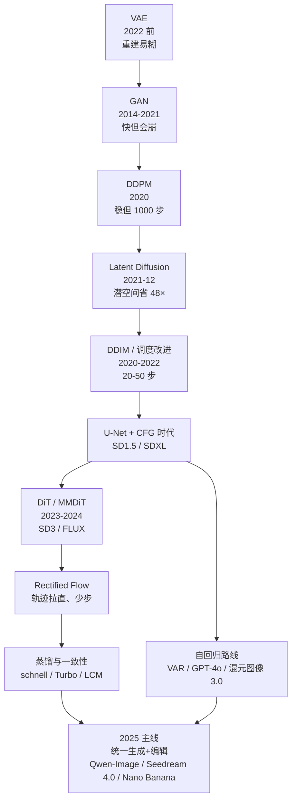

# 02 · 生图模型 · 事实与面试弹药（核对时点：2026-10-14）

> **这份文档的定位**：模块二「生图模型」的**事实底稿**——把易错、易混、易被面试官追问的**具体数字与事实**钉死，并显式区分「已核实」与「需核实」。
> **不替代进度表**：学习进度的唯一真相来源仍是 [00 · 知识点总表](./00-知识点总表) 的「模块二」表。本文只给事实与面试弹药，不重复建清单。
> **配套大纲**：[02 · 生图模型 · 知识点大纲](./02-生图模型-知识点大纲)——**学习主线走大纲，查数字与模型对照表看本文**。
> **核对方式**：本文标 🔗 的结论来自公开资料检索（公司博客 / 模型卡 / 论文页面 / GitHub）。标注 **需核实** 的数字表示检索未取得官方一手确认，面试时**必须**说"大约/我看到的报道是"，绝不能当确定值讲。
> ⚠️ **时效提醒**：生图领域迭代极快。本文的模型对照表核查于 2026-10-14，但**生成侧（含生图）在 2025 年底之后又出了一代新模型**（`01 · 视频多模态 · 事实与面试弹药` 已按 2026-10 更新，可对照其"统一生成+编辑"趋势）。**面试前一天请重新确认你要引用的每一个数字**；生图侧的对照表仍以本文为准，但请把"当前最新版本"当作必须现场核实的信息。
> **硬件前提**：Apple M5 / 32GB 统一内存 / 无 NVIDIA 独显，所有实验按 diffusers + MPS（或 MLX）设计。

## 〇、置信度标记约定

| 标记 | 含义 | 面试话术 |
|------|------|---------|
| ✅ | 官方博客/模型卡/论文页面已确认（附链接） | 直接讲 |
| 🟡 | 有公开来源但非一手，或来源间不一致 | "公开报道是 X，具体以官方模型卡为准" |
| 🔴 | 未取得来源，仅凭常识推断 | **不要讲数字**，只讲机制 |

---

## 一、知识分层清单（原理层 / 架构层 / 工程层）

### 1.1 原理层（数学与训练目标——面试最容易被追到底的一层）

| # | 知识点 | 必须能说出的硬事实 | 权重 | 可复现 |
|---|--------|------------------|------|--------|
| P1 | 生成范式谱系 | VAE（ELBO，重建-先验权衡，易糊）→ GAN（对抗博弈，模式崩溃 + 训练不稳）→ Diffusion（去噪即学习数据分布梯度场，训练稳定但采样慢）→ Flow Matching / Rectified Flow（回归速度场，轨迹可拉直，少步更好训）→ 自回归图像生成（把图像当 token 序列，next-scale 或 next-token）→ 一致性模型（学习"任意点直达终点"的自映射，1–4 步） | P0 | 部分 |
| P2 | 前向加噪闭式解 | $x_t=\sqrt{\bar\alpha_t}x_0+\sqrt{1-\bar\alpha_t}\epsilon$，$\bar\alpha_t=\prod\alpha_i$。这是"一次跳到任意 t"的依据，也是训练能随机采 t 的前提 | P0 | ✅ |
| P3 | 三种预测目标 | ε-pred（预测噪声，SD1.5/SDXL）、x₀-pred（直接预测干净图）、v-pred（$v=\sqrt{\bar\alpha_t}\epsilon-\sqrt{1-\bar\alpha_t}x_0$，本质是 SNR 加权的 ε/x₀ 混合）。关系：知道任意一个 + $x_t$ 就能推出另两个 | P0 | ✅ |
| P4 | 为什么转向 v-pred / flow matching | ε-pred 在低噪声区（SNR 极高）梯度权重失衡、样本质量差；v-pred 与 SNR 解耦、训练更稳（SD2 起可选）；rectified flow / flow matching 把"预测噪声"换成"预测速度"，路径更接近直线 → 少步采样损失更小，这是 SD3/FLUX 少步可行的数学原因 | P0 | ✅ |
| P5 | 反向采样 | DDPM 随机采样（马尔可夫链，需重采样噪声）；DDIM 确定性采样（$\eta=0$，同一个 $x_T$ 必然产出同一张图，可用 DDIM inversion 做编辑）；本质都是离散化概率流 ODE | P0 | ✅ |
| P6 | 噪声调度 | linear / cosine / **shifted** / zero-terminal-SNR。「shift」是 SD3 引入的关键技巧：分辨率越高，同样 step 的噪声水平实际越"浅"，需要把时间步 schedule 按分辨率平移后再采样 | P1 | ✅ |
| P7 | 训练时的 t 采样 | 均匀采 t 效果一般，SD3 用 **logit-normal** 采 t 并配 shift，等价于按信噪比分配训练算力；这解释了"为什么 SD3 的 prompt 跟随更好" | P1 | ✅ |
| P8 | CFG 公式与原理 | $\hat\epsilon=\epsilon_\theta(x_t,\varnothing)+s\cdot(\epsilon_\theta(x_t,c)-\epsilon_\theta(x_t,\varnothing))$。训练时以 5%–10% 概率把文本置空（null embedding），使同一网络同时建模条件和无条件分布；推理时把"条件方向"外推 | P0 | ✅ |
| P9 | CFG 的副作用 | s 过大 → 过饱和/过锐化、构图僵化、多样性崩塌、解剖结构崩坏、文字扭曲；s 过小 → 指令不跟随。**蒸馏模型（schnell / Turbo / Lightning）已把 guidance 内化，再叠加 CFG 会毁图** | P0 | ✅ |
| P10 | CFG 的改良 | Rescaled CFG（按方差重标定）、CFG++、APG（自适应投影）、动态 CFG（按 t 递减）；工程上常配 "guidance rescale 0.7" | P1 | ✅ |
| P11 | 一致性模型家族 | CM（consistency distillation，把 ODE 轨迹上任意点映射到同一起点）→ LCM（在 latent 上做，4 步）→ LCM-LoRA（把一致性能力做成 LoRA，免重训）→ sCM（continuous-time，TrigFlow 参数化，2 步，宣称约 50× 加速） | P1 | ✅ |
| P12 | 自回归图像生成 | VAR 提出 **next-scale prediction**：不是按光栅顺序出 token，而是从低分辨率尺度逐级预测到高分辨率；2 步即可超过同规模 DiT 的 ImageNet 256 FID（论文声明）；GPT-4o 走的是原生多模态自回归 token 路线，优势是**指令跟随与文字渲染**，代价是推理 token 数多 | P1 | ❌ |
| P13 | 分布/监督视角 | 扩散可看作去噪得分匹配 + 概率流 ODE；CFG 可解释为"隐式分类器引导"（Imagen 起）或"条件后验外推"。面试若被问"CFG 为什么不是免费的"，答"它在放大条件似然的同时压缩了条件分布的方差" | P1 | — |

### 1.2 架构层（结构、条件注入、可控与编辑）

| # | 知识点 | 硬事实与关键数字 | 权重 | 可复现 |
|---|--------|----------------|------|--------|
| A1 | Latent Diffusion | SD 的 VAE 是 **8× 空间下采样**：512×512×3 → **64×64×4**，像素数降到 **1/48**（不算通道）；SD3/FLUX 改用 **16 通道** VAE 以提升细节保真，下采样倍率仍是 8× | P0 | ✅ |
| A2 | 为什么要 latent | 直接在 512² 像素上做扩散，每步要算 786k 维，自注意力成本无法接受；潜空间把每步计算量与显存压到约 1/48，同时 VAE 承担"感知压缩"（去掉人眼不敏感的高频）。代价：VAE 引入重建误差，**细节上限被 VAE 卡住**（小字、细纹理最先糊） | P0 | ✅ |
| A3 | U-Net | 编码器-解码器 + skip connection + 残差块 + 自注意力/交叉注意力；时间步经 sinusoidal embedding → MLP → **AdaGN / FiLM** 注入每个 block 做仿射调制；文本经**交叉注意力**注入 | P0 | ✅ |
| A4 | DiT | patchify 成 token 序列 → 标准 Transformer block → 用 **adaLN-Zero** 注入时间步与类别条件（零初始化使初始网络为恒等映射，训练更稳）；把扩散模型的 backbone 变成可被 scaling law 描述的结构 | P0 | ⚠️ |
| A5 | DiT 相对 U-Net 的优势 | ① 结构与 LLM 同源，可复用 FlashAttention / 序列并行 / 量化 / MoE 等全套基建；② 无 skip 连接的归纳偏置约束，**参数量与数据量上去后收益更明显**；③ 全局自注意力对长程一致性和文字排版更友好。代价：同参数量下显存与算力更贵，小数据量时容易不如 U-Net | P0 | — |
| A6 | MMDiT | SD3 提出：文本流与图像流**各自独立权重**，在注意力层做**联合注意力（joint attention）**，让文本 token 与图像 patch 双向交互（U-Net 的交叉注意力是单向查询）。SD3.5 Medium 用 **MMDiT-X**（加入 QK-norm 等改动，具体改动细节 **需核实**） | P1 | ❌ |
| A7 | FLUX 的双流+单流 | FLUX.1 的 12B transformer 采用 **双流 block + 单流 block 混合**（常见引用为 19 个 double-stream + 38 个 single-stream，**需核实**）；双流段保持图文分离建模，单流段拼接后统一处理，兼顾效率与交互深度 | P1 | ❌ |
| A8 | 文本编码器选型 | CLIP ViT-L/14：77 token，语义粗、擅长风格与概念，**不会拼写**；OpenCLIP bigG/14：SDXL 的第二编码器，池化向量走额外条件通道；T5-XXL（**约 4.7B**）：长文本、计数、拼写强，是 SD3/FLUX 质量跃升的关键，但需**长 prompt + 更好的文本编码**；中文模型换用 LLM 编码器：Kolors 用 **ChatGLM3-6B**，HunyuanDiT 用**双语 CLIP + mT5**，Qwen-Image 用 **Qwen2.5-VL** | P0 | ⚠️ |
| A9 | ControlNet | 复制 U-Net 编码器 + 中间层，用 **zero convolution**（权重初始化为 0）把条件分支接回主分支 → 训练初期不破坏预训练能力。2025 年生态里同样机制被搬到 DiT（FLUX 的 ControlNet / Union 模型） | P0 | ✅ |
| A10 | T2I-Adapter | 只训练一个轻量 adapter 网络（约几十 M）编码条件，接口更小、可组合多个 adapter，代价是控制精度不如 ControlNet | P2 | ✅ |
| A11 | IP-Adapter | 用 CLIP 图像编码器出图像 embedding，通过**解耦交叉注意力**（新增一组 K/V 投影，原文本 K/V 冻结）注入，实现"图像作提示"；权重可调 0–1 控制风格/结构占比 | P1 | ✅ |
| A12 | ReferenceNet | 与主生成器同结构的参考分支，逐层做特征对齐（AnimateAnyone 系列路线），用于**像素级主体一致性**，成本高于 IP-Adapter | P1 | ❌ |
| A13 | LoRA | $\Delta W=BA$，$B\in\mathbb R^{d\times r}$、$A\in\mathbb R^{r\times k}$，$A$ 高斯初始化、$B$ 零初始化（保证训练起点等价于原模型）；实际 loss 里缩放为 $\frac{\alpha}{r}$。秩常取 **4–128**；注入目标是 attention 的 q/k/v/o 与 FFN 线性层 | P0 | ✅ |
| A14 | LoRA 为什么有效 | 微调带来的权重更新矩阵**近似低秩**；生图任务里要学的是"概念/风格/人脸"，信息量远低于全参微调所需容量，低秩足够；顺带带来三大工程优势：**文件小（几十 MB）、可动态加载卸载、可多 LoRA 叠加** | P0 | ✅ |
| A15 | DreamBooth | 用稀有 token 标识主体 + **先验保持损失**（用模型自己生成的同类图当正则），防止语言漂移与背景过拟合；数据量 3–5 张起 | P1 | ⚠️ |
| A16 | Textual Inversion | 只学一个新的 **text embedding 向量**（如 `S*`），**不动任何权重**，所以文件只有几 KB；表达能力弱于 LoRA，适合学风格词汇而非复杂主体 | P1 | ⚠️ |
| A17 | Inpainting / Outpainting | Inpainting：SD 2 时代的 inpainting 模型是 **9 通道 U-Net**（4 潜变量 + 4 掩码潜变量 + 1 掩码），现主流做法是普通模型 + 掩码潜变量拼接 + 只在掩码区回填；Outpainting = 扩画布后对新增区域做 inpainting + 与原图对齐（常配模糊/羽化过渡） | P0 | ✅ |
| A18 | SDEdit 与编辑幅度 | 对原图加噪到 $t$ 再反向去噪，**$t$ 就是编辑幅度的旋钮**（strength 0.3 微调、0.7 大改）；缺点：加噪会丢失原图细节，且无法做语义精准的局部修改 | P1 | ✅ |
| A19 | 指令编辑 | InstructPix2Pix（2022-11）：用 GPT-3 生成指令 + Prompt-to-Prompt 生成配对图，**纯合成数据训练**一个条件扩散模型；2025 主流已转向**上下文编辑模型**（把参考图当上下文 token 一起生成）：FLUX.1 Kontext 🔗、Qwen-Image-Edit / Edit-2509（多图）、OmniGen2、Gemini 2.5 Flash Image「Nano Banana」🔗 | P1 | ⚠️ |
| A20 | 免训练编辑 | DDIM inversion（把图反演成噪声再带新 prompt 去噪，误差累积）、Null-text Inversion（优化 null embedding 补偿误差）、Prompt-to-Prompt（改注意力图）、MasaCtrl（改自注意力做非刚性编辑）、RF-Inversion / FlowEdit（针对 flow 模型，**不需要反演**，直接构造编辑轨迹） | P2 | ❌ |
| A21 | 一致性三件套 | **角色一致**：IP-Adapter FaceID / InstantID / PhotoMaker / PuLID / UNO / DreamO（ID 保真 vs 可编辑性天然权衡）；**风格一致**：风格 LoRA / IP-Adapter 风格权重 / StyleAligned（跨图共享注意力）；**多图一致**：把多张参考图的 token 拼进条件序列（Seedream 4.0 多图参考、Qwen-Image-Edit-2509） | P0 | ⚠️ |

### 1.3 工程层（加速、量化、部署、评测——你 Go 背景的主场）

| # | 知识点 | 硬事实与关键数字 | 权重 | 可复现 |
|---|--------|----------------|------|--------|
| E1 | 加速技术四分类 | ① 少步采样器（DDIM/DPM++/UniPC，20–30 步）；② **步数蒸馏**（schnell 的 timestep distillation、SDXL-Lightning 的渐进式对抗蒸馏）；③ **对抗蒸馏**（SDXL-Turbo 用 ADD，**1 步**出图）；④ **一致性蒸馏**（LCM 4 步 / LCM-LoRA） | P0 | ✅ |
| E2 | 蒸馏的本质代价 | 蒸馏把"多步搜索"压成"一步映射"，**多样性下降、对 CFG 不再敏感、换 prompt 模板可能失效**；生产上常配固定 CFG=1、固定步数、固定 scheduler，把随机性只留在 seed | P0 | ✅ |
| E3 | 量化 | fp8（权重+激活，H100/RTX40 起有硬件支持，Apple 无原生 fp8 → 主要落 GGUF）、int8（bitsandbytes，**MPS 支持差**）、**GGUF Q4/Q8**（llama.cpp 系，diffusers 可直接加载量化 transformer）、SVDQuant / Nunchaku（2025 年 4-bit 推理，宣称接近无损，**需核实**） | P0 | ⚠️ |
| E4 | 显存/内存换算方法 | 权重内存 ≈ 参数量 × 每参数字节：12B @fp16 ≈ **24GB**、@int8 ≈ 12GB、@Q4 ≈ 6–7GB；再加激活（随分辨率与 batch 增长）+ VAE + 文本编码器（T5-XXL 单独约 **9GB @fp16**）。**32GB 统一内存下 12B fp16 必须开 CPU offload 或换量化** | P0 | ✅ |
| E5 | 步数-质量权衡 | 典型曲线：4 步（蒸馏模型）→ 肉眼可用；8–12 步 → 细节补齐；20–30 步 → 收益递减；>50 步基本无收益。**注意：调度器比步数更重要**（DPM++ 2M Karras 15 步常优于 Euler 30 步） | P0 | ✅ |
| E6 | Apple Silicon（MPS）踩坑清单 | ① `bfloat16` 在老 macOS/PyTorch 的 MPS 后端不支持 → **用 float16 或 float32**；② diffusers 的 `enable_attention_slicing()` 与 `enable_model_cpu_offload()` 在 MPS 上组合会**出全黑图** 🔗；③ VAE 在 fp16 下可能溢出出 NaN → 把 VAE 单独转 `float32` 或换 fp16-fix VAE；④ 显存不够时用 `PYTORCH_MPS_HIGH_WATERMARK_RATIO=0.0` 放开水位限制，配 `torch.mps.empty_cache()` | P0 | ✅ |
| E7 | MLX 路线 | Apple 官方 MLX 生态（如 **mflux**）在 Apple Silicon 上跑 FLUX，支持 4-bit/8-bit 量化，是 32GB 机器跑 12B 模型最现实的路子（比 diffusers+MPS 更省内存） | P1 | ⚠️ |
| E8 | 评测：FID | 用 Inception-v3 特征算两个高斯分布的距离。**三大坑**：样本量高度敏感（<10k 不稳定）、只测"像不像真实分布"**完全不测文本对齐**、可被过拟合刷分 | P0 | ✅ |
| E9 | 评测：文本对齐 | CLIPScore（CLIP 相似度，便宜但不懂审美与排版，且 CLIP 本身不擅长计数/空间）、ImageReward（人类偏好奖励模型）、HPSv2 / **HPSv3**（2025，ICCV 2025 收录，扩大偏好维度）🔗、PickScore | P1 | ✅ |
| E10 | 评测：组合能力 | **GenEval**（把 prompt 拆成计数/位置/颜色/属性绑定等原子能力，衡量"听话程度"）、**DPG-Bench**（密集长 prompt / 文字渲染）、T2I-CompBench；中文场景看 **OneIG-Bench**（NeurIPS 2025，多维度中文生图评测）🔗 | P1 | ⚠️ |
| E11 | 评测：人工偏好 | Elo 式对战（LMArena / Artificial Analysis 类榜单一律是**动态变化的**，具体排名每次都要现查，**不要在面试里背排名**）；生产环境真正的评测是**业务 A/B**：点击率、下载率、退款率、生成失败率 | P2 | — |
| E12 | 服务化工程 | 生图服务的四件事：**队列（超时/重试/优先级）、降级（大模型→蒸馏模型→模板兜底）、缓存（prompt 规范化 + 图片哈希 + seed 固定）、成本（按 GPU 秒估算 + 命中率折算）**。任意一个没做，面试官都会追 | P0 | ✅ |
| E13 | 中文生图三大难点 | ① 训练数据以英文为主，中文语义与**文化元素**（书法、节气、国风服饰）分布稀疏；② **文字渲染**要同时管字形、位置、字体，评测指标（FID/CLIPScore）对此**完全失效**，必须用 OCR 类指标（如 AnyText / TextDiffuser 那套评测）；③ 中文分词边界模糊导致计数与数量描述容易错 | P1 | ⚠️ |
| E14 | 垂类要点 | 电商（白底/主体保真/多 SKU 一致 + 版权合规）、人像（ID 保真 vs 可编辑性权衡、美颜度、皮肤质感）、海报（版式约束 + 文字准确率 + 品牌色）、AIGC 内容安全（生成审核、肖像权、水印） | P1 | ⚠️ |

---

## 二、代表模型对照表

> 说明：**参数量口径不统一**（有的只算 U-Net/DiT，有的含文本编码器）——表格里已注明口径，口径不明的写"需核实"。开源性"权重可用"≠"可商用"。

| 模型 | 发布方 / 时间 | 参数量 | 文本编码器 | 核心机制 | 开源协议 | M5/32GB 可复现性 |
|------|-------------|--------|-----------|---------|---------|----------------|
| **SD 1.5** | Runway+Stability / 2022-08 | U-Net ≈ **860M**（主干）；整套 ≈1B ✅ | CLIP ViT-L/14（77 token） | Latent Diffusion + U-Net；512²，潜变量 64×64×4 | CreativeML OpenRAIL-M（可商用） | ✅ fp16 直跑，512²/20 步约 **10–30s**（需实测） |
| **SD 2.1** | Stability / 2022-12 | ≈865M | OpenCLIP ViT-H/14 | 首次提供 **v-prediction** 版本 | OpenRAIL++ | ✅ |
| **SDXL** | Stability / 2023-07 | U-Net ≈ **2.6B**；含编码器整套 ≈3.5B；refiner 参数 **需核实** | CLIP ViT-L/14 + OpenCLIP bigG/14（双编码器） | base+refiner 两阶段；**micro-conditioning**（原图尺寸/裁剪）解决构图崩坏 | CreativeML OpenRAIL++-M | ✅ fp16 1024²/25 步约 **30–90s**（需实测） |
| **SD 3 Medium** | Stability / 2024-06 | ≈**2B** | CLIP-L + bigG + **T5-XXL（≈4.7B）** | 首个 **MMDiT** + **Rectified Flow** + 16 通道 VAE | Stability Community License | ⚠️ 可跑但慢，T5 本身吃内存 |
| **SD 3.5 Large / Large Turbo** | Stability / 2024-10 🔗 | ≈**8B** | 同上三编码器 | MMDiT + Rectified Flow；Large Turbo 为蒸馏版少步 | Stability Community License（年营收阈值以下免商用，**具体阈值与条款需核实**） | ⚠️ 需 GGUF 量化；fp16 权重约 16GB，可行但慢 |
| **SD 3.5 Medium** | Stability / 2024-10 🔗 | ≈**2.5B** | CLIP-L + T5-XXL | **MMDiT-X**（改动细节需核实） | 同上 | ⚠️/✅ 32GB 上较舒服的一档 |
| **FLUX.1 [schnell]** | Black Forest Labs / 2024-08 | **12B**（rectified flow transformer）🔗 | CLIP ViT-L/14 + T5-XXL | 时序蒸馏，**1–4 步**出图；无需 CFG | **Apache-2.0**（可商用）🔗 | ⚠️ fp16 权重约 24GB → 必须量化；Q4 + mflux 约 **40–90s/1024²**（需实测） |
| **FLUX.1 [dev]** | BFL / 2024-08 | **12B** 🔗 | 同上 | **guidance distillation** 版，质量更高但要 CFG，典型 20–50 步 | **FLUX.1 [dev] 非商用许可** 🔗；商用需自行训练或买 pro | ⚠️ 量化后可跑，速度约为 schnell 的 1/5–1/10 |
| **FLUX.1 [pro]** | BFL / 2024-08 | 未公开 | 未公开 | API only，画质最好 | 闭源 | ❌ 只能调 API |
| **FLUX.1 Kontext [dev]** | BFL / 2025 🔗 | 12B 系（需核实） | 同上 | **上下文图像编辑**：图文一起进序列，支持局部改、保持角色/风格 | 非商用 | ⚠️ |
| **FLUX.2 [dev]** | BFL / 2025-11 | 公开报道 **24B** 🟡（另有 32B 说法，**需核实**） | 换成 VLM 系文本编码器（Mistral 系，**需核实**） | 支持**最多 10 张参考图**、4MP 级编辑 🟡 | FLUX [dev] Non-Commercial License **v2.0** 🔗 | ⚠️/❌ 32GB 需更激进量化 |
| **Playground v2.5** | Playground AI / 2024-02 | U-Net ≈2.6B（同 SDXL 架构，**需核实**） | CLIP-L + bigG（同 SDXL）🔗 | SDXL 架构 + **EDM 训练框架** + 重度人类偏好对齐（美术感强、解剖好） | Playground 自定许可（**商用需确认**，需核实） | ✅/⚠️ 结构同 SDXL |
| **Playground v3** | Playground AI / 2024-09 | 报道 **24B DiT** 🟡 | 报道 Llama3-8B 🟡 | DiT + LLM 编码器 | 需核实 | ❌ |
| **Kolors（可图）** | 快手 / 2024-07 | U-Net 规模同 SDXL（**需核实**） | **ChatGLM3-6B** 🔗 | SDXL 架构 + **中文 LLM 文本编码器**，中文语义/国风显著强于 SDXL | Kolors 自定许可（**免费商用有条件**，需核实） | ✅/⚠️ 结构同 SDXL，fp16 可跑 |
| **HunyuanDiT** | 腾讯 / 2024-05 🔗 | **≈1.5B** DiT 🟡 | 双语 CLIP + **mT5** | DiT + 多分辨率 + 细粒度中文理解 | 腾讯混元社区许可（需核实商用条款） | ✅ 轻量，32GB 很轻松 |
| **HunyuanImage 3.0** | 腾讯 / 2025-09-28 🔗 | 总 **≈80B MoE**（激活参数需核实）🟡 | 原生多模态骨干 | **原生自回归**多模态图像生成（非扩散路线），主打中文/文字/世界知识 | 开源（混元社区许可，需核实） | ❌ 只能读原理 |
| **Qwen-Image** | 阿里 / 2025-08 🔗 | **20B MMDiT** 🔗 | Qwen2.5-VL 🔗 | MMDiT + 强**中英文字渲染**（官方称达商用级）🔗 | **Apache-2.0** 🔗 | ⚠️ 4-bit 量化后极限可行；建议 API |
| **Qwen-Image-Edit / Edit-2509** | 阿里 / 2025-08 / 2025-09 | 同上 | 同上 | 图像编辑；**2509 支持多图输入**（人物/风格一致性） | Apache-2.0（需核实） | ⚠️ |
| **Seedream 2.0 / 3.0 / 4.0** | 字节 Seed / 2024-12 / 2025-04 / **2025-09-10** 🔗 | **均未公开，需核实** 🔴 | 未公开 | 4.0 起**统一生成+编辑**、4K 输出、多图参考一致性 🔗 | 闭源（字节内部/火山引擎 API） | ❌ 只能调 API —— **但这是你目标产品线的模型，必须能讲清能力边界** |
| **GPT-4o 图像生成 / gpt-image-1** | OpenAI / **2025-03-25** 🔗 | 未公开 🔴 | 自身 LLM | **原生自回归**多模态 token 生成；强指令跟随、强文字渲染、强多轮编辑一致性 | 闭源 | ❌ |
| **Gemini 2.5 Flash Image（Nano Banana）** | Google / 2025-08 🔗 | 未公开 🔴 | 自身 LLM | 编辑+角色一致性+多图融合，2025 下半年编辑赛道标杆 | 闭源 | ❌ |
| **其他值得知道的** | PixArt-α/Σ（0.6B DiT+T5）、NVIDIA Sana（0.6B/1.6B 高效 DiT）、HiDream-I1（17B MoE，2025-04，**需核实**）、OmniGen2、Step1X-Edit、Lumina 系 | — | — | 用于回答"还有哪些开源路线" | 各异 | ⚠️ |

**一句话总结给面试官听的**：2024 年是"开源追上闭源"的一年（FLUX 12B / SD3.5 8B），2025 年的主战场已经**从"生成"移到"编辑与一致性"**——Qwen-Image-Edit、FLUX.1 Kontext、Seedream 4.0、Nano Banana 全部在打统一生成-编辑与多图一致性，这正好是剪映/即梦的核心诉求。

---

## 三、面试高频问题（8 题 + 参考答案要点）

### Q1. CFG 为什么有效？有什么副作用？
- 训练时以一定概率（通常 5%–10%）把文本条件替换为空串，让同一网络同时学会"有条件"和"无条件"两套预测，这是 CFG 能成立的前提。
- 推理时用 `uncond + s·(cond − uncond)` 把"条件方向"外推，等价于在隐式分类器的梯度方向上放大条件概率，所以指令跟随变强。
- 代价是压缩了条件分布的方差：s 越大图像越"标准答案"、多样性越低；同时出现过饱和、过锐化、构图僵化、结构崩坏。
- 蒸馏模型（schnell / Turbo / Lightning）已把 guidance 内化，**再叠加 CFG 会毁图**，这类模型必须用 `guidance_scale=1`（FLUX schnell / Turbo）或极低值（FLUX dev 约 3.5）。
- 工程上可用 Rescaled CFG / 动态 CFG 缓解，常见经验是 CFG 7–8 起步，配合 rescale 0.7。

### Q2. LoRA 的原理？为什么在生图里这么好用？
- 核心假设：微调的权重增量 ΔW 是低秩的，于是令 ΔW = BA，只训 B（d×r）和 A（r×k），r 通常 4–128。
- A 高斯初始化、B 零初始化，保证第 0 步的输出与原始模型完全一致，训练不会一开始就把底模带偏；实际缩放系数为 α/r。
- 参数量下降 2–4 个数量级：SDXL 的 LoRA 文件常见几 MB 到 200MB，而底模是 6.6GB 量级，所以能**在推理时动态加载/卸载、多个 LoRA 叠加并调权重**。
- 生图任务要学的往往是"一个概念/一种风格/一张脸"，信息量本来就低，低秩足够，因此效果接近全参微调而成本低两个数量级。
- 代价：容量有限，学不了太多概念；多个 LoRA 叠加会互相污染（权重冲突），需要调 scale 或做合并（merge）。

### Q3. 为什么扩散要在 latent 空间做？
- 直接在 512² 像素上做扩散，每个采样步要处理 78 万维张量，自注意力算不动；VAE 以 8× 下采样把张量变成 64×64×4，**计算量降到约 1/48**。
- VAE 承担"感知压缩"：丢掉人眼不敏感的高频，保留语义与结构，使扩散模型专注学语义而非像素纹理。
- 代价是质量上限被 VAE 卡住——小字、细纹理、皮肤细节最容易糊，这也是 SD3/FLUX 把 VAE 通道从 4 提到 16 的原因。
- 还有训练收益：潜空间分布更接近高斯，扩散过程更稳定；同时对下游（视频的 3D VAE、编辑的潜空间反演）都复用同一套接口。
- 一句话收尾：latent 是"用一点重建误差换一个数量级的算力"，在算力受限时永远成立。

### Q4. DiT 相比 U-Net 的优势是什么？
- 结构与 Transformer/LLM 同源，可以直接复用 FlashAttention、序列并行、量化、MoE、编译优化等整套基建，工程红利巨大。
- U-Net 的 skip connection 与局部卷积是强归纳偏置，小数据下友好，但**规模上来后反而限制上限**；DiT 在参数量与数据量增长时收益更明显。
- DiT 用 adaLN-Zero 注入条件（零初始化保证初始为恒等映射），训练稳定性不输 U-Net。
- 全局自注意力对长程一致性、文字排版、多主体关系更友好，这也是 SD3/FLUX 文字渲染明显强于 SD1.5 的原因之一。
- 代价：同参数量下显存和延迟更高，小数据集或小分辨率场景 U-Net 仍更划算；实际选型取决于算力预算而非"谁更先进"。

### Q5. 如何评估生图质量？
- 先分层：**保真度 / 文本对齐 / 审美 / 多样性** 四个维度不能用一个指标概括。
- FID 只测"分布像不像"，不测文本对齐，且对样本量与预处理极度敏感（<10k 样本结果不可比），还能被刷分。
- CLIPScore 便宜、可自动化，但 CLIP 本身不擅长计数、空间关系与文字，所以它会系统性高估"风格对但内容错"的图。
- 组合能力要用 GenEval 这类原子能力拆解；文字渲染要用 OCR 类指标；审美/偏好要用 HPSv2/HPSv3、ImageReward 或人工 Elo。
- 真正可信的是业务 A/B（点击率、下载率、重绘率），面试里主动说"线上指标才是最终裁判"能明显加分。

### Q6. ε-prediction、x₀-prediction、v-prediction 有什么区别？新模型为什么用 flow matching？
- 三者是同一个扩散过程的三种参数化：知道 $x_t$、t 和任意一个预测值，就能推出另外两个，理论上等价。
- 差别在**不同噪声水平下的数值稳定性与损失权重**：ε-pred 在低噪声端（SNR 极高）对小误差极敏感、表现差；v-pred 相当于 SNR 加权的混合，在各噪声区间都更均衡，SD2 起就提供了 v-pred 版本。
- 训练时 t 的采样分布同样重要，SD3 用 logit-normal + shift，把训练算力按信噪比合理分配。
- Flow matching / rectified flow 不再预测噪声，而是回归从噪声到数据的速度场，路径更接近直线，**同样的步数下离散化误差更小**，这是少步高质的数学根因。
- 代价是要重新设计调度与 shift 策略（分辨率越高 shift 越大），迁移旧 LoRA/ControlNet 也不完全兼容。

### Q7. 怎么实现角色/风格/多图一致性？
- 三条技术路线：**免训练条件注入**（IP-Adapter 及其 FaceID 变体）、**轻量适配器**（InstantID / PhotoMaker / PuLID 这类 ID 注入）、**参考分支**（ReferenceNet，像素级对齐但成本高）。
- 角色一致的核心矛盾是"ID 保真 vs 可编辑性"：ID 约束越强，姿势/表情/场景越难改，评测时必须两个指标一起看。
- 风格一致常用风格 LoRA 或 IP-Adapter 的低权重（0.3–0.6），再配合固定 seed 家族与共享 prompt 前缀。
- 多图一致（2025 的新解法）是把多张参考图的 token 直接拼进条件序列，让模型在注意力里做跨图对齐——Seedream 4.0、Qwen-Image-Edit-2509、Nano Banana 都走这条路。
- 工程上还要配"选图 + 重试"机制：生成 N 张用 CLIP/人脸相似度打分挑最优，比单纯调参有效得多。

### Q8. 加速方案怎么选？蒸馏、一致性、量化、少步采样各适合什么场景？
- 四层叠加，不是互斥：先选**架构/权重**（蒸馏模型或原模型）→ 再选**采样器与步数** → 再选**量化精度** → 最后才是编译优化（torch.compile / MLX）。
- 少步采样器（DPM++/UniPC）免费但下限约 10–15 步；一致性蒸馏（LCM 4 步）和对抗蒸馏（Turbo 1 步）能把延迟降一个数量级，代价是多样性与 prompt 泛化下降。
- 量化是"省内存为主、省时为辅"：fp8/GGUF Q8 基本无损，Q4 在文字与小细节上有可见损失；显存不足时量化是唯一选择。
- 蒸馏模型 + 低精度 + 固定 seed 的组合最适合线上首屏；高价值、可等待的任务（如海报、电商主图）才上大模型 + 高步数 + CFG 精调。
- 面试加分点：先问清 SLA 与成本预算再谈方案，"延迟预算决定技术栈"，而不是一上来就堆最强模型。

**高频追问补充（各 3 句以内）**
- **ControlNet 的零卷积为什么重要？** 权重初始化为 0，训练起步时条件分支输出为 0，主分支完全等价于预训练模型，因此不会在训练早期破坏底模；条件信号随训练逐步注入。
- **免训练编辑为什么难？** DDIM inversion 与采样不是严格互逆，误差在长链上累积；Null-text / RF-Inversion 本质都是在补偿这个不可逆性。
- **为什么 GPT-4o 的文字渲染比开源扩散模型强？** 自回归路线在"字形与拼写"上天然占优（token 级监督），而扩散模型要靠文本编码器的语义向量去诱导像素，缺少显式的字符级约束。
- **中文生图为什么比英文难？** 训练数据以英文为主 + 中文字形复杂 + 现有评测指标（FID/CLIPScore）对文字与语义细节基本失明，导致"跑分高但中文烂"。

---

## 四、Apple Silicon 可做的最小实验（diffusers + MPS / MLX）

> 前置检查（一次性）：
> `pip install -U torch torchvision diffusers transformers accelerate safetensors`
> `python -c "import torch;print(torch.backends.mps.is_available())"` 必须为 `True`。
> **MPS 三条铁律**：① 不用 `bfloat16`，用 `float16`/`float32`；② **不要**同时开 `enable_attention_slicing()` + `enable_model_cpu_offload()`（MPS 上会出全黑图 🔗）；③ VAE 出 NaN 就单独转 `float32` 或换 fp16-fix VAE。

### 实验 A｜CFG × 步数 网格消融（性价比最高，直接"看见"CFG 的副作用）

**目标**：亲手验证"CFG 越大越听话但越僵、越饱和"和"步数收益递减"，拿到能贴在面试里的实测结论。

**步骤思路**
1. 加载 `stable-diffusion-v1-5/stable-diffusion-v1-5`（或更快的 `stabilityai/sdxl-turbo`），`torch_dtype=torch.float16` + `.to("mps")`。
2. 固定 seed 与 prompt（选一个含计数/颜色的 prompt，如 "three red apples on a wooden table, photo"），保证唯一变量。
3. 双重循环：`guidance_scale ∈ {1, 3, 5, 7.5, 12, 20}` × `num_inference_steps ∈ {4, 8, 15, 30}`，共 24 格，拼成一张 6×4 网格图（用 PIL 拼接，不要装额外库）。
4. 每格记录：单图耗时（`time.perf_counter()`）、`torch.mps.current_allocated_memory()` 峰值。
5. 再用 `DPMSolverMultistepScheduler` 替换默认 scheduler 跑同一组参数，对比"调度器 vs 步数"谁的贡献大。
6. 可选加分：对 24 张图算 CLIPScore，画出 "CLIPScore vs CFG" 曲线——你会看到 CLIPScore 单调上升而人眼观感在 CFG>12 后开始崩，**这就是"单一指标会骗人"的实证**。

**内存/时间预期**：SD1.5 fp16 @512²，权重约 2GB，峰值内存 **4–6GB**；单图 **3–15s**，整个网格 **3–8 分钟**（需实测，M5 无独显，以实测为准）。

**产出**：一张网格图 + 一张耗时/内存表 + 一句话结论（例："CFG 7.5→12 的构图稳定性提升已不明显，但色彩饱和明显过冲，8 附近是拐点"）。

---

### 实验 B｜在 MPS 上做一个自己的概念 LoRA（DreamBooth-LoRA）

**目标**：打通"数据准备 → LoRA 训练 → 推理加载 → 效果验收"的完整链路，这是简历里唯一能证明你"动过手"的东西。

**步骤思路**
1. 准备 **8–15 张**同一主体（自己拍一个马克杯/一只玩偶/一个 logo 都行）的图，512×512，配 `instance_prompt="a photo of a sks mug"`（用 `sks` 这类稀有 token）。
2. 用 diffusers 官方 `examples/dreambooth/train_dreambooth_lora.py`：
   `--pretrained_model_name_or_path=stable-diffusion-v1-5 --instance_data_dir=./data --output_dir=./lora --resolution=512 --train_batch_size=1 --gradient_accumulation_steps=4 --learning_rate=1e-4 --lr_scheduler=cosine --max_train_steps=800 --rank=16 --mixed_precision=no --gradient_checkpointing --use_8bit_adam`（`--mixed_precision=no` 是 MPS 上避开 bf16 限制的关键，代价是慢）。
3. 训练时观察 loss 曲线：DreamBooth 的 loss 掉得快不等于好学，**过拟合表现为"任何 prompt 都出这个主体"**，这是要写进日志的失败案例。
4. 推理：`pipe.load_lora_weights("./lora")` + `pipe.fuse_lora(lora_scale=0.8)`，用未见过的场景 prompt 验证泛化（如 "a sks mug on the moon, cinematic"）。
5. 对照实验：同一 prompt 分别用 `lora_scale ∈ {0, 0.5, 0.8, 1.0}` 生成，观察"概念强度 vs 底模能力被带偏"的权衡。
6. 若时间允许，用 `Textual Inversion` 复现一遍（只学 embedding，几分钟到十几分钟），对比"几 KB vs 几十 MB"的表达能力差异。

**内存/时间预期**：SD1.5 + LoRA（rank 16）+ 梯度检查点 @512²，权重+优化器状态峰值约 **12–20GB 统一内存**（需实测，若 OOM 就把 `train_batch_size=1` + 降 resolution 到 384 或减 rank）；800 步预计 **1–3 小时**。**不要**在 M5 上尝试 SDXL/FLUX 的 LoRA 全量训练。

**产出**：一个 LoRA 权重文件 + 前后对比图 + 一句面试话术（"我用 12 张图、rank 16、800 步训了一个概念 LoRA，在 MPS 上必须关掉 bf16 混合精度，并且我观察到 800 步后开始过拟合……"）。

---

### 实验 C｜加速与量化对比：同一条 prompt 的"质量-延迟-内存"三角

**目标**：把工程层（E1–E5）从纸面变成实测曲线——这是你相对算法背景候选人**最大的差异化**。

**步骤思路**
1. 固定 prompt、seed、512² 或 1024²，跑四组对照组：
   - 组 1：SDXL fp16 + DPM++ 25 步 + CFG 7.5（基线）
   - 组 2：SDXL + **LCM-LoRA**（4 步、CFG 1–2）🔗
   - 组 3：**SDXL-Turbo**（1–4 步、CFG 1）🔗
   - 组 4（可选，需额外内存）：**FLUX.1 [schnell] Q4/Q8**（4 步），走 diffusers 的 GGUF 量化加载或直接用 **mflux**（MLX 4-bit，Apple Silicon 上最省内存的路线）
2. 每组测三个数：端到端延迟（含文本编码与 VAE 解码，不要只测 U-Net/DiT）、峰值内存 `torch.mps.current_allocated_memory()`、冷启动时间（首次加载权重）。
3. 质量侧做两件事：① 人眼打分（1–5 分，同一 prompt 的 4 张图盲评）；② 算 CLIPScore 或 ImageReward，观察"指标排序"与"人眼排序"是否一致——不一致本身就是极好的面试素材。
4. 对 FLUX 组额外记录：fp16 是否 OOM、量化后降到多少内存、提示词需要多长才有效（T5 编码器对长 prompt 敏感，把 prompt 从 8 个词写到 40 个词看差异）。
5. 收尾：把结论写成一张表（延迟 / 内存 / 质量分 / 是否可商用），并给出"如果我是剪映，首屏出图选哪组、精修选哪组"的决策建议。

**内存/时间预期**（需实测，M5 无独显，仅供参考区间）：SDXL fp16 @1024 峰值 **12–18GB**、**30–90s/图**；LCM-LoRA 4 步降到 **5–15s/图**；SDXL-Turbo 1 步 **2–6s/图**；FLUX schnell Q4 @1024 峰值 **10–14GB**、**40–120s/图**（fp16 未量化基本会 OOM 或严重 swap）。整组实验 **1–2 小时**（含模型下载，首次下载 FLUX 有 10GB+ 流量）。

---

## 五、给面试前的三句话（可直接背）

1. **范式上**：生图已从"U-Net + 扩散 + CFG"演进到"DiT/MMDiT + Rectified Flow + 少步蒸馏"，数学上等价性没变，变的是参数化的数值性质让少步高质量成为可能。
2. **产品上**：2025 年的竞争焦点是**编辑、一致性与文字渲染**（FLUX.1 Kontext / Qwen-Image-Edit / Seedream 4.0 / Nano Banana），而不是单张出图的画质——这正好对应剪映"AI 剪辑"的业务重心。
3. **工程上**：生图服务的难点不在模型，在**队列、超时、降级、缓存与成本**；我能把这三件事写进方案的，这就是我作为 Go 后端在这个岗位上的位置。
