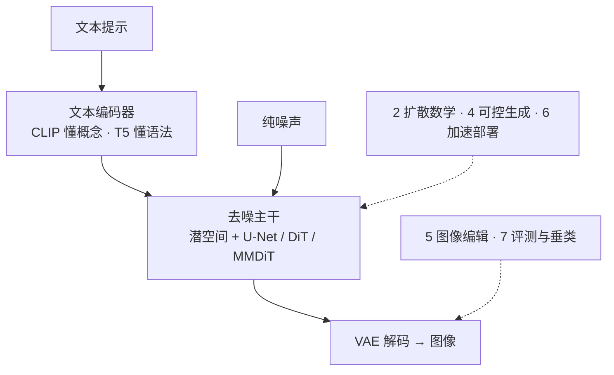
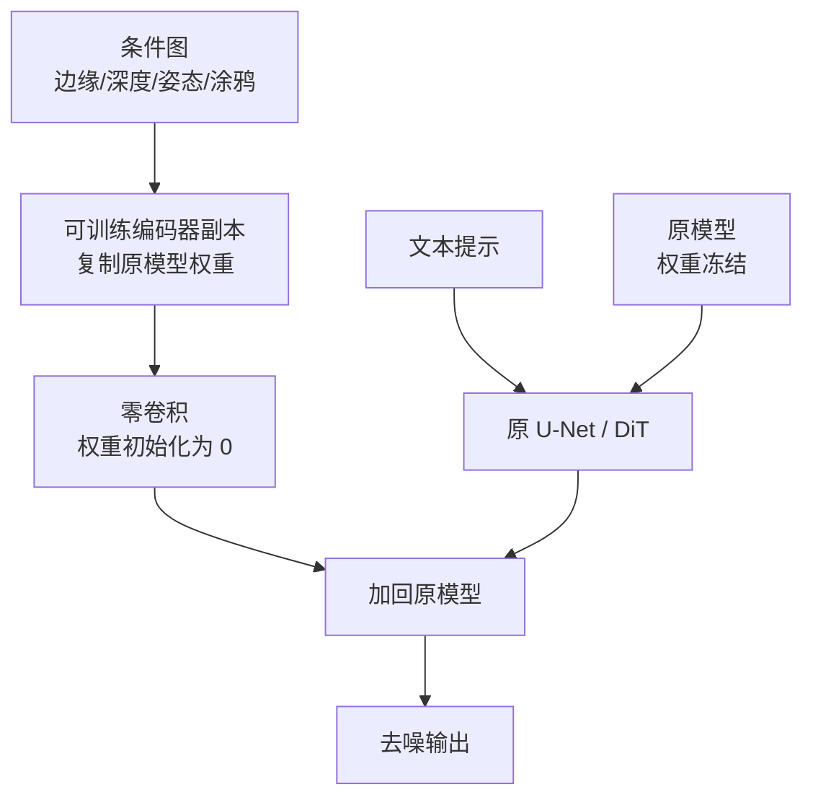
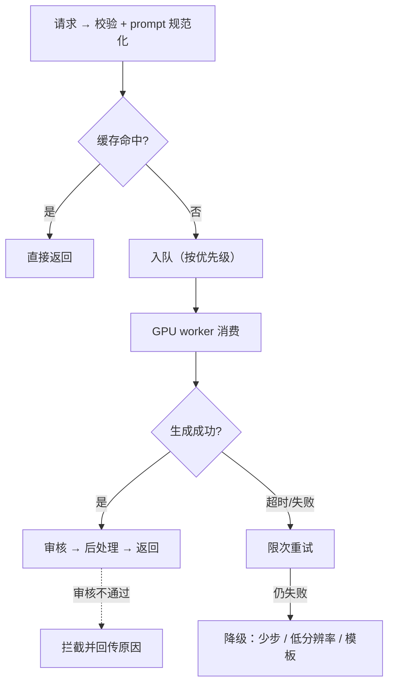

# 02 · 生图模型 · 知识点大纲

> **模块定位**：三大模块里**数学密度最高**、但概念闭环最漂亮的一块——从加噪到去噪，一条主线串起所有模型。
> **为什么它对你重要**：剪映/CapCut/即梦的产品核心是生成；面试问"你了解扩散模型吗"的概率接近 100%，而且追问链很长（CFG → LoRA → 蒸馏 → 一致性）。
> **学完的标准**：能手推前向加噪的闭式解、能解释 CFG 为什么有效又为什么过饱和、能说清 LoRA 的低秩假设、能估算一张图的推理成本、能讲清"蒸馏模型为什么不能叠加 CFG"。
> **编号纪律**：本章编号与 [00 · 知识点总表](./00-知识点总表) **一一对应**（1.1–7.5 共 39 项）。
> **配套**：模型对照表、许可协议、M5 实测预期见 [02 · 事实与面试弹药](./02-生图模型-事实与面试弹药)（核查时点 2026-10）。**模型名会过期，数学不会**——本文只推数学与机制，引用具体参数量前请回弹药篇确认。

## 一、知识地图

本模块 = **一条生成链路** + **三圈外挂能力**：



**一条主线**：`文本 → 文本编码器 → 条件向量 → 在潜空间从纯噪声迭代去噪 → VAE 解码成图`。所有论文都在优化这条链的某一段。

| 章节 | 优化哪一段 | 一句话 |
|------|-----------|--------|
| 1 生成范式演进 | 整条链路的选型 | 为什么最后是扩散而不是 GAN/VAE |
| 2 扩散数学与采样 | **怎么去噪** | 数学最密，决定能不能少步出图 |
| 3 架构谱系 | **用什么网络去噪** | U-Net → DiT → MMDiT，以及潜空间为什么省 48 倍 |
| 4 可控生成 | **额外控制信号怎么塞** | 剪映类产品的核心：一致性 |
| 5 图像编辑 | **怎么在已有图上改** | 改多少由加噪强度决定 |
| 6 加速与部署 | **怎么用更少算力出图** | 你 Go 背景最能接上的一环 |
| 7 评测与垂类 | **怎么衡量好** | 单一指标会误导 |

## 二、怎么用这篇

| 读法 | 花多久 | 读什么 |
|------|--------|--------|
| **速览** | 5 分钟 | 每节「本质」句 + 「面试一句话」，先拿到骨架 |
| **推导** | 90–120 分钟 | 2.1–2.6 拿纸笔推一遍（只需高中数学 + 高斯乘法的性质） |
| **动手** | 半天 | 先读 2.4、2.6、4.4、6.1，再做文末自测（M5 可跑项优先） |

::: tip 先记住这一句
**整个生图领域只做了一件事：把"从噪声到图像"变成一条可学习的轨迹，然后想办法用最少的步数走完它。** 后面所有概念（DDIM、CFG、LCM、Flow Matching）都是这句话的不同答案。
:::

## 三、知识点详解（编号与 00 总表一一对应）

### 模块 1 · 生成范式演进：为什么最后是扩散

#### 1.1 生成范式演进：VAE → GAN → Diffusion → Flow Matching → 自回归（P0）

**本质**：每一代都在解决上一代的**某个具体缺陷**，同时引入新代价——**权衡链比结论重要**。

| 范式 | 核心机制 | 优势 | 致命弱点 | 为什么被下一个取代 |
|------|---------|------|---------|------------------|
| VAE | 编码-解码 + 潜空间先验 | 有理论、潜空间可解释 | 生成样本模糊 | 似然目标偏向均值，高频细节丢失 |
| GAN | 生成器与判别器对抗 | 一步出图、锐利 | 训练不稳、模式崩溃 | 无法稳定 scale，多样性不可控 |
| Diffusion | 学去噪、迭代采样 | 训练稳定、质量高、可控性强 | 采样慢（数百步） | —（成了主流） |
| Latent Diffusion | 在 VAE 潜空间扩散 | 算力降一个数量级 | 受 VAE 重建上限约束 | —（工程标准） |
| DiT | Transformer 去噪主干 | scaling 可预测、与 LLM 基础设施统一 | 数据需求大 | —（SD3/FLUX 都用） |
| Flow Matching | 学"噪声→数据"的速度场 | 路径更直、少步数质量更好 | 理论较新、生态较新 | —（当下前沿） |
| 自回归生成 | 图像离散成 token 逐块预测 | 与 LLM 同构、指令跟随与文字渲染强 | 需要强 tokenizer、token 数多 | 并行路线，因"统一生成+编辑"重新变热 |

**面试要讲的是"代价链"**：扩散换来了训练稳定与可控性，代价是慢；于是所有后续工作（DDIM → LCM/Turbo → Flow Matching）都在打"慢"这个代价。**能讲出这条链，比背"扩散更好"高一个档次。**

> 面试一句话：生成范式的演化是"用稳定性换速度、再用结构换稳定性"的螺旋——扩散赢在训练稳与可控，代价是慢，所以后续全在提速。

#### 1.2 VAE 的重建-先验权衡与潜空间（P0）

**本质**：VAE 学一个"能压能还原"的潜空间，但**压缩比与还原精度是零和的**。

**机制**：编码器输出均值 μ 与方差 σ，采样 `z = μ + σ⊙ε`（重参数化技巧让梯度能穿过采样），解码器还原。训练目标是重建损失 + KL 正则，KL 太强 → 潜空间规整但糊；太弱 → 还原好但潜空间不可采样。

**算例**：512×512×3 ≈ 78.6 万个数值 → 64×64×4 = 1.6 万个潜变量，约 **48 倍压缩**（详见 3.1）。这 48 倍就是"消费级显卡能跑扩散"的全部秘密。

**边界**：**输出质量被 VAE 重建能力封顶**——小字、细纹理、皮肤细节最先糊。所以新模型把潜通道从 4 提到 16（见 3.1），本质是想在同样空间下采样下保留更多信息。

> 面试一句话：VAE 用重参数化把"采样"变成可训练的一步；它的压缩比决定了扩散的成本，它的重建能力决定了生成质量的封顶。

#### 1.3 GAN 的对抗训练与模式崩溃（P1）

**本质**：生成器与判别器互相博弈，**一步出图**是它最大的诱惑，**训练不稳**是它最大的代价。

**机制**：`min_G max_D E[log D(x)] + E[log(1-D(G(z)))]`。理论上收敛到纳什均衡，实践中判别器太强 → 梯度消失、生成器学不动；判别器太弱 → 生成器学不到细节。**模式崩溃**指生成器找到"骗过判别器的一小撮样本"后不再探索多样性。

**边界**：它在"固定分布的小图"上很强（如人脸），但**无法稳定 scale 到开放域、可控性差**——这两点直接决定了它让位给扩散。

> 面试一句话：GAN 的"一步出图"仍然最快，但对抗训练不稳定、模式崩溃、可控性差，所以在开放域生成上让位于扩散。

#### 1.4 自回归图像生成（VAR / GPT-4o 图像生成）（P1）

**本质**：把图像离散成 token 序列，用 LLM 的方式逐 token（或逐尺度）预测。

**两条路线**：

| 路线 | 做法 | 优势 | 代价 |
|------|------|------|------|
| **VAR（next-scale）** | 从低分辨率尺度逐级预测到高分辨率，不是光栅顺序 | 尺度由粗到细，生成路径短 | 需要多尺度 tokenizer |
| **统一多模态自回归**（GPT-4o 类） | 图像 token 与文本 token 同空间 | 指令跟随、文字渲染强、天然支持编辑 | token 数多、推理开销大 |

**为什么它重新变热**：产品需要"生成 + 编辑 + 对话"统一（见 5.3），自回归与 LLM 天然同构；而扩散的"编辑"需要额外机制。

**边界**：图像 token 的 tokenizer 很难（高保真重建 + 可预测性），且推理 token 数远多于扩散的采样步数——**单位成本通常更高**。

> 面试一句话：自回归把图像当 token 预测，优势是与 LLM 同构、指令跟随与文字渲染强；瓶颈在 tokenizer 与推理成本。

#### 1.5 一致性模型与一步生成（P2）

**本质**：学一个**自映射**——把轨迹上任意一点直接映射到终点，从而一步/少步出图。

**机制**：`f_θ(x_t, t) ≈ x_0`（或终点），用"沿同一条概率流的一致性"约束训练；LCM/Turbo 是它的工程化（见 6.1）。

**边界**：一步生成的多样性明显下降（映射把轨迹"塌缩"），且对训练数据与教师模型依赖强。**它解决的是"快"，不解决"好"。**

> 面试一句话：一致性模型学"任意时刻一步到终点"，把几十步压到 1–8 步，代价是多样性与细节下降。

### 模块 2 · 扩散数学与采样（本模块的核心）

#### 2.1 前向加噪过程与闭式解（P0）

**本质**：前向过程每一步加一点高斯噪声，但**可以一步跳到任意时刻 t**——这是训练能并行的根本。

**推导**：

```text
单步：x_t = √(1-β_t) · x_{t-1} + √β_t · ε,      ε ~ N(0, I)

连乘：x_t = √(ᾱ_t) · x_0 + √(1-ᾱ_t) · ε̄,        ᾱ_t = ∏_{i=1..t}(1-β_i)

为什么能合并：两个独立高斯相加仍是高斯，方差相加
  Var = (1-β_t) · (1-ᾱ_{t-1}) + β_t = 1 - ᾱ_t
```

**两个直觉**：`√ᾱ_t` 是"保留了多少原图信号"，`√(1-ᾱ_t)` 是"掺了多少噪声"。t 越大 ᾱ 越小、图越糊，t=T 时基本是纯噪声。**信噪比** `SNR(t) = ᾱ_t / (1-ᾱ_t)` 是描述"糊到什么程度"的统一语言。

**算例**：ᾱ 在 t=1000 步的常见调度下从 1 衰减到接近 0；取 ᾱ=0.5 时，图里一半是信号一半是噪声——这时模型最难预测，也是训练信号最强的区间。

> 面试一句话：前向加噪是高斯链，方差相加让它可以合并成 `x_t = √ᾱ_t x_0 + √(1-ᾱ_t) ε`；有了闭式解，训练时任意 t 可直接采样，训练才可并行。

#### 2.2 反向去噪与训练目标（ε / x₀ / v-prediction）（P0）

**本质**：网络不学"图像长什么样"，只学**某一时刻的噪声（或干净图、或速度）**——把生成简化成回归。

**三种预测目标**：

| 目标 | 网络输出 | 换算关系 | 特点 |
|------|---------|---------|------|
| ε-prediction | 预测加进去的噪声 | `x₀ = (x_t − √(1−ᾱ)ε)/√ᾱ` | 最经典，高噪声区间好 |
| x₀-prediction | 直接预测干净图 | `ε = (x_t − √ᾱ x₀)/√(1−ᾱ)` | 低噪声区间稳，高噪声区间数值不稳 |
| v-prediction | 预测 `v = √ᾱ ε − √(1−ᾱ) x₀` | 二者线性组合 | 各区间尺度一致，训练更稳 |

**为什么 v-pred 更稳**：v 是"归一化后的混合量"，**在不同 t 上量级接近**；而 ε 在高噪声区信号弱、x₀ 在低噪声区信号弱，各自在某些区间会出现梯度尺度失衡。

**损失函数**：训练就是 `L = E ||ε − ε_θ(x_t, t, c)||²`。真正的设计在于**加权**：按 SNR 加权（min-SNR 等）能让训练重点放在"可学"的区间。

> 面试一句话：扩散训练是"预测噪声/干净图/速度"的回归，三种目标可互换；v-pred 的价值是让不同 t 的目标量级一致，缓解高噪声区训练不稳。

#### 2.3 DDPM 与 DDIM 采样，确定性 vs 随机性（P0）

**本质**：DDPM 反向是**随机**马尔可夫链（每步重新注噪），DDIM 把随机项去掉，变成**确定性**映射，于是可以大步跳。

```text
DDPM 反向一步（均值 + 方差）：
  μ = (x_t − β_t/√(1−ᾱ_t) · ε_θ) / √(1−β_t)
  x_{t-1} = μ + σ_t · z,   σ_t = √β_t               ← 每步都注入随机性

DDIM（η = 0）：
  x_{t-1} = √ᾱ_{t-1} · x̂₀ + √(1−ᾱ_{t-1}) · ε_θ     ← 确定性，可跳步
```

**两个直接后果**：

1. **同初始噪声 + 同 prompt → 同一张图**（可复现，产品里靠它做"种子"）；
2. **可反演（DDIM inversion）**：已知图反推初始噪声，是很多编辑方法的基础（5.2/5.4）。

**调度器**（Karras、DPM-Solver 系列）本质是"用更少的步逼近同一条轨迹"；SD3 还引入 **shifted schedule**：分辨率越高，同样步数对应的噪声水平实际越"浅"，需要按分辨率平移时间步。

> 面试一句话：DDPM 是随机采样需上千步，DDIM 去随机项得到确定性映射，可几十步出图且可逆；现代调度器是"更少步逼近同轨迹"的工程化。

#### 2.4 噪声调度（linear / cosine / shifted）（P1）

**本质**：调度决定"每个 t 对应的噪声水平"，直接决定训练难度与质量。

| 调度 | 特点 | 问题 |
|------|------|------|
| linear β | 最简单 | 两端浪费：低噪声区过度训练、高噪声区不足 |
| cosine | 中间区段信噪比分配更均匀 | 更常用 |
| shifted（SD3） | 按分辨率平移时间步 | 高分辨率下噪声水平对不上，需平移补偿 |

**训练侧的采样分布也重要**：SD3 用 **logit-normal 训练采样 + shift**，等价于按信噪比合理分配训练算力——这被认为是它提示词跟随变好的原因之一。

**边界**：调度是"训练与采样必须一致"的设定，**换调度通常要重训或至少重新调参**，不是推理时随便换的。

> 面试一句话：调度决定噪声水平随 t 的分布；linear 两端浪费、cosine 更均匀、高分辨率要 shift 补偿；训练与采样的调度必须一致。

#### 2.5 Classifier-Free Guidance 原理与副作用（P0，最常被追问）

**本质**：同时算"有提示词"与"没提示词"两个预测，**外推两者的差**，把"更符合提示词"的方向放大。

```text
ε_guided = ε_uncond + w · (ε_cond − ε_uncond)

直觉：ε_uncond 是"随便画点什么"，ε_cond 是"画成提示词说的样子"
     差值是"提示词带来的方向"，w 把它放大 → 更贴提示词

w = 1 等价于普通条件生成；w 典型 5~12（SD 系）
```

**为什么有效**：把条件生成与无条件生成当作两个分布，做了一次**分布外推**——在放大条件似然的同时压缩条件分布方差，于是"更贴提示词、但更确定（多样性下降）"。

**怎么实现**：训练时以一定概率（常见 5%–10%）把文本条件置空（dropout），**同一个网络**同时学会条件与无条件；推理时就能拿到两个预测做外推。

**副作用与工程权衡**：

| w 偏小 | w 偏大 |
|--------|--------|
| 多样性高、构图自由 | 过饱和、色彩失真、构图僵化、多样性骤降 |

产品里"要贴提示词"就调高、"要多样性给用户挑"就调低；图生图/编辑类任务通常用较低 w。改良方案有 rescale、动态 CFG（按 t 递减）等。

**两个必须知道的坑**：

1. **CFG 要两次前向**，推理成本约翻倍——所以有 CFG 蒸馏、把两个分支拼进一个 batch 的优化；
2. **蒸馏模型已把 guidance 内化**（FLUX schnell、SDXL-Turbo、Lightning 系），再叠加 CFG **会毁图**，必须 `guidance_scale=1`。

> 面试一句话：CFG 用"有/无提示词"两个预测外推提示词方向，w 是质量-多样性旋钮；它要两次前向，而过大会过饱和、且对蒸馏模型必须关掉。

#### 2.6 Flow Matching 与 Rectified Flow 的直觉（P1）

**本质**：不学"加噪-去噪"，直接学**从噪声分布到数据分布的速度场**；路径越直，步数越少。

```text
扩散：一条弯曲的概率路径，必须小步走     → 步数多
Flow Matching：学速度场 v(x,t)，解 ODE 从噪声积分到数据
Rectified Flow：把配对路径"拉直"（reflow） → 路径近似直线，1–4 步即可
```

**为什么能把路径拉直**：用"同一条流上的点对"构造训练对，模型学到的就是直线连接——**"直线可一步走完"是它少步数质量好的根本原因**。

**边界**：理论较新、生态（工具链、LoRA、插件）还在补；且"路径直"不等于"语义对"，提示词跟随仍要靠训练数据与编码器（见 3.5）。

> 面试一句话：Flow Matching 直接学速度场，Rectified Flow 把路径拉直，所以少步数质量更好；它和"换预测目标、改调度"是同一场"让采样更少步"的战役。

#### 2.7 采样步数与质量的权衡曲线（P0）

**本质**：步数是"质量-成本"曲线上最直接的旋钮，存在明显的饱和点。

| 步数区间 | 感受 | 说明 |
|---------|------|------|
| 1–4 步 | 能用但质量明显掉 | 需要蒸馏模型（LCM/Turbo/FLUX-schnell） |
| 8–15 步 | 接近可用 | 蒸馏模型 + 低 CFG 的常用配置 |
| 20–30 步 | 质量饱和区 | 常规模型的性价比区间 |
| 50 步以上 | 收益极小 | 浪费算力 |

**这张表直接对应成本决策**：步数减半 ≈ 成本减半。产品里常见做法是**分层生成**——低步数出草稿让用户确认，满意后再走高质量路径成片。

> 面试一句话：20–30 步是常规模型的饱和区，8–15 步要配蒸馏模型；步数与成本近似线性，所以产品用"草稿/定稿分级"而不是一个步数打天下。

### 模块 3 · 架构谱系

#### 3.1 Latent Diffusion：为什么在潜空间做（P0）

**本质**：把扩散搬到 VAE 的潜空间，**数据量降约 48 倍**，这是消费级显卡能跑 SD 的直接原因。

```text
像素空间：512×512×3 = 786,432 个数
潜空间：  64×64×4   =  16,384 个数          ← 约 1/48
```

三个要点：**8 倍空间下采样**把像素压到潜变量；**扩散在潜空间进行**（算力降一个数量级）；**最后 VAE 解码还原**。代价是**质量被 VAE 重建能力封顶**——小字、细纹理最先糊，这正是 SD3/FLUX 把潜通道从 4 提到 **16** 的原因（下采样倍率仍是 8×）。

> 面试一句话：Latent Diffusion 用 VAE 把数据压约 48 倍再扩散，算力降一个数量级；代价是输出质量被 VAE 封顶，所以新模型在加潜通道。

#### 3.2 U-Net 结构：下采样 / 上采样 / skip connection / 时间步注入（P0）

**本质**：编码-解码 + 跳连，让网络**同时看到全局语义与局部细节**。

**机制**：

- **下采样**：逐级降分辨率、升通道，提取语义；
- **上采样**：逐级恢复分辨率，靠 **skip connection** 把同尺度特征直接接回来（细节不丢）；
- **时间步注入**：正弦位置编码 + MLP → 每个 ResBlock 里的**仿射调制**（AdaGN/FiLM 类），相当于"告诉网络现在是第几步"；
- **条件注入**：文本经 cross-attention 注入（图当 Q、文本当 K/V）。

**面试必答**：为什么同时有 self-attention 与 cross-attention？——self-attention 让图内不同位置互相看见（全局一致性），cross-attention 让图去"查询"文本 token（提示词对齐）。

**代价**：U-Net 的归纳偏置（多尺度卷积）在中小规模有效，但**缺少可预测的 scaling 规律**，且结构复杂、优化点分散。

> 面试一句话：U-Net = 下采样提语义 + 上采样恢复细节 + skip 保细节；时间步靠仿射调制注入、文本靠 cross-attention 注入，这是它对齐提示词的核心机制。

#### 3.3 DiT：用 Transformer 替换 U-Net 的动机与代价（P0）

**本质**：把潜空间的图切成 patch（像 ViT），用**标准 Transformer** 做去噪；动机是 **scaling 可预测**。

**机制**：patchify → 加时间步/类别条件（adaLN-Zero 调制，零初始化让初始网络接近恒等）→ Transformer 块 → unpatchify 回潜空间。

**收益**：规模-性能关系可预测；直接复用 LLM 的并行策略、算子优化与推理引擎。**代价**：数据需求大、对超参更敏感；且"patch 化"丢掉了卷积的局部偏置，需要更多数据补。

> 面试一句话：DiT 用标准 Transformer 替换 U-Net，换来可预测 scaling 与 LLM 基础设施复用；代价是数据需求更大。

#### 3.4 MMDiT 与双流/单流设计（SD3 / FLUX）（P1）

**本质**：文本与图像**各走一条流**（各自权重），在注意力层做**联合注意力**，避免一个模态主导另一个。

**为什么不能共用一套权重**：文本信息量远小于图像，共用流会被图像"淹没"，提示词跟随变差。

**FLUX 的工程折中**：**双流 block + 单流 block 混合**——双流段保持图文分离（保表达力），单流段拼接统一处理（提效率）。

**对比 U-Net**：U-Net 的 cross-attention 是**单向查询**（图查文本，文本不查图），MMDiT 的双向联合注意力表达力更强。

> 面试一句话：MMDiT 让文本与图像各走一条流、在注意力层联合交互，避免弱模态被强模态淹没；FLUX 用"双流 + 单流"混合兼顾表达力与效率。

#### 3.5 文本编码器：CLIP vs T5-XXL vs 双编码器（P0）

**本质**：文本编码器决定模型"听懂多少"——**懂概念**（CLIP）与**懂语法/长文本**（T5）是两种能力。

| 编码器 | 特点 | 对生成的影响 |
|--------|------|-------------|
| CLIP ViT-L/14 | 图文对齐目标，**77 token 上限**，输出整体语义向量 | 懂视觉概念、擅长风格；不擅长长句、计数、拼写 |
| OpenCLIP bigG/14 | SDXL 的第二编码器 | 池化向量走额外条件通道，补语义 |
| T5-XXL | 纯语言模型（约 4.7B），懂语法、长文本、计数、拼写 | SD3/FLUX 质量跃升的关键；吃显存，且对长 prompt 敏感 |
| 中文 LLM 编码器 | Kolors 用 ChatGLM3-6B；HunyuanDiT 用双语 CLIP + mT5；Qwen-Image 用 Qwen2.5-VL | 中文语义与文字渲染的关键 |

**两个实操推论**：① **FLUX/SD3 这类用 T5 的模型，提示词写长写详细效果明显更好**；② CLIP 的 77 token 上限是"早期 SD 画不好长提示词与文字"的结构性原因。

> 面试一句话：CLIP 懂概念、T5 懂语法与长文本；77 token 上限与"整句语义"决定了 CLIP 路线在长提示词、文字渲染上的先天短板。

#### 3.6 SD 系列谱系（1.5 / 2.1 / XL / 3 / 3.5）（P0）

**本质**：SD 谱系每个版本只动"三个位置"之一：主干、文本编码器、潜空间。

| 系列 | 主干 | 文本编码器 | 潜空间 | 定位与关键事实 |
|------|------|-----------|--------|--------------|
| SD 1.5 | U-Net | CLIP（单） | 8× 下采样 / 4 通道 | 生态最庞大、LoRA 资源最多，学习首选 |
| SD 2.1 | U-Net | OpenCLIP | 同上 | 提示词跟随有争议，生态弱于 1.5 |
| SDXL | U-Net（更大） | CLIP 双塔 | 同上 | 1024 原生，可加 refiner 提细节 |
| SD3 / 3.5 | MMDiT | CLIP + T5-XXL | **16 通道** VAE | 首个 MMDiT + Rectified Flow，提示词跟随与文字渲染明显提升 |

**为什么能记住这条谱系**：每一步都在换"三个位置"之一——主干（U-Net → MMDiT）、文本编码器（CLIP → CLIP+T5）、潜空间（4 → 16 通道）。**面试问"SD3 比 SDXL 强在哪"，答这三个位置就够了。**

> 面试一句话：SD 谱系的主线是"主干换 Transformer、文本编码器加 T5、潜空间通道翻倍"，三处改动分别对应 scaling、语义理解与细节保真。

#### 3.7 FLUX.1 系列（schnell / dev / pro）与蒸馏（P0）

**本质**：FLUX 的三个变体是"速度/质量/许可"的三点选择，schnell 的少步能力来自蒸馏。

| 变体 | 定位 | 许可 | 关键差异 |
|------|------|------|---------|
| schnell | 蒸馏少步 | Apache-2.0 可商用 | **已把 guidance 内化，必须 `guidance=1`** |
| dev | 质量更高 | 非商用许可 | 仍可用 CFG，质量与速度折中 |
| pro | API 版 | 商用接口 | 看不到权重，只能谈机制 |

**核心事实**：FLUX.1 是 **12B** 级 MMDiT 类架构（双流 + 单流），潜空间 16 通道类。**schnell 的"1–4 步"来自蒸馏，不是架构魔法**——这也是 6.1 与 2.5 的"坑"的来源。

> 面试一句话：FLUX 的三个变体是"速度/质量/许可"的三点选择，schnell 的少步能力来自蒸馏且 guidance 已内化——对它叠加 CFG 会毁图。

#### 3.8 中文生图与文字渲染（Kolors / HunyuanDiT / Qwen-Image）（P1）

**本质**：中文生成难在**中文文本编码**与**文字渲染**两件事。

| 模型 | 中文能力来源 |
|------|-------------|
| Kolors | 用 **ChatGLM3-6B** 当文本编码器（中文语义强） |
| HunyuanDiT | 双语 CLIP + mT5，约 1.5B 较轻盈 |
| Qwen-Image | 用 Qwen2.5-VL 系，主打**中英文字渲染** |

**文字渲染为什么难**：文字是"高频细节 + 精确结构"，需要（a）文本编码器真的理解"要写哪几个字"，（b）VAE 与主干在足够分辨率下保留字形，（c）训练数据里有大量"带字图片 + 精确文本"的配对。**三件事缺一不可**，这也是为什么"会写字"成了新一代模型的核心卖点。

> 面试一句话：中文生图 = 中文文本编码器 + 字形保真 + 带字配对数据；文字渲染是高频细节问题，直接对应 VAE 与分辨率的上限。

### 模块 4 · 可控生成与个性化

#### 4.1 ControlNet 原理与零卷积设计（P0）

**本质**：复制一份编码器当"控制分支"，用**零初始化卷积**把它的输出接回原模型——**训练起点等价于原模型**。



**为什么零卷积关键**：控制分支初始输出为 0，**训练第一步整个模型等于原模型**——控制信号从"零影响"平滑介入，不会在训练初期破坏预训练能力。这是"安全加装"的核心。

**为什么复制编码器**：复制预训练权重让控制分支一开始就"看得懂图像特征"，收敛快得多；从零训练的随机分支要多花大量步数才学会。

**代价**：多一份编码器的参数量与显存（约 +30%~50% 主干），推理时也要多一次前向。

> 面试一句话：ControlNet 用"复制的编码器 + 零初始化卷积"让控制分支从零影响开始介入，既不破坏预训练能力，又能快速学会条件；代价是多一份主干参数量。

#### 4.2 T2I-Adapter 与轻量控制（P2）

**本质**：不复制主干，只用一个**轻量适配器**把条件编码成若干特征，注入原模型的多尺度层。

**取舍**：参数少（MB 级）、推理开销小；但控制强度与精度不如 ControlNet（没有复制主干的"强先验"）。**适合"够用就好"的轻量场景**。

> 面试一句话：T2I-Adapter 用轻量适配器做多尺度条件注入，省参数省显存，代价是控制精度弱于 ControlNet。

#### 4.3 IP-Adapter 与图像提示（P1）

**本质**：把一张"参考图"编码成条件，通过**独立的交叉注意力**注入——图生图/图生风格的"图像提示词"。

**机制**：图像编码器（CLIP 图像塔）→ 投影 → 与文本 cross-attention **并列**的 cross-attention（decoupled cross-attention），可分别调文本/图像权重。

**为什么解耦**：文本与图像的语义空间不同，解耦后可以"调图像权重"而不影响文本对齐，也便于热插拔参考图。

**边界**：IP-Adapter 保的是"风格/氛围/身份"的**近似**，不保证像素级一致；要更硬的相似度需要 4.6 的组合手段与 LoRA。

> 面试一句话：IP-Adapter 用独立的交叉注意力注入参考图，实现图像提示词，且文本/图像权重可分别调；它保风格近似，不保像素级一致。

#### 4.4 LoRA 原理与秩分解、缩放系数（P0）

**本质**：微调的权重变化是**低秩**的，用两个小矩阵近似即可。

```text
原始：W' = W + ΔW，       ΔW 与 W 同尺寸
LoRA：W' = W + B·A，      A: r×d, B: d×r, r 取 4~128
                         可训练参数从 d² 降到 2dr
输出乘 α/r：缩放系数控制 LoRA 影响力强度
```

**算例**：d=1024、r=16 时，`ΔW` 约 100 万参数，`2dr` 约 3.3 万——**降两个数量级**；挂在 attention 的 QKV 上，可训练参数常降到 1% 以下。

**在扩散里的实操差别**：U-Net 时代主流只给 cross-attention 的 QKV 加 LoRA；DiT/MMDiT 时代（SD3、FLUX）做法不同，**要看具体模型的支持情况**——这是动手最容易踩的坑。

**边界**：LoRA 学"风格/概念"很强，学"完全新的知识"不如全量微调；多个 LoRA 叠加会互相干扰（合并权重或调 α）。

> 面试一句话：LoRA 靠"微调增量低秩"的假设把可训练参数降到千分之一，实现小文件、热插拔、低显存；代价是表达力有上限。

#### 4.5 DreamBooth 与 Textual Inversion（P1）

**本质**：四种个性化方法的分歧在"训多少参数"，本质是"表达力 vs 成本"的取舍。

| 方法 | 训什么 | 文件大小 | 效果 | 适合 |
|------|--------|---------|------|------|
| Textual Inversion | 一个新 token 的 embedding | KB | 弱 | 简单风格/概念 |
| LoRA | 低秩增量矩阵 | 几十 MB | 中–强 | 风格、角色、画风（主流） |
| DreamBooth | 整个模型（或大范围） | GB | 强 | 单一主体的高保真复现 |
| 全量微调 | 全部权重 | GB+ | 最强 | 有算力的垂类定制 |

**DreamBooth 的关键是"先验保留损失"**：训练时同时让模型生成"该类别的通用样本"并保持其分布，避免"学了一个主体、把整类都画成它"。Textual Inversion 的弱点是**靠一个向量承载整个主体**，信息瓶颈严重。

> 面试一句话：DreamBooth 用 3–5 张图微调整个模型、靠先验保留损失防过拟合；TI 只学一个 embedding，便宜但表达力弱；LoRA 是两者之间的工程主流。

#### 4.6 参考图与角色一致性（ReferenceNet / 一致性三件套）（P0）

**本质**：一致性没有单一模型能解决，工程上是**组合拳**。

| 一致性类型 | 保持什么 | 主要手段 |
|-----------|---------|---------|
| 身份一致性 | 脸/主体不漂移 | 参考图（IP-Adapter 类）+ 人脸 ID 模块（InstantID 类） |
| 风格一致性 | 画风统一 | 风格 LoRA、提示词模板 |
| 构图一致性 | 布局可控 | ControlNet（姿态/深度/边缘） |
| 时序一致性 | 视频帧间不跳 | 时序注意力（见[模块一](./01-视频多模态-知识点大纲)） |

**ReferenceNet 类的思路**：把参考图当"第二个视觉输入"，用与主干同构的网络编码，再在注意力层做特征对齐——比 IP-Adapter 的"加一个 cross-attention"更强，但参数与显存更高。

**主要难点**：多个控制信号会**互相打架**（参考图说"红衣服"、ControlNet 说"这个姿势"、提示词说"夜景"），需要调权重与顺序；产品上还要有"不合格就重试"的兜底。

> 面试一句话：角色一致性靠"参考图保身份 + LoRA 保风格 + ControlNet 保构图"的组合，难点在多信号冲突，需要调权重 + 重试兜底。

### 模块 5 · 图像编辑

#### 5.1 Inpainting / Outpainting 与掩码策略（P0）

**本质**：只在掩码区域内重绘，掩码外保持原图——**编辑范围由掩码定义**。

| 方式 | 机制 | 关键点 |
|------|------|--------|
| Inpainting | 掩码内重绘 | 掩码边缘羽化、掩码外像素如何参与（VAE 编码 > 直接拼回） |
| Outpainting | 扩画布后重绘新增区域 | 扩出的区域要与原图风格/光照/透视一致 |

**两个工程细节**：① 掩码边缘要羽化/膨胀，否则接缝明显；② 掩码外的内容最好也参与条件（不全遮），否则新生成内容与原图不协调。**训练侧的随机掩码策略**决定模型对"各种形状掩码"的泛化。

> 面试一句话：Inpainting 由掩码定义编辑范围，工程上要处理边缘羽化与掩码外上下文；Outpainting 则是"扩画布 + 风格连续性"。

#### 5.2 SDEdit 与噪声强度控制编辑幅度（P1）

**本质**：对原图**加噪到某个 t**，再从 t 去噪——**加噪强度就是"允许改多少"**。

```text
strength 小（加噪到 t 小）→ 只改细节、保结构
strength 大（加噪到 t 大）→ 几乎重画
```

**这是所有图生图接口 `strength` 参数的本质**：产品里用户感知的"重绘程度"就靠它。**注意它和"加噪步数"不是一回事**：strength 决定起点 t，采样步数决定从 t 到 0 走多少步。

**边界**：强度大时原图信息基本丢失，会出现"风格漂移 + 主体变化"；要"保结构换风格"应配合 ControlNet（4.1）而不是只调强度。

> 面试一句话：SDEdit 用"加到某个噪声水平的起点"控制编辑幅度，strength 就是"改多少"的旋钮；它和采样步数是两个参数。

#### 5.3 指令编辑（InstructPix2Pix 及后继）（P1）

**本质**：用"配对数据（原图 + 指令 + 目标图）"训练模型学会按指令改图。

**当代形态是上下文编辑**：把参考图当**上下文 token** 一起送进模型（而不是外挂条件分支），代表是 FLUX.1 Kontext、Qwen-Image-Edit 这类。能力特征是**"改一处、保留其余"**——支持局部修改同时保持角色身份与风格。

**为什么这是剪映/即梦的核心诉求**：用户说"把背景换成海边、人不变"，这就是"指令 + 局部 + 一致性"三件事同时成立。

> 面试一句话：指令编辑从"配对数据训练"演化到"参考图当上下文 token"，能力特征是"改一处、保留其余"——这正是剪辑产品的核心诉求。

#### 5.4 免训练编辑与注意力注入类方法（P2）

**本质**：不改权重，靠**在去噪过程中注入原图的注意力/特征**来控制"保留什么"。

代表思路：Prompt-to-Prompt（改 cross-attention 的映射）、Attention 注入（把原图注意力与编辑图注意力混合）、DDIM inversion + 特征替换。**优点是零训练成本**，缺点是对复杂编辑（大范围重绘、改变视角）不稳定。

> 面试一句话：免训练编辑靠注意力注入/DDIM 反演控制"保什么"，零成本但只适合中等幅度编辑；大改还要靠有训练的方法。

### 模块 6 · 加速与部署

#### 6.1 采样加速：LCM / Turbo / 一致性蒸馏（P0）

**本质**：所有加速方法都在做同一件事——把"逐步走完轨迹"变成"直接跳到终点"。

| 方法类 | 思路 | 步数 | 代价 |
|--------|------|------|------|
| 一致性模型（CM → LCM） | 学"轨迹上任意点一步到终点" | 4–8 步 | 细节与多样性下降 |
| LCM-LoRA | 把一致性能力做成 **LoRA** 挂载，免重训 | 4–8 步 | 同上，但不用重训整个模型 |
| 对抗蒸馏 | 判别器逼少步模型逼近多步模型 | 1–4 步 | 训练不稳 |
| 轨迹/时间步蒸馏 | 直接拟合教师采样轨迹 | 1–4 步 | 依赖教师质量 |

**一致性模型的思路值得单独记**：它不学"一步去一点噪声"，而是直接学**自映射**——把轨迹上任意一点直接映射到终点。**LCM-LoRA 的工程价值**在于把这件事变成可插拔的 LoRA，所以它能被广泛使用。

**核心权衡**：**步数 ↓ → 成本 ↓、延迟 ↓，但质量与多样性 ↓**。产品典型决策是"8 步 Turbo 给快速预览，满意后 25 步精修"——**分层生成**。

**再次强调**：蒸馏/少步模型已把 guidance 内化，**必须关掉或大幅调低 CFG**，否则毁图。

> 面试一句话：一致性模型学"任意点一步到终点"，LCM-LoRA 把它变成可插拔 LoRA；步数换质量与多样性，产品用"草稿/定稿"分层来折中。

#### 6.2 量化部署（fp8 / int8 / GGUF）与显存换算（P0）

**本质**：显存 = 权重 + 激活，量化只压第一项。

```text
权重显存 ≈ 参数量 × 每参数字节
  fp16 → 2 字节   fp8 → 1 字节   int8 → 1 字节   4bit → 0.5 字节

例：12B 级生图模型
  fp16 ≈ 24 GB（消费级卡直接爆）
  fp8  ≈ 12 GB
  4bit ≈  6–7 GB（这是能在单卡/MPS 上跑的原因）
```

**关键认知**：量化省的是**权重**，**激活显存不随权重量化等比下降**——高分辨率时激活才是大头，所以"4bit 就一定能跑"是误解。

::: warning Apple Silicon / MPS 三个必须知道的坑
你要在 M5 上做实验，这三条能省几个小时：
1. **`enable_attention_slicing()` 与 `enable_model_cpu_offload()` 同时开，在 Apple Silicon 上会产出全黑图**（diffusers 已知 issue）——二选一，别同时用。
2. **MPS 不支持 bf16**，训练脚本里要显式避开或用 fp16。
3. **想省内存优先走 MLX 路线**（Apple 官方 MLX 生图实现，支持 4/8-bit 量化），比 diffusers + MPS 更省内存，是 32GB 机器跑 12B 模型的现实选择。
:::

> 面试一句话：显存 = 权重 + 激活；量化只省权重，分辨率高时激活是大头；Apple Silicon 上要避开 attention_slicing 与 offload 同开、bf16，并优先用 MLX。

#### 6.3 推理服务化：批处理、显存管理、冷启动、成本估算（P0）

**本质**：生图服务的核心矛盾是"GPU 利用率"与"单请求延迟"的取舍。

| 环节 | 要点 |
|------|------|
| 批处理 | 多请求合成 batch 提升 GPU 利用率，但要权衡延迟（排队 vs 吞吐） |
| 显存管理 | 模型常驻 vs 按需加载（冷启动秒级到十几秒），决定实例池策略 |
| 队列 | 生成任务数秒到数分钟，必须异步化 + 状态查询 + 超时取消 |
| 成本估算 | 按 GPU 秒计价：单张成本 ≈ 卡时价/3600 × 单张耗时 × 并发系数 |
| 缓存 | 相同 prompt + 参数命中缓存；prompt 要规范化（空白、参数排序） |
| 降级 | 高负载切少步/降分辨率/排队提示 |

**成本速算**（示意，建立量级感）：1024 图、25 步、单卡 3 秒、卡时价 5 元/小时 → `5/3600×3 ≈ 0.004 元/张`。**能说出"成本不是瓶颈，瓶颈是延迟与峰值并发"就很专业。**

> 面试一句话：生图服务的心跳是"异步队列 + 状态机 + 超时取消"，成本按 GPU 秒算；缓存与降级是两条命脉。

#### 6.4 生图流水线的生产级编排（队列、超时、重试、降级）（P0）

**本质**：把一次"生成"变成可运维的"任务"——队列、状态、超时、重试、降级。



**编排要点**：幂等（同请求 id 重试不重复出图）、可取消（用户关页面要能停）、配额与限流（防单个用户打满）、审核前置（生成后先审再返回）。

> 面试一句话：生图流水线 = 队列 + 优先级 + 超时取消 + 重试限次 + 降级兜底 + 审核前置；这些是 Go 后端的主场，也是面试差异化。

### 模块 7 · 评测与垂类

#### 7.1 FID 的原理与局限（P0）

**本质**：FID 用 Inception 特征比较"生成分布"与"真实分布"的距离——**它测的是分布像不像，不是语义对不对**。

**局限（面试必答）**：① 不看提示词对齐；② 不惩罚"照抄训练集"（甚至奖励，因为分布更接近）；③ 对模糊/过平滑的图可能给低分；④ 换 Inception 权重就没法跨论文比较。**"FID 低"不等于"好"。**

> 面试一句话：FID 只比特征分布、不比语义，低 FID 可能是"更像训练集但更糊"；它需要与语义/偏好指标组合看。

#### 7.2 CLIPScore / ImageReward / HPSv2（P1）

**本质**：语义一致性与人类偏好是两种不同的"好"，指标只是它们的代理。

| 指标 | 测什么 | 局限 |
|------|--------|------|
| CLIPScore | 图与文本的语义一致性 | 继承 CLIP 的失败模式（计数/空间/细节） |
| ImageReward | 人类偏好的学习模型 | 偏好模型的偏差会被继承 |
| HPSv2 | 人类偏好（更大规模） | 同上；且偏好数据有文化/审美偏差 |

**用法**：CLIPScore 适合"粗筛提示词对齐"，偏好模型适合"排序候选"，都不能当唯一标准。

> 面试一句话：CLIPScore 测语义对齐但继承 CLIP 的短板，偏好模型测"人觉得好不好"但继承偏好数据的偏差——它们用来排序，不用来定论。

#### 7.3 GenEval 与组合能力评测（P1）

**本质**：用结构化任务（数量、颜色、位置、属性绑定）自动检查"提示词里的每个成分是否都实现了"。

**为什么重要**：这正是扩散模型最弱的地方（与 CLIP 的失败模式同源），也是"提示词跟随"能力最直接的度量。**GenEval 高 = 组合能力好**，比 FID 更接近产品关心的"用户说的都画对了吗"。

> 面试一句话：GenEval 用组合任务（数量/颜色/空间/属性）测提示词跟随，正好打在扩散模型的短板上，比 FID 更贴近产品。

#### 7.4 人工偏好评测与 Elo 排名（P2）

**本质**：让人两两比较选更好，用 Elo 汇总——**最接近真实产品体验，也最贵最慢**。

**局限**：主观、人群偏差、prompt 采样偏差；且"好看"不等于"符合需求"（用户要的是"按我说的改"）。工业界更常用"业务指标 + 小规模人工抽检"。

> 面试一句话：Elo 人工评测最贴近体验但贵且主观；产品里用"业务指标 + 小样本人工抽检"更实际。

#### 7.5 垂类场景：人像 / 电商 / 海报 / 文字渲染（P1）

**本质**：垂类问题的本质都是"训练数据分布 + 分辨率 + 可控性"的组合。

| 垂类 | 关键需求 | 对应技术点 |
|------|---------|-----------|
| 人像 | 脸不崩、皮肤质感 | 人脸 ID 保持、VAE 细节、分辨率 |
| 电商 | 商品一致性、白底/场景替换 | Inpainting + 参考图 + 品牌色控制 |
| 海报 | 文字准确、版式可编辑 | 中文文本编码器 + 文字渲染 + 布局控制 |
| 文字渲染 | 字形精确 | 高分辨率 + VAE 通道 + 带字数据 |

**面试要点**：垂类问题的本质都是"**训练数据分布 + 分辨率 + 可控性**"三件事的组合，没有垂直魔法；能按这个框架拆解任一垂类需求，就是加分。

> 面试一句话：垂类差异的本质是"数据分布 + 分辨率 + 可控性"的配比；按这三点拆需求，比背各垂类的技巧有用。

---

## 四、面试问答（带参考答案要点）

**Q1：扩散模型为什么能一步算出任意时刻的噪声图？**
因为前向是高斯链，两个独立高斯相加仍是高斯、方差相加，所以可以合并成 `x_t = √ᾱ_t·x₀ + √(1-ᾱ_t)·ε`。闭式解让训练时能对任意 t 直接采样，不必逐步模拟——**训练因此完全可并行**，这是扩散能训得动的根本。

**Q2：CFG 为什么有效？副作用是什么？**
它把有条件与无条件的预测相减得到"提示词方向"再外推，等价于对条件分布做外推，从而更强地遵循提示词。副作用是 w 过大会过饱和、色彩失真、多样性下降，且需要两次前向（成本约翻倍）。工程上 w 是质量-多样性旋钮；**蒸馏模型已内化 guidance，必须 `guidance=1`**。

**Q3：为什么要用潜空间？**
512×512×3 ≈ 78.6 万个数，压到 64×64×4 ≈ 1.6 万，约 48 倍，算力降一个数量级——这是消费级显卡能跑 SD 的直接原因。代价是输出质量被 VAE 重建能力封顶。

**Q4：DiT 相比 U-Net 的优势？**
U-Net 的多尺度归纳偏置在中小规模有效，但缺少可预测的 scaling 规律；DiT 换成标准 Transformer 后规模-性能关系更可预测，且能复用 LLM 的并行策略、算子与推理基础设施。代价是数据需求更大、对超参更敏感。

**Q5：LoRA 原理？为什么参数量能降这么多？**
低秩假设：微调改变量是低秩的，可用 B·A（秩 r）近似，参数从 d² 降到 2dr，r 取 4–128，可训练参数常降到 1% 以下。好处是显存低、文件小、可热插拔；代价是表达力有上限。

**Q6：ControlNet 的零卷积为什么关键？**
控制分支输出层初始化为 0，训练第一步模型输出与原模型完全一致，控制信号从"零影响"平滑介入，不会破坏预训练能力；再配合复制编码器权重，让控制分支一开始就理解图像特征、收敛更快。**这就是"安全加装"。**

**Q7：怎么让同一个角色在不同场景保持一致？**
组合方案：参考图注入（IP-Adapter 类）保身份、人脸 ID 模块保五官、LoRA 保风格、ControlNet 保构图。难点是多信号互相干扰，需要调权重；更强的一致性是训练专属角色 LoRA。**没有单一模型能解决。**

**Q8：怎么把生图延迟从 5 秒降到 1 秒？**
四条路：① 换少步蒸馏模型（25 → 4–8 步）；② 降分辨率或两阶段（低分出草图 + 高分精修）；③ 量化 + 更快的注意力算子；④ 服务侧：批处理提吞吐、常驻预热避免冷启动、热点 prompt 缓存。**注意区分"单请求延迟"与"吞吐"。**

**Q9：FID 低就代表模型好吗？**
不一定。FID 只比较特征分布的统计距离，不看语义一致性，也不惩罚"照抄训练集"。模糊但分布接近的模型可能低 FID，却在提示词跟随上很差。要看组合指标，产品更该看提示词跟随率与人工偏好。

**Q10：蒸馏模型为什么不能加 CFG？**
蒸馏（schnell/Turbo/Lightning）在训练时已经把"有/无提示词"的差异内化进单次前向——再外推一次等于重复放大，会过饱和、崩坏。这类模型必须 `guidance_scale=1`。**这是新手最常踩的坑。**

## 五、自测清单

- [ ] 能手写前向加噪闭式解，并解释为什么方差是相加的
- [ ] 能说清 ε / x₀ / v 三种预测目标的差别与各自适用的噪声区间
- [ ] 能手写 DDIM 确定性更新式，并解释"为什么要去掉随机项"
- [ ] 能画出 CFG 公式，解释"为什么需要两次前向"以及"为什么过大会过饱和"
- [ ] 能算清 512 像素空间与 64 潜空间的数据量比（约 48 倍）
- [ ] 能解释 U-Net 里 self-attention 与 cross-attention 各自的作用
- [ ] 能说清 MMDiT 为什么要让文本与图像各走一条流
- [ ] 能讲清 LoRA 的低秩假设、参数量降幅与 α/r 缩放
- [ ] 能解释零卷积为什么让 ControlNet"安全加装"
- [ ] 能说出"角色一致性"的组合方案与主要难点
- [ ] 能估算一张图的推理成本量级，并区分延迟与吞吐
- [ ] 已在 M5 上跑通一次 SD/FLUX 量化推理并记录耗时与显存
