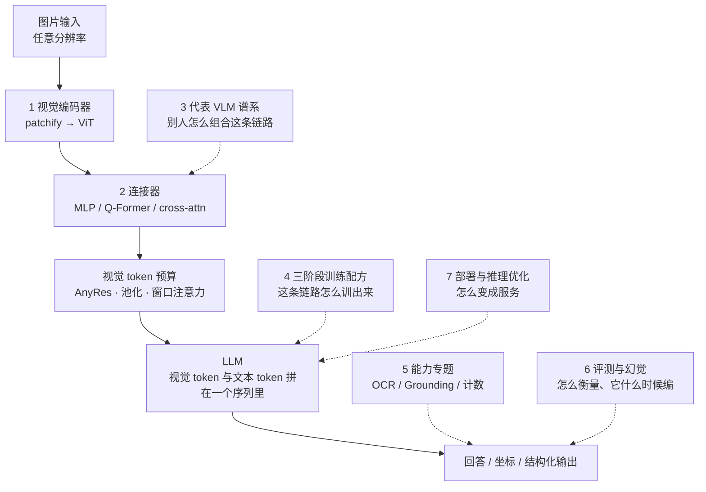
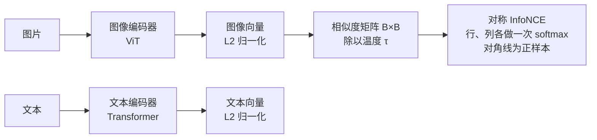
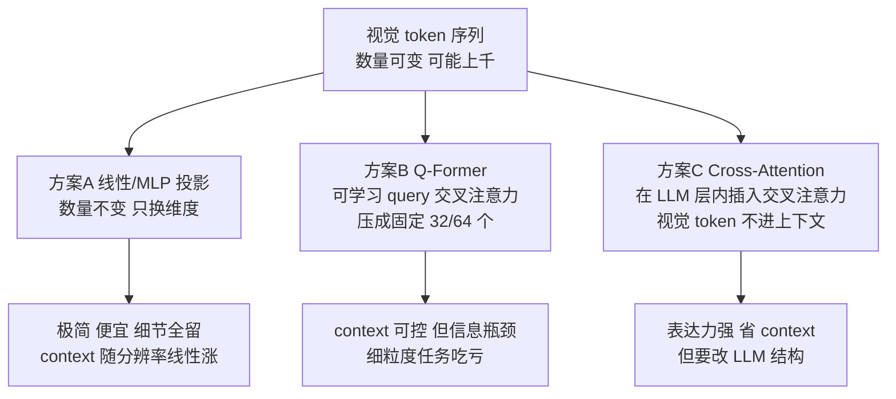
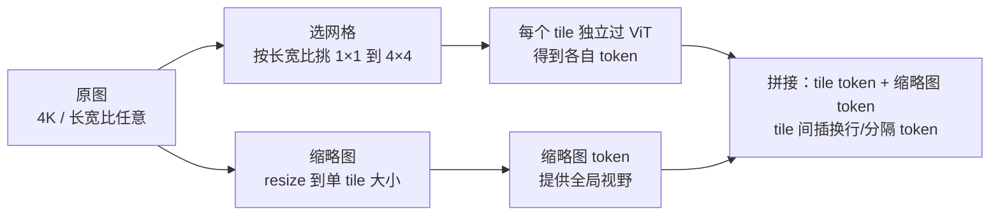
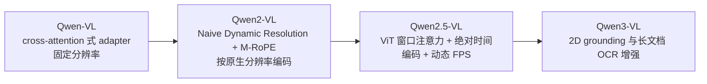
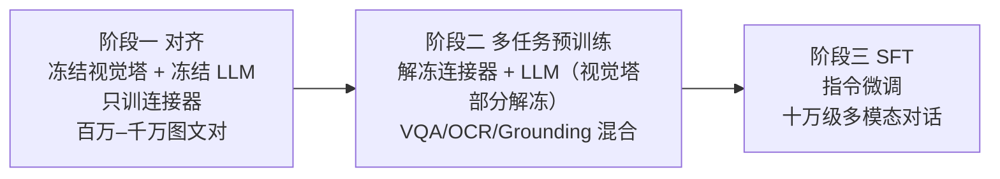
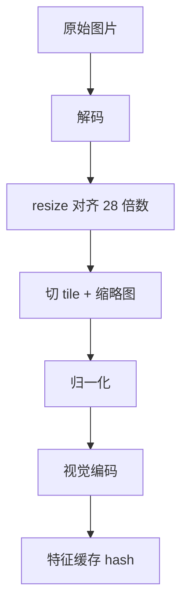

# 03 · 图片理解 VL 模型 · 知识点大纲

> **模块定位**：三大模块里**最该先学**的一块。它回答的是"图片 → 文本"这条链路，也是视频多模态的前置（视频 VLM 本质是把抽帧后的多图喂给 VL 模型）。
> **为什么先学它**：① 概念量最少、闭环最快；② 在 Apple M5 / 32GB 上真能跑起来（3B 级 4bit 量化 + MPS/MLX）；③ 面试出现频率最高——"你们的模型见过什么图、怎么处理的"几乎是必问开场。
> **学完的标准**：能对着任意一个开源 VLM 的配置说清"它的视觉编码器是什么、连接器是什么、视觉 token 有多少、为什么这么设计、它的边界在哪"。
> **编号纪律**：本文章节编号与 [00 · 知识点总表](./00-知识点总表) **一一对应**（1.1–7.4 共 39 项）。读完一节就回总表改一次状态，这是本专栏唯一的进度真相。
> **配套**：数字与模型对照见 [03 · 事实与面试弹药](./03-图片理解VL模型-事实与面试弹药)（核查时点 2026-10），**数字会过期、机制不会**——本文只讲机制与算术，引用具体模型参数前请回弹药篇确认。

## 一、知识地图

本模块的全部内容可以压成一条链路 + 四个外围专题：



**一句话理解整条链路**：`图片 → 切成 patch → ViT 编码成视觉 token → 连接器映射/压缩 → 与文本 token 拼成一个序列 → 交给 LLM 自回归生成`。

**六个关键判断**（先记住，后面逐个展开）：

| 判断 | 为什么重要 |
|------|-----------|
| 视觉 token 的数量 = `分辨率 ÷ patch 大小` 的平方 | 决定了这一路所有的成本算术 |
| 分辨率翻倍 → token 4 倍、注意力算力 16 倍 | 高分辨率"贵得不成比例"的根源 |
| 连接器只有两件事：**换维度**与**压数量** | 三方案的本质区别只在"压不压、怎么压" |
| 视觉塔该不该解冻，是算力问题不是理论问题 | 决定训练能不能跑完 |
| 幻觉 = 语言先验压过视觉证据 | 缓解手段都是"让视觉证据更硬"或"逼它更依赖视觉" |
| VLM 的失败大多发生在**预处理与 token 预算**上 | 这是工程侧（你的优势区）最容易做出差异的地方 |

## 二、怎么用这篇

同一节内容有三种读法，按你当天的目标选：

| 读法 | 花多久 | 读什么 |
|------|--------|--------|
| **速览** | 5 分钟 | 每节标题下的「本质」句 + 结尾「面试一句话」，建立骨架 |
| **深读** | 60–90 分钟 | 每节按「本质 → 为什么 → 机制 → 算例 → 边界」顺序读，算例自己按一遍计算器 |
| **动手** | 半天 | 先读完 1.1、1.2、2.3、2.4，再做文末自测清单里标 ✅ 的项（都可复现） |

::: tip 一个学习顺序建议
从「1.1 → 1.2 → 2.4 → 5.1」这四节开始：它们是**整条链路的成本模型**，也是面试问得最深的部分。把 token 算术吃透，后面所有"为什么选这个方案"的讨论都会变成同一道算术题。
:::

## 三、知识点详解（编号与 00 总表一一对应）

### 模块 1 · 视觉编码器：把图变成 token 序列

#### 1.1 patchify 与 token 数计算（P0）

**本质**：ViT 把图片切成固定大小的方块（patch），每块拉平后过一个线性层变成向量，再当作一个"视觉词"参与 Transformer——**没有任何卷积与局部感受野的归纳偏置，全靠数据学**。

**为什么必须切**：Transformer 只接受序列。切块是最便宜的空间离散化方式：不引入额外结构，且"把 patch 当 token"这件事让视觉和语言在结构上天然可比（这也是后来"多模态统一序列"能成立的前提）。

**机制**：三个小公式就够。

```text
token 数 = (H / p) × (W / p)          [可选 +1 个 CLS token]
patched 图 = 序列长度 N 的向量序列      [N = 上面的结果]
线性层：每个 patch 拉平成 p×p×C 维，乘一个 (p²C) × d 的矩阵 → d 维
```

**算例**（这几行要能随手算）：

```text
224 @ patch16 → 14×14 = 196
224 @ patch14 → 16×16 = 256
336 @ patch14 → 24×24 = 576      ← LLaVA-1.5 的常用配置
448 @ patch16 → 28×28 = 784      ← 长宽各翻倍，token 正好 4 倍
768 @ patch14 → 54×54 = 2916
```

**两条边界**：

- patch 越大 token 越少，但每个 token 承担的信息越多——细节（小字、纹理）最先丢，所以"patch 大小"和"分辨率"是两个不同的旋钮，不能混着说；
- 非方形图片要么 resize 到方形（畸变），要么走动态分辨率（见 2.3）——**长宽比畸变会直接影响 grounding 精度**，这是很多人只看 token 数不看长宽比的地方。

> 面试一句话：ViT 把图切成 patch 当 token，token 数 = (H/p)×(W/p)；它是纯注意力模型、没有卷积偏置，所以对分辨率与数据量都更敏感。

#### 1.2 分辨率翻倍的代价（P0，面试最爱算的算术题）

**本质**：分辨率翻倍时 **token 数 ×4、注意力算力 ×16、注意力显存 ×16**——这是平方项，不是线性项。

**为什么**：自注意力要对每对 token 算相似度，代价是 `O(N²)`。N 翻 2 倍 → 相似度矩阵元素数翻 4 倍；而"矩阵乘 + softmax + 存中间结果"都吃这 N²，于是显存也翻 16 倍。

**机制**：把 ViT 的算力拆成三块，增长速率完全不同：

| 组成 | 复杂度 | 分辨率翻倍时 | 224 → 448 的具体数字 |
|------|--------|-------------|--------------------|
| patch 线性层 + patchify | O(N) | ×4 | — |
| 注意力（QKᵀ、softmax、AV） | O(N²d) | **×16** | 约 1.4 → 22.7 GFLOPs（12 层合计） |
| MLP（FFN） | O(Nd²) | ×4 | 与 token 数线性 |
| ViT 总共 | 介于两者之间 | 约 ×3–4 | 84 → 约 330 GFLOPs 量级 |

**算例**（显存这一列最容易被追问，实际按一遍）：

```text
朴素 attention 需要显存化 N×N 分数矩阵：
  大小 = batch × heads × N × N × 2 字节（fp16）

224：N=196，batch 32，12 heads → 32×12×196×196×2  ≈  29 MB / 层
448：N=784，batch 32，12 heads → 32×12×784×784×2  ≈ 472 MB / 层
12 层全保留供反向         ≈ 5.7 GB   ← 8GB 显存卡直接 OOM
```

**结论**：**FlashAttention（不显式存 N² 矩阵）与梯度检查点（不保留全部中间激活）不是优化项，而是高分辨率能不能跑的前提。** 同一条算术在 LLM 侧更狠：视觉 token 全部进自注意力，1 万 token 的 KV cache 就是几 GB 级别——**真正的大头常常是 LLM 侧的 KV cache，而不是 ViT 本身**。

**边界**：

- 224 时注意力只占 ViT 算力约一成（MLP 是大头），784 时升到三成以上——所以"分辨率越高越该用注意力优化"；
- 提分辨率不是免费的精度：如果训练分辨率没跟上（见 4.2），推理时硬提反而掉点。

> 面试一句话：token 数随面积线性增长、注意力随面积平方增长，所以分辨率翻倍时 token 4 倍、注意力算力与显存 16 倍；因此高分辨率必须配 FlashAttention + 梯度检查点，而且真正吃显存的是 LLM 侧的视觉 token KV cache。

#### 1.3 位置编码与分辨率外推（P1）

**本质**：ViT 本身对顺序无感，位置信息全靠位置编码注入；在固定分辨率上训练的编码，**换分辨率就会错位**。

**为什么难**：位置编码是"按训练时的 token 网格长度"学出来的。推理时网格长宽都变了，编码与特征的对应关系就断了——表现是模型对同尺寸物体在不同分辨率下"看法不一致"。

**机制**：四条路线。

| 路线 | 做法 | 代价 |
|------|------|------|
| 1D 绝对位置 + 插值 | 把编码按比例插值到新长度 | 简单，但精度掉，且插值方式本身是超参 |
| 2D 分解编码 | 高度、宽度各一套编码（H 方向 + W 方向），相加或拼接 | 支持变长宽比，但仍是固定网格外推 |
| 2D RoPE / M-RoPE | 把 RoPE 的频率分量按维度切给时间/高/宽 | 天然支持外推与变长，实现复杂 |
| 原生弹性分辨率（NaFlex） | 编码器直接吃变长宽比输入（SigLIP2 等） | 需要从预训练就按变长训练 |

**算例 / 验证**：拿同一个模型对同一张图在 336 与 448 下问同一个问题（比如"图里有几个字"），如果答案显著不一致，就可以怀疑是位置外推问题，而不是模型能力问题。

**边界**：位置编码只是"坐标系统"，不解决"看到细节"的问题——提分辨率后小字仍然需要足够的 token 密度，别把两件事混为一谈。

> 面试一句话：位置编码在固定网格上训练，换分辨率就外推失真；解法从插值 → 2D 分解 → 2D RoPE（M-RoPE 把频率切给时间/高/宽）→ 原生变长编码，代价逐级上升。

#### 1.4 CLIP 双塔与 InfoNCE、可学习温度（P0）

**本质**：CLIP 用**两个互不见面的塔**分别编码图与文，只让它们的向量在对比目标下靠近——**训练的是"对应关系"，不是"生成"**。

**为什么这样设计**：双塔在推理时可以**离线预计算**图片向量、只对文本做在线编码，再用近邻检索——这是"以图搜图/以文搜图"能做到毫秒级的原因，也是它后来成为几乎所有 VLM 视觉塔的原因（特征空间已经和语言语义对齐）。

**机制**：



四个必须说清的细节：

1. **负样本来自 batch 本身**：B 个图文对，每个图对 B−1 个"错配文本"都是负样本——所以 **batch 越大，负样本越多，对比学习信号越强**（这就是"batch size 是对比学习的超参中的超参"）；
2. **对称**：图→文、文→图各算一次 loss，避免模型只学一个方向；
3. **温度 τ（可学习）**：控制 softmax 的锐度，让模型自己决定"要多严格地区分正负样本"；
4. **假负样本**：batch 里存在"其实是同一语义"的错配对（比如图里有多只猫、文本是"a cat"），会被当成负样本拉远——这是 CLIP 特征偏"整体语义、不偏细节"的原因之一。

**算例**：B=4096 时，每个样本有 4095 个负样本；B=32768 时负样本增至 32767——**同一条 loss，负样本量差 8 倍，效果差异往往比换模型架构更明显**。这也是 SigLIP 存在的意义。

**边界**：CLIP 的输出是**整图一个向量**，没有空间结构，也没有 token 级对齐——所以它做不了精确定位（见 1.5）。

> 面试一句话：CLIP 是双塔对比学习，用 batch 内的错配当负样本、可学习温度控制锐度；双塔能离线编码所以检索快，但也决定了它只有全局语义、没有空间结构。

#### 1.5 CLIP 的失败模式（P0，必须能背）

**本质**：CLIP 的失败不是"训练不够"，而是**目标函数决定的**——整图一个向量 + 句子级对比，天然丢失实例结构。

| 失败类型 | 典型表现 | 根因 |
|---------|---------|------|
| 计数 | "三只猫"与"两只猫"无法区分 | 池化把多个实例压成一个向量，数量信息不进梯度 |
| 空间关系 | "杯子在桌子左边"判断接近随机 | 全局向量没有坐标概念，相对位置被抹平 |
| 属性绑定 | "红球在蓝盒子上"张冠李戴 | 属性与物体在同一向量里被打散，组合关系无法表达 |
| 细粒度 OCR | 看不清小字 | 低分辨率 + 池化双重损失，字形细节最先丢 |
| 否定与常识 | "没有狗"与"有狗"向量接近 | 句子级对比对否定句不敏感 |

**工程验证**：一张"左边红球、右边蓝球"与"左边蓝球、右边红球"的图，对调后 CLIP 相似度几乎不变，而 VLM 能答对——**这个对比实验是理解"为什么要让 LLM 直接看 token"的最好证据**。

**边界**：这五条是**检索类任务不致命、理解类任务致命**。所以 CLIP 适合作检索索引与 VLM 的视觉塔，但绝不能单独拿它当"理解模型"。

> 面试一句话：CLIP 的弱项（计数、空间、属性绑定、OCR、否定）都是"整图池化 + 句子级对比"的必然结果，这也正是 LLaVA 让 LLM 直接看视觉 token 的原因。

#### 1.6 SigLIP 的 sigmoid 损失与 batch 解耦（P1）

**本质**：把 softmax 的**全局归一化**换成**逐对 sigmoid 二分类**，让每个图文对独立判断"配不配"，从而**不再依赖巨大 batch**。

**为什么重要**：softmax 版 InfoNCE 的负样本是"同 batch 的所有其它样本"，batch 小了信号就弱；sigmoid 版每题独立，小 batch 也能训——这直接降低了训练成本门槛。

**机制对照**：

| 维度 | CLIP（softmax / InfoNCE） | SigLIP（sigmoid） |
|------|--------------------------|-------------------|
| 归一化方式 | 每行/列在 batch 内 softmax，全局竞争 | 每个 pair 独立做二分类 |
| 效果对 batch 的依赖 | 强 | 弱 |
| 常见落点 | 早期 CLIP 系 | Idefics2、MiniCPM-V、Qwen3-VL 等 |

**算例**：同样 8 张卡，CLIP 需要尽量把 batch 堆大到几千；SigLIP 在 512 左右的 batch 就能得到可用信号，**训练可行性从"堆硬件"变成"调数据"**。

**边界**：sigmoid 版不会自动让"同一 batch 内的难负样本"竞争，所以数据质量（hard negative 构造）更关键；另外它的双塔仍是全局向量，1.5 的失败模式照样存在。

> 面试一句话：SigLIP 把 softmax 换成逐对 sigmoid，让负样本不再依赖 batch 内竞争，从而摆脱"必须大 batch"的约束。

#### 1.7 DINOv2 / EVA 等自监督与蒸馏编码器（P1）

**本质**：DINOv2 用**自监督**（无文本监督）学视觉特征，学的是"稠密、保留空间结构"的表征；EVA 系用 **CLIP 蒸馏 + 掩码图像建模**，把强特征与大参数量结合起来。

**为什么 VLM 大多不用 DINOv2 当主塔**：VLM 需要"视觉特征空间里有语言入口"——CLIP/SigLIP 的特征已经和语言对齐，DINOv2 没有。所以 DINOv2 的强项（分割、深度、对应关系、密集预测）更多被作为**辅助塔**使用。

**机制对照**：

| 编码器 | 监督信号 | 特征特点 | 适合 |
|--------|---------|---------|------|
| CLIP / SigLIP | 图文对比 | 全局语义、含语言入口 | VLM 主塔、检索 |
| DINOv2 | 自监督（多视图一致性） | 稠密、空间结构保留好 | 分割、深度、对应、作为辅助塔 |
| EVA-02 | CLIP 蒸馏 + MIM | 强特征、大参数量 | CogVLM 系的视觉塔 |

**边界**：双塔（CLIP + DINO）拼接能同时拿到语义与几何，代价是参数量与预处理翻倍——**只在对定位/细节要求高的产品里值得**。

> 面试一句话：CLIP/SigLIP 的特征空间自带"语言入口"，所以当 VLM 主塔；DINOv2 保留稠密空间结构但不含语言，所以常做辅助塔。

#### 1.8 编码器选型决策（冻结 vs 微调）（P0）

**本质**：冻结还是解冻视觉塔，本质是**在"训练成本"与"细节能力上限"之间选一个点**。

**机制与代价**：

| 方案 | 可训练参数 | 显存/算力 | 效果上限 | 适用 |
|------|-----------|----------|---------|------|
| 完全冻结 | 0（视觉塔只做前向） | 最低 | 视觉能力被锁死 | 快速跑通对齐、算力极紧 |
| 冻结 + 只训连接器 | 连接器（百万级） | 低 | 中 | 三阶段训练的第一阶段 |
| 解冻最后几层 | 视觉塔尾部 | 中高（反向激活是大头） | 较高，OCR/Grounding 明显受益 | 主流折中 |
| 全解冻 | 视觉塔全部 | 最高 | 最高 | 有算力且任务吃细节 |

**为什么"解冻"很贵**：反向传播要在视觉塔里保留大量中间激活（见 1.2 的显存算术），视觉塔越大越明显；这也解释了为什么小团队通常走"冻结 + 高质量数据"。

**一个常被忽略的坑**：解冻视觉塔后如果 SFT 数据量小、任务单一，会出现**灾难性遗忘**——视觉特征被拉去适配新任务，通用识别能力下降。缓解：小学习率、只解冻后几层、混入通用数据。

**边界**：解冻不等于变强。如果 4.1 的对齐没做好，解冻只会让模型过拟合下游数据、在需要"看图说话"的任务上更差。

> 面试一句话：冻结视觉塔省钱但封顶，解冻能补 OCR/Grounding 细节，代价是反向激活吃显存且易灾难性遗忘；所以常见路线是"先冻结跑通对齐，再解冻最后几层做 SFT"。

### 模块 2 · 连接器与 token 预算

#### 2.1 连接器三方案：MLP / Q-Former / cross-attention（P0）

**本质**：连接器只干两件事——**换维度**（把视觉向量翻译成 LLM 认识的维度）与**压数量**（把视觉 token 压少，省 context）。三方案的区别只在"压不压、怎么压、要不要改 LLM"。



| 方案 | 代表 | 视觉 token 数 | 可训练参数（示意） | 优点 | 代价 |
|------|------|--------------|------------------|------|------|
| MLP 投影 | LLaVA | 全部保留（576+） | 两层 MLP，千万级 | 极简、细节全留、训练稳 | context 线性膨胀 |
| Q-Former | BLIP-2、InstructBLIP | 固定 32/64 | 亿级 | context 极省、可配冻结 LLM | 信息瓶颈、读小字差 |
| Cross-attention | Flamingo、CogVLM | 不进上下文 | 中 | 表达力强、省 context | 改 LLM 结构、训练复杂 |

**算例（参数量的直觉）**：若视觉维度 1024、LLM 维度 4096，两层 MLP 大约 `1024×4096 + 4096×4096 ≈ 2100 万` 参数——**相比 LLM 的几十亿，这只是零头**，所以 LLaVA 路线的"极简连接器"在工程上完全成立。

**边界**：MLP 方案下，视觉 token 全进 LLM 的注意力，成本是 `O(N²)`；当 N 到几千（高分辨率切图/多图/视频），必须靠 2.5 的压缩手段兜底。

> 面试一句话：连接器只做"换维度"和"压数量"两件事；MLP 保真但贵、Q-Former 省 context 但对齐难、cross-attention 表达强但要改 LLM——工业界现状是"少压缩 + 轻连接器 + 强预训练"。

#### 2.2 Q-Former 的 32 query 压缩机制（P0）

**本质**：用 **32 个可学习的 query** 通过交叉注意力去"查询"视觉特征，输出**固定长度**的 32 个向量——把"数量可变"变成"数量固定"。

**为什么这样设计**：

1. **定长 → context 可控**：无论输入一张图还是一百张图，进 LLM 的都是 32 个 token；
2. **解耦 → 可冻结 LLM**：Q-Former 先在视觉-文本对上自己对齐（图文对比/匹配/生成三种损失），再接到冻结的 LLM 上；**大模型不用训**，这是 BLIP-2 能在有限算力下做出强模型的根本；
3. **query 数量是硬瓶颈**：信息没被 query 采到就永久丢失——所以 BLIP-2 读不了小字，这不是训练问题，是结构问题。

**机制**：

```text
视觉特征（可变长，如 257 个 patch token）
    │  交叉注意力：32 个 query 当 Q，视觉特征当 K/V
    ▼
32 个输出向量（定长）→ 线性投影 → LLM 的输入 embedding
```

**算例**：一张 336×336 的图 → 576 个 patch token；Q-Former 压在 32 个 token，**压缩比约 18:1**。代价是每个 token 平均要承载 18 个 patch 的信息——所以它只能记住"整体语义"，记不住"左下角那行小字"。

**边界**：Q-Former 适合"信息冗余高"的输入（长视频、多图、大批素材）与"必须冻结 LLM"的约束；对 OCR/文档/Grounding 这类信息密度高的输入，它的信息瓶颈是致命的。

> 面试一句话：Q-Former 用 32 个可学习 query 做交叉注意力，把任意数量视觉 token 压成定长，换来 context 可控与冻结 LLM 的可能；代价是 query 数量成为硬性信息瓶颈。

#### 2.3 AnyRes / 动态分辨率与切图策略（P0）

**本质**：高分辨率靠**切图**换细节——把大图切成若干 tile 分别编码，再额外拼一张缩略图提供全局视野。

**为什么需要缩略图**：如果只有 tile，模型看到的是"一堆局部"，不知道整体长什么样（比如海报的版式）。缩略图提供"全局语义锚点"，tile 提供"局部细节"，**两者缺一不可**。

**机制**：



**算例（token 预算）**：

```text
单 tile（336 patch14）      ≈  576 token
4 切图 + 1 缩略图           ≈ 5 × 576 ≈ 2880 token
长边 4K 的密集文档（更高切图档）≈ 6000–10000+ token
```

**边界**：

- **token 线性膨胀**：切几块就是几倍，深分页式的"多图多切"会把 context 吃满；
- **tile 之间没有天然关联**：模型需要靠分隔 token 与位置编码理解"这是同一张图的第 2 块"，所以坐标输出要额外做偏移校正；
- 动态分辨率（按原生尺寸编码）相比"固定 resize"更准，但 token 数随输入变化，**服务端必须做上限控制**（见 7.2）。

> 面试一句话：AnyRes 用"切 tile + 缩略图全局视野"换高分辨率细节，代价是视觉 token 线性膨胀（4 切 ≈ 5 倍），所以必须在 token 预算里做分级。

#### 2.4 视觉 token 预算与上下文长度的博弈（P0，工程决策的锚点）

**本质**：**1 个视觉 token 的 context 开销 ≈ 1 个文本 token**，所以"一张图 = 一段文本"这个换算决定了所有参数选择。

**算例（本模块最实用的一张表）**：

```text
336×336 单图（patch14）          ≈    576 token   ≈ 一段 800–1000 字中文
AnyRes 4 切 + 缩略图             ≈  2,880 token
一张 A4 扫描件（高分辨率切图）     ≈  3,000–6,000 token
翻拍文档 / 密集小字表格           ≈  6,000–10,000+ token
一段 1 分钟视频（1fps 抽帧）       ≈  60 × 576 ≈ 34,560 token   ← 视频场景的根源
```

**三个直接决策**：

| 决策 | 怎么做 |
|------|--------|
| 上下文够不够放多图 | 先按上表估总 token，再留 30% 给文本与输出 |
| 延迟与成本 | prefill 时间与视觉 token 数近似线性；KV cache 与 token 数线性 |
| 要不要牺牲分辨率 | 按业务分级：缩略图/打标档低分辨率，OCR/小字档才开高分辨率 |

**边界**：不要把 `max_pixels` 当成"越大越好"的旋钮——它的收益是非线性的，且超过训练分辨率后往往变成纯成本（见 4.2 的"训练分辨率决定上限"）。

> 面试一句话：视觉 token 与文本 token 同价，336 单图约 576 token、4 切约 2880 token、1 分钟 1fps 视频约 3.5 万 token——所有"要不要提分辨率/能放几张图"的问题都落到这张表上。

#### 2.5 视觉 token 池化与重采样（视觉 token 压缩）（P1）

**本质**：在 ViT 之后、进 LLM 之前，把视觉 token **再压一次**。三种主流手段的原理完全不同：

| 手段 | 做法 | 代表 | 压缩比 | 代价 |
|------|------|------|--------|------|
| **Pixel Shuffle / 2×2 merge** | 相邻 2×2 patch 在通道维拼接后投影 | Qwen2-VL 起的 Merger | **÷4**（1 token 覆盖 28×28 像素） | 空间分辨率降到 1/2 |
| **可学习重采样** | query 做 cross-attention 抽取信息 | Q-Former、Perceiver Resampler | 任意 → 固定数 | 信息瓶颈 |
| **ViT 内窗口注意力** | 把全局注意力换成窗口内注意力 | Qwen2.5-VL | 注意力 `O(N²)` → 近线性 | 跨窗口信息靠少量全局层补 |

**为什么第三条最关键**：高分辨率真正贵的是 **ViT 内部的全局注意力**（见 1.2）。如果注意力还是全局的，提分辨率的成本是平方级；窗口注意力把"每个 token 只看邻居"做成默认，**才让"敢开高分辨率"在模型侧成立**。换句话说：2×2 merge 省的是 LLM 侧的 token 数，窗口注意力省的是 ViT 侧的算力——**两个方向要同时打**。

**算例**：

```text
一张 1344×1344 的图（4 切 tile 档）
  不压缩：约 4×576 = 2304 token 进 LLM
  2×2 merge 后：约 576 token 进 LLM
  但 ViT 内部仍要处理原分辨率 → 窗口注意力把这段的平方项压掉
```

**边界**：压缩比与细节是零和的。判断标准只有一条——**业务里"小字/小目标"是否关键**。OCR/文档/表格就不该激进压缩（这也是 2.1 里"少压缩 + 强预训练"趋势的来源）。

> 面试一句话：视觉 token 压缩有"合并相邻 patch、可学习重采样、窗口注意力"三招；前两者省 LLM 侧 token，后者省 ViT 侧算力，高分辨率要两者同时上。

### 模块 3 · 代表 VLM 谱系（别人怎么组合这条链路）

#### 3.1 BLIP-2 三阶段与冻结 LLM 策略（P1）

**本质**：**什么都可以冻结，只训一个轻量桥**。BLIP-2 = 冻结视觉塔 + Q-Former + 冻结 LLM。

**三阶段**：

| 阶段 | 冻结什么 | 训什么 | 损失 |
|------|---------|--------|------|
| 一 | 视觉塔 | Q-Former | 图文对比（ITC）+ 图文匹配（ITM）+ 图像条件文本生成（ITG） |
| 二 | 视觉塔、LLM | Q-Former 的线性投影 | 语言建模（把 32 个 query 投影成 LLM 的前缀） |
| 三（可选） | 视觉塔 | Q-Former + LLM 的轻量部分 | 指令微调 |

**洞察**：它证明了"小模块 + 冻结大模型"可以做出强 VLM，代价是 2.2 的信息瓶颈。

> 面试一句话：BLIP-2 用 Q-Former 当桥、冻结视觉塔与 LLM，证明了大模型不必重训也能做多模态；代价是 query 数量带来的信息瓶颈。

#### 3.2 LLaVA 极简架构与"一个 MLP 就够"的论证（P0，必读论文）

**本质**：**CLIP 视觉塔（冻结）+ 2 层 MLP + LLM**，极简到近乎粗暴。

**为什么一个 MLP 就够**：CLIP 特征是在图文对比下训练的，**它的输出空间已经和语言语义对齐**——"翻译"比"从零建立对应关系"容易得多。BLIP-2 的 Q-Former 之所以复杂，是因为它要同时解决"压缩 token"和"适配冻结 LLM"两件事；LLaVA 放弃压缩，于是连接器可以极简。

**真正的贡献是数据**：用 GPT-4 生成图文指令数据，把多模态从"任务模型"变成"对话助手"——**这一条对行业的影响比架构大**。

> 面试一句话：LLaVA 证明了"CLIP 特征已带语言性，2 层 MLP 就能翻译"，它的真正贡献是数据配方——把多模态任务变成对话任务。

#### 3.3 LLaVA-1.5 / NeXT 的改进点（P1）

**本质**：两版都在"分辨率与 token 预算"上加码——1.5 提分辨率，NeXT 用切图换细节。

| 版本 | 改了什么 | 带来的收益 |
|------|---------|-----------|
| 1.5 | MLP 加一层、分辨率提到 336、补学术任务数据 | 通用能力明显提升，成为后续基线 |
| NeXT | **AnyRes**：tile 切图 + 缩略图 + 换行分隔 token | 高分辨率细节能力（OCR/文档）跃升 |

**边界**：AnyRes 的 token 膨胀（见 2.3）让它的显存与延迟显著上升，**这是"能力换成本"的典型案例**，也是面试里"你怎么权衡"的好素材。

> 面试一句话：LLaVA-1.5 提分辨率与数据配比，NeXT 用 AnyRes 换细节——这条线的主题始终是"分辨率与 token 预算的权衡"。

#### 3.4 Qwen-VL 系列演进（含动态分辨率与 M-RoPE）（P0）

**本质**：演进主线是**分辨率与位置编码**——从"固定分辨率 + cross-attention adapter"走到"原生动态分辨率 + M-RoPE + 窗口注意力"。



| 机制 | 解决什么 | 代价 |
|------|---------|------|
| **Naive Dynamic Resolution** | 不强制 resize，按原生分辨率编码 → 长宽比不畸变、grounding 更准 | token 数随输入变，服务端要做上限 |
| **M-RoPE** | 把 RoPE 频率分量拆给**时间/高/宽**，一套编码同时支持图片、多图、视频 | 实现复杂、预填充更碎 |
| **绝对时间编码** | 视频位置从"第几帧"变成"真实时间戳" | 需要训练侧时间信息 |
| **ViT 窗口注意力** | 把 ViT 的平方注意力降成近线性 | 跨窗口信息需全局层补 |

> 面试一句话：Qwen-VL 的演进是"用原生分辨率 + M-RoPE + 窗口注意力，把'看清'与'算得起'同时向前推"，代价是 token 数不可控与服务端限额。

#### 3.5 InternVL 系列（视觉编码器扩展与动态高分辨率）（P0）

**本质**：主线是**把视觉编码器做大 + 动态切图**；论文的核心经验结论是——**视觉编码器规模要与 LLM 匹配**。

**为什么**：小视觉塔 + 大语言模型，瓶颈卡在"看"这一环；反过来视觉塔太大而 LLM 太小，则语言推理接不住。这也是"堆视觉参数量"不是万能解的原因。

**机制**：动态高分辨率切图（按长宽比选择切多少块）+ pixel shuffle 压缩 + MLP 连接器。

> 面试一句话：InternVL 的贡献是把视觉塔按 LLM 规模等比例放大，并证明"视觉侧太弱会卡住整条链路"；它对"该不该堆视觉参数量"给出了经验边界。

#### 3.6 其他开源 VLM（MiniCPM-V / CogVLM / Idefics / Phi-Vision）（P2）

**本质**：这些模型的分歧在"把视觉能力放在哪"——连接器、LLM 内部、还是端侧效率。

| 模型 | 押注在哪 | 值得记住的点 |
|------|---------|-------------|
| MiniCPM-V | 端侧效率 | 小参数 + 高分辨率，适合本地部署 |
| CogVLM / CogVLM2 | 视觉能力注入 LLM 内部 | **Visual Expert**：在 LLM 的注意力与 FFN 里为视觉 token 加一组专属参数，不改 LLM 原权重 |
| Idefics / Idefics2 | Flamingo 路线开源化 | Perceiver Resampler + 交叉注意力，**跨图能力强** |
| Phi-3.5-Vision | 小模型多模态 | 多帧拼接处理视频 |

**读懂即可，重点是"各自押注在哪个环节"**——面试被问"你还知道哪些 VLM"，能说"各自押注"比报菜名强得多。

> 面试一句话：这些模型的分歧在于"把视觉能力放在哪"——连接器（Idefics）、LLM 内部（CogVLM）、端侧效率（MiniCPM-V）。

#### 3.7 闭源对照（GPT-4o / Gemini / Claude 的多图与长上下文）（P1）

**本质**：闭源与开源架构同构，差距主要在数据规模与训练配方。

| 维度 | 开源 VLM 常见做法 | 闭源模型的表现 |
|------|------------------|---------------|
| 多图输入 | 拼在一个序列里，靠位置编码区分 | 原生支持多图，跨图指代更稳 |
| 长上下文 | 受限于视觉 token 预算 | 上下文窗口大，能塞更多图/更长文档 |
| 视频理解 | 抽帧当多图 | 原生处理（帧序列 + 时间信息） |
| 能力边界 | 需要自己补 OCR/Grounding | 综合能力强，但**同样有幻觉** |

**面试要点**：闭源模型的能力差异往往来自**训练数据与规模**，不是某个魔法模块；讲清楚"架构上它们与开源同构，差别在数据与规模"，比背榜单分数有价值。

> 面试一句话：闭源与开源的架构同构，差距主要在数据规模与训练配方；能力要按业务样本实测，不能照搬榜单。

### 模块 4 · 三阶段训练配方（这条链路怎么训出来）

#### 4.1 阶段一：对齐预训练（冻结什么、训什么、数据量级）（P0）

**本质**：先让**视觉特征落进 LLM 的语义空间**，再谈具体能力。



**为什么必须先对齐**：连接器是随机初始化的，视觉 token 在 LLM 眼里是"乱码"。跳过这一步直接 SFT，模型会学成"基本忽略图片、按语言先验作答"——loss 可能降得很好看，但读图任务全崩。

**算例**：阶段一对齐通常只需要百万级图文对、单卡/少量卡即可跑；这正是"VLM 训练的第一步很便宜"的原因。

> 面试一句话：三阶段第一步只训连接器、冻结两端，目的是让视觉特征进入 LLM 语义空间；跳过它会导致模型"不看图也会答"。

#### 4.2 阶段二：多任务预训练与数据配方（P1）

**本质**：**能力是配比出来的**——OCR/文档数据少了，公式与表格必崩；Grounding 数据少了，坐标必飘。

| 数据类 | 作用 | 缺了会怎样 |
|--------|------|-----------|
| 图文描述（Caption） | 基础语义对齐 | 描述能力差、只认关键词 |
| VQA / 对话 | 推理与交互 | 答非所问、不会追问 |
| OCR / 文档 | 文字与版式 | 读不了小字与表格 |
| Grounding（框/点） | 空间定位 | 坐标不准、无法指代 |
| 视频/多图 | 时序与跨图 | 视频理解差、多图对比乱 |

**训练分辨率也在这个阶段定型**：用低分辨率数据训出来的模型，给 4K 图必然退化——**训练分辨率决定能力上限**，这不是推理时调参数能补的。

> 面试一句话：阶段二靠数据配比注入能力，缺哪类数据就缺哪种能力；同时它把"训练分辨率"钉死，决定了模型能吃多高分辨率的图。

#### 4.3 阶段三：SFT 与指令数据构造（P0）

**本质**：把"会做任务"变成"会按指令做任务"。数据质量 > 数据数量。

**机制与坑**：

- 指令数据要覆盖**拒答、澄清、格式约束**（比如"不确定时说不知道"），否则模型会硬编；
- 混入纯文本指令数据，防止语言能力退化；
- **指令数据差会直接教出幻觉**——模型学到"编一个看起来合理的答案"比"承认看不到"更安全。

> 面试一句话：SFT 阶段决定"像不像助手"，关键是数据质量与覆盖度（含拒答/澄清），差数据会把模型教成"自信地编"。

#### 4.4 视觉侧微调 vs 冻结的取舍与成本（P0）

**本质**：与 1.8 同一个问题，放在训练流程里看。见 1.8 的决策表——这里只补一条**成本口径**：

```text
视觉塔反向的显存 ≈ 前向激活 × 层数（梯度检查点可换时间省显存）
冻结时：视觉塔只占前向激活
解冻时：额外吃反向激活 → 大视觉塔（如 300M–6B）是显存大头
```

**面试里怎么答**："训练成本先看视觉塔解不解冻——解冻的话反向激活是显存大头，必须配梯度检查点；所以常见策略是先冻结跑通，再解冻后几层做 SFT。"

> 面试一句话：视觉侧微调的成本主要在反向激活，解冻后几层是最常见的折中；冻结路线省钱但能力封顶。

#### 4.5 常见训练坑：loss 不降、视觉能力遗忘、重复输出（P1）

**本质**：VLM 训练事故大多不是"模型不行"，而是对齐顺序、数据配比、预处理对齐这三处细节。

| 现象 | 根因 | 处理 |
|------|------|------|
| loss 不降 | 连接器学习率太小 / 数据太少 / 对齐阶段跳过 | 提高连接器 lr、先做阶段一 |
| 视觉能力遗忘 | 解冻后 SFT 数据单一 | 小 lr、只解冻后几层、混通用数据 |
| 重复输出 | 指令数据里同格式样本过多、解码策略问题 | 清洗数据、调 repetition penalty |
| 乱标注/编造 | 数据里"看不到也答"的样本 | 加入"拒答"样本、提高数据质量 |
| 坐标偏移 | 预处理 resize 未对齐 patch×merge 倍数 | 按倍数对齐（如 28 的倍数） |

> 面试一句话：VLM 训练事故大多不是"模型不行"，而是对齐顺序、数据配比、预处理对齐这三处细节错了。

### 模块 5 · 能力专题（能做/不能做什么）

#### 5.1 OCR 与文档理解（分辨率瓶颈）（P0）

**本质**：OCR 是**小目标 + 高频细节**任务，与 1.2、2.4 的 token 算术直接冲突。

**机制与链路**：


**为什么难**：① 文字是小目标，压缩或降分辨率最先抹掉；② 对比学习预训练偏向语义而非字形；③ 文档有版式（表格/多栏/公式），需要结构理解；④ 标注贵，大量依赖 HTML/LaTeX 渲染合成数据。

**工程做法**：先定位再细看的两阶段（见 7.3）；坐标与像素对齐（见 4.5 的"坐标偏移"）。

> 面试一句话：OCR 难在"小目标 + 字面识别 + 版式结构"，工程上靠高分辨率切图 + 局部精读，而不是把整张图塞给模型。

#### 5.2 图表与结构化信息理解（P1）

**本质**：读图取数 + 数值推理，比纯 OCR 多一层"理解图表含义"。

**机制**：高分辨率保证刻度与图例可见 + 结构化数据合成训练（用代码渲染图表并配对数值）+ 让模型输出中间量（如"读出的数值是…"）降低数值推理的错误率。

**边界**：图表类型迁移能力弱（训练里没见过的图表类型容易读错），需要针对性数据；数值精度不要指望模型"心算"，**输出中间结果再交给代码算**更稳。

> 面试一句话：图表理解 = 高分辨率可见 + 结构化合成数据 + 让模型输出中间量再外部计算，别指望它直接心算。

#### 5.3 Grounding 与指代定位（坐标表示方式）（P0）

**本质**：让模型输出坐标，把"看到"变成"指出位置"。核心是**把坐标变成 token**。

**机制**：

```text
坐标文本化：<box_start> x1 y1 x2 y2 <box_end>
坐标归一化：都映射到 0–1000 的整数（与真实分辨率无关）
推理时：再按输入尺寸乘回去
训练数据：RefCOCO 类指代数据 + 检测框数据
```

**为什么归一化**：让同一套权重处理任意尺寸的输入，且坐标 token 的数值范围稳定，训练更容易。

**工程坑**：预处理 resize 如果没对齐 `patch × merge` 倍数（Qwen 系是 28），内部会自动 resize，导致**坐标系统性偏移**——这类坑最适合写进面试的"我踩过"故事。

> 面试一句话：Grounding 把框写成归一化到 0–1000 的坐标 token；归一化让权重与分辨率解耦，而预处理必须按 patch×merge 倍数对齐，否则坐标系统性偏移。

#### 5.4 计数与空间关系推理（VLM 的传统弱项）（P1）

**本质**：这是 CLIP 时代遗留、VLM 时代缓解但未根治的弱项。

**为什么仍弱**：① 视觉 token 的压缩与池化仍会抹掉多实例结构；② 训练数据偏"整体描述"，缺少"数一数/比较左右"的监督；③ 语言先验会覆盖视觉证据（"通常有三个人"）。

**缓解**：提高有效视觉 token 密度（高分辨率 + 少压缩）、针对性数据（计数/空间关系样本）、让模型输出推理过程（"我看到左边有…右边有…"）。

> 面试一句话：计数与空间关系仍是 VLM 的公开弱项，原因是压缩抹结构 + 数据偏整体描述；缓解靠分辨率、针对性数据与显式推理步骤。

#### 5.5 多图输入与跨图对比（P1）

**本质**：把多张图拼进同一序列，靠位置编码与分隔 token 区分"哪张图"。

**机制**：

| 方式 | 做法 | 问题 |
|------|------|------|
| 序列拼接 | 多图 token 顺序拼接，中间插图文分隔 | context 线性增长；跨图指代依赖位置编码 |
| 帧标记 | 每帧/每图加特殊 token 标记 | 简单有效，视频场景常用 |
| M-RoPE 时间维 | 用位置编码的时间分量区分图/帧 | 更优雅，需要训练侧支持 |

**边界**：图越多，跨图指代（"第二张图里的和第一张图的相比"）越容易错；**实践里图数控制在 4–8 张内最稳**，再多就该考虑"先分别摘要、再汇总"。

> 面试一句话：多图输入靠拼接 + 分隔/位置编码区分，图数越多跨图指代越弱，超过几张就应改成"分别摘要再汇总"。

#### 5.6 GUI Agent 与屏幕理解（P1）

**本质**：截图理解 + 元素定位 + 动作空间设计，是 VLM 在"操作型任务"上的落地。

**机制**：截图 → 元素识别（按钮/输入框/列表）→ 坐标输出 → 动作（点击/输入/滚动）→ 反馈循环。难点是**屏幕元素密集**（需要高分辨率 + Grounding）与**动作空间设计**（怎么把"点击登录"映射成坐标）。

**边界**：纯视觉路线的兜底成本高，实践中常与 DOM/可访问性树混合；这类系统的评测要看"任务成功率"而不是单步准确率。

> 面试一句话：GUI Agent = 截图理解 + Grounding + 动作空间；难点在密集元素定位与长链路成功率，工程上常与 DOM 信息混合。

### 模块 6 · 评测与幻觉

#### 6.1 主流 benchmark 谱系（MMBench / MMMU / MME / OCRBench）（P0）

**本质**：每个榜只测"某一种能力"，**读榜先看它测什么、怎么测**。

| 类型 | 代表 | 考什么 | 这个榜的坑（必须知道） |
|------|------|--------|----------------------|
| 综合能力 | MMBench、MMMU | 多学科多能力 | MMBench 是选择题，**可被语言先验蒙对**；MMMU 难度高、对 prompt 敏感，绝对值低不代表模型差 |
| 感知基础 | MME | 感知 + 认知成对测 | 大量是/否题，**"全答是"也能拿分** |
| OCR / 文档 | OCRBench、DocVQA | 文字识别与文档问答 | 与分辨率强相关；DocVQA 用 ANLS，对轻微 OCR 错误有容忍，别和 accuracy 混谈 |
| 图表数学 | ChartQA、MathVista | 图 + 数值推理 | 依赖 CoT，结论波动大 |
| 幻觉 | POPE、HallusionBench | 物体存在性 / 关系与错觉 | **POPE 只测存在性幻觉**，不测关系幻觉；HallusionBench 方差大 |

**正确的读榜姿势**：按业务能力挑榜 + **自造 20–50 条真实样本做回归**，公开榜只用来筛候选。看到"某模型第一"先问三件事：**评测配置（分辨率/抽帧）、prompt 模板、是否与训练数据重叠**。

> 面试一句话：没有"综合榜第一"这种结论——MMBench 能被先验蒙、MME 能被全答是刷、POPE 只测存在性；正确做法是按业务能力选榜 + 自建样本回归。

#### 6.2 幻觉评测（POPE / HallusionBench）与成因分类（P0）

**本质**：幻觉 = **模型把语言先验看得比视觉证据更重**。

**四类成因**：

| 成因 | 机制 | 表现 |
|------|------|------|
| 语言先验过强 | LLM 太强，没看图也能答得像 | 图里没有的东西被"常识补全" |
| 视觉信息不足 | 分辨率不够/压缩过度，细节没进模型 | 看不清就说"大概是这样" |
| 数据共现偏置 | 训练集里"厨房一定有微波炉" | 按数据统计规律编造 |
| 曝光偏差 | 生成错 token 后被自己的上下文带偏 | 越说越错、重复 |

> 面试一句话：幻觉的根因是语言先验压过视觉证据——四类成因分别对应"模型太强、看得太少、数据太偏、自回归跑偏"。

#### 6.3 幻觉缓解手段（对比解码、视觉对比、数据侧）（P1）

**本质**：缓解幻觉只有两条路——让视觉证据更硬，或逼模型更依赖视觉。

按性价比排序：

| 手段 | 做法 | 代价 |
|------|------|------|
| **产品侧：要求输出证据** | 让模型引用图中的文字/坐标，再做后置校验 | 最有效、最便宜 |
| 输入侧：提分辨率 | 让视觉证据真的进模型 | 成本随 token 涨 |
| 数据侧：负样本/偏见样本 | 训练"图里没有 X"的样本 | 需要数据工程 |
| 解码侧：对比解码 | 对比"有图"与"无图/扰动图"的 logits，放大视觉贡献 | 推理成本翻倍 |
| 训练侧：偏好优化 | 用 DPO 类方法压"编造" | 需要偏好数据 |

> 面试一句话：缓解幻觉的四条路——把视觉证据做硬（提分辨率）、让模型更依赖视觉（对比解码）、用数据纠偏（负样本）、产品上强制引用（最便宜有效）。

#### 6.4 评测刷分与数据泄漏的识别（P1）

**本质**：公开榜是"训练数据的回音壁"，数据泄漏与 prompt 过拟合普遍存在。

**识别方法**：① 看 bench 是否在训练数据里（同源数据/公开测试集被爬）；② 看 prompt 模板是否被针对性优化（同一模型换模板分数波动大 = 过拟合信号）；③ 看长尾子集（难例子集）表现，而不是平均值；④ 自建"未见过的业务样本"做盲测。

> 面试一句话：看到高分先怀疑数据泄漏与 prompt 过拟合，用难例子集与自建盲测交叉验证。

### 模块 7 · 部署与推理优化（你的优势区）

#### 7.1 多模态推理引擎（vLLM / SGLang 的视觉处理路径）（P0）

**本质**：多模态推理 = **视觉编码（一次） + LLM 解码（自回归）**，两者特性完全不同，需要分别优化。

| 环节 | 特性 | 优化手段 |
|------|------|---------|
| 视觉编码 | 计算密集、可批处理、与输出无关 | 编码缓存（同图复用）、批量编码 |
| prefill | 变长视觉 token 让 batch 内长度差异大 | chunked prefill / padding 策略 |
| decode | 访存密集、逐 token | KV cache、连续批处理 |
| 约束 | 图像数/分辨率上限 | `limit_mm_per_prompt`、`mm_processor_kwargs` |

**⚠️ 本地 vs 生产的路线差异**：vLLM / SGLang 依赖 CUDA，Apple Silicon 上跑不了；本地验证走 llama.cpp / MLX / transformers+MPS，生产走 vLLM/SGLang。**面试里能说清"我的本地验证路线与生产部署路线不同"是加分项。**

> 面试一句话：多模态推理要分开看视觉编码（可缓存、批量）与 LLM 解码（KV cache、连续批处理）；生产用 vLLM/SGLang，本地 Mac 只能走 MLX/llama.cpp。

#### 7.2 量化部署与显存估算方法（P0）

**本质**：显存 = 权重 + 激活 + KV cache，量化只省第一项。

```text
权重显存 ≈ 参数量 × 每参数字节（fp16 2B / int8 1B / 4bit 0.5B）
KV cache ≈ 2 × 层数 × 头数 × head_dim × 序列长度 × batch × 字节
激活     ≈ 与分辨率、token 数、batch 相关（量化收益有限）

例：7B 级 VLM
  fp16 权重 ≈ 14 GB；4bit ≈ 3.5–4 GB
  但高分辨率图片的视觉 token KV cache 可能再吃几 GB
  → "4bit 就一定能跑"是误解
```

**边界**：长图/多图/视频场景，**KV cache 与激活才是瓶颈**，量化帮助有限；这时该做的是降 token 数（2.5）而不是继续压精度。

> 面试一句话：量化省的是权重，不吃激活与 KV cache；高分辨率/多图场景的显存瓶颈在 token 侧，先压 token 再谈量化。

#### 7.3 图片预处理链路（缩放、切块、编码缓存）（P0）

**本质**：预处理是**隐藏的 CPU 瓶颈**，也是坐标正确性的关键。



**三个工程要点**：

1. **解码 + resize + 归一化是 CPU 密集**，常比 GPU 推理还慢 → 独立进程池；
2. **尺寸必须对齐 `patch × merge` 倍数**，否则内部 resize 导致 grounding 坐标系统性偏移；
3. **同一图片重复请求做特征缓存**（图片 hash → 视觉特征），命中率直接映射到成本。

> 面试一句话：预处理是 CPU 密集的隐藏瓶颈，必须独立进程池；尺寸要对齐 patch×merge 倍数否则坐标偏移；同图请求做特征缓存是最高性价比的优化。

#### 7.4 图片哈希缓存与重复请求优化（P1）

**本质**：多模态请求的重复率往往很高（同一商品图、同一素材帧），**缓存视觉编码结果**收益极大。

| 缓存层 | key | 价值 |
|--------|-----|------|
| 视觉特征缓存 | 图片内容 hash（感知哈希或全量 hash） | 省视觉编码（CPU+GPU） |
| 完整响应缓存 | 图 hash + prompt + 参数 | 最省，但只对热门查询有效 |
| 系统 prompt 前缀缓存 | prompt 前缀 hash | 省 prefill（引擎侧支持） |

**注意**：图片 hash 要做**规范化**（去掉 EXIF、统一尺寸/格式）否则同一张图会算出不同 hash；感知哈希（pHash）能兜"同一图不同压缩"的情况，但会带来误命中风险——**按业务选**。

> 面试一句话：图片重复率高，缓存视觉特征与系统 prompt 前缀能直接省钱；key 要做规范化，感知哈希兜相似图但有误命中风险。

---

## 四、面试问答（带参考答案要点）

**Q1：CLIP 为什么在计数和空间关系上很差？**
它把整图压成一个全局向量，池化抹掉了实例数量与空间布局；训练目标只要求"整句描述与该图更近"，从不要求区分"三只猫"与"两只猫"。所以它能检索、做不了需要结构细节的任务——这也正是 LLaVA 让 LLM 直接看视觉 token 的原因。

**Q2：LLaVA 为什么一个 2 层 MLP 就够？**
CLIP 特征在图文对比目标下训练，输出空间已与语言对齐，"翻译"难度远低于"从零建立对应"。BLIP-2 的 Q-Former 复杂，是因为它同时要解决"压缩 token"和"适配冻结 LLM"；LLaVA 放弃压缩，连接器就可以极简。

**Q3：Q-Former 和 MLP 怎么选？**
看"信息密度"与 context 预算：读小字/文档/做 Grounding → 选 MLP（甚至不压缩），因为瓶颈会丢细节；视觉输入很多（长视频、海量图片）或必须冻结 LLM → 选 Q-Former。工业界现状是"高分辨率 + 少压缩 + 轻连接器 + 强预训练"。

**Q4：一张图占多少视觉 token？为什么算它？**
336×336 patch14 = 576 个，约等于一段千字文本。算它是为了三个决策：context 放得下几张图、延迟与成本能否接受、要不要牺牲分辨率换 token。视频最极端——1fps 抽 1 分钟约 3.5 万 token。

**Q5：分辨率翻倍，代价涨多少？**
token 数 4 倍，注意力算力与注意力显存 16 倍。所以高分辨率必须配 FlashAttention 与梯度检查点；而真正的大头常在 LLM 侧——几千个视觉 token 全进 KV cache。

**Q6：如何减少 VLM 的幻觉？**
四条路：数据侧加负样本/偏见样本；输入侧提分辨率让视觉证据进模型；解码侧对比解码放大视觉贡献；产品侧强制引用证据并后置校验（最便宜有效）。

**Q7：三阶段训练跳过第一阶段会怎样？**
视觉特征还没进入 LLM 语义空间就做指令微调，模型会学成"基本忽略图片、按语言先验作答"——loss 好看、读图全崩。这是必须做对齐预训练的原因。

**Q8：视觉编码器要不要解冻？**
先冻结跑通对齐，再解冻最后几层做 SFT。全解冻对 OCR/Grounding 明显有益，但反向激活是显存大头、且易灾难性遗忘。没有算力就不要解冻，这个取舍说清楚就是加分。

**Q9：Grounding 的坐标怎么输出？为什么归一化？**
把框写成 `<box_start> x1 y1 x2 y2 <box_end>`，坐标归一化到 0–1000。归一化让权重与真实分辨率解耦、数值尺度稳定，推理时再乘回真实尺寸；工程上要按 patch×merge 倍数对齐预处理，否则坐标系统性偏移。

**Q10：多模态部署的瓶颈在哪？**
图像预处理 CPU 密集常比 GPU 推理慢；变长视觉 token 造成 batch 内长度差异；KV cache 被视觉 token 撑爆（要限制图像数/分辨率）；同图重复请求做特征缓存收益极大。另有环境坑：vLLM/SGLang 依赖 CUDA，Mac 上只能走 MLX/llama.cpp。

## 五、自测清单

- [ ] 能不看资料算出 448 patch16 的 token 数、注意力显存，并解释为什么是 16 倍
- [ ] 能画出 CLIP 双塔 + InfoNCE 的结构图，说清负样本、温度、对称损失
- [ ] 能列出 CLIP 五种失败模式并逐个说明根因
- [ ] 能说清 MLP / Q-Former / cross-attention 三方案的取舍，并给出选型判据
- [ ] 能写出从 336 单图到 1 分钟视频的视觉 token 估算表
- [ ] 能讲清 LLaVA 与 BLIP-2 在"连接器为什么可以这么简单"上的分歧
- [ ] 能说出 M-RoPE 与 Naive Dynamic Resolution 各解决什么问题
- [ ] 能完整复述三阶段训练的数据量级与冻结策略，并说出跳过第一阶段的后果
- [ ] 能给出幻觉的四条缓解路径，并说明哪条最便宜有效
- [ ] 能解释视觉 token 压缩三招分别省的是 LLM 侧还是 ViT 侧
- [ ] 能说清预处理为什么必须对齐 patch×merge 倍数（坐标偏移）
- [ ] 已在本机跑通一个小 VLM 并记录翻车案例（可复现项优先）
