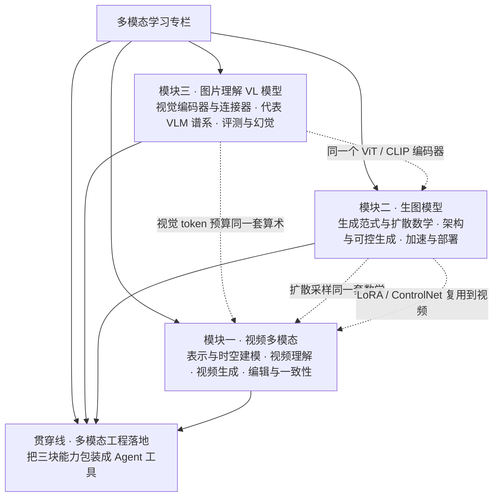
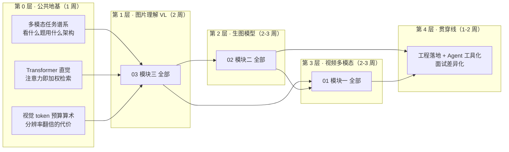

# 多模态学习专栏

> **专栏定位**：这是按导师要求新开的**多模态系统学习专栏**，把「视频多模态 / 生图模型 / 图片理解 VL 模型」三大模块拆成可勾选、可验收的知识点清单，并逐篇补齐深度内容。
> **目标岗位**：字节跳动 剪映/CapCut「Agent 开发实习生（AI 剪辑）」（职位 ID：A80542，深圳/广州）。剪映、CapCut、即梦、Dreamina、醒图这些产品线**同时**用到了这三块能力——多模态不是"附加知识"，而是这个岗位的主战场。
> **本专栏的用法**：先看下面第一、二节的**知识地图**拿到全局，再打开 [00 · 知识点总表](./00-知识点总表) 当作**进度追踪清单**，然后按模块推进。知识点总表每完成一项就改状态，这是本专栏唯一的"进度真相"。
> **本专栏与已有文档的分工**：原理推导的深度已在别处打过地基，本专栏**不重复造轮子**，而是做「体系化编排 + 缺口补齐」：
> - 扩散/文生视频的**零基础入门** → [生成原理零基础学习方案](../导师学习路径/11-JD专题-生成原理零基础学习方案)
> - 扩散与文生视频的**原理推导** → [JD 专题：文生视频与 Diffusion](../导师学习路径/07-JD专题-文生视频与Diffusion模型)
> - 多模态**架构谱系与选型** → [多模态原理与架构谱系](../转岗大模型算法/05-多模态原理与架构谱系)
> - 模型服务的**后端工程底座**（队列、GPU 池化、限流、缓存） → [架构师修炼](../架构师修炼/) 与 [后端技术栈强化](../后端技术栈强化/)

## 一、三大模块知识地图

**读这张图的三个要点**：

1. **三块不是并列的，而是共享地基**。虚线是真正的复用关系：VL 理解里的「视觉 token 预算算术」直接决定视频 VLM 能不能装下长视频；生图的「扩散采样数学」就是视频生成的同一套数学；生图的 LoRA/ControlNet 原样搬到视频编辑。**先学公共地基，再学各自特化**，是省时间的关键。
2. **模块三（图片理解）是模块一（视频多模态）的前置**。视频 VLM 本质是"把视频抽帧后的多图喂给 VL 模型"，图片理解没打牢，视频理解就是空中楼阁。因此推荐顺序是 **三 → 二 → 一**，而不是按编号。
3. **贯穿线是面试的差异化**。候选人普遍能背模型名，但很少能把「生图能力包装成 Agent 工具并解决超时、成本、并发」讲清楚——这正是你 Go 后端背景的优势区，也是剪映这个岗位真正在招的能力。

## 二、推荐学习顺序（含依赖关系）

| 顺序 | 模块 | 建议周期 | 为什么排在这里 |
|------|------|---------|---------------|
| 1 | [03 · 图片理解 VL 模型](./03-图片理解VL模型-知识点大纲) | 2 周 | 概念最少、收益最快、是视频理解的前置；也是三块里最容易在单机上真跑起来（3B 量化模型） |
| 2 | [02 · 生图模型](./02-生图模型-知识点大纲) | 2-3 周 | 数学密度最高（扩散），但概念闭环清晰；Apple Silicon 上可用 diffusers+MPS 真跑 |
| 3 | [01 · 视频多模态](./01-视频多模态-知识点大纲) | 2-3 周 | 是前两者的**叠加**（时序 + 生成 + 理解），放在最后可以避免"每步都在补前置" |
| 4 | 贯穿线 · 工程落地 | 1-2 周 | 把三块能力用 Go 串成服务与 Agent 工具，形成简历上可讲的完整链路 |

::: tip 觉得顺序太重？
如果时间紧，走**面试最小闭环路线**：模块三的「视觉编码器 + 连接器 + 代表 VLM 谱系」→ 模块二的「扩散数学 + CFG + LoRA + ControlNet」→ 模块一的「视频 token 压缩 + 视频生成时序 + 一致性」。这九个子块覆盖了面试 80% 的提问面，其余作为追问储备。
:::

## 三、本专栏文档索引

每个模块都是**两篇一组**：**知识点大纲**用于学习，**事实与面试弹药**用于查数字（模型对照表、参数量、许可、可复现性、踩坑清单）。**学习走大纲，查数字查弹药。**

**知识点大纲的读法（已按此格式重写三篇）**：每个知识点独立一节、**编号与 `00 · 知识点总表` 严格一致**（如大纲 `2.4` 就是总表 `2.4` 那一行），每节统一五段式——

| 段落 | 回答什么 |
|------|---------|
| **本质** | 一句话说清它是什么 |
| **为什么** | 它解决什么痛点、不这么做会怎样 |
| **机制** | 拆开讲怎么工作（公式 / 表格 / mermaid） |
| **算例** | 自己按一遍计算器就能验证的数字 |
| **边界 + 面试一句话** | 什么时候不适用、踩过什么坑，以及怎么在面试里一句话讲完 |

这样设计的原因：**背结论过不了追问，能算、能说边界才过得了**。读的时候遇到"算例"不要跳——所有"为什么这么设计"的追问最后都会落到那几行算术上。

| 文档 | 内容 | 状态 |
|------|------|------|
| [00 · 知识点总表（进度追踪）](./00-知识点总表) | 三大模块共 118 个知识点的勾选清单 + 掌握度自评标准 + 面试权重 | ✅ 已建立 |
| [01 · 视频多模态 · 知识点大纲](./01-视频多模态-知识点大纲) | 7 大子模块、32 个知识点（编号对齐总表）、每点「本质→动机→机制→算例→边界」、面试问答、自测清单 | ✅ 已重写 |
| [01 · 视频多模态 · 事实与面试弹药](./01-视频多模态-事实与面试弹药) | **核查时点 2026-10** 的模型对照表、字节系产品线换代（Seedance 2.x / CapCut Video Studio / 剪映 Hub / Vidi 系列 / AutoCut）、VUE 指标口径、8 题面试稿、3 个 M5 实验 | ✅ 已建立 |
| [02 · 生图模型 · 知识点大纲](./02-生图模型-知识点大纲) | 7 大子模块、39 个知识点（编号对齐总表）、扩散数学推导、CFG/蒸馏机制、可控生成、MPS 踩坑 | ✅ 已重写 |
| [02 · 生图模型 · 事实与面试弹药](./02-生图模型-事实与面试弹药) | 22 行模型对照表（参数量/编码器/许可/可复现性）、置信度标注、8 题面试稿、3 个 M5 实验 | ✅ 已建立 |
| [03 · 图片理解 VL 模型 · 知识点大纲](./03-图片理解VL模型-知识点大纲) | 7 大子模块、39 个知识点（编号对齐总表）、token 预算算术、VLM 谱系与训练配方、部署工程 | ✅ 已重写 |
| [03 · 图片理解 VL 模型 · 事实与面试弹药](./03-图片理解VL模型-事实与面试弹药) | 20 行模型对照表、token 算术模板、10 题面试稿、3 个 M5 实验、防翻车原则 | ✅ 已建立 |
| [学习日志](./学习日志) | 每次学习后追加一条：学了什么、卡在哪、下一步 | ✅ 已建立 |
| 各知识点的**深度篇**（按需追加） | 大纲已含完整的"原理 + 算例 + 边界"；只有某个知识点要升级到"能讲透"（补代码、数值验证、论文级推导）时才单独成篇 | 🔄 按需追加 |

::: danger 关于时效：本专栏已做过一次时间点更正
本专栏初版把核查时点写成"2025 年底"，**实际当前时间是 2026-10-14**。多模态领域在这段时间又迭代了至少一代（字节侧已从"即梦一代"换到 **Seedance 2.x + CapCut Video Studio**，字节的 **Vidi** 系列做到了视频时序检索与时空定位，开源侧 Wan / HunyuanVideo / LTX 都出了新版本）。

因此本专栏确立一条纪律：**架构与算术结论可以长期复用，模型名与数字必须现场核实**。三个模块的事实篇都标了核查时点，**访谈前一天重新确认你要引用的每一个数字**。
:::

::: warning 关于事实与数字的纪律
生图与多模态领域**半年就会变一次天**。本专栏的事实篇对每个具体数字都做了置信度标注：**已核实 / 需核实**。
**面试前一天，请打开官方模型卡确认你要引用的每一个数字**；确认不了就**只讲架构与权衡，不讲数字**——"这个数我不确定，但机制是这样"远比编造一个数字安全。
:::

## 四、怎么"不断补充"——本专栏的迭代机制

这个专栏是**活的**，补充内容按下面三条规则追加：

1. **状态标记法**：每个知识点用 `⬜ 未学 / 🔄 在学 / ✅ 已掌握 / ⭐ 能讲透` 标记，改标记就是更新进度。总表是唯一真相来源。
2. **深度篇追加**：当某个知识点从"知道"要升级到"能讲透"时，在该知识点下新建深度篇（命名如 `03-图片理解VL模型-01-ViT与token预算深度篇.md`），并在总表对应行添加链接。
3. **触发式补充**：三种情况必须补充专栏 —— ① 面试被问住的知识点；② 读论文/源码时发现与专栏表述冲突；③ 动手实验跑出与预期不符的结果（这类最有价值，记录下来就是面试的"我踩过的坑"）。

详细的记录格式见 [学习日志](./学习日志)。

## 五、验收标准：什么时候算"学完了"

对应岗位 JD 的「对 AIGC 相关技术感兴趣，有 AI Agent 建设经验者优先」，本专栏的验收分三档：

| 档位 | 标准 | 能否通过面试 |
|------|------|-------------|
| **能听懂** | 看到名词知道属于哪条路线、大概解决什么问题 | ❌ 只能点头，一追问就崩 |
| **能讲清** | 能说清"解决了什么问题、代价是什么、什么时候不该用"三件事 | ✅ 基本可答，多数问题能接住 |
| **能动手** | 跑过最小实验、调过参数、看过失败案例、能说清数值量级 | ✅✅ 明显优于只背概念的候选人 |

::: warning 一个诚实提醒（这条我初稿写错过，已更正）
本专栏的定位是**建立判断力与表达能力**，不是训练模型。你的机器是 Apple M5 / 32GB 统一内存、无 NVIDIA 独显。

事实核查把边界钉死了：**视频/生图大模型的官方显存要求普遍在几十 GB 级别**——Wan 的 1.3B 版约 8GB 是少数能在你机器上跑的，而 5B/14B 系要 24-80GB，HunyuanVideo 13B 要 45-60GB；而且**统一内存 ≠ 显存**（Metal 只能锁住一部分），diffusers 里**只有极少数视频管线带官方 MPS 标记**。

**所以本专栏所有实验都按「MPS 真能跑 / 量化推理 / 云端免费额度」三种方式设计，不设计需要 A100 的实验。** 凡是标注 ❌ 只能读懂的内容，就老老实实读懂——面试时主动说明"我读懂了原理和代码，但本地跑不了这个大模型"，比吹牛被拆穿安全得多，而且**面试官往往更看重你清不清楚自己的边界**。
:::

## 六、下一步

1. 打开 [00 · 知识点总表](./00-知识点总表)，先做一次**自评**：把已经会的打 ✅，不会的保持 ⬜。这一步 30 分钟，但能让你清楚差距在哪。
2. 从 [03 · 图片理解 VL 模型](./03-图片理解VL模型-知识点大纲) 开始，按「知识点详解 → 动手实验 → 自测题」的顺序推进。
3. 每完成一个子模块，回来更新总表 + 在 [学习日志](./学习日志) 追加一条。
4. 遇到卡点直接在对话里提出，专栏会针对性补充深度篇。
